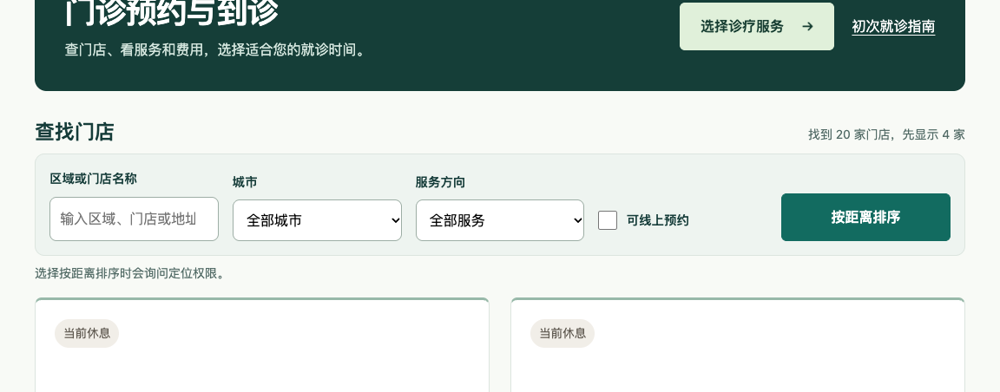

# ADC 口腔 · 连锁门诊系统

患者从这里找门店、约时间、查报告和费用。前台安排到诊，医师接诊并确认病历，三个岗位可以沿同一笔就诊核对进度。

**[打开门诊首页](https://lijiahao.duckdns.org/)　·　[患者登录](https://lijiahao.duckdns.org/portal/login/)　·　[员工登录](https://lijiahao.duckdns.org/accounts/login/)**

## 第一次体验

无需账号即可打开门诊首页。先选城市和门店，再选「本店服务」，看看这家店能办理什么、到诊需要准备什么。试用环境使用虚构门店、患者和业务记录。

| 想体验的角色 | 从哪里开始 | 可以亲手核对什么 |
| --- | --- | --- |
| 患者 | 患者登录 → 我的预约 → 打开一笔预约 | 预约的门店和时间；打开同一笔历史就诊，可查已发布的报告或结算单 |
| 前台 | 员工登录 → 前台工作台 → 选择负责的门店 | 按姓名或编号查找患者，核对档案编号和当天预约，再查看到诊状态 |
| 医师 | 员工登录 → 医师工作台 → 检查记录工作台 | 找到本人负责的就诊，查看检查草稿、已确认版本和相应病历文书 |

岗位账号随私有试用邀请提供。拿到带角色选择的邀请时，先选角色，再点登录；手头已有账号也可直接填写。患者微信小程序入口随邀请发放。

[按角色体验，一步一步操作](docs/TEACHER_WALKTHROUGH.md)　·　[阅读课程报告 PDF](课程报告/课程报告_张加良_8210241102.pdf)

## 阅读项目

| 想了解什么 | 建议先看 |
| --- | --- |
| 门诊的业务流程与岗位分工 | [项目文档导览](docs/README.md) · [商业产品范围](docs/COMMERCIAL_V2_MASTER_PLAN.md) |
| 前后端如何共享一笔就诊 | [预约与排班](scheduling/) · [患者网页](portal/) · [医师病历](clinical/) · [微信小程序](clients/wechat/) |
| 数据如何保存、系统如何验证 | [数据库设计与关系图](docs/database/README.md) · [业务回归测试](tests/) · [GitHub 验证记录](https://github.com/Zhang646967/adc-dental-clinic/actions) |
| 在自己的电脑运行 | [macOS 本地安装与合成试用库](docs/MACOS.md) · [统一部署包](docs/C5_UNIFIED_DEPLOYMENT.md) |

课程报告由张加良（信管 T2401）编写。仓库中的开发候选和已开放的试用入口分别验收，具体范围见各功能的[规格与验收记录](specs/)。
