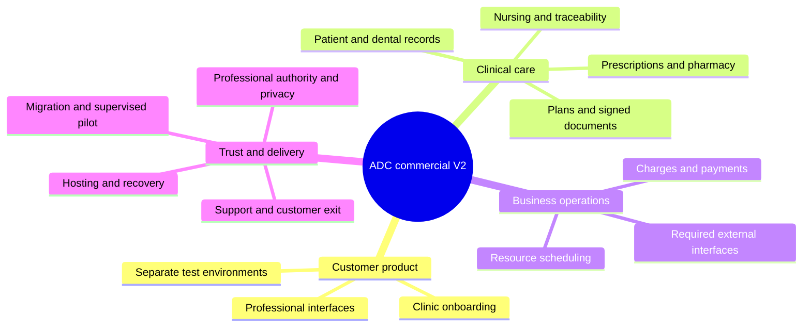

# ADC commercial dental platform upgrade plan

Customer trust → complete clinical workflows → protected records and money → reliable operation → supported commercial launch.

Planning baseline: 2026-10-22, local source `c750e7ebabc6bfa90769570a8468972ae7b94b14`. This is the controlling development plan for the commercial V2 program. Historical RC/course evidence retains its original date, environment and scope.

**2026-10-23 research refinement:** the [six-product maturity study](research/DENTAL_PRACTICE_STUDY_20261023.md) and [C1–C2 next-stage plan](COMMERCIAL_V2_NEXT_STAGE.md) refine the immediate sequence around verified identity, professional authority and continuous care. Internal clinical recall and lab readiness move into C2; actual supplier interfaces remain C5. C0.3 is locally accepted as a synthetic service-channel increment. The [current audit](COMMERCIAL_V2_BASELINE.md) supersedes earlier deployment gaps only for its recorded scope. Broader C0 and clinical/production qualification remain incomplete.

## Product decisions

The user has explicitly selected **one dental chain per independent deployment** and **full replacement of the clinic's clinical system, including electronic medical records and prescriptions**. ADC will serve clinic owners, reception staff, dentists, nurses, pharmacy personnel and patients as a working dental practice platform. Clinical completion is a release requirement, rather than a later optional enhancement.

The initial market assumption is mainland China and outpatient dental care. The prior 5–20-clinic envelope remains a sizing hypothesis. Confirm the first customer's location, actual clinical service catalogue and peak workload before committing to legal applicability, deployment location or an SLA. Inpatient care, internet diagnosis and clinical AI require separate intended-use and professional reviews; their absence must not leave gaps in the first clinic's contracted outpatient services.

The first customer's complete service matrix is the scope contract. General dentistry, periodontal care, paediatric dentistry, endodontics, restorative/prosthetic care, orthodontics and implants must each be marked applicable or inapplicable by the clinic. For every applicable service, capture its records, orders, consent, materials, imaging, follow-up and professional authorization. A feature can be excluded from the first contract only when that customer's service scope does not require it. An incomplete clinical module does not qualify as full replacement.

Customer-facing pages use the product and clinic identity, current tasks, service information and meaningful help. Course names, student identifiers, source commits and developer acceptance checklists belong in engineering/academic materials. Isolated test environments keep a concise test-environment indicator. Production presentation and actual production readiness are separate states.

## What the current code establishes

The [baseline audit](COMMERCIAL_V2_BASELINE.md) distinguishes inspected implementation from historical execution. Existing strengths include scoped workspaces, shared appointment/resource commands, waitlist confirmation, immutable billing versions, financial reviewer separation and recovery tools. These are foundations to retain.

The inspected care model contains `clinical_note`, versioned treatment charge lines and an invoice pointer. This is useful operational functionality, but does not establish a complete dental clinical record, prescription, pharmacy or nursing system. Seven currently implemented roles do not cover those professional responsibilities. A prescription, a signed record and an approved payment must have different authorities and lifecycles.

The requirements structure follows the uploaded requirements/design notes: observable customer behavior and exceptions first, then design decisions, implementation and evidence. “Commercial quality” is replaced below by concrete deliverables and acceptance conditions.

## Customer experience and onboarding

The [C0 service-centre implementation](C0_SERVICE_RELEASE.md) now provides patient needs, clinic-published service content, fee terms and service-first booking continuation. Manager readiness and draft preview are implemented. Initial source checks were followed by C0.3 local PostgreSQL/browser/recovery acceptance and protected synthetic installation. These results do not establish commercial clinical qualification or a completed clinical scope contract.

The [C0.2 native service journey](C02_NATIVE_SERVICE_RELEASE.md) brings those
published descriptions, fee terms and selected-service booking into the native
patient channel, closes its raw-draft exposure, and preserves own historical
rescheduling. Its initial source/rule/Page-handler checks were followed by [C0.3 local acceptance](C03_RELEASE_ACCEPTANCE.md): actual PostgreSQL, exact-image website/native-handler journeys, official eleven-page offline compilation, protected restore/upgrade and local synthetic installation. Device/experience, cloud and professional clinical qualification remain pending. Neither C0 slice is an installed commercial clinical release.

The staff front door opens into that person's work: today's schedule, waiting patients, unsigned records, orders awaiting action, exceptions and responsible colleagues. The patient front door offers clinic/service selection, appointments, treatment progress, approved documents, balances and a contact path. An owner or platform evaluator is not the default persona for either interface.

The visual system covers typography, spacing, form controls, tables, status wording, tooth-chart symbols, keyboard operation and narrow layouts. Clinical alerts such as unreviewed allergies or unsigned prescriptions remain prominent. Their purpose is specific action and patient safety, rather than a generic product disclaimer. No fake certifications, clinic addresses, testimonials, uptime figures or clinical capability claims may appear in sales or product pages.

The previous public six-route acceptance entry becomes internal operator material. `/start/` must become a normal product entry, and ordinary login/workspace navigation must stop directing patients and staff to developer verification. Access to any internal acceptance tool is explicitly authorized at its own route.

Onboarding creates an institution and branches, opens reviewed service/drug/material dictionaries, records verified staff identities and practice scopes, configures pricing, imports reviewed records and trains users. Production uses a separate clean database and new customer accounts/secrets. Demonstration accounts, passwords published in chat and synthetic records are never promoted into production. Import identifies source/provenance and ambiguous patient matches for human resolution; it never merges people by phone number alone.

## Clinical product requirements

### Patient identity and longitudinal records

Create a verified patient identity with explicit guardian/delegated-access relationships where applicable. A relationship to one patient or one clinic does not authorize reading everyone in the chain. Clinical access follows current professional role, clinic/service authorization, care relationship and purpose. Administrative account management does not imply clinical-record access.

A longitudinal patient view joins encounters, dental findings, treatment plans, consent, procedures, orders, medications, imaging and follow-ups without making them one editable text field. Separate patient-reported history from professional confirmation, unknown allergies from reviewed negative history, and proposed treatment from treatment actually performed. Never generate missing historical diagnoses from billing descriptions.

### Structured dental record and treatment planning

Provide clinician-approved templates for first and follow-up visits, complaint/history, examinations, diagnosis, plan, performed procedures and follow-up. Record tooth and surface, adult/primary/mixed dentition, periodontal findings and the procedure-specific fields in the first clinic's service matrix. Confirm the tooth-numbering convention with clinicians and encode it explicitly. A graphical odontogram has an equivalent keyboard-accessible structured entry path.

Treatment plans span several encounters and carry a clinically meaningful revision history. A proposed cost estimate, a performed procedure and an issued bill are separate facts. Changes in a plan or tooth chart do not automatically charge, refund or erase completed treatment. Common long-running cases such as staged endodontics, crowns, orthodontics or implants must preserve the connection between planned and completed steps where contracted.

Draft saving is server-side and bound to the exact patient, encounter, author and revision. Switching patient or identity cannot carry text into another record. Concurrent changes return a clear conflict and retained draft; a successful save acknowledgement requires a durable server commit.

### Signing, amendment, consent and archive

Define draft, review, signed, archived and amended states with role-specific authority and deadlines. Preserve the original signed content and the exact signer, credential evidence, authoritative time and version. A typed name or uploaded signature picture is not described as a reliable digital-signature service. Select the signature/archival mechanism after the clinic's professional and legal review.

Medical-record amendments and financial corrections remain different processes. A permitted amendment appends an attributed version with reason and appropriate clinical/records approval; it does not silently rewrite an old bill. Consent records bind the correct patient/guardian, procedure, document version, time and signers. Support controlled copies, independent reading/printing, archive verification, retention and legal holds. Withdrawal of optional consent does not automatically erase records with a lawful retention obligation.

### Orders, prescriptions and medication safety

Add prescription/order lifecycles, verified prescriber scope, reviewed medication dictionaries, explicit units/strength/route/frequency/duration and all fields approved for the clinic. Cover review, rejection, amendment, cancellation, partial fulfilment, dispensing and administration where applicable. Each step has its own professional authority and attributable history. A pharmacist's review and a nurse's administration record cannot be represented by a finance or reception approval.

Formal prescription review precedes medication pricing/charging and dispensing in the adopted workflow. Unsupported prescribing paths, missing professional authority or unavailable required review fail closed. Any lawful exception needs a separately reviewed, attributable contract; it is never a generic administrator bypass. Printed and electronic prescription delivery must follow the accepted local practice, without promising universal paperless validity.

Allergy/interaction/dose checks require a maintained, appropriately licensed and clinically reviewed knowledge source. Rule coverage, unknown data, overrides and knowledge-version changes are visible and auditable. A green screen is not proof of complete medication safety. No generative model writes diagnoses, prescribes, approves review or supplies unchecked dosing rules.

### Imaging, materials, nursing and external clinical services

Provide protected patient/encounter-bound attachments and links to the authoritative imaging system. Imaging integration must preserve patient identity, accession/study identity, source, time, image integrity and result status. A generic photo upload is not assumed to replace a diagnostic PACS viewer. Lab/prosthetic work orders retain sending, acknowledgement, result/return and follow-up, including failure and correction paths.

Track applicable drug, implant and material batches, expiry, receipts, issues, returns and recalls. For instruments, retain sterilization/package/use evidence required by the clinic's infection-control process. Concurrent use cannot oversell or make stock negative; cancelling an order does not erase a prior dispense/use event. Nursing execution records the actual professional and performed event, not merely the doctor's planned order.

## Business and financial completion

Retain the existing distinctions between billed revenue, cash, missing costs and zero. Relate clinical performed events to approved charge facts; preserve existing bill/version history during migration. Longitudinal treatment plans and deposits need explicit allocation/refund rules rather than a second uncoordinated invoice-line source. Procedure and medicine charging must respect their distinct clinical prerequisites.

Integrate the selected payment provider through verified server callbacks, merchant/order binding, idempotency, reconciliation and failure recovery. A client-side success page is not payment evidence. Preserve a separate attributable manual-cash workflow. Electronic tax invoicing, insurance settlement and external prescription delivery are separate interfaces with actual provider/regulatory access; the first customer's required interfaces must work before replacement cutover. A business settlement document continues to identify itself accurately when it is not a tax invoice.

Operational follow-ups have responsible people and deadlines, and patient reminders have actual delivery/failure states. Care communications and optional marketing have separate permission handling. Customer support receives the minimum data needed, with no standing ability to browse a clinic's records.

## Clinical risk acceptance

| Failure to prevent | Design requirement | Mandatory challenge case |
|---|---|---|
| Record or act on the wrong patient/tooth | Persistent patient/encounter identifiers, explicit dental convention and context-bound commands | Switch patient during drafting, open stale tabs and exercise graphical/keyboard tooth selection |
| Treat an obsolete or unsigned order as actionable | Distinct clinical signatures, versions, professional scopes and pharmacy/fulfilment states | Amend/cancel while another professional reviews or fulfils; revoke authority during confirmation |
| Double-dispense, double-use stock or double-charge | Shared transactional protocols and saved operation results at the corresponding domain boundary | Lose the response, repeat confirmation and race two authorized operators |
| Present incomplete medication checking as a safety guarantee | Reviewed knowledge version and explicit uncovered/unknown state | Unavailable/changed knowledge source, incomplete history and differing units/strengths |
| Expose an unrelated patient's record or attachment | Purpose/object/role scope and protected read/export/file access | Guess identifiers, reuse expiring links and change role/clinic between preview and access |
| Lose clinically significant history after migration or failure | Attributed immutable versions, complete backup dependencies and independent reconciliation | Restore SQL without objects/keys, cut over with a late delta and recover after new clinical writes |

The clinical director and relevant professional reviewers approve severity, mitigations and residual risk for the contracted service matrix. This register is an initial design input; no clinical review is represented as already performed.

## Architecture and data migration

Continue the Django/PostgreSQL modular monolith. One customer receives an independent database, object storage, credentials, encryption keys, deployment identity and backup boundary. Two different customers must be unable to share sessions, object links, backups or configuration. This is a delivery isolation model; it is not a claim that a shared multi-tenant platform has been implemented.

Add explicit clinical, medication, materials and integration domain boundaries. Retain existing transaction/lock/idempotency protocols for bookings and financial changes. A background integration worker delivers durable Outbox intents with bounded retries and reconciliation; it cannot invent clinical consent or confirmation. Use object storage for protected attachments, with bounded uploads, type/content validation, malware-handling policy, scoped expiring retrieval and separate retention. Do not make a medical file public to simplify viewing.

The clinical design review should model an encounter linked to the existing Visit, longitudinal treatment episodes/plans, immutable clinical documents, signed prescriptions/orders, fulfilment and material-use events. Existing `VisitRecordVersion`/`TreatmentRecord` remain historical billing sources. The precise extension/mapping belongs in an additive migration ADR before coding; copying the old free-text note into a new “certified clinical record” is not a valid migration.

Preserve all 39 existing application migrations and historical evidence. Practise schema/data conversion on independent copies, with row/version/attachment/signature/amount reconciliation and reviewed ambiguous cases. Real cutover needs a declared write freeze, final delta, independent comparison, named clinical/financial acceptance and a tested rollback decision. If new clinical writes have occurred, rollback requires a reconciled forward/restore strategy; it cannot discard those records or simply reinstall old binaries.

## Identity, privacy and reliable operation

Expand the authority model for nursing, pharmacy, medical-record administration and inventory responsibilities where the clinic requires them. These are proposed policy roles, not newly granted permissions. Record who has checked professional qualifications, their scope/validity and the evidence source. Existing directory associations are not automatic professional verification.

Use attributable staff accounts, protected activation/reset, privileged MFA and documented inactivity/absolute session expiry. Provide session inspection/revocation, timely departures and credential-change invalidation. Patient binding/recovery and guardian access need their own identity checks. Any emergency access must be purpose-bound, time-limited, independently reviewable and explicitly specified; superuser status is not a clinical business bypass.

Design controlled sensitive reads, bulk exports and print/copy access as well as writes. Security logs record bounded event metadata; raw records, tokens, passwords and clinical text stay out of routine logs and analytics. Define lawful purpose, minimum collection, notices, applicable consent, processor/subprocessor contracts, retention and breach response. Use mainland hosting as the initial deployment design assumption, and review any cross-border service or external AI separately. This is not a claim that one blanket localization rule covers every operator and data category.

Run independently of the developer's Mac. Provide HTTPS, private database access, separated schema/runtime privileges, managed secrets, supervised workers, independent monitoring, off-host encrypted backups and independently verified recovery. Restore must include attachments, identity and signature dependencies, not just SQL rows. Define owner coverage, incident severity, escalation, downtime procedures and safe recovery/re-entry of clinical records.

Proposed engineering targets below are for sizing and acceptance design. They become customer commitments only after measurement, cost/staffing review and agreement.

| Area | Proposed target | Evidence needed |
|---|---|---|
| Initial capacity envelope | Up to 20 clinics; 100 simultaneous staff sessions plus 200 patient sessions; an explicitly defined 30 requests/second mixed HTTP workload | Representative history and payloads, valid writes, parallel resource/Rx/stock/payment cases; sessions and request rate measured separately |
| Ordinary interactive latency | p95 ≤ 1.5 s for ordinary reads and ≤ 2.5 s for durable confirmations at the agreed load | Server and user-visible timings, including failed/conflicting requests; attachments/reports/external providers budgeted separately |
| Availability | Design toward 99.9% monthly service availability | Independent observation and stated exclusions; actual support/on-call coverage and maintenance policy; no launch-time claim from a short test |
| Recovery | Initial proposal RPO ≤ 5 min and RTO ≤ 60 min | Business-approved loss tolerance, WAL/PITR or equivalent design, off-host dependencies and timed complete-service restoration; tighter signed-record needs resolved explicitly |
| Soak and failure recovery | 24 h representative staging observation plus actual restart, database/worker/storage/provider failure exercises | No lost acknowledged work within the tested durability/fault model; no duplicate fulfilment, stock movement or money posting; observable backlog and recovery |
| Usability | Every required role evaluated; ≥ 90% completion on agreed ordinary tasks and no unresolved serious safety-related usability error | Observed tasks without developer coaching, ordinary and exception cases, actual clinician comparison baseline; sample size and limitations retained |

## Delivery batches and dependencies

Batch order reflects clinical dependency, rather than a promise that a visually finished preview is already fit for real care. Infrastructure/privacy work starts with C0 and continues throughout; it is not deferred until after feature development.

| Batch | Customer-visible or operational result | Main exit condition | Dependency |
|---|---|---|---|
| C0 Product and environment foundation | Professional login/workspaces; product identity/configuration; separate test/production presentation; internal acceptance tools separated | Customer UI has no academic/developer scaffolding; test provenance and production bootstrap guards remain effective; existing role/scope/forms unchanged | Current baseline |
| C1 Organization, people and authority | Branch onboarding, verified patient/guardian relationships, attributable professionals, nursing/pharmacy/records policies | No unauthorized chart/order/export; revocation and concurrent role/clinic changes verified; qualification evidence is attributable | C0 |
| C2 Complete dental encounters | Structured record, odontogram, service-specific templates, multi-visit plans, actual execution/charge bridge, clinical recall, internal lab readiness and quality worklists | First clinic's applicable C2 service matrix handled; correct patient/encounter, partial care and draft/concurrency/exception flows reviewed by dental professionals; prescribing/signing/interfaces retain their later gates | C1 |
| C3 Clinical evidence and archive | Consent, signatures, immutable amendments, controlled copies and protected imaging/documents | Original signed versions remain verifiable; archive/copy/retention/legal-hold and attachment-recovery cases pass professional review | C2; identity/security foundations |
| C4 Prescribing and pharmacy | Medication catalogue, prescription/order creation, professional review and fulfilment | No unreviewed medicine charge/dispense or role bypass; units, revisions, cancellations, partial fulfilment and knowledge-source behavior verified | C1–C3 |
| C5 Nursing and material traceability | Execution, drug/material/implant lots, infection-control linkage, lab/imaging interfaces | Patient/order/use/batch chain is complete; expiry/recall/concurrency and interface failure cases pass the relevant professional review | C2–C4 |
| C6 Commercial financial closure | Performed-event charges, deposits/allocations where needed, provider payments/refunds, required tax/insurance interfaces | Independent clinical-to-bill and provider-to-ledger reconciliation; duplicate callback/outage/refund and old-version facts preserved | C2–C4; C5 where cost/use applies |
| C7 Production qualification and migration | Independently hosted release, read/export security, recovery, observability, measured capacity and complete cutover pack | Required security/clinical/financial/user/recovery gates pass on the exact release in its target environment | Starts with C0; final gate includes C1–C6 |
| C8 Supervised commercial pilot and support | First clinic actually operates the contracted full workflow, with attributable support and an exit/export path | Agreed pilot observation and critical-error handling complete; responsible clinical/operating/customer owners authorize wider sale | C7 |

Each batch needs user journeys, abnormal responses, data/state/authority design, changed-service tests, actual PostgreSQL/concurrency and browser checks, independent business reconciliation and migration/recovery coverage as applicable. A test count or a checked personal walkthrough is never substituted for the batch's business exit condition. The machine-readable [backlog](COMMERCIAL_V2_BACKLOG.json) holds concrete work and evidence, initially planned rather than completed.

The immediate implementation is **C1.1 patient relationships and bounded appointment authority**, with the minimal C1.0 identity/receipt ADRs and outstanding environment/service contracts. C1.2 professional/shared-care authority follows, then C2 structured encounters, plans/performed facts and recall/readiness. The [24 proposed scenarios](COMMERCIAL_V2_NEXT_STAGE.md) and [requirement trace](research/NEXT_STAGE_TRACEABILITY.json) are unexecuted specifications. Internal lab and non-drug follow-up need not wait behind dispensing; a full financial/clinical release still includes its prescription, signing, material and interface prerequisites.

## Original C0 work package and remaining scope

This list preserves the initial product/environment scope. Service-content and channel work were accepted in C0.3; the uncompleted environment, initialization and clinic-scope contracts remain requirements rather than being marked done by a visual refresh.

1. Write a product/environment contract using existing deployment-stage configuration as the starting point. Keep brand configuration separate from readiness/authority; a “production” appearance cannot enable clinical functions or load synthetic defaults.
2. Replace customer login, staff shell and patient shell academic text with product/clinic identity, service/help/privacy information and concise action-specific errors. Retain legally meaningful document status and clinical/financial alerts. Do not erase test provenance from archived documents.
3. Redesign `/start/` and remove ordinary-user links to the public six-route developer checklist. Preserve a permission-checked internal acceptance path and engineering/academic artifacts separately.
4. Define one patient journey, one front-desk journey and one clinician journey using actual tasks; specify the new clinical workspace around chart, record, plan, orders and next actions. Avoid inventing completed clinical features in the interface.
5. Add clean customer initialization and attributable activation/reset designs; explicitly block demo bootstrap/accounts/configuration in a production release.
6. Verify all changed pages, both environment modes, existing login activation, stale contexts, clinic boundaries, protected forms, billing document wording,390px/keyboard behavior and non-JS navigation. Update the actual runtime only after target access and the release checks are available.

C0 delivers a professional product foundation and clinical design contract. C2–C7 remain required before claiming the requested full clinical replacement is commercially operational.

## Commercial handover and sale

Package a repeatable independent installation, configuration/import tooling, user and operator guides, backup/key custody, upgrade/rollback procedures and a customer data export/exit process. The clinic retains its records and continuity obligations even if the software contract ends.

Use a scoped licence/service contract with implementation and migration, ongoing maintenance/support, and optional managed hosting priced separately. Identify external costs for signature services, medication knowledge, messaging, imaging/payment interfaces, storage, backup, professional review and applicable security assessment. Do not commit prices or 24/7 support before the actual supplier/operation model is costed.

Customer acceptance includes clinical director/dentist, pharmacy reviewer, relevant nursing/infection-control staff, finance, the institution's privacy/security owner and operations. These are responsibilities to appoint, not fictitious people already involved. Clinician/pharmacy validation cannot be replaced by AI-generated fixtures or the developer's own review.

Before retiring the existing clinical system, complete a supervised migration/rehearsal and downtime plan. A restricted pilot is still real clinical use: its critical identity, prescription, signed-record, privacy, recovery and incident controls must already work. Proposed 30-day pilot observation is a planning checkpoint; the actual duration and service scope are agreed with the first clinic. Growth to the remaining branches follows recorded defects, support capacity and customer sign-off.

## Mainland regulatory and professional workstream

These sources establish initial requirements for the assumed mainland deployment. A jurisdiction-specific applicability review is a launch deliverable, not a certification represented by this plan.

| Requirement area | Product consequence | Source |
|---|---|---|
| Health information and entrusted processing | Sensitive-data purpose/minimization/protection; appropriate lawful basis/notices/consent; explicit clinic/vendor responsibilities and supplier review | [Personal Information Protection Law, especially Articles 13, 21, 28–31, 38–40, 51 and 55](https://www.cac.gov.cn/2021-08/20/c_1631050028355286.htm) |
| Electronic-record lifecycle | Attributed operations, controlled changes, archive/copy and preservation; institution-retained outpatient records have a minimum 15-year period from the last visit under the cited norm | [NHC 2017 norm](https://www.nhc.gov.cn/mohwsbwstjxxzx/s8553/201702/ebe31b47c1ea4bcfaed973fb8806992c.shtml), [readable official explanation](https://www.oscca.gov.cn/sca/ztpd/2017-04/19/content_1012650.shtml) |
| Current electronic-record access controls | Account/permission control, traceable use and controlled viewing/export; do not give managers or technical support unrestricted clinical access | [NHC 2025 notice, 国卫办医政函〔2025〕262号](https://www.nhc.gov.cn/yzygj/c100068/202506/c68abee7c54b4651a774cd533761780b.shtml); [2025 local implementation example, not nationwide extension of its local provisions](https://www.pudong.gov.cn/zwgk/14557.gkml_ywl_yzgl/2025/245/345047.html) |
| Prescription authority and review | Attributable authorized prescribing, pharmaceutical review before the corresponding charge/dispense flow, correction/refusal and fulfilment traceability | [Prescription Administration Measures](https://www.nhc.gov.cn/fzs/c100048/201808/0278c08ce1f540c5a5a0b9e4eef8a568.shtml), [national 2018 review norm](https://www.natcm.gov.cn/bangongshi/zhengcewenjian/2018-07-13/7363.html); [Hunan implementation example](https://www.hunan.gov.cn/zqt/zcsd/202012/t20201230_14775120.html) |

Network/security classification and assessment, reliable signature, clinical intended use, drug/device duties, regional interfaces and any internet-care activity require their applicable national/local rules to be mapped before release. Do not assume every dental installation requires the same protection level, every software feature has the same device classification, or a privacy policy by itself fulfils the obligations.

The [Open Dental chart manual](https://www.opendental.com/manual/chart.html) is a functional benchmark for chart, prescriptions, periodontal data, consent, imaging and multi-visit work. Its market, legal assumptions and integrations are not adopted as Chinese requirements.

## Historical planning completion: 2026-10-22

The initial planning turn established the commercial product target, the inspected gap baseline, dependencies and acceptance backlog. At that time it changed planning/instructions, not application behavior, migrations or the running Mac. The preceding local B1.6 source was then undeployed and GitHub/CI and Docker limits were recorded. Those dated statements remain historical; [C0.3](C03_RELEASE_ACCEPTANCE.md) subsequently records authorized publication, exact CI and protected local installation for its synthetic application scope.

The 2026-10-23 research increment changes planning documents only. It preserves all 40 current migration files, the installed application and formal report's implemented baseline. Proposed logical relations remain separate from observed SQL; cloud, actual WeChat runtime/device/experience, sustained operation and professional clinical acceptance remain outstanding. The historical Windows-data and collector UNKNOWN boundaries are retained.

Clinical workflows, qualified reviewers, first-clinic service scope, integrations, hosting and support coverage are the material scheduling dependencies. Estimate the calendar after those contracts and supplier inputs are known; a short interface sprint is not an estimate for replacing a clinical system.

