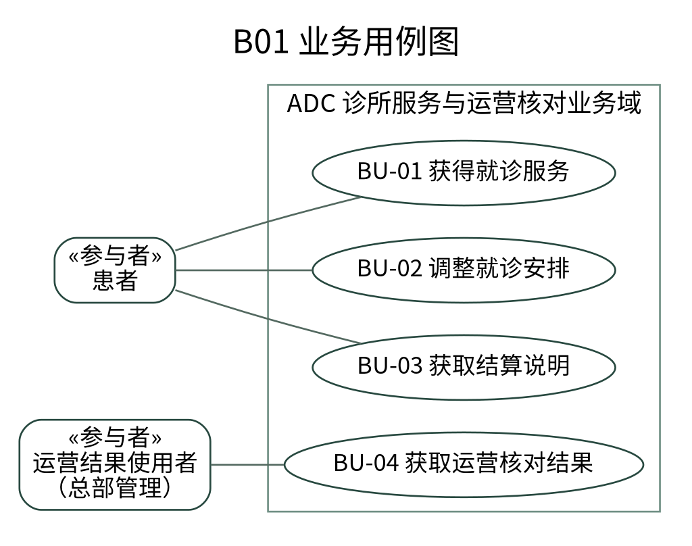
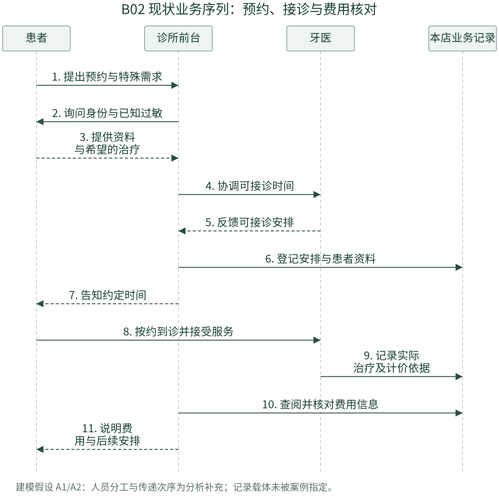
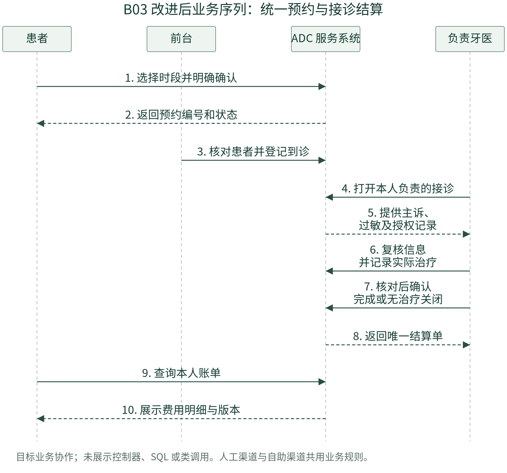
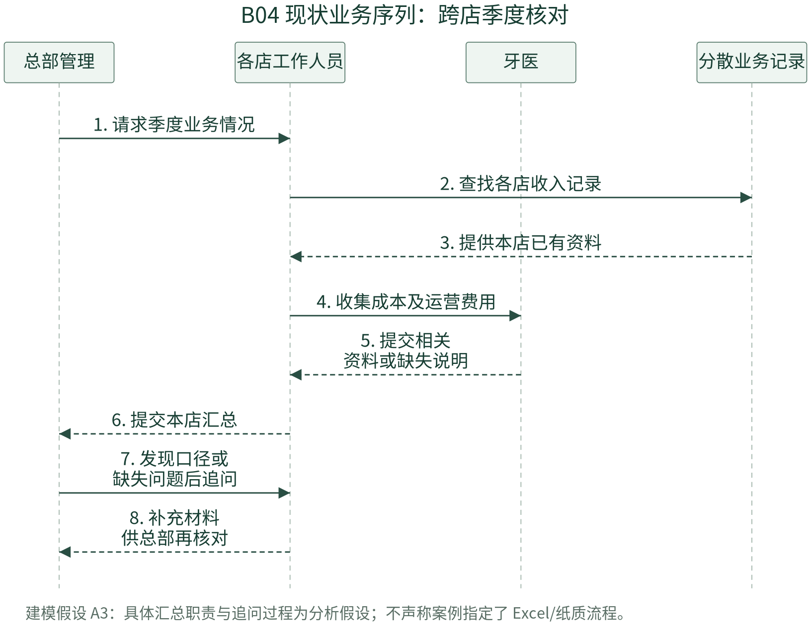
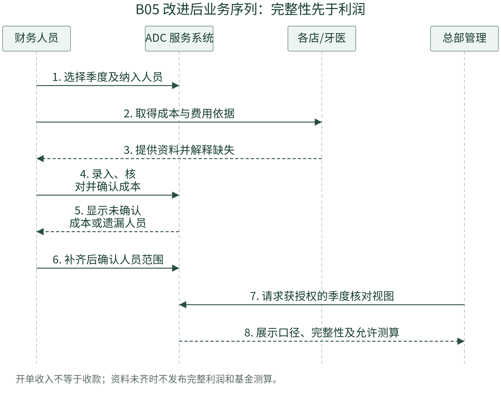
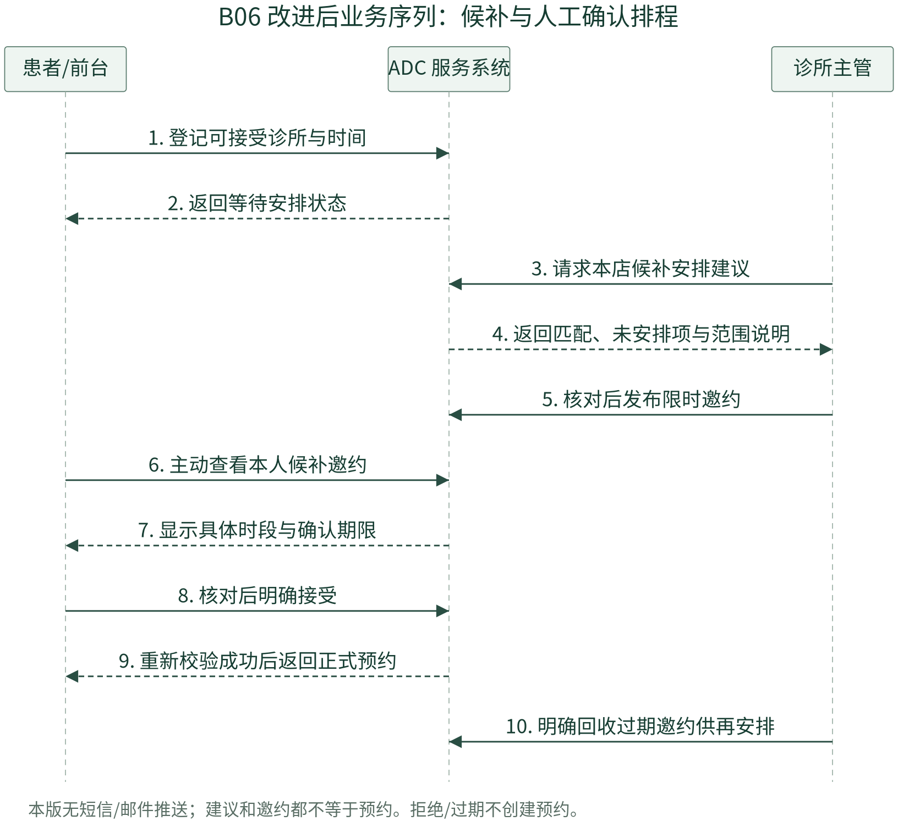
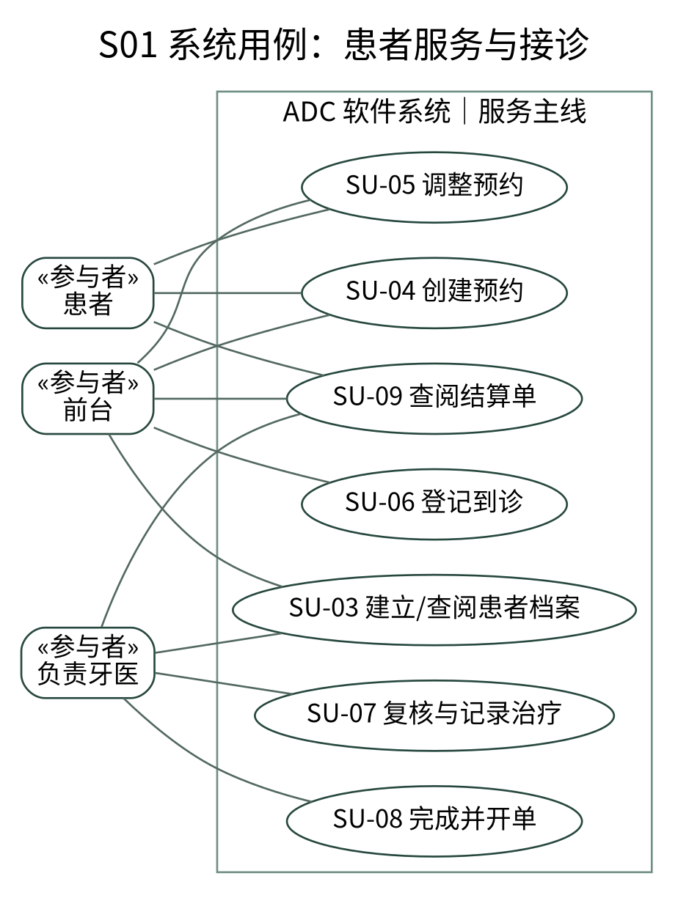
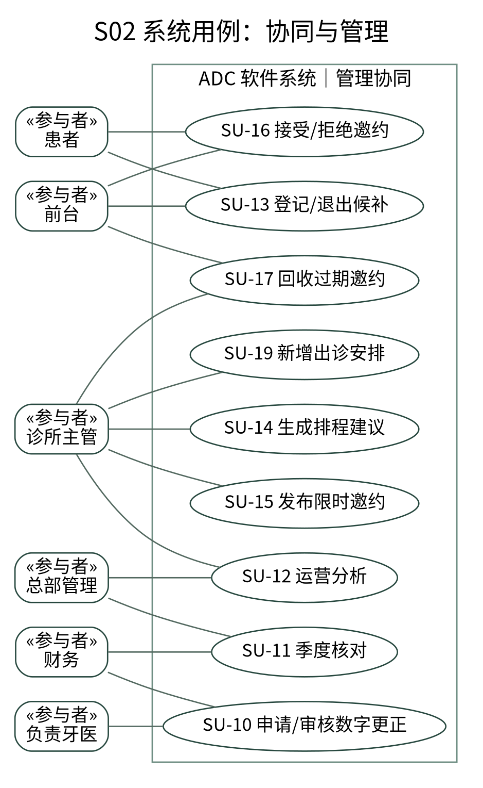
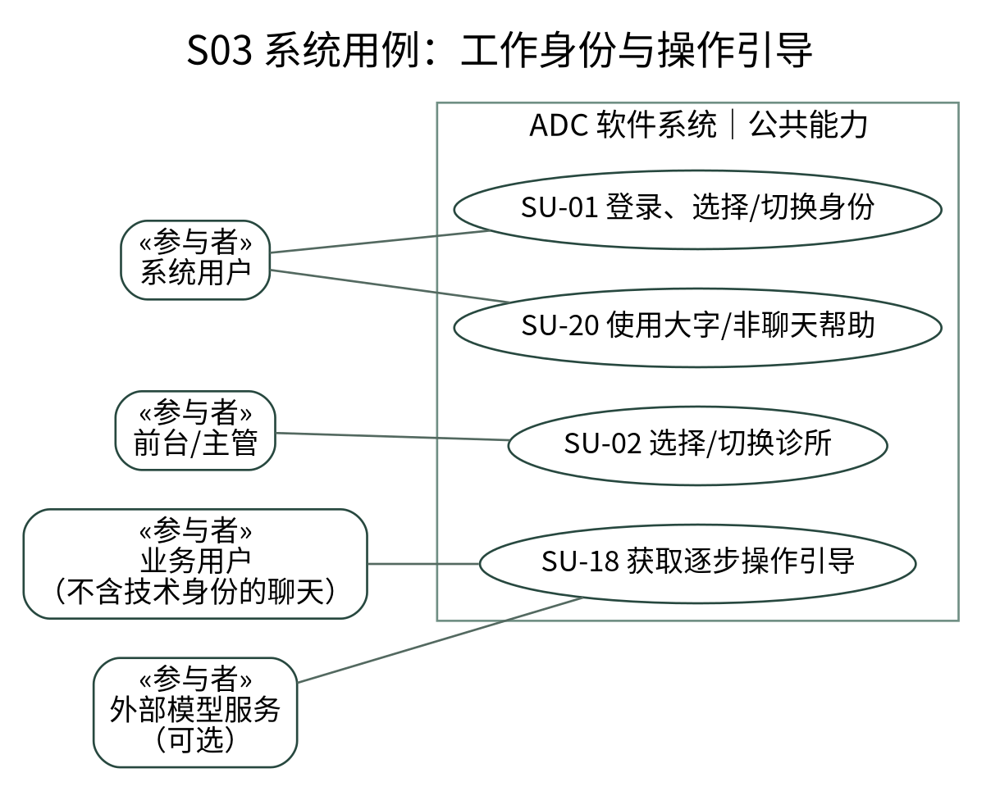

# ADC
牙科连锁运营管理系统

项目愿景、业务建模与需求规约

v0.7 · 教师阶段作业
2026 年 9 月 27 日
个人课程项目 · 合成数据演示

## 摘要

本项目以 Andrew's Dental Chain（ADC）案例为背景，围绕患者资料、跨店预约、接诊、结算及季度运营核对建立信息系统。拟通过统一业务记录解决诊所分散管理带来的协作与核对问题，并通过独立角色工作台降低使用者寻找功能的负担。[C，第1—2页]

v0.7 采用“账号登录—选择工作身份—进入独立工作台—在需要时选择诊所”的交互结构。操作助手把自然语言需求映射到已核对的页面与手动步骤，不替用户提交业务；候补和有限排程先形成建议与限时邀约，再由患者或前台明确确认。

本报告按教师要求组织为愿景、业务建模和系统需求。现状业务序列中的补充假设逐项标注；用例规约说明正常与异常行为。文档完成不等于软件已安装或全部测试已通过；当前源码为 0.7-candidate，本地新版数据库回归和部署仍需单独取证。

## 本次交付结构

| 教师要求 | 本报告位置 |
| --- | --- |
| 项目愿景 | 第2—3页：目标、范围、利益相关者与假设 |
| 业务用例图 | 第4页：B01 |
| 现状业务序列图 | 第5、7页：B02、B04 |
| 改进后的业务序列图 | 第6、8—9页：B03、B05、B06 |
| 系统用例图 | 第10—12页：S01、S02、S03 |
| 用例规约 | 第14—23页：SU-01 至 SU-20 |
附：第13页业务与质量规则；第24页追踪；第25页实现和验证边界；第26页参考依据。

# 01 项目愿景

业务问题 → 使用者价值 → 可观察目标 → 开发边界

愿景陈述：面向 ADC 患者和各类工作人员，建设一套以统一数据为基础、以岗位任务为入口的连锁诊所运营系统；把预约、接诊、结算与管理核对连接起来，让用户知道“到哪里、怎样做、是否已成功”，并使关键业务变化可核查。

| 利益相关者 | 主要需求 | 系统应提供的价值 |
| --- | --- | --- |
| 患者 | 找到时间、调整安排、理解费用和操作 | 本人记录、明确确认、候补、可退出的逐步指南 |
| 前台 | 识别患者、协调预约、登记到诊 | 当前诊所工作台，共享身份与冲突检查 |
| 负责牙医 | 核对过敏与主诉、记录实际治疗 | 本人接诊队列、明细确认、唯一结算单 |
| 诊所主管 | 了解本店业务、协调医生时段与需求 | 选店后管理；候补安排建议及有口径的运营指标 |
| 总部/财务 | 跨店核对、季度成本、利润测算 | 范围、缺失和当前版本明确；更正独立审核 |
| 技术管理 | 维护技术环境与授权基础 | 身份隔离与非敏感诊断；不默认获得临床编辑权 |

## 阶段目标

G1 数据一致：患者与牙医可以跨店产生业务，多过敏、多资格和多项治疗分别记录。G2 业务可核查：预约状态、实际到诊、账单与历史版本相互一致。G3 操作可理解：不同身份具有独立入口、导航和当前范围提示。G4 管理可解释：缺失成本不当作零，比例带分母。G5 扩展可约束：AI 不执行写入，排程不自动改动已有预约。

这些是验收目标，不是已经得到的效果统计。不预先声称取消率下降、收益提高或老年用户完成率提升；相应结果需要任务测试或研究设计支持。

愿景总结：统一事实 → 分角色协作 → 明确手动确认 → 可解释的业务与管理结果。

# 02 依据、假设与范围

案例事实、用户决定、建模假设和实现状态分别记录

| 标记 | 含义 | 本报告中的实例 |
| --- | --- | --- |
| C | 案例原文明示 | 15家诊所、扩张计划、跨店业务、多过敏/资格、季度数据和一就诊一结算单 |
| U | 用户确认的扩展 | 身份与诊所两级选择、独立工作台、AI操作引导、候补和排程 |
| A | 现状细化假设 | 前台协助协调时间、各店记录独立汇集、季度资料存在核对往返 |
| D | 项目设计补充 | 状态细分、金额舍入、候补30分钟、15分钟邀约、有限最大匹配 |

## 现状建模假设登记

| 假设 | 内容 | 使用范围 |
| --- | --- | --- |
| A1 | 前台承担预约协调与到诊记录；具体岗位细分未经另外访谈。 | B02现状服务序列 |
| A2 | 各店已有业务记录用于传递患者、治疗及费用信息；不指定纸张、Excel或某个旧软件。 | B02、B04 |
| A3 | 季度核对需要各店和牙医提供资料，总部可能就缺失或口径追问。 | B04现状季度序列 |
| A4 | 本版每次就诊由一位负责牙医归属；共同治疗收入分摊另行设计。 | 全部相关系统用例 |
案例说顾问开展过信息需求评估；本项目并未另行开展真实机构访谈。A1—A3 是为比较改进前后而补充的分析模型，不冒充调研结论。[C，第1—2页]

## 范围内与范围外

范围内：资料与预约、接诊与结算、有限数字更正、季度核对、运营分析、独立工作台、受控候补、固定时长候选排程、手动操作引导。范围外：真实支付、医保税务、完整病历/影像、AI诊断、家属代理、真实短信身份验证、临床资格自动判定、椅位/设备/通勤的联合优化。

开发以模块化单体为基础。完整账号发放、目录编辑、历史终态纠错、后台通知调度和公网运维仍须后续增量；本次角色选择本身不创建新授权。

来源总结：C/N/T提供依据；U确定扩展方向；A/D明确补充假设与政策。

# 03 业务用例模型

业务用例描述服务结果，不以页面、数据库或框架为业务参与者

业务边界取“诊所服务与运营核对业务域”。前台、牙医和办理资料归集的财务为域内工作者；患者及接收结果的总部管理为业务结果使用者。总部角色在此图位于所选作业域之外，不表示其在法律或组织上不属于 ADC。

图 B01：业务参与者与目标。参与者框标明语义；椭圆为业务用例。

| 业务用例 | 服务成果 | 域内协作 |
| --- | --- | --- |
| BU-01 获得就诊服务 | 患者取得可确认的安排，并完成符合实际的接诊记录 | 前台与牙医 |
| BU-02 调整就诊安排 | 取消、改期或候补等请求得到明确结果 | 前台与主管 |
| BU-03 获取结算说明 | 患者获得可追溯的治疗费用说明 | 牙医、前台与财务 |
| BU-04 获取运营核对结果 | 管理者得到注明口径与缺失的运营和季度结果 | 各店、牙医与财务 |
本业务图不将“登录”“调用AI”“写数据库”画成患者获得的业务成果。软件支持这些目标的方式在 S01—S03 中展开。

# 04 现状业务序列：服务过程

范围：一次预约到接诊及费用说明；不是现有 v0.3 软件的界面流程

图 B02：现状业务序列。时间自上而下；实线表示请求/记录动作，虚线表示反馈。

案例的信息需求涉及电话预约、资料及过敏收集、接诊安排、实际治疗和计价信息；图中前台向牙医协调、向本店记录读写及费用说明的具体次序采用 A1/A2。[C，第1—2页]

问题定位：信息分散时难以一致地识别跨店患者、核对冲突与整合费用。图不声称所有旧记录一定错误；它说明统一系统应在哪些协作点提供支持。

# 05 改进后的业务序列：服务过程

身份识别与人工确认保留，统一系统连接业务记录

图 B03：改进后服务序列。人工预约渠道可由前台代为办理，与患者自助使用相同约束。

变化点：预约提交检查当前可用性；前台登记真实到诊；负责牙医确认过敏和实际治疗；完成操作同时产生唯一结算单；患者只能查阅本人已发布内容。图中的“ADC 服务系统”是业务支持者，不展开控制器、ORM 或 SQL。

异常并未被正常箭头省略成“总会成功”：时段冲突、权限撤销、未知过敏、空治疗和重复提交分别在 SU-04、SU-07、SU-08 中规定。无治疗关闭仍保持真实到诊，不伪造治疗。

# 06 现状业务序列：季度核对

范围：跨店资料归集与管理者获取结果

图 B04：现状季度核对。具体资料传递方式未在案例中规定，采用 A2/A3。

案例明确关注牙医季度收入、成本和运营费用，并提出总体激励基金的比例。它没有规定成本如何由系统采集、缺失如何确认、如何分摊跨店成本，也没有给出个人奖金分配政策。[C，第1—2页]

因此，本图中的收集、汇总和追问是分析性细化。不能从“尚未提交成本”推断成本为零，也不能把一张费用单解释成已经收款。

# 07 改进后的业务序列：季度核对

确认纳入范围和成本 → 检查完整性 → 再显示测算

图 B05：改进后季度核对。财务写入与总部查阅权限分开。

项目口径：收入为当前有效账单的开单金额，按完成时间归属自然季度。P(d,q)=R(d,q)−C(d,q)−O(d,q)；总体 P(q) 为纳入牙医利润贡献之和。在资料完整且 P(q)>0 时，基金测算 F(q)=10%×P(q)。这不是个人奖金、现金流或法定财务净利润。

任何未确认成本、遗漏开单牙医或未确认清单均阻止完整测算；明确的零成本须显式确认。有成本但无收入的牙医仍需纳入。账单更正后按当前版本重算，不能将新旧版本相加。

# 08 改进后的业务序列：候补与排程

请求 → 建议 → 限时邀约 → 明确接受 → 正式预约

图 B06：v0.7 协同流程。候补、排程建议和限时邀约是不同业务对象。

本版为每个诊所枚举固定30分钟候选时段，用最大匹配最大化本批可安排人数。主管先核对方案再发布邀约；患者在候补页面主动查询，或由前台协调。最多保留15分钟或至开始时间，以较早者为准。[U/D]

发布前与接受时均重新检查；拒绝、过期或冲突不产生预约。前台与患者受相同占用规则约束；本版没有短信/邮件推送、自动回收任务或完整医疗资源优化。

# 09 系统用例：患者、前台与医生

软件边界内描述可由系统完成的用户目标

图 S01：服务主线系统用例。共用用例不代表各角色具有相同操作权限。

SU-03 中前台可以建档，牙医只能查阅相关授权资料；SU-05 中患者仅取消未开始的本人预约，前台可办理其范围内的改期、取消与核实爽约。SU-09 的患者路径与员工路径使用不同页面和对象授权。

图中关联线表示参与，不表示时序。登录和有效工作上下文作为受保护用例的前置条件，不将每一个业务用例都机械地画成“包含登录”。

# 10 系统用例：协同与管理

主管、总部与财务的职责不能相互借用

图 S02：有限更正、管理核对与候补排程；技术管理不默认参与业务审批。

主管不能代患者确认邀约；前台可以在取得明确确认后代为办理。财务不能审核自己以医生身份提交的申请。总部查阅季度结果不等于能够录入成本。各操作的角色限制在规约中展开。

# 11 系统用例：身份与操作引导

账号 ≠ 当前身份；当前身份 ≠ 当前诊所

图 S03：公共用例。外部模型为可选支持者，不拥有业务执行权限。

| 工作身份 | 范围选择规则 | 主要入口 |
| --- | --- | --- |
| 患者 | 本人绑定资料；无诊所工作范围选择 | 患者服务首页 |
| 医生 | 本人负责接诊；可跨店查看本人任务 | 医生工作台 |
| 前台 / 主管 | 先进入相应工作台，再选择该身份已授权的诊所 | 独立接待/主管首页 |
| 总部 / 财务 | 各自的全链授权汇总或财务范围 | 独立总部/财务首页 |
| 技术管理 | 技术与授权基础；无自动业务绕过 | 技术首页 |
每次登录均先选身份，即使只有一个身份；主管不在第一层选择“甲店主管/乙店主管”。切换身份清空旧诊所，切换诊所保持身份。身份与范围变化后，旧页面提交应被拒绝并要求刷新核对。

# 12 业务规则与质量要求

规则是前后条件的共同依据；目标不是已经测得的效果

| 编号 | 规则或拟验收要求 |
| --- | --- |
| BR-01 身份与范围 | 可用身份来自有效授权；选身份不授予新权限；必须使用同一条角色与范围绑定。每次写入重查。 |
| BR-02 资料 | 患者跨店复用编号；电话不设唯一身份；未知过敏、明确无已知过敏和已知条目分别表示。 |
| BR-03 预约 | 开始早于结束；预约处于可用出诊时段；同患者或牙医的有效占用不得重叠。 |
| BR-04 状态 | 取消、爽约、改期替代与尚未到期分别记录；无治疗关闭仍为到诊。普通编辑不任意回退终态。 |
| BR-05 金额与历史 | 十进制、逐行四舍五入至分后求和；单号唯一；已发布内容保留；只计当前账单版本。 |
| BR-06 更正/季度 | 数字更正须不同账号审核；缺失不为零；期间、纳入范围与查询时点随结果显示。 |
| BR-07 候补 | 每位患者同时一条有效候补；未来14天范围；每次30分钟；邀约必须有效且由本人/前台明确接受。 |
| BR-08 排程 | 最多60条需求、80个出诊块、200个候选格；只对枚举图最大匹配；超过15分钟的草案不能发布。 |
| BR-09 引导 | 只能使用当前身份可用指南及真实页面名；不自动点击/提交；不把“下一步”视为业务成功。 |
| NFR-01 一致性 | 关键冲突、越权、重复提交与回滚场景应全部通过；不能用测试数量替代覆盖分析。 |
| NFR-02 可用性 | 标准/大字可选；关键操作有文本、确认和恢复路径；桌面与窄屏不丢主要按钮。 |
| NFR-03 运维与安全 | 密钥仅后端；先备份再迁移；保留原配置与历史；公网、恢复与完整辅助技术测试单独验收。 |
页数、按钮尺寸、候补期限和算法上限不是教师或案例规定，而是项目设计。候补共享占用协议目前由应用命令和数据库锁协作实现，不能声称任意直接SQL写入也会自动满足全部跨表候补规则。

# 用例规约 01—02

规约是用户可观察行为与失败保证；不是内部程序调用清单

## SU-01 登录、选择与切换身份

主要参与者：所有系统用户。  触发：登录或点击“切换身份”。

前置条件：账号有效；凭据正确；数据库已有相应绑定。

主流程：1）验证账号后展示当前有效身份，单一身份也不跳过。 2）用户选择身份；服务端再次核验并激活它。 3）清空原诊所范围，进入对应的独立工作台。

异常/替代：A1）没有可用身份：说明待授权并允许退出。 A2）授权撤销或伪造身份：拒绝选择，不进入目标工作台。 A3）旧页继续提交：提示工作上下文已变化，不执行业务。

后置与失败保证：只改变当前工作身份，不增加权限，不改变已有业务记录。

实现追踪：workspaces/views.py、context.py、middleware.py

## SU-02 选择与切换诊所

主要参与者：当前为前台或主管的用户。  触发：进入角色首页或点击“切换诊所”。

前置条件：已经选择身份；该身份至少有一个有效诊所范围。

主流程：1）在工作台列出当前身份可进入的诊所。 2）用户明确选择一店；服务端核对该身份下的诊所绑定。 3）显示该店导航、数据与页首范围；身份保持不变。

异常/替代：A1）没有有效诊所：说明原因，不展示合并数据。 A2）目标诊所停用或无授权：拒绝，不能借用另一角色的范围。 A3）切换后旧表单提交：拒绝并要求刷新。

后置与失败保证：当前店明确；另一家店的业务不会混入当前查询或提交。

实现追踪：workspaces/views.py、accounts/policies.py

# 用例规约 03—04

规约是用户可观察行为与失败保证；不是内部程序调用清单

## SU-03 建立与查阅患者档案

主要参与者：前台建档；负责牙医查阅授权记录。  触发：新患者需要建档，或工作人员需要查阅。

前置条件：有效工作身份与范围；仅使用合成资料。

主流程：1）先检索已有编号或最小识别信息。 2）前台为确属新患者填写资料、紧急联系人及过敏状态/条目。 3）校验后分配稳定编号；相关牙医仅查阅授权范围。

异常/替代：A1）疑似重复：提示核对，不按相同电话自动合并。 A2）必填缺失、未来出生日期或过敏状态矛盾：阻止保存。 A3）无关联/无授权的直接访问：拒绝，不泄露资料。

后置与失败保证：成功时形成一份一致档案；失败不留下半条记录。完整资料编辑/合并另列后续。

实现追踪：patients/services.py、selectors.py；adc_core/views.py

## SU-04 创建预约

主要参与者：患者或当前诊所前台。  触发：用户提出预约并进入确认。

前置条件：有效患者；牙医、诊所及出诊时段可用。

主流程：1）患者选择30分钟候选段；前台可填写合法起止时段。 2）展示患者/诊所/医生/北京时间，用户明确确认。 3）提交时重新检查范围、患者与牙医占用及有效候补保留。 4）成功后显示预约编号与已预约状态。

异常/替代：A1）页面过期、签名不符或范围改变：不创建。 A2）并发争用同一资源：冲突一方收到重新选择提示。 A3）保存或审计失败：撤销本次关联写入；重试成功回执不重复预约。

后置与失败保证：一条可查询且不冲突的预约；没有隐含治疗确认或付款。

实现追踪：scheduling/services.py；portal/services.py；coordination/reservations.py

# 用例规约 05—06

规约是用户可观察行为与失败保证；不是内部程序调用清单

## SU-05 调整预约结果

主要参与者：前台；患者仅本人未开始预约取消。  触发：取消、改期或核实爽约。

前置条件：目标尚在允许操作的状态；范围与修订号有效。

主流程：1）核对目标预约及实际需求。 2）取消记录发起方与原因；改期核对新时段；爽约核对原结束时间。 3）明确确认；改期保留旧记录并关联后继预约。

异常/替代：A1）尚未到结束时间：不能认定爽约。 A2）已到诊/已结束：普通取消或改期被拒绝。 A3）新时段失败：原预约继续有效。患者改期仍联系前台。

后置与失败保证：状态、到诊标志和历史一致。当前单店工作台的普通改期仅选择当前店时段。

实现追踪：scheduling/services.py；portal/services.py

## SU-06 登记实际到诊

主要参与者：当前诊所前台。  触发：工作人员选择“登记到诊”。

前置条件：目标为已预约；已核对真实到达的患者。

主流程：1）打开当前店目标预约，核对人和时间。 2）选择登记到诊并亲自确认。 3）更新到诊状态、实际到诊时间与事件记录。

异常/替代：A1）已经取消/爽约/改期替代：拒绝直接到诊。 A2）旧修订号或授权撤回：拒绝并提示刷新。 A3）重复或失败请求不产生第二次独立接诊。

后置与失败保证：到诊=true，状态已到诊；此时尚无治疗完成或收款事实。

实现追踪：scheduling/services.py：change_appointment

# 用例规约 07—08

规约是用户可观察行为与失败保证；不是内部程序调用清单

## SU-07 复核信息与记录实际治疗

主要参与者：本次负责牙医。  触发：从接诊队列进入工作区。

前置条件：医生身份有效，目标本人负责且已到诊。

主流程：1）查看主诉和已记录过敏，复核当次知识状态。 2）逐项选择实际提供的治疗与数量，确认当时价格和单位。 3）保存事实与必要快照；误录草稿行可说明原因后撤回。

异常/替代：A1）未知过敏可以保存草稿，但不能当作已确认无过敏。 A2）数量/价格不合法或页面过期：阻止保存。 A3）已发布内容不在此处直接修改；非本人接诊拒绝。

后置与失败保证：形成可供核对的实际治疗草稿；预约意向不会自动计费。

实现追踪：care/services.py、views.py

## SU-08 完成就诊并生成结算单

主要参与者：本次负责牙医。  触发：核对后明确关闭本次接诊。

前置条件：已到诊；有治疗时过敏已复核、实际明细已确认。

主流程：1）展示明细、数量、单价、行小计和总额。 2）选择治疗完成；确无治疗时选择无治疗关闭并填写原因。 3）在同一业务提交中发布内容、唯一单据、状态与事件。

异常/替代：A1）有治疗却选无治疗：拒绝；不得伪造或抹掉事实。 A2）无治疗允许未知信息仍为未知，生成零明细零金额单。 A3）重复完成返回既有结果；中途失败不留下半完成账单。

后置与失败保证：闭合就诊恰有一张逻辑结算单；到诊仍为true；不代表已收款。

实现追踪：care/services.py：complete_visit；care数据库保护

# 用例规约 09—10

规约是用户可观察行为与失败保证；不是内部程序调用清单

## SU-09 查阅与打印结算单

主要参与者：本人患者、授权前台/负责牙医/财务。  触发：用户打开账单或选择历史版本。

前置条件：账单已发布；对象属于当前允许范围。

主流程：1）核对单号、患者、诊所、负责牙医及时间。 2）查看由对应版本实际治疗构成的明细与总额。 3）必要时选择已发布历史版本或手动打印。

异常/替代：A1）其他患者/诊所的对象：拒绝。 A2）草稿版本不对患者公开；未开单不解释为免费。 A3）历史打印明确“非当前”，不新增一笔交易。

后置与失败保证：只读展示；任何目录调价不改变历史单据内容。

实现追踪：care/views.py、ledger.py；portal页面

## SU-10 申请与审核账单数字更正

主要参与者：负责牙医申请；不同账号的财务审核。  触发：发现原治疗行数量或单价误录。

前置条件：基版仍为当前版；无另一待审核申请；在允许更正范围内。

主流程：1）牙医选择一条原行，填正确数字及事实依据。 2）系统形成完整草稿，原版继续有效。 3）独立财务核对差异，明确批准或拒绝。 4）批准时原子发布后继版本并切换同一账单当前指针。

异常/替代：A1）同账号切换财务身份自批：仍拒绝。 A2）基版已变化、撤权或非法数值：不发布。 A3）拒绝/技术失败保留原版；不支持项目增删、身份或退款纠错。

后置与失败保证：单号不变，旧版可查；收入只计当前有效版。

实现追踪：care/corrections.py、correction_views.py

# 用例规约 11—12

规约是用户可观察行为与失败保证；不是内部程序调用清单

## SU-11 形成季度成本与利润核对

主要参与者：财务维护；总部授权查阅。  触发：选择季度进行核对。

前置条件：自然季度与纳入范围明确，当前角色允许读或写。

主流程：1）纳入相关牙医，包括有成本但无收入者。 2）逐人保存并确认用品成本、运营费用与依据。 3）确认人员范围；系统检查遗漏开单人员及未确认成本。 4）满足条件后显示收入、利润贡献、总体基金并允许核对导出。

异常/替代：A1）未填与确认零值分开；资料不全不发布完整利润。 A2）零/负总体利润：基金政策待确认，不生成负奖金。 A3）旧页面修订号、权限或跨季度对象不符：拒绝写入。

后置与失败保证：结果带期间、查询时点与口径；不是奖金发放或不可变关账报表。

实现追踪：finance/services.py、selectors.py、policies.py

## SU-12 查询运营指标

主要参与者：本店主管或授权总部。  触发：用户提交只读筛选条件。

前置条件：有当前范围和明确日期区间。

主流程：1）按计划日期筛选已到计划结束时间的记录。 2）按就诊过程区分到诊、患者取消、诊所取消、爽约及待核实。 3）显示分子、分母、样本量、查询时刻和缺失说明。

异常/替代：A1）未来预约与被改期替代记录不混入主要分母。 A2）零分母显示N/A；未判定记录不假装为爽约。 A3）范围外查询被拒绝，不用费用或少量样本判断临床能力。

后置与失败保证：只读结果可解释，数据不因查询改变。

实现追踪：operations/selectors.py、policies.py、views.py

# 用例规约 13—14

规约是用户可观察行为与失败保证；不是内部程序调用清单

## SU-13 登记或退出候补

主要参与者：本人患者或该店前台。  触发：无合适时段，或者不再需要等待。

前置条件：患者及诊所有效；偏好位于未来14天且至少30分钟。

主流程：1）填写诊所、可接受起止时间、可选医生偏好。 2）明确确认后形成等待安排请求；前台须核对患者编号。 3）退出时再次确认；撤回尚未确认的邀约。

异常/替代：A1）同一患者已有有效候补：提示先处理，不重复占位。 A2）时间范围不合法、非本人或无当前店权限：拒绝。 A3）已经形成正式预约：退出候补不能代替取消预约。

后置与失败保证：登记不是预约；退出不删除历史，也不取消其他正式预约。

实现追踪：coordination/services.py、policies.py、forms.py

## SU-14 生成有限排程建议

主要参与者：当前诊所主管。  触发：主管请求生成候选安排。

前置条件：有有效候补和出诊安排；当前身份和店范围明确。

主流程：1）按登记顺序纳入最多60条需求、80个出诊块，枚举最多200个30分钟时间格。 2）过滤当前预约、有效保留、时间与医生偏好冲突。 3）执行有限二部图最大匹配，返回建议、未安排项、生成时刻与范围。

异常/替代：A1）无候选：展示未安排及原因范围，不伪造可行解。 A2）达到上限：说明仅处理枚举范围，不称全域最优。 A3）此步骤不锁定时段；求解后可用性仍可能变化。

后置与失败保证：仅保存草案；不修改已有预约，不声称椅位/资格/通勤优化。

实现追踪：coordination/solver.py；services.py：create_plan

# 用例规约 15—16

规约是用户可观察行为与失败保证；不是内部程序调用清单

## SU-15 审核并发布限时邀约

主要参与者：当前诊所主管。  触发：主管核对建议后确认发布。

前置条件：草案属于本店，未发布且生成未超过15分钟。

主流程：1）读取草案及所依赖的需求、出诊时段和修订号。 2）重新核验权限、偏好、占用及各需求状态。 3）整批建立保留至15分钟或开始时间较早者的邀约。

异常/替代：A1）任一项已变化或发生冲突：整批不发布，提示重新生成。 A2）空草案/过旧草案：拒绝发布。 A3）重复成功提交返回既有结果，不增加同一请求的邀约。

后置与失败保证：请求转等待确认；邀约暂占资源，但正式预约数不因发布增加。

实现追踪：coordination/services.py：publish_plan；reservations.py

## SU-16 接受或拒绝候补邀约

主要参与者：本人患者或当前诊所前台。  触发：用户主动查看邀约并作出决定。

前置条件：邀约属于允许范围；尚未过期；请求待确认。

主流程：1）核对诊所、医生、具体日期、时间及期限。 2）亲自选择接受或拒绝；前台应先取得患者明确意思。 3）接受时再次核验占用，在同一事务内转为正式预约；拒绝则恢复等待安排。

异常/替代：A1）过期、被撤回或需求已变：不创建预约。 A2）经理不能代患者确认；其他患者不能按ID接受。 A3）重复成功接受返回同一预约；失败则原保留不被半途丢掉。

后置与失败保证：接受恰形成一条正式预约；拒绝不形成预约、不删除需求。

实现追踪：coordination/services.py：answer_offer

# 用例规约 17—18

规约是用户可观察行为与失败保证；不是内部程序调用清单

## SU-17 回收过期邀约

主要参与者：当前诊所主管或前台。  触发：在候补页明确执行回收。

前置条件：有本店到期仍待处理的邀约。

主流程：1）展示操作含义，用户勾选确认。 2）核对当前时间，逐项锁定并标为过期。 3）相应请求恢复等待，可参与下一次建议。

异常/替代：A1）仍有效、已接受或其他店邀约不受影响。 A2）单次最多200条；剩余可再次执行。 A3）本版没有后台自动回收；过期时间本身已使保留不再阻挡新预约。

后置与失败保证：历史保留；回收不删除已经成立的预约。

实现追踪：coordination/services.py：expire_clinic_offers

## SU-18 获取定位页面与手动步骤的引导

主要参与者：患者、医生、前台、主管、总部、财务。  触发：用户提问或从任务目录选择指南。

前置条件：已选有效工作身份；普通业务无需AI也可用。

主流程：1）识别想办理的任务；不清楚时展示当前身份可选任务。 2）可选外部模型只识别白名单意图；不同意外发则本地处理。 3）按当前身份提供已核对页面、按钮、条件和逐步说明。 4）用户手动打开页面与操作；“下一步”只切换说明。

异常/替代：A1）换身份/诊所：旧引导失效；网络返回后再次检查上下文。 A2）模型失败明确降级；不伪造链接或办理成功。 A3）医学判断转人工；无权任务说明切换已有身份，不新增授权。

后置与失败保证：聊天无业务写入；只有实际业务页面提交才可能改变记录。

实现追踪：assistants/services.py；guidance/catalog.py、context.py；static/guidance.js

# 用例规约 19—20

规约是用户可观察行为与失败保证；不是内部程序调用清单

## SU-19 新增牙医出诊时段

主要参与者：当前诊所主管。  触发：新增供预约/排程使用的可用时间。

前置条件：医生及本店有效；时段在未来。

主流程：1）核对当前店，选择有效医生和起止时间。 2）系统检查时间与医生跨店时段重叠。 3）明确提交后保存安排并记录事件。

异常/替代：A1）无当前店权限、医生停用、开始晚于结束或冲突：拒绝。 A2）既有时段修改与停用的完整流程尚未开放，不能任意覆盖。 A3）新增时段不意味着医学资格适配或椅位资源已保证。

后置与失败保证：形成可查询的出诊安排；患者仍须另行确认预约。

实现追踪：scheduling/services.py：create_slot；adc_core/views.py

## SU-20 选择显示方式与非聊天帮助

主要参与者：所有系统用户。  触发：用户调整字号、使用键盘或进入帮助目录。

前置条件：已打开支持的页面；业务入口依然存在。

主流程：1）自主切换标准/大字简明模式，不按年龄自动分流。 2）通过键盘、列表及按钮完成主要任务；步骤可返回或退出。 3）需要朗读时主动点击；仅在设备有本地中文声音时启用。

异常/替代：A1）无可用语音：保留文本，不自动上传云端语音。 A2）JavaScript或AI不可用：服务端普通表单仍可使用。 A3）切换身份前提示未提交内容；不声称已自动保存草稿。

后置与失败保证：用户明确当前模式与进度；无自动录音、病情上传或业务提交。

实现追踪：static/experience.js、experience.css；guidance页面

# 13 需求追踪与评审检查

业务结果 → 系统用例 → 规则与实现 → 独立验收

| 业务结果/横向要求 | 系统用例 | 实现位置 | 验证重点 |
| --- | --- | --- | --- |
| BU-01 就诊服务 | SU-03/04/06/07/08/19 | patients、scheduling、portal、care | 跨店身份、时间冲突、信息复核和闭合一致性 |
| BU-02 调整安排 | SU-05/13/14/15/16/17 | scheduling、coordination | 改期回滚、邀约与普通预约竞争、接受重试 |
| BU-03 结算说明 | SU-08/09/10 | care、finance入口 | 唯一单号、快照、原行数字更正、不自批 |
| BU-04 运营核对 | SU-11/12 | finance、operations | 数据粒度、缺失状态、期间与分母 |
| U 独立工作台 | SU-01/02 | workspaces、accounts | 单角色也选择；两级上下文；旧页拒绝 |
| U 新手操作引导 | SU-18/20 | guidance、assistants、static | 指南匹配角色、真页面名、退出、无自动写入 |

## 主要人工验收链

链A：登录 multi_demo → 选择主管 → 选择甲店 → 切换乙店 → 切换医生，确认旧店范围清空且导航不同。

链B：患者登记候补 → 主管生成并发布建议 → 患者核对接受 → 前台到诊 → 医生复核/治疗/开单 → 患者查账单。

链C：财务检查成本缺失 → 完整确认 → 查看测算 → 医生申请数字更正 → 不同财务账号批准 → 核对收入不重复。

链D：在上述任务中使用逐步指南、大字模式和键盘；切换上下文后尝试提交旧页；另测越权对象、冲突与邀约过期。

评审时不能只看正常主流程。报错必须可解释且无半完成写入；静态图、测试方法数量或页面能打开都不能独立证明全部需求通过。[N3，第4—5、11页]

追踪总结：每项需求可找到规约；每项规约说明成功、异常和不做的事项。

# 14 实现边界与证据状态

报告已经完成；安装、数据库验收和公网交付分别取证

| 层次 | 本次状态 | 可据此说明/不能据此说明 |
| --- | --- | --- |
| 源码 | 0.7-candidate 已写入 | 包含工作台、指南、候补与有限最大匹配；不等于部署完成 |
| 原版本运行 | 用户已提供 v0.3 的30项成功日志及登录图 | 仅说明当时 v0.3，不自动继承给新版本 |
| 纯规则/静态/模拟契约 | 181个测试方法实际通过 | 包含512个三乘三候选图的穷举比较；图实例不另冒充512个业务测试 |
| 静态浏览器 | 新页面157条断言；原双端87条、管理84条断言通过 | 转换源码模板、合成数据及明确替身；不是Django端到端 |
| 新版Django/PostgreSQL | 197项测试方法已编写，未在本环境执行 | 原143项加54项；须在Docker执行完整门槛 |
| 真实AI、恢复、公网 | 未执行 | 无真实模型准确率/延迟/费用结论，无已上线地址 |

## 未在本版完成的范围

排程不是多资源CP-SAT：不处理可变治疗时长、椅位、设备、通勤或专业资格匹配。候补不是通知平台：没有短信、邮件、后台自动邀约或自动回收。技术工作台不是完整账号管理后台。原有终态纠错、治疗项目增删更正和真实退款仍在范围外。

## 部署同步原则

保留原工作目录、.env、账号密码和数据库卷。累计源码包含 v0.4/v0.5 所需迁移，但不跳过迁移；升级脚本先备份、再构建与验收。新迁移已执行而测试失败时不可盲目覆盖旧代码。备份可读不等于恢复演练。

本次环境缺少 Django/PostgreSQL/Docker，依赖获取失败。未改用 SQLite 或删除约束来声称通过；实际结果保存在交付包的 docs/TEST_REPORT.md 和 evidence_v0.7.json。

证据总结：拟要求、已写源码、有限检查、本地安装、公开发布是五种不同状态。

# 15 参考依据与提交说明

外部资料解释机制；项目规则不能反向冒充来源原文

C  Zifeng Chen；指导 Derrick Neufeld。ANDREW’S DENTAL CHAIN：数据建模，W44694，2024-10-08，第1—2页。用户提供课程案例，仅摘要必要信息，不附原PDF及照片。

教师要求  用户提供的课程沟通截图：愿景；业务用例图、现状与改进后业务序列图；系统用例图、用例规约；汇总为Word或PDF。未另设页数、模板或图数要求。

N1/N2  上传 note__1、note__2：组织化复杂性与增量交付。历史讲义不当作当代行业统计证明。

N3  上传 note__3，第1、4—5、11页：需求/设计区分、追踪、可测试性、不变量和操作前后条件。

N4/N5  上传 note__4，第7、10—11页；note__5，第4—10页：并行细化功能与数据、ADT、明确接口、关注点分离与信息隐藏。

T1  OMG，UML 2.5.1：用例及交互图语义参考。https://www.omg.org/spec/UML/2.5.1

T2  OWASP，Authorization Cheat Sheet：默认拒绝、逐请求授权。https://cheatsheetseries.owasp.org/cheatsheets/Authorization_Cheat_Sheet.html

T3  Django 5.2，How to use sessions：会话机制。https://docs.djangoproject.com/en/5.2/topics/http/sessions/

T4  W3C，Use Clear Step-by-step Instructions：靠近任务、分步骤和进度说明。https://www.w3.org/WAI/WCAG2/supplemental/patterns/o4p07-step-instructions/

T5  PostgreSQL 17，Explicit Locking：锁机制参考。https://www.postgresql.org/docs/17/explicit-locking.html

## 制图与版本约定

图形均为本项目生成的模型。用例图使用参与者、边界和椭圆用例，序列图使用参与者、生命线与有序消息；图未通过模型交换或形式化语义认证。数据/流程/技术分层未在同一图内混画。SVG、DOT或消息JSON随源码保存，可继续修改。

SU编号用于本次教师阶段报告，区别于早期工程文档的UC编号；追踪以名称和模块对应，不暗中重新定义旧编号。v0.6原为规划，无对应待安装的软件版本；本报告描述v0.7的限定范围与候选实现。

提交者应在实际本地验收后将真实结果补充到工程测试记录；本报告可作为完整的愿景、业务建模与需求阶段材料，不应删去假设和实现边界以制造“全部完成”的印象。

总览：业务愿景 → 明确边界与假设 → 现状/改进模型 → 系统用例 → 可核验规约 → 实现与证据追踪。
