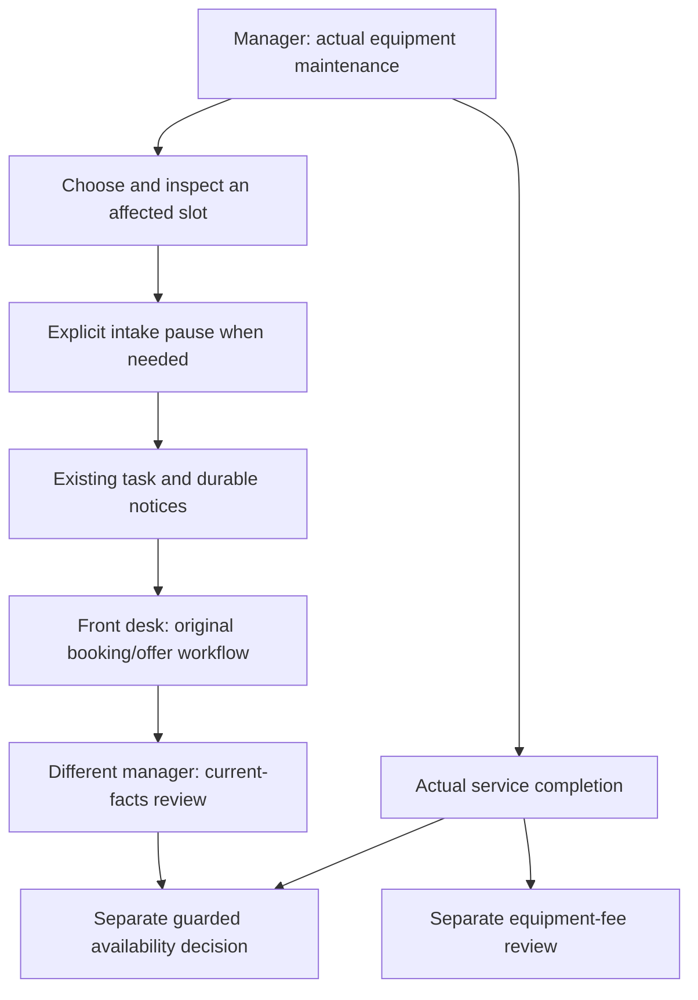

# Finance and equipment handoffs（收退款、费用与维护衔接）

Current source facts → explicit request → independent review → reconciled balance
→ separate operational decisions.

This refinement follows the uploaded requirements/design note's distinction between
business responsibilities and implementation. The clinic rules are project choices.
It extends [the first workflow release](CARE_FINANCE_EQUIPMENT_WORKFLOWS.md), with
the same seven roles, 20 existing migrations and retained historical facts.

## 1. Receipt/refund processing（收退款）

1. **Front desk:** open the current published invoice. Read billed amount, posted
   net receipts, remaining receivable, refund balance and separate pending amounts.
   Check that invoice's request history before adding another request.
2. For an ordinary receipt, the form suggests the remaining receivable. When a
   corrected bill is overpaid, it suggests REFUND and the current refund balance.
   These defaults are editable inputs, not evidence that cash changed hands.
   Native date widgets use an ISO value so the business-day default remains visible
   in the browser even when the application language is Chinese.
3. Preview the candidate. The page shows the current bill version, pending
   receipt/refund totals and the balances **if this one candidate is approved**.
   Other pending entries are excluded. Pending does not reserve funds or promise
   approval, and a subsequent change can invalidate the preview.
4. **Different finance account:** inspect source, date, facts, amount and effect;
   explicitly approve or reject. Final posting still locks and rechecks source,
   workspace, grants, request cursor and amount bounds.
5. If the bill was corrected or the preparer's grant expired, the review page
   explains the blocker and offers rejection. The old request remains in history;
   front desk submits a new request against current facts when appropriate.
6. A refund can reopen a receivable when the current billed amount remains higher
   than net receipts. The preview shows this outcome; a refund does not itself
   correct clinical facts or reduce the bill. Use the existing independent bill
   correction when the original billed facts were wrong.

| Quantity | Definition |
|---|---|
| Net receipts | POSTED receipts − POSTED refunds |
| Remaining receivable | max(current published bill − net receipts, 0) |
| Refund balance | max(net receipts − current published bill, 0) |
| Pending amounts | Separate unposted intents, including obsolete requests until rejected |
| Candidate projection | Current posted balance + this one approved candidate |

Cash requests can be filtered by kind and by one invoice or equipment event.
Pagination retains the validated filters. The filtered history has the same
current-role/current-clinic boundary as the unfiltered page.

Mind map:

- Source → current published version → billed versus cash.
- Pending → count and amounts → separate from posted money.
- Preview → one candidate → due/refund effect → fresh final checks.
- Review → different account → approve/reject → immutable result.
- Exception → stale bill/revoked preparer → reject old request → recheck/resubmit.
- Correction → clinical/bill change and cash reversal remain separate actions.

## 2. Equipment fee reconciliation（设备费用核对）

The worklist begins with REGISTER and SERVICE source events, rather than only cash
requests. This exposes recorded fees that have never been submitted.

| Source state | Operator's next step |
|---|---|
| UNREQUESTED | Manager checks the recorded positive fee and explicitly submits it |
| PENDING | Finance opens that event's request history for independent review |
| POSTED | Retain the checked result; inspect source/history if necessary |
| REVERSED | Manager rechecks facts before submitting a replacement fee request |
| ATTENTION | Reconcile the discrepancy; never infer payment from an inconsistent balance |
| UNKNOWN | Trace the event and check original facts; unknown is not zero or paid |
| ZERO | Retain the explicit zero fact; no positive expense request is offered |

The default list covers known positive fees. UNKNOWN/ZERO filters expose those
source events separately. Summary cards keep known recorded cost, posted net
expense, pending sources and missing/zero facts distinct.

Event cost appears once even when it has several request/reversal rows. Scalar
subqueries avoid multiplying a fee by its cash history. Equipment history also
shows the current reconciliation state, and hides a second ordinary expense link
while a valid request is pending or the event's fee is posted.

The manager sees the selected clinic. FINANCE and HQ have chain reading; HQ does
not gain individual cash-review permissions. Technical, clinical, patient and
front-desk roles do not inherit equipment permissions.

Recorded identity/cost facts stay immutable in this increment. Unknown or incorrect
historical source costs require controlled follow-up; this release does not add a
cost-amendment workflow. The worklist is a course reconciliation record, not a
procurement payable, tax invoice, bank account or depreciation system. Equipment
cash expenses remain separate from dentist-quarter cost/profit calculations.

Mind map:

- Event source → registration/service → known / unknown / explicit zero.
- Positive fee → unrequested → pending → independently posted.
- History → source once → requests/reversals retained → correct net expense.
- Error → discrepancy or reversal → recheck facts → explicit next request.
- Scope → current clinic manager → chain finance/HQ reading → separate cash authority.

## 3. Maintenance and scheduling（设备维护与排班）

1. **Manager:** record the actual maintenance state. The form for a device already
   under repair starts with service completion and offers retirement as the other
   valid outcome. Retired devices retain readable history and have no new ordinary
   lifecycle edit form.
2. Open **核对维护对出诊的影响** and explicitly choose a potentially affected slot.
   The manager must identify the actual operational relationship. The system does
   not infer chair allocation or clinical readiness from the equipment record.
3. Read the existing availability impact: protected appointments/care, valid
   offers, anomalies and completeness limits. Only aggregate operational facts
   are shown to the manager; no patient names, contacts or clinical notes.
4. If necessary, separately preview and confirm intake pause. Existing bookings,
   care and outstanding valid offers remain protected. Pause is not cancellation.
5. For an eligible future paused slot, open or continue the existing coordination
   task. Durable task notifications use the existing worker and frozen recipients.
6. **Front desk:** claim responsibility, coordinate through the existing booking/
   offer flows, record the bounded statement and submit current facts for review.
   A statement is not patient consent or proof that the original command succeeded.
7. **Different manager:** independently review the submitted current facts. Task
   closure does not change availability. Stop/replace a cleared future slot only
   through its original guarded maintenance command. A replacement inherits pause.
8. After actual service completion, record the equipment event and separately
   request any positive known service fee. Recheck the intended slot and explicitly
   confirm reopening when appropriate. Equipment service and fee approval do not
   automatically reopen a schedule or move a patient.

The numbered procedure is the accessible text fallback. This is a small business
flowchart, not formal BPMN/UML interchange or an automatic scheduling engine.

Mind map:

- Equipment → actual maintenance → eligible lifecycle actions → retained events.
- Planning → selected clinic/slot → current protected facts → explicit pause.
- Coordination → durable notice → front-desk owner → original patient workflow.
- Review → different manager → current digest and blockers → separate stop/replace.
- Recovery → service completion → fee review and schedule reopening as separate decisions.
- Protection → historical slots/visits retained → valid offers respected → no implicit care/bill changes.

## Requirement, design and evidence（需求追踪）

| Requirement | Boundary | Verification |
|---|---|---|
| FEF-01 show pending and candidate balances | Posted facts plus one explicit candidate | Exact-cent PG projections, partial payment/refund browser route |
| FEF-02 triage obsolete requests early | Read-only blocker; locked final posting remains authoritative | Correction/revocation/rejection and competing-request tests |
| FEF-03 find unrequested equipment fees | Source-event worklist, scalar cash subqueries | Missing/zero, reversal/repost, clinic and query-count tests |
| FEF-04 actionable maintenance form | Current state selects legitimate choices | Repair and retired-device HTTP/browser checks |
| FEF-05 deliberate scheduling handoff | Manager-selected slot; existing commands own every write | Privacy/role/scope/read-only tests and full coordination route |
| FEF-06 preserve history and Mac data | No schema change; original 20 migrations retained | Full regression, private backup and before/after fingerprints |

Current execution evidence is in
[evidence_finance_equipment_followup/acceptance.json](evidence_finance_equipment_followup/acceptance.json).
Historical acceptance, the RC tag, the unresolved Windows-data recovery and
independent cloud-course readiness keep their existing status.

Local delivery validation passed 884 source checks and 912 PostgreSQL/HTTP/
concurrency tests (42 new test methods). Browser routes retained both completed
business scenarios, the partial-payment/maintenance handoff and its driver-corrected
continuation. The evidence records 367 successful browser assertions, 34 independent
raw database checks, and a separate encrypted restore with all 41 model/association
fingerprints matching. The small-fixture restore duration is not a production-size
performance promise.
