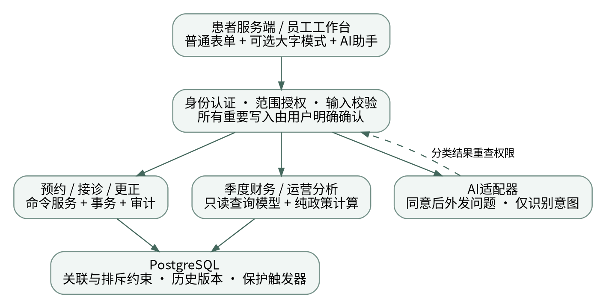
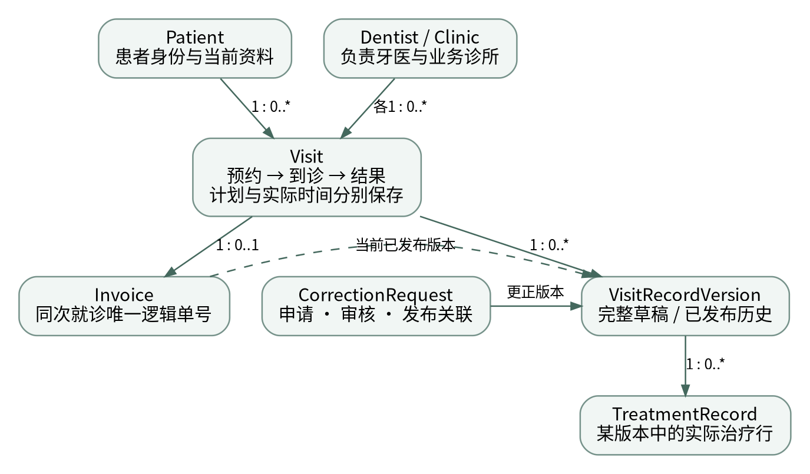
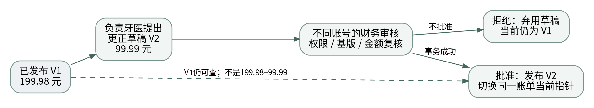
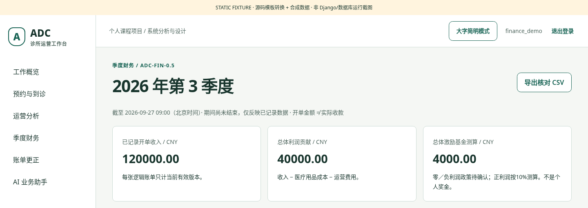

# ADC牙科连锁运营管理系统：系统说明报告 v0.5

编制日期：2026-09-27。源码已交付；147项纯/静态/契约与84+87项静态浏览器断言通过；143项新版PostgreSQL测试待执行。真实AI、公网和恢复演练未执行。


## 01 业务问题、目标与范围

业务问题 → 信息需求 → 交付边界 → 可验收的目标

ADC案例描述了15家牙科诊所的跨店管理问题，并提出扩张、患者取消、牙医资格组合、季度业绩与标准化结算等信息需求。病例或治疗质量并非仅靠费用统计就能判断。本项目将其转化为一个合成数据课程演示系统，不宣称具备真实医疗机构运营资质。[C，第1—2页]

|目标|在系统中的落实|不作出的推断|

|---|---|---|

|统一资料|患者身份跨店复用；多过敏、多资格分别关联|电话相同不等于同一患者|

|业务闭环|预约、到诊、实际治疗、唯一账单、有限误录更正|开单不等于已经付款|

|管理核对|季度纳入人员、成本确认、开单收入与利润贡献|不把缺失成本当作零|

|运营分析|取消、爽约、到诊和待核实的分母与时间窗|不从小样本直接判断经营或临床优劣|

|可解释交付|模型、模块契约、代码、测试和报告相互对应|网页能打开不等于全部需求已验证|

### 当前交付口径

v0.5源码延续患者端、员工端及受限AI助手，并补充季度财务、运营分析和账单原治疗行的数量／单价更正。网站使用虚构身份、预约和交易数据。AI、患者门户和大字模式属于用户后续提出的扩展，不是原案例明示需求。

暂不纳入真实支付、医保、税务发票、完整电子病历和影像、AI诊断、自动优化排班、个人奖金发放、家属代办与真实短信认证。部分基础资料维护、账号发放、预约终态纠错和生产部署仍待完成。这些限制在页面、需求追踪和发布清单中保留。

开发条件为个人完成、无明确截止日期、质量优先。今日交付是代码与说明报告；系统在用户电脑上的升级、现场端到端验收和最终公网发布，是不同阶段的证据，不能合并表述。

```text
业务范围
├─ 主线：资料 → 预约 → 接诊 → 结算
├─ 管理：季度完整性 → 利润测算；运营指标明确分母
└─ 边界：合成演示，不是医疗诊断、支付或正式财务产品
```


## 02 已学设计原则如何落实

保留笔记原意 → 定位变化点 → 明确接口 → 用测试核验设计效果

note__5将四项主要设计原则表述为关注点分离、抽象、简单性和受限可见性／信息局部性；并提出把困难且容易变化的决策封装在模块中。下表右栏是本项目对这些原则的应用，不是讲义原文已经给出的ADC架构。[N5，第4—8页]

|笔记原则|本轮具体应用|可检查的证据|

|---|---|---|

|关注点分离|视图处理表单；服务处理用例；纯政策计算指标；适配器处理外部协议|finance/views、services、policies分离|

|抽象|care.ledger输出牙医粒度收入，不暴露账单版本关联给财务计算|财务服务不复制current_record_version查询|

|简单性|单体部署；一次更正仅改原行数字；不为了展示设计模式增加微服务|变更范围与明确拒绝的操作|

|受限可见性|模块通过明确接口合作；财务页面不接收过敏快照和完整病历|最小只读数据与模板上下文|

|信息隐藏|将基金口径、季度边界、当前账单选择和API字段封装|纯政策测试、接口契约和回归测试|

### 信息隐藏与授权并非同一个概念

信息隐藏面向开发者：调用方不依赖内部数据表达与实现细节。授权面向系统用户：某个身份能否执行某动作、访问哪些对象。内部函数名称或私有约定不构成安全边界；后端仍要检查角色、范围和状态。

### 不把“画更多图”当作设计质量

note__4要求功能与数据并行细化，并显式记录设计决定；note__5也讨论了过度依赖固定方法和不断增加模型的局限。因此只保留解释关键问题的模型，不为本项目无端增加继承层次、通用规则平台或自治代理。[N4，第7页；N5，第12—15页]

讲义中关于设计方法与面向对象的历史评价应按其授课语境理解，不在本报告中改写为当代软件工业的普遍实证结论。

```text
设计原则
├─ 分离关注点；公开稳定契约，隐藏变化细节
├─ 抽象与简单性服务于可理解、可检查和可修改
└─ 代码可见性与用户授权分别设计、分别验证
```


## 03 总体架构与模块契约

双端界面 → 认证授权 → 用例与只读模型 → 数据库／受限外部接口



图1 运行职责示意。项目设计图；不是标准化UML认证结果。

采用Django服务端模板和PostgreSQL的模块化单体。患者端与员工端共享数据事实，但使用不同的权限与页面入口；AI只是可选语言入口，常规业务表单独立可用。图中的回路表示意图识别后重新授权，不表示模型获得数据库操作权。

|契约|输入与输出|被封装的变化|

|---|---|---|

|care.ledger /
income_by_dentist|授权调用方提供时间窗；返回牙医收入行|账单当前版本的存储与关联|

|finance.policies /
calculate_profit|同一截面的收入和成本；返回数值或缺失原因|基金比例、完整性与缺失政策|

|accounts.finance_access|有效账号与授权绑定；财务读／写检查|总部查询与财务修改的差异|

|adc_core.snapshots|在无外层事务时创建一致只读查询环境|PostgreSQL读取隔离选择|

本轮移除了portal、care对scheduling私有函数的跨模块依赖；共用并发错误转换与修订号检查放入adc_core。财务权限归accounts，避免care反向依赖财务业务模块。内部公开接口仍具有“先授权、在事务内调用”等前置条件，不能直接暴露为匿名HTTP能力。[N4，第11页；N5，第8—10页]

```text
架构
├─ 命令负责业务变化；查询模型负责只读事实
├─ 政策可独立测试；适配器局部处理外部协议
└─ 单体部署不等于所有职责混在一个模块
```


## 04 角色、访问范围与主要用例

身份 → 角色绑定 → 资源范围 → 操作状态 → 授权决定

|参与者|主要业务目标|权限限制|

|---|---|---|

|患者|查询本人预约、确认预约、取消未开始预约、查看本人账单|PatientAccess显式绑定；患者编号不是密码|

|前台|建档、预约、改期、取消、核实爽约、登记到诊|只在获授权诊所操作；不能确认实际治疗|

|负责牙医|复核过敏、记录治疗、完成账单、申请原行数字更正|本人负责接诊；不能自批账单更正|

|诊所主管|维护出诊时段、查询本店运营|不能借用其他诊所的角色权限|

|总部管理|跨店运营查询、季度财务查阅与核对导出|查询不自动产生财务写入权限|

|财务|维护季度清单与成本、审核账单数字更正|不进入牙医接诊工作台或修改临床事实|

|技术管理员|技术账号与配置职责|技术身份不默认绕过应用业务授权|

### 本轮主要用例

UC-08：形成季度绩效与总体基金测算。先定义季度纳入范围，再保存成本草稿并确认，最后生成有时点和口径的核对视图。UC-09：查询运营指标。明确日期和获授权诊所，再展示已判定样本与待核实数。UC-12B：申请并审核原治疗行数字更正。它是原更正规划的有限子集，而非全部异常处理。

### 权限是同一条绑定的联合条件

“甲店前台＋乙店主管”不能组合成“两家店主管”。页面导航仅改善可用性；真正的检查位于后端查询和写入服务。过期页面提交、直接访问URL、只读模式下的写入尝试以及AI网络返回后的查询都要重新核验。

同一开发者可切换多个演示账号，但申请和审核仍使用不同账号。这是对系统角色的演示，不代表已在真实机构完成职责分离或身份核验。

```text
角色与用例
├─ 患者本人范围；员工按诊所／负责关系范围
├─ 总部查询与财务修改分开
└─ 菜单隐藏只是界面结果，后端授权才是控制点
```


## 05 数据模型与事实粒度

一条记录代表什么 → 关联与基数 → 历史保存 → 正确汇总



图2 核心关系子图。省略账号、目录、配额和季度表；基数是业务设计约定。

本版沿用24个领域对象；框架权限和会话等物理表不包含在该计数中。本轮没有增加领域实体，只给Quarter追加修订号，并增加更正发布保护迁移。原始迁移保持原文不变。

|对象／对象组|记录粒度与理由|

|---|---|

|Patient、过敏关联；Dentist、资格关联|身份跨店复用；多值关系规范化保存，不将电话设为唯一身份|

|Visit、出诊时段、治疗意向|Visit连接一个患者、负责牙医和诊所；计划时间与实际时间分开|

|VisitRecordVersion、TreatmentRecord|一个完整内容版本及其实际治疗行；已发布内容保留历史快照|

|Invoice、CorrectionRequest|一次闭合就诊一个逻辑单号；更正改变当前版本，不增加第二笔账单|

|Quarter、DentistQuarterCost|一个自然季度和一位纳入牙医的季度成本；缺失状态显式保存|

活跃患者／资格／过敏关系使用常规关联；已发布抬头、单价和过敏复核依据保存快照。快照是为了历史语义，不是用JSON替代全部关系设计。财务查询先按当前账单汇总到牙医季度，再与同粒度成本组合，避免治疗明细联结重复计算成本。

```text
数据模型
├─ Visit是业务过程；版本是内容历史；Invoice是逻辑单号
├─ 治疗意向不是实际治疗；账单不是支付事实
└─ 明确粒度后再联结和聚合
```


## 06 状态模型与业务不变量

允许的命令 → 前置条件 → 状态变化 → 必须保持的事实

note__3要求抽象模型包含不变量，以及每项操作的前置条件和后置条件。本系统将这一思想用于预约和结算，而不是只在报告中绘制状态图。[N3，第11页]

|状态|到诊标志|账单关系与普通操作|

|---|---|---|

|SCHEDULED 已预约|false|无账单；可到诊、取消、核实爽约或改期|

|CHECKED_IN 已到诊|true|尚未开单；牙医复核、记录实际治疗|

|COMPLETED 治疗完成|true|恰一张逻辑账单；普通编辑关闭|

|CLOSED_NO_TREATMENT 无治疗关闭|true|恰一张零金额空明细单；原因必填|

|CANCELLED 已取消|false|无正常治疗账单；记录患者／诊所发起方|

|NO_SHOW 爽约|false|达到原计划结束时间且经授权人员核实|

|RESCHEDULED 已被改期替代|false|旧记录保留并关联新预约；不重复计入取消分母|

### 三个提交后的不变量

① 到诊标志为true，当且仅当状态为已到诊、治疗完成或无治疗关闭。② 两种闭合状态必须各有一张逻辑账单；预约、取消、爽约和被替代记录没有正常治疗账单。③ 账单当前版本必须属于同次Visit且已经发布；不能只检验两个外键各自存在。

### 无治疗关闭与误录更正

没有实际治疗不能伪造收费项目。已治疗部分不能被标成“无治疗”；过敏信息未知也不能被改成“无过敏”来通过表单。无治疗关闭允许未知信息仍为未知。本版对已发布账单更正只新增内容版本，不回退就诊生命周期。

预约终态误标、错绑患者、由有治疗改为无治疗等纠错尚未开放。界面与服务应拒绝范围外操作，不能通过管理员随意编辑状态替代受控规则。

```text
状态与不变量
├─ 状态、到诊、实际时间、账单和版本保持一致
├─ 无治疗也是已到诊事实
└─ 已完成内容通过版本更正，不任意回退生命周期
```


## 07 事务、并发与错误处理

授权 → 锁定资源 → 比较修订号 → 校验 → 原子写入与审计

|机制|本项目作用|不能替代的工作|

|---|---|---|

|数据库唯一／排斥约束|同Visit唯一账单；同患者或牙医有效预约不重叠|不能代替访问授权或临床事实确认|

|事务原子性|改期、完成开单、更正发布与审计一起提交或撤销|不会自动使所有并发竞争正确|

|行锁与固定顺序|先协调出诊时段，再锁Visit等聚合记录|仍需真实并发与死锁场景测试|

|修订号检查|Visit和Quarter拒绝过期页面覆盖新状态|不是数据库历史内容版本|

|业务幂等|重复完成或同审核人重试批准返回已完成结果|不是让任意失败请求无限自动重试|

|只读一致快照|多个报表查询读取同一数据库截面|不是财务关账，也不是永久历史报表|

### 失败不能留下半条业务

改期的新时段失败，旧预约必须继续有效；审计写入失败，本次财务修改或更正发布也撤销。已知预约排斥冲突转换为可理解提示；死锁或序列化竞争提示刷新重试；未知数据库错误继续向上传递，不能统统伪装成“预约冲突”。

### 本轮新增的Quarter修订号

一个季度内的纳入清单、成本草稿与确认通过季度行锁协调。两个财务页面持有相同修订号同时修改时，后提交者不能覆盖先提交者的结果。成员增加使清单确认失效；成本编辑使该成本确认失效。跨季度对象编号不被当作合法编辑目标。

Django transaction.atomic提供事务边界，select_for_update负责相应查询的行锁；本项目还组合了约束、状态检查与用例逻辑。官方机制说明不等于本项目并发正确性证明，必须保留143项真实数据库测试的待执行状态。[T1；T2]

```text
一致性机制
├─ 原子性、唯一性、授权、幂等分别负责不同问题
├─ 固定锁顺序 + 业务修订号 + 明确失败保证
└─ 报表只读快照与不可变历史是两种能力
```


## 08 季度财务与基金测算

确定纳入人员 → 录入并确认成本 → 同粒度汇总 → 检查完整性 → 测算

案例要求按季度记录牙医收入、成本和运营费用，并给出净利润扣除口径与10%激励基金比例。本项目将收入暂定为已完成就诊的当前有效开单金额，按完成时间归入上海时区自然季度；这不是实收款、现金流或法定财务净利润。[C，第1—2页；项目解释D]

```text
P(d,q) = R(d,q) − C(d,q) − O(d,q)
P(q) = Σ P(d,q)
F(q) = 0.10 × P(q)    仅在数据完整且P(q)>0时测算
```

|合成示例|开单收入|用品成本|运营费用|利润贡献|

|---|---|---|---|---|

|牙医甲|100,000|20,000|30,000|50,000|

|牙医乙|20,000|15,000|15,000|−10,000|

|总体|120,000|35,000|45,000|40,000|

上述总体基金测算为4,000元，不能仅对正利润牙医计算5,000元后相加，也不能将结果直接当作个人奖金。总体利润为零或负数时展示实际利润，基金标为政策待确认，不擅自发放负奖金或编造亏损结转规则。全部示例数字均为合成验算值。

### 完整性先于利润

MISSING、DRAFT、CONFIRMED三态分别表示未录入、草稿和已确认。零成本需要显式录入与确认。空纳入清单、未确认人员范围、任何未确认成本或存在开单但未纳入的牙医，均阻止完整利润与基金展示。纳入清单也应包括有成本而无收入的牙医；软件不能从收入记录自动证明这些人员已经全部纳入。

页面和CSV包含查询时点、口径版本、期间是否尚未结束。账单数字更正以后，原完成季度按当前版本重述；历史成本修改同样可能改变重算结果。成本尚无诊所分摊规则，因此不计算诊所净利润。

```text
季度财务
├─ 缺失 ≠ 零；纳入人员 ≠ 仅有收入的牙医
├─ 各自汇总至牙医季度，再计算总体利润
└─ 基金是总体测算；历史会重述，不是关账或奖金发放
```


## 09 运营指标与解释边界

选择计划日期和授权诊所 → 排除未到期与改期替代 → 分开状态 → 展示分母

运营页按预约计划开始日期选择记录，只将查询时刻已到计划结束时间的记录纳入主要统计。使用当前已记录状态；不提供任意历史时点重放。未来记录与被改期替代的原记录单列，患者取消、诊所取消和爽约不同。该口径是项目设计，不声称是行业统一标准。

|符号|含义|合成示例|

|---|---|---|

|A|已到诊，包括治疗完成和无治疗关闭|80|

|Cp|患者取消|10|

|Cc|诊所取消|3|

|N|经核实爽约|5|

|U|已到期但仍待核实|2|

```text
D = A + Cp + N = 95
患者取消率 = Cp / D = 10.53%
爽约率 = N / D = 5.26%
状态完整率 = (A + Cp + Cc + N) / (A + Cp + Cc + N + U) = 98%
```

另外20条未来预约和7条被改期替代记录不进入上述分母。D为零时显示N/A，而非0%；存在U时明确提示主要比例基于已判定样本。不能把“到诊标志=false”一项直接解释成取消或爽约。

### 从数据库走向商业分析

指标按Visit计数，而不是按治疗明细或历史内容版本计数。各诊所按代码顺序列出，不以少量样本自动排名。日期、缺失率和样本量必须随结果展示；描述统计不能支持费用造成取消、某医生能力更强等因果或临床结论。

当前页面是按需刷新，不是实时监控。它展示授权范围的聚合计数，不返回患者身份或病历内容。治疗项目结构、资格分布和需求—技能匹配仍属后续分析范围；没有经确认的资格映射时不生成“适配率”。

```text
运营指标
├─ 分子、分母、时间窗与查询时刻一起解释
├─ 未来、改期替代、诊所取消与待核实分别处理
└─ 明细粒度正确；描述性比较不自动等于因果或质量评价
```


## 10 账单历史与有限受控更正

原账单保留 → 牙医准备完整新版本 → 独立财务核对 → 原子发布



图3 合成更正示例：单号不变，旧版可查，收入只取当前版本。

更正申请只允许改变当前已发布版本中一条原治疗行的数量或单价，必须填写事实依据。项目身份、单位、患者、诊所、负责牙医、已确认完成时间、临床备注和结果类型都不改变；不能添加或删除治疗项目。本轮选择这一有限范围，以可检查规则替代任意历史编辑。

|阶段|系统必须满足的条件|

|---|---|

|提出申请|本人负责牙医；基版与Visit修订号匹配；无另一待审核申请；数值合法且确有变化|

|等待审核|完整草稿复制原有效内容后改指定行；当前账单仍为旧版；患者不能查看草稿|

|批准|财务与申请人不同账号；原牙医授权仍有效；申请、原版和草稿一致；金额复算一致|

|提交|申请APPLIED、新版PUBLISHED、同一Invoice切换指针、Visit修订号和审计同事务保存|

|拒绝或失败|拒绝则草稿ABANDONED，原版继续有效；技术失败则本次修改回滚|

新增数据库保护限制当前指针只能从原当前版向合法后继发布，并保护已处理申请不被普通DML改写。技术管理员或数据库所有者的底层控制能力不在普通应用权限隔离保证内；本项目不宣称实现密码学防篡改。

历史打印通过指定同次就诊的已发布revision进行，显式标为非当前版本。一次重试不生成第二张Invoice；复算原完成季度时，不将旧新版本一起求和。这不是实际退款或税务作废流程。

```text
历史更正
├─ 一个单号，多份不可普通改写的完整历史
├─ 负责牙医申请，独立财务审核，所有关联同事务变更
└─ 原行数字更正已写代码；其他终态、身份与退款异常仍在范围外
```


## 11 AI接口、数据流与信任边界

输入与同意 → 配额与脱敏尝试 → 意图识别 → 权限重查 → 系统事实与页面入口

本轮不扩展AI自主权限，继续采用v0.4的受限意图分类器。模型只返回白名单问题类别及有限置信信息；业务事实由Django查询、规则计算并生成卡片。模型不生成SQL、不决定授权、不直接取消预约、修改治疗或批准账单。

```text
浏览器：会话 + CSRF；无API Key
后端：身份/范围 → 输入与配额 → 外发同意
适配器：兼容消息协议 → 受限结构化分类
后端：重新授权 → 允许的数据查询 → 来源/时间/操作入口
异常：明确本地降级；普通业务不依赖AI
```

|控制点|实现与限制|

|---|---|

|服务端密钥|环境变量读取；本地隐藏输入工具；不写HTML、JavaScript或代码仓库|

|信息最小化|不主动附带患者档案和数据库摘要；问题文本有限遮蔽并要求同意，不保证完整匿名化|

|输出不受信任|限制意图、字段和格式；拒绝模型给出的任意外部链接或操作指令|

|成本与故障|用户/全局限额、超时、错误处理；不自动无界重试|

|日志|记录状态、耗时等必要元数据，不保存对话正文、密码或密钥|

|替代路径|demo明确未调用模型；remote失败明确降级；disabled保留普通界面|

适配器为Chat Completions兼容结构，不是全部供应商原生API的通用翻译层。真实供应商、模型能力、分类准确率、费用和网络时延本轮均未测量。不要将模拟HTTP契约测试解释为真实模型表现。

涉及医疗判断的问题转向人工专业接诊；该辅助界面不是医疗诊断系统。仅添加免责声明无法替代能力限制、授权控制与实际测试。患者和员工助手均保留非聊天入口。

```text
AI边界
├─ 语言理解是辅助，业务事实和授权由系统负责
├─ 同意、有限外发、配额、错误降级；不泄露密钥
└─ 无真实API证据，不报告模型准确率、费用收益或医疗效果
```


## 12 双端交互与包容性设计

用户目标优先 → 可选择显示模式 → 明确确认和反馈 → 普通路径始终可用

患者端关注“我要做什么”：选择时段、核对预约、查看本人记录与账单。员工端关注“下一步业务动作”：前台到诊、牙医接诊、财务核对。导航根据权限显示，但安全校验不依赖导航。

|交互选择|具体实现|仍需实际验证|

|---|---|---|

|标准／大字简明|基础16px／20px；按钮最小48px／大字56px；选择由用户主动决定|不依据年龄自动分类，也无真实目标用户效果结论|

|移动端|减少并列操作；主要动作纵向；宽表局部滚动|键盘弹出、设备差异、读屏器需要现场测试|

|错误与确认|表单回显错误、关键操作确认、待核实与未确认有文本标签|不能只靠颜色表达成功失败|

|朗读与非聊天|可选本地中文声音；无本地声音就保留文本；普通表单无AI仍可用|不录音上传；无云语音识别|

|管理报告|查询时点、口径、期间未结束、缺失和N/A明确展示|不把动态报表当不可变财务报表|



图4 新管理页面的静态布局检查节选。合成数据、转换模板；不是实际Django运行截图。

本项目以WCAG相关概念作为后续评估参考，但本轮没有完成全面符合性审核。上述字号与按钮尺寸是项目自定目标，不声称是所有标准统一规定。静态浏览器检查覆盖1440、390、320宽度与两种模式，不代替真实老年用户和年轻用户的任务测试。

```text
包容性交互
├─ 按需求提供模式，不按年龄强制分流
├─ 关键确认、焦点、文本反馈和普通业务路径
└─ 静态布局已检；实际可用性和辅助技术仍待验证
```


## 13 测试策略与实际证据

规则 → 模块契约 → 数据库 → 浏览器端到端 → 部署运行；证据不能跨层替代

|检查层次|本轮状态|证据与限制|

|---|---|---|

|纯规则／静态／模拟契约|147个test方法通过|原101＋新增46；HTTP使用模拟响应，无真实API|

|新管理界面静态浏览器|84/84断言通过|固定合成页面；不是Django表单与数据库运行|

|原双端／助手前端回归|87/87断言通过|明确的fetch、storage替身；非真实登录端到端|

|语法与既有迁移核对|通过|Python compileall、两JS语法；v0.4旧迁移逐文件未改变|

|新版Django/PostgreSQL|143项已编写，未执行|原86＋新增55集成＋2并发；需用户Docker运行|

|真实AI、性能、公网、安全、恢复|未执行|不写成功率、延迟、上线地址或恢复时间|

### 历史证据与当前证据

用户已提供v0.3的完整本地日志：Django检查、模型迁移一致性、PostgreSQL迁移及30项测试全部通过，测试耗时8.540秒，并提供登录界面截图。该证据只说明v0.3在当时环境中的结果；不能直接继承为v0.4或v0.5通过。

本轮生成环境没有Django、PostgreSQL和Docker；依赖访问遇到DNS失败。没有改用SQLite、删除约束或编造测试输出。完整实际输出保存在docs/unit_results_v0.5.txt，机器可读边界在docs/evidence_v0.5.json。

### 新增数据库验收重点

财务覆盖缺失与确认零值、无收入成本、遗漏人员、同粒度聚合、撤权与旧表单；更正覆盖不覆盖原版、独立审核、重试唯一、当前版本重述及回滚；运营覆盖时间成熟度、未知状态、无治疗、跨店权限；并发检查季度修订竞争及重复批准。

不能用测试方法数量替代需求覆盖率，也不能把“84＋87条静态断言”叫作171个完整业务场景。完整端到端验收、异常网络和目标用户验证仍是后续门槛。

```text
验证证据
├─ 已执行结果与待运行测试分栏
├─ 原版通过不自动迁移至新版
└─ 规则、数据库、交互、部署与真实AI分别取证
```


## 14 需求追踪与完成范围

来源 → 需求 → 用例／模块 → 验证入口 → 剩余缺口

note__3明确要求需求目标与约束可以追踪到设计再到代码。本表为阶段性覆盖视图，不是教师评分表，也不是所有需求已验收的证明。[N3，第1页]

|需求组|源码落实|当前限制／证据|

|---|---|---|

|FR-01～03 资料与资格|patients、registry；建档、过敏关联、牙医/诊所/资格模型与种子|完整目录管理、归档与账号发放UI仍待补齐|

|FR-04～07 预约与治疗|scheduling、portal、care；跨店时间、状态、复核与实际行|终态误标纠正未开放；旧测试须整体回归|

|FR-08 标准结算|care.services、ledger、corrections；唯一单号和版本|本轮只开放原行数字更正，不含退款与身份纠错|

|FR-09/10 季度成本与基金|finance.services、policies、selectors、页面及CSV|143项数据库测试中的财务场景待执行|

|FR-11 运营管理|operations；到诊、取消、爽约、缺失和样本数|治疗／资格分布、技能需求映射仍未完整实现|

|FR-12/13 授权与历史|accounts、commands、audit、数据库保护|不声称数据库所有者无法修改底层存储|

|FR-14 公网演示|本地Compose、升级脚本、生产阻断与发布清单|未完成公网部署和恢复演练|

|FR-15～17 双端/AI/包容性|portal、assistants、experience资源|真实模型和目标用户效果未验证|

FR编号来自项目需求基线；患者端、AI与包容性交互由后续用户需求追加。今日把FR-09/10及FR-11的一部分推进到实际源码和界面，把UC-12B推进到有限的可执行更正，不宣称补齐全部案例分析目标。

原v0.4的保护与迁移不因新功能删除。本轮追加finance.0002_quarter_lock_version与care.0003_correction_publication_guard，所有旧迁移哈希保持一致；这降低升级时的历史漂移风险，但不能替代迁移执行与恢复验证。

```text
可追踪交付
├─ 不将模型存在误写成界面或业务已经完成
├─ 新需求保留来源，新增规则保留设计标记
└─ 覆盖状态、测试层次与剩余缺口一起说明
```


## 15 Windows升级、诊断与运维

原目录／原配置 → 保密备份 → 覆盖累计源码 → 验收门 → 启动与人工验证

用户已用Windows CMD和Docker Desktop跑通v0.3，主机Python启动器存在问题，因此以下命令不调用宿主机py，也不使用PowerShell专属语法。升级支持从既有v0.3或v0.4源码累计覆盖，但实际兼容性以完整门槛结果为准。

```text
cd /d D:\Users\Zhang\Desktop\ADC_engineering_v0.3
docker compose stop web
REM 复制原源码作保密备份，再覆盖累计更新包中的文件
UPGRADE_WINDOWS.cmd
```

不要新建目录并在其下随意启动Compose；原目录名不等于程序版本。保留原.env、项目名称、密码和数据卷。更新包不含用户密钥和真实数据。源码备份与数据库备份不同，两者都要保留。

|脚本阶段|实际行为与失败处理|

|---|---|

|备份|pg_dump生成backups/pre_v05.dump；同名已有则停止，不覆盖|

|备份可读性|pg_restore --list检查格式；不等于实际恢复到空数据库|

|构建与门槛|构建web → 147项纯检查 → Django/迁移检查 → migrate → 143项数据库测试|

|成功后|保留旧密码的门户演示初始化 → 安全版本诊断 → 启动web|

|失败后|保留第一处错误；不删除迁移、关约束或执行down -v；数据库可能已经部分升级|

```text
docker compose run --rm web python manage.py system_status
docker compose ps
curl http://127.0.0.1:8000/health/
```

system_status只输出版本、待迁移数、AI模式和是否有Key等非敏感诊断，不输出Key、数据库密码或患者资料；不调用真实模型。Windows升级脚本本轮未实机执行。需要回滚时先分析新迁移与旧代码兼容性，不能盲目覆盖旧源码或自动还原现有库。

未来公网发布还需生产应用服务器、HTTPS、最小数据库权限、登录节流、配置密钥管理、依赖／镜像锁、备份恢复和演示写入隔离。production配置仍明确阻断，不能只删除阻断就声称已部署。[T4]

```text
运维
├─ 源码、配置和数据分别保护
├─ 先备份、再迁移验收；失败停止而非删库
└─ localhost不是公网；备份可读不是恢复演练
```


## 16 多角色演示与交付结论

展示业务闭环 → 核对指标 → 验证失败保证 → 记录真实证据

|步骤|角色与动作|核对结果|

|---|---|---|

|1|患者选时段并二次确认；前台登记到诊|同一患者身份，预约唯一且到诊一致|

|2|负责牙医复核、加入实际治疗、完成开单|单号唯一，明细舍入正确，患者可看本人账单|

|3|财务建季度、纳入全部相关牙医，暂不填成本|页面显示缺失，不伪装完整利润|

|4|填成本及依据并确认，核对清单|手工复算总体利润、基金；期间标签与查询时点明确|

|5|牙医申请原行数字更正；财务逐项审核|当前指针切换，旧版可查；申请人不能自批|

|6|复查原完成季度|只计新有效版本，不把两版相加|

|7|主管／总部查询运营；另看无样本区间|范围正确；未知与诊所取消分开；零分母N/A|

|8|切大字模式、键盘操作；AI演示或明示降级|常规业务不依赖AI，标签不伪装模型调用|

### 今日交付到什么程度

本轮完成了版本化源码改善、季度管理与运营统计页面、有限历史更正、静态与纯规则检查，以及与实现一致的系统报告。它是一份可继续在用户本地验收的课程系统候选，而不是通过全量验收的真实医疗产品。

演示只使用虚构数据。截图应保留版本、角色、统计口径与时间，遮盖随机登录密码和密钥。报告中当前的页面图来自明确标注的静态夹具；正式提交前可用本地成功执行后的真实页面截图替换，并记录运行版本。

### 后续优先级

首先运行完整数据库门槛和多角色端到端场景，修复实际失败；其次补足账号／目录维护及仍未解决的异常；然后执行依赖锁定、生产权限与恢复演练，再进行公网部署。新功能只在对主线与质量有明确作用时加入，避免范围持续膨胀。[N1，第8页；N2，第4页]

```text
交付结论
├─ 今日：源码完善 + 系统报告 + 分层证据
├─ 下一门槛：真实数据库与双端业务验收
└─ 最终：生产配置、恢复与公网发布；不跳过验收
```


## 参考资料与版本说明

课程依据、项目决策与外部实现文档分别记录

|编号|资料与使用位置|

|---|---|

|C|Zifeng Chen；指导Derrick Neufeld。ANDREW’S DENTAL CHAIN：数据建模，W44694，2024-10-08版本，第1—2页。用户提供课程案例；本报告只概述必要信息，不附原文及照片。|

|N1|note__1.pdf，Nancy Leveson，Software Engineering Concepts，第8、18—21页：范围膨胀、组织化复杂性及交互问题。讲义为历史授课材料。|

|N2|note__2.pdf，第4—5页：增量模型与风险驱动的过程选择。|

|N3|note__3.pdf，第1、4—5、11页：需求／设计区别、追踪、可测试性、不变量与操作前后条件。|

|N4|note__4.pdf，第7、10—11、15—16页：逐步求精、ADT、明确模块联系、内聚与耦合。|

|N5|note__5.pdf，第4—10、12—15页：四项原则、信息隐藏、模块化与设计方法的局限。|

|T1|Django 5.2官方文档：Database transactions。https://docs.djangoproject.com/en/5.2/topics/db/transactions/|

|T2|Django 5.2官方文档：QuerySet API / select_for_update。https://docs.djangoproject.com/en/5.2/ref/models/querysets/|

|T3|Django 5.2官方文档：Aggregation。https://docs.djangoproject.com/en/5.2/topics/db/aggregation/|

|T4|Django 5.2官方文档：Deployment checklist。https://docs.djangoproject.com/en/5.2/howto/deployment/checklist/|

文档版本：ADC系统说明报告v0.5。编制日期：2026-09-27。应用版本标识：0.5-candidate。第三方文档用于解释实现机制，不据此声明本项目已经通过测试或符合标准。

本报告来源类型：C/N为案例或笔记；未在原资料中规定的技术栈、金额／时间口径、权限、更正范围与AI设计属于项目决定D。运行证据分别来自用户提供的v0.3日志与本轮实际检查文件；没有真实机构访谈、真实患者资料或虚构的模型效果评估。

完整可修改报告源稿、模块契约、字段/历史模型资料、需求追踪和验收脚本随源码提供。Word报告为阶段性说明正文，可在收到教师格式及用户本地运行证据后更新。

```text
最终总览
业务需求 → 清楚模型 → 封装变化 → 可执行规则 → 分层验证
→ 保留历史与权限 → 可解释指标 → 有边界的AI → 可复现交付
```