# 当前数据库设计与ER图

业务事实 → 真实表与主外键 → 分模块ER → 一致性规则 → 下一阶段优化。

本目录解释独立PostgreSQL验证库中已实际迁移的表、键和基数。领域图说明业务责任，状态图说明生命周期；ER按真实元数据生成。当前C6.1B/C追加结算、资金分配、差异跟进及撤销四个视图，交付状态见[执行证据](../evidence_c61bc/README.md)。原C6.1A的115表[历史快照](../evidence_c61a/schema_snapshot.json)及其[安装核对](../evidence_c61a/mac-schema.json)保留原日期和范围。

## 登录增量结构（2026-10-25）

微信／短信登录候选已在独立空库执行第61份追加迁移：130张SQL表、129张ORM表、1279个ORM字段、353条外键及103项触发器。原60份迁移字节保留。新增短信挑战表只关联可选账号：注册登录没有预先指定用户，绑定用途必须指向本人。账号、患者、关系授权继续分别建模。当前字段、关系、DBML与下方患者账号ER已按这份实际元数据更新；后文C6.1B/C为较早的129表结构说明，保留当时验证范围。正式课程报告仍为该阶段版本，本轮登录和教师试用增量见[专项说明](../WECHAT_SMS_TEACHER_TEST.md)。

## 结构基线与阅读方式

2026-10-25在独立PostgreSQL验证库执行60份应用迁移后，只读核对129张SQL表：128张由ORM描述，另1张为`django_migrations`。1266个ORM字段逐项核对；351条普通外键及1条账单复合外键共352条，应用触发器103项且全部启用。与C6.1A相比追加14张结算和资金表；全部56份原迁移保持原字节，不补造历史参保、诊疗或资金。

二十六张分图显示真实可空和唯一外键。结算请求和原始结果、资金凭据和独立决定、分配和差异跟进分别建模；关系引用本身不授予岗位权限。当前结构与历史容量、微信运行时、公网及真实临床验收分别记录。

只提取表结构元数据，未导出业务行、凭据、配置值或字段默认值。结构证据见[schema_snapshot.json](schema_snapshot.json)，该结构核对与业务、并发及容量验收分别保留。

字段类型、可空和单列唯一键逐列核对。框架连接表`auth_group_permissions.id`的integer／bigint差异在使用同版本迁移的独立空库中也可复现，列为框架自动连接表的已知兼容性记录，目录和DBML保留实际bigint。Django官方说明自动连接表主键受迁移配置影响，现有表的主键不会自动跟随模型声明迁移；本阶段不缩窄既有主键。[官方说明](https://docs.djangoproject.com/en/5.2/ref/settings/#default-auto-field)。

先按下面的业务问题查看分图，再检索[完整字段目录](FIELD_CATALOG.md)和[352条SQL外键](RELATIONSHIPS.md)。[完整DBML](schema.dbml)便于继续建模；条件唯一、检查、排斥约束的精确定义以结构快照为准，DBML没有替代触发器和业务命令。

## 图例

- 表头为真实表名；PK为主键，FK为外键，UK为单列唯一，`?`为可空列。
- 使用乌鸦脚记法：双竖线表示恰好一个，圆圈加竖线表示零或一个，圆圈加三叉表示零到多个。连线两端表示该关系的基数。
- 选取关键列和关系以便打印；未展开的操作者、诊所及历史引用等仍在完整目录中。颜色仅辅助区分表头，黑白打印仍可阅读。
- 条件唯一不标成永久一对一：资源方案、凭据和对账均能保留多次历史。必需关系或有效占用的状态条件另由实际约束及命令校验。

## 预约与电话接待

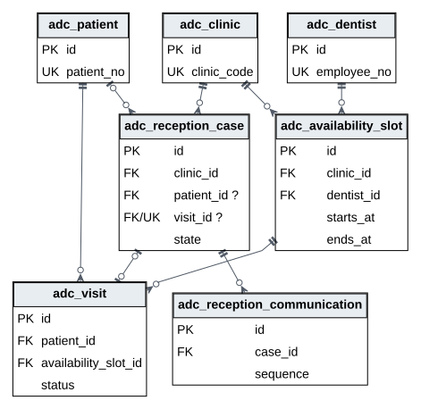

接待单的患者和预约引用可空；成约后引用真实预约。沟通记录以`case_id,sequence`唯一排序。诊所、医师和出诊分别建模；排班由前台当前店办理，不从ER连线推断授权。

## 排班服务与医师适配

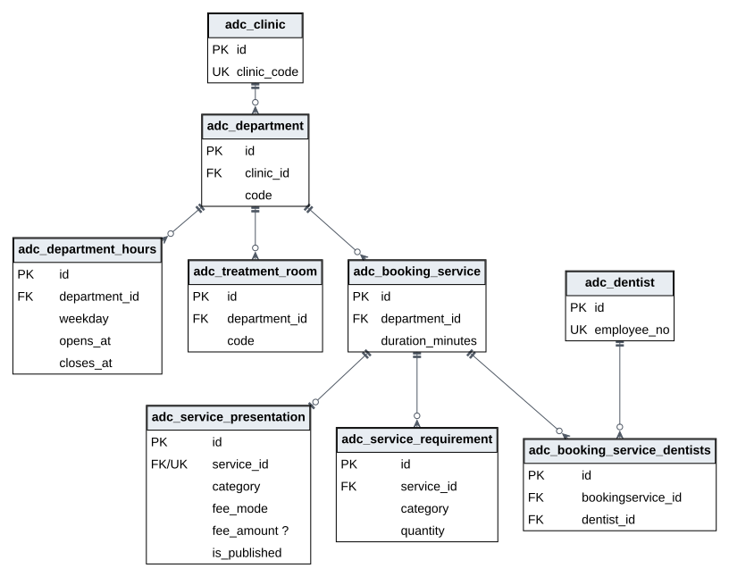

科室属于诊所，诊室和服务属于科室；每周开放区间与医师出诊分别保存。服务—医师多对多由`adc_booking_service_dentists`连接表实现，配对有真实唯一约束。预约服务不作为收费项目。每项服务可以没有患者说明，也可以有唯一一份；公开状态与接诊配置共同决定能否作为新预约入口，说明费用不生成账单。

## 设备位置与资源占用

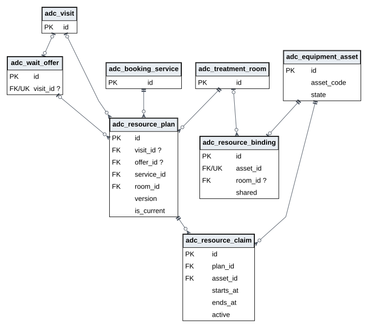

设备资产复用原台账，排程位置是独立一对一绑定。资源方案至少引用预约或邀约之一，接受邀约后允许同时引用二者；不是XOR。替换方案追加历史，每个来源至多一个当前方案；有效资源区间另受`physical_resource_no_overlap`排斥约束。

## 诊疗结算与资金凭据

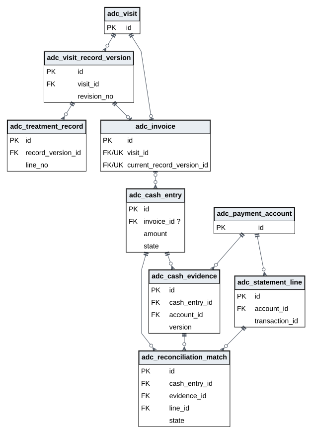

每次就诊至多一个逻辑账单。`invoice_same_visit_fk`用`current_record_version_id,visit_id`共同引用记录版本，保证属于同次就诊；图中两条普通外键不能单独表达这个约束。收退款是多次资金事实，凭据有版本，匹配的活动唯一性按状态限定，不把历史强行压成一对一。设备资金的可选来源、原CSV批次及其他未展开关系见目录。

## 前台排班与调班责任

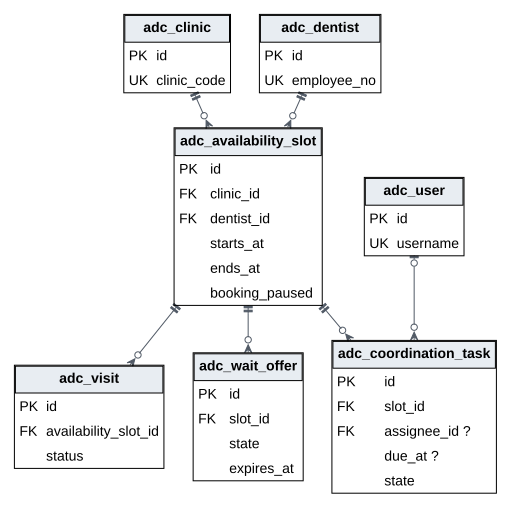

出诊经clinic_id和dentist_id归属诊所与医师，预约及邀约引用原出诊；任务经slot_id归店，assignee_id允许尚未受理，due_at保留历史未填写。每个出诊最多一个活动任务，终态历史可有多条；独立复核不得由提交人切换角色完成。

## 患者自助改期与历史追踪

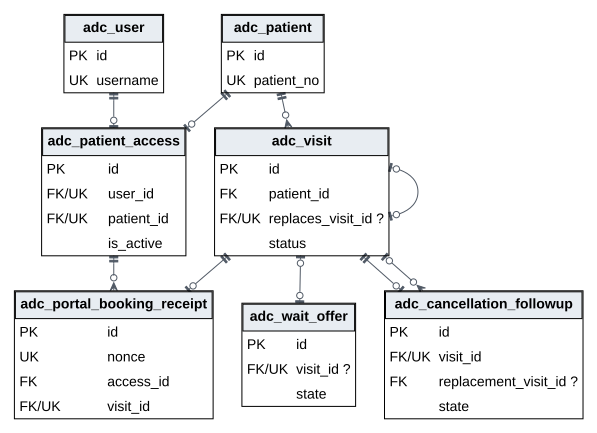

患者账号通过`adc_patient_access`绑定本人档案。`adc_portal_booking_receipt.nonce`唯一，回执唯一指向结果预约；`adc_visit.replaces_visit_id`可空且唯一，保留直接前身并限制原约至多一个后继。有效候补接受时`adc_wait_offer.visit_id`指向同一结果，后来再改期仍保留原接受事实。取消跟进的`replacement_visit_id`保留当时另约依据；页面另展示合法的直接后继，不重写历史证据。

这七张表及九条外键均从真实元数据生成。外键不代表访问许可；本人范围、同店同服务、未来时间和有效状态由业务命令核验。普通改期不新建取消跟进，不改变临床或资金表。

## 已有关系优化

| 业务问题 | 数据库规则 | 反例及命令边界 |
|---|---|---|
| 外店设备被排入本店诊室或牙椅设为共享 | binding_business_relation | 检查资产与诊室归店；牙椅必须固定到诊室。 |
| 停用记录引用外店目标 | block_business_relation | 科室、诊室或设备须属于记录的clinic_id。 |
| 同店不同科室混用，或邀约接受关联到别人的预约 | plan_business_relation | 服务与诊室同科室；双来源的患者、诊所、医师、出诊和完整时间一致。 |
| 占用区间与承诺不符 | claim_business_relation | 对照保留的预约或邀约时间，不使用当前可修改的服务时长推算历史。 |
| 排班清单和邀约查询随历史增长 | slot_clinic_start_idx、offer_slot_state_exp_idx | 按店和日期、出诊和状态索引；候选查询复用预载资源，查询数不随逐行增加。 |

历史排班增量追加coordination0004和scheduling0005；本次保留全部39份原迁移，并已在独立库执行服务说明的第40份追加迁移。协调期限历史空值继续明确展示。上述历史版本包含42项应用触发器，C1.1当时版本包含50项，完整定义在结构快照，字段目录列明每表触发器。

## 复现与优化

使用文档运行环境执行`python docs/database/build_schema_docs.py`，从保留的结构快照重建DOT、DBML、字段和外键目录；再执行`node docs/database/render_er.cjs`，需要`@viz-js/viz`、Playwright及本地Chrome，导出SVG／PNG。生成器先核对模型关系与实际SQL外键，渲染器再核对每幅图的表、列和连线数量。它们不连接数据库，也不读取私有配置。

当前ER用于排班事实、诊所归属、可空状态、条件唯一、版本链和查询索引的下一轮评审。新增结构须先解释业务问题，再追加迁移及反例测试。原v0.3[物理设计](../PHYSICAL_DESIGN.md)和[字段目录](../FIELD_CATALOG.md)作为历史来源保留，当前设计入口统一指向本目录。

## 患者关系与预约授权

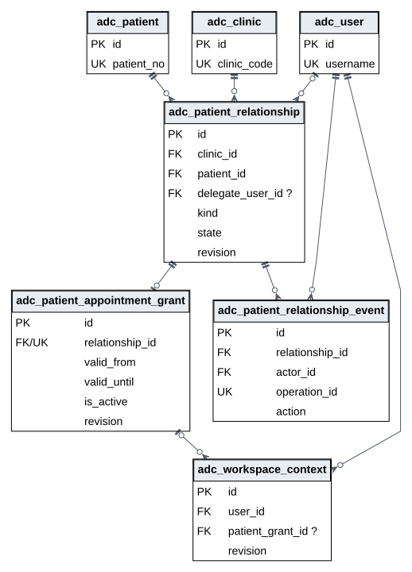

关系核验和预约授权分别保存；联系人并不自动获得授权。工作上下文明确选择当前就诊人，核验事件只追加。代约不包括病历、账单或临床知情同意，实际权限由事务命令核验。

## 专业范围与机构审核

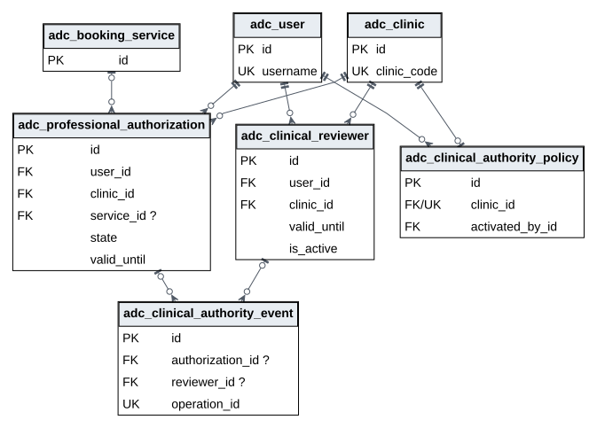

机构审核职责按账号和诊所唯一；资质证据、操作范围和独立决定分别保留。服务为空只对应无服务旧记录。授权有效期及动作由命令重检，外键关系不授予处方、财务审核或病历复制权限。诊所启用事实和历史事件不可原地改写。

## 限定跨店转诊与查阅记录

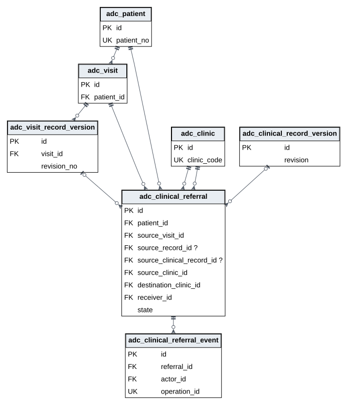

转诊保留原患者、原就诊、可选发布版本、转出与接收诊所及指定医师。身份争议保留待澄清，不合并患者；接收不扩展全连锁患者搜索。查阅事件保存受控对象类型和编号，二者不是伪造的关系外键。专业与转诊来源不可改写，决定及查阅事件只追加。

本次结构来自独立演练库，正式安装与恢复验收在工程证据中另行标识；合成资质不表示已经完成真实临床资格审查。

## 健康自述与实际检查

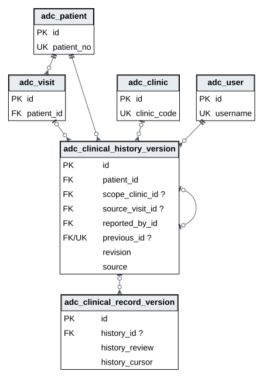

本人自述的scope_clinic、source_visit为空，本店医师面谈引用实际就诊及当前诊所。`patient_id,scope_clinic_id,revision`使用NULL不互异唯一约束，各来源分别递增；前版引用允许为空且唯一。检查引用具体自述，同时保留当前可见来源游标与专业核对结论，不覆盖已复核过敏资料。

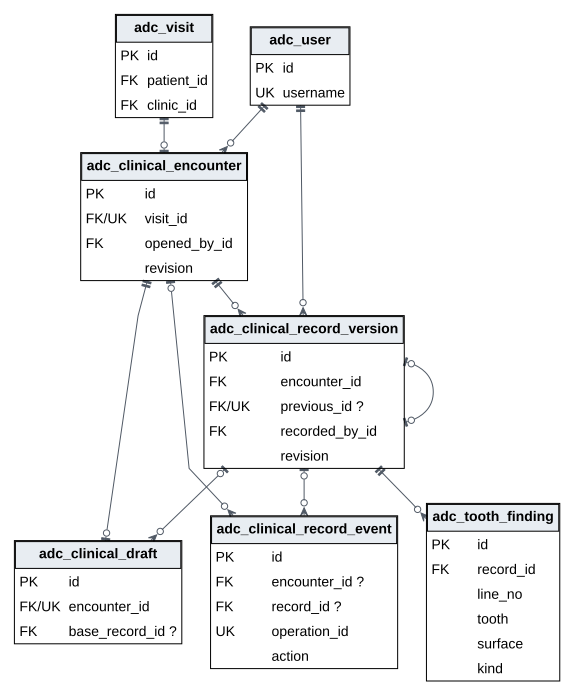

检查头与原实际就诊一对一，不重复保存患者及诊所；草稿与检查头至多一对一。确认版本按检查头及版号唯一，前版允许为空且唯一；观察属于具体确认版本。`base_record_id`仅指更正草稿依据，既有确认内容及决定不可原地改写。草稿工作载荷有界，确认时才生成不可改写观察行。数据库约束与事务命令分别保护结构与业务规则；历史记录不被迁移补造成新检查。

转诊新增可选的结构化检查版本引用，旧发布版本与新引用至多选择一种，并核对同次原就诊。后续更正不改写已选择的披露。以上结构核对不等于专业术语审定、合格电子签名、云部署或容量验收。

## 连续诊疗、复诊与加工件

### 跨次就诊方案与保留版本

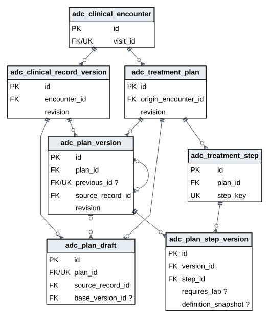

患者与诊所经原检查头及就诊推导；不重复维护患者归属。工作草稿可修改，确认方案和步骤版本保留历史。稳定步骤只表达沿革，不能把旧版本人决定或加工验收当作新版授权。目录定义与时长保留发布时快照，旧记录空值表示未登记，不补造历史。

### 具体方案步骤与本人决定

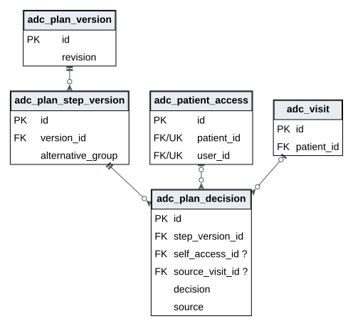

每次决定绑定具体步骤版本。本人网站决定引用本人PatientAccess，医师手工登记的讨论决定引用本次就诊，来源二选一；这不是手术知情同意签署。代约授权不授予方案或病历访问。互斥组不能同时形成两个已接受的当前选择；所有决定只追加。

### 实际执行、原始开单与账单版本

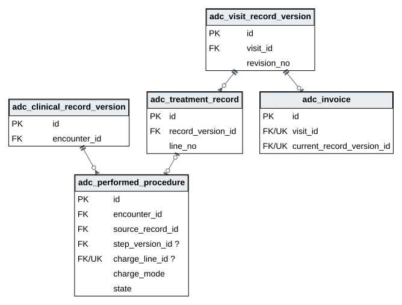

实际执行可引用计划内步骤，也可明确登记计划外依据。原始收费行至多归属一个实际执行；审核后的账单版本副本不生成第二次执行。原开单快照保留在实际执行JSON中，不伪画为外键。完成时计费方案的中间阶段可不另收费，但仍属已治疗；未发布作废保留原执行与快照，已发布执行不能作废。

### 医师后续要求与原预约关联

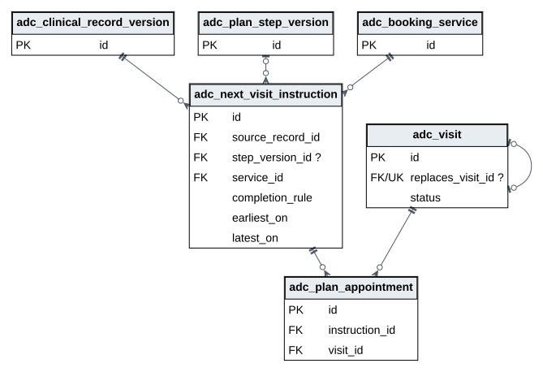

后续要求保留原检查、具体步骤、服务、建议窗口和完成标准；前台只读取安排所需投影。先经统一资源规则成约，再明确关联原预约；改期沿唯一后继关系跟踪，取消不代表复诊完成。一次部分治疗关闭后，如未达到明确完成标准，可以继续安排。历史未登记完成标准的记录保留未明确状态。

### 复诊责任、沟通与实际完成依据

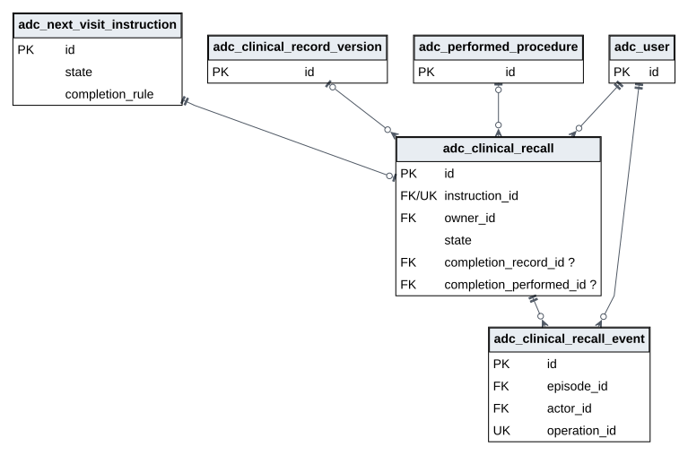

一条后续要求至多一份随访责任，状态、负责人和期限变化追加事件。完成时仅选择同患者、同店、同服务且明确关联的已关闭后续就诊事实；确认检查或指定步骤完成依据二选一。晚于建议窗口如实记录，不改原日期。患者暂不继续转医师核对，未经明确恢复不重复对外联系，也不自动取消预约。

### 加工请求、物理送返与具体版本验收

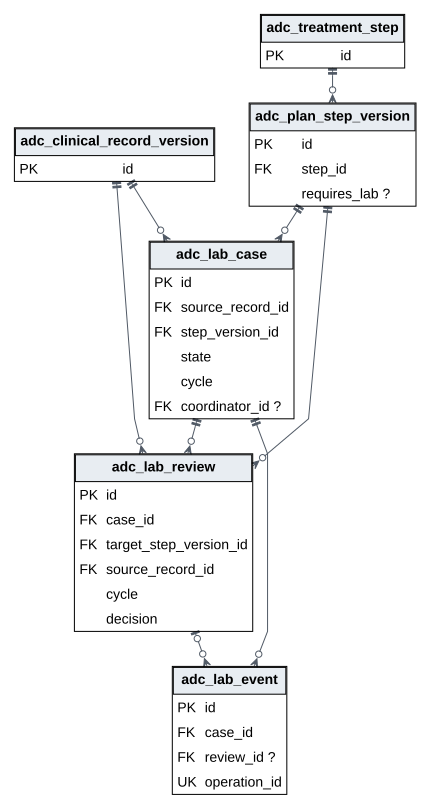

医师请求绑定原确认检查及已接受具体方案步骤。送出、返回是手工交接事实，不代表临床适配；每次返工须经过新送返周期。验收绑定本周期及当前确切步骤版本，跨版本复用必须重新明确核对。前台不读取加工临床规格或验收详情；原需要日期与预约保留。只在所需加工件全部有效验收后允许相应实际执行，不自动产生收费。

## 门店公开资料与发布历史

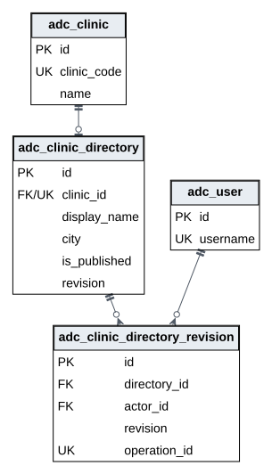

`adc_clinic_directory.clinic_id`唯一引用原诊所，当前公开别名不修改业务名称。版本引用资料及操作者，按资料和版号唯一并保留原发布快照；`operation_id`唯一。公开营业投影继续读取原科室日历和停用记录，距离与导航坐标分别保存且成对可空。登录通道为原工作上下文的受约束属性，不伪造独立身份外键；通道本身不授予患者或员工权限。

## 患者账号、凭证与联络来源

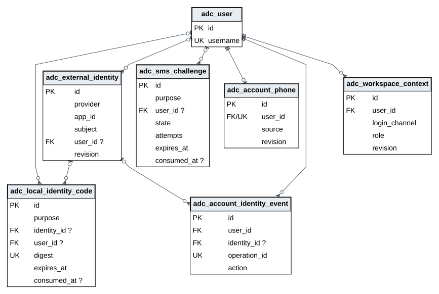

外部身份按提供方、应用和主体组合唯一，用户外键在未绑定或解绑后可空；同一账号可保留多条身份历史。账号手机与用户一对一，号码不是唯一患者标识。分用途凭证保留摘要及一次消费时间，登录凭证引用身份、手机凭证引用用户，两种来源由检查约束区分。身份事件仅追加；登录通道、账号和有效患者权限不等同。

## 本人申请与独立核验

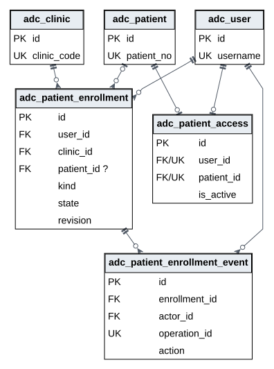

申请始终属于账号及明确诊所，批准后才引用患者；同一账号至多一件待核验或待补充申请，条件唯一不限制其终态历史数量。审核事件保存操作者、依据及快照。新档批准建立原完整患者及本人关联，旧档批准不重写患者；暂停后的复核恢复同一PatientAccess行，不新建或改绑。不同账号审核、当前店职责和原关联一致性由事务命令核验，不把ER连线当作权限授予。

## 医保政策来源、门店安排与收费适配

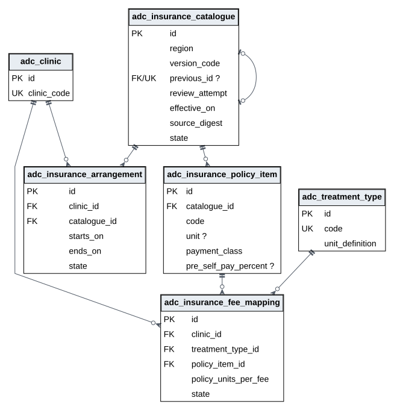

同一官方来源可保留多次明确审阅。首次记录无前版、次数为1，后续记录以唯一前版和递增次数串联；仅原审阅已拒绝或停用后才可重新提交，原始文件、规范记录及政策版本保持一致。政策项目按目录及编码唯一。门店已确认安排的包含首尾日期范围受排斥约束；同店同收费项目至多一个已确认映射。映射引用原收费定义并保留单位快照，不改原治疗、价格或账单。

## 患者模拟待遇版本与准备事件

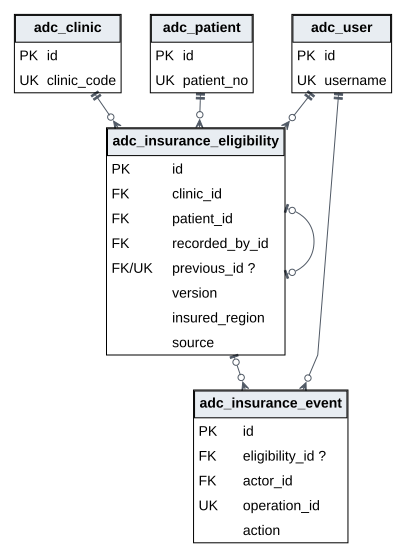

待遇按明确患者和本店递增，前版必须属于同一患者、诊所和紧邻版本，原记录不可改写。最新未知或过期不回退到旧核实结果。准备事件恰好引用目录、安排、映射或待遇之一，操作编号唯一、只追加；来源及决定历史与运行日志分离。本批六张表不表达结算或基金应收，后续扩展须另行追加迁移并核对实际ER。

## 实际费用与唯一模拟结算

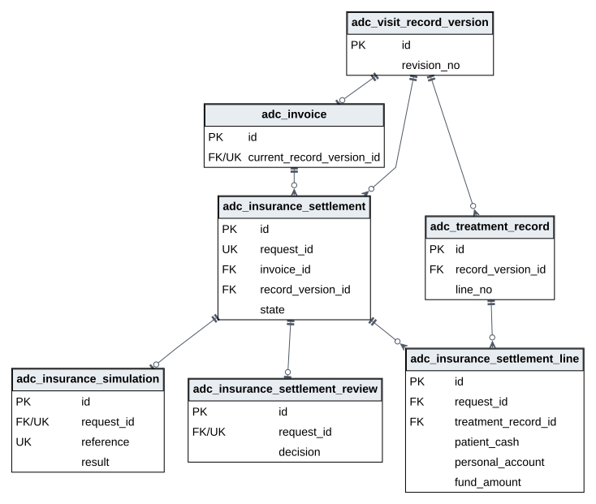

请求引用原账单和确切版本，每条结算行引用原实际收费；原模拟结果及独立复核各至多一条。活动请求唯一性为条件约束，不能把账单与全部历史请求画成永久一对一。基金、个人账户与现金责任的等式不表示现金已经收到。

## 银行依据与基金分配

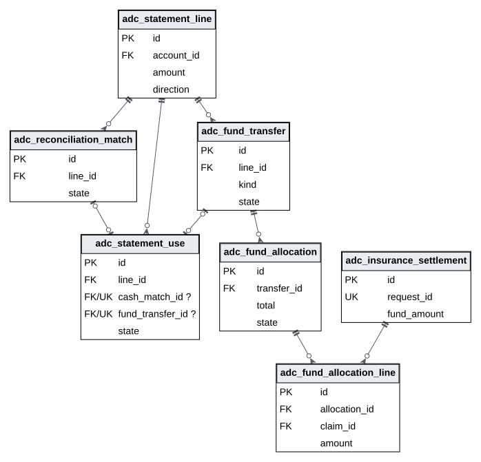

同一流水可保留多次历史用途，但当前R1匹配与基金用途排他。每批分配属于一个已核对基金凭据，明细引用原申报且同批不重复；待审及已通过金额共同占用额度。反向资金须有银行退回证据及原已核销金额，拒绝决定保留历史。

## 基金差异与责任历史

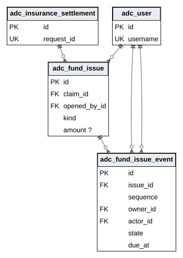

差异事项引用原申报；金额允许未知，不能替换为零。责任和期限、处理依据及状态保存在按序追加的事件中。负责人和处理人是不同的用户外键，图中明确两条关系；结束事项不改变结算或资金。

## 原结算撤销与独立复核

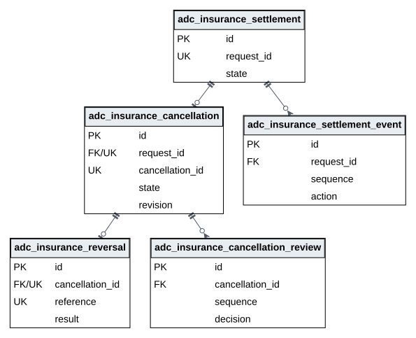

撤销请求唯一引用原申报，原撤销结果与请求一对一，独立复核可以保留多次未通过历史而至多一次通过。原申报事件按序保留处理中、未知和后续查询结果。终结还需数据库与命令核对资金已退清、待审已处理；外键不能单独表达该条件。

本次交付后已对原本机数据库执行同一只读结构提取；表、列、索引、迁移、外键及触发器定义与上述实际ER逐项一致，见[安装结构核对](../evidence_c61bc/mac-schema.json)。
