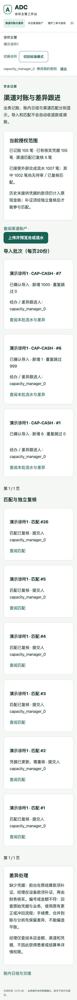
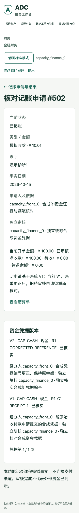

# R1 financial evidence acceptance 资金凭据与逐笔对账验收

Retained source → explicit proposal → independent review → visible differences →
unchanged money → measured load → encrypted recovery.
The full executed record is [acceptance.json](acceptance.json). The business
contract and permission matrix are in [R1 specification](../FINANCIAL_EVIDENCE_RECONCILIATION.md);
the learning comparison and ordered roadmap are in [Mature system study](../MATURE_SYSTEM_STUDY.md).

| Check | Executed result |
|---|---|
| Isolated synthetic fixture | Five clinics, twenty distinct measured accounts, 10,024 patients before load, 10,505 visits, 500 invoices and 150 equipment assets |
| Regression | 908 source/host checks and 1106 PostgreSQL/HTTP/concurrency tests, including 41 R1 methods and 11 CSV checks |
| Browser workflows | 2423 assertions across partial payments, refunds, equipment expense/reversal, evidence correction, imports, independent review and duplicate confirmation; seven roles and cross-clinic probes before/during/after load |
| CSV boundary | A valid 1,254,061-byte source passed the real gateway; one accepted transaction and 999 explicit duplicates; malformed header refused |
| Continuous capacity | Thirty wall-clock minutes; 9,000 scheduled requests, 7,200 reads and 1,800 valid writes; twenty concurrent requests per wave every four seconds |
| Latency | p95 0.337 seconds; maximum 0.7315 seconds, including client queuing |
| Failure/resource gate | No unexpected positive-workload failures, dropped arrivals, duplicate patients, OOM, restarts or PostgreSQL deadlocks |
| Additional work inside load | Five 1,000-row imports and five independently confirmed matches; 4,995 new unmatched differences remain visible; twenty additional command audits; no cash effect |
| Independent workload facts | 900 unique patients in their expected clinic and 900 exact draft-note saves; all original posted cash and invoice facts unchanged |
| Independent money facts | Receipts 50100.10 CNY; refunds 100.10 CNY; patient net 50000.00 CNY; equipment expense and reversal 50.05 CNY each |
| Recovery | 50 complete model/association fingerprints match in a separate initially empty PostgreSQL database; encrypted archive; recorded restore-and-compare interval 2.556 seconds |
| Upgrade safety | All 28 old migration files unchanged; two additive migrations, 30 total; obsolete cash request/review previews rejected without money effects |
| Usability | Real Chrome, keyboard-only preview/explicit confirmation and 390px large-text layouts; no JavaScript errors |

The scheduled load and ancillary work have separate denominators. Five authenticated
CSV imports/reviews and expected-denial permission probes add traffic beyond the
9,000 scheduled requests. The initial seed contained 10,004 patients; a 40-second
preflight added twenty patients, all retained. The accepted run then added 900.
No data was reset to obtain a passing result.

After the business scenarios, 24 matches were confirmed and one old reviewed match
was marked stale by a separately reviewed evidence correction. During load five
more were confirmed, leaving 29 current confirmed matches and the original stale
decision readable. There are 5,031 accepted statement lines. Matching and import
left posted cash amounts unchanged; unsupported fees/combined settlements remain
differences. A separate keyboard exercise re-enabled the existing synthetic card
channel after load and before recovery, with no financial effect. Tab/Enter/Space
completed the state-change preview and explicit confirmation using the valid
default decision. macOS native-menu option navigation could not be driven by
Chrome automation and is not claimed as verified.

## Requirement-to-test trace 需求到测试追踪

| Contract | Representative PostgreSQL test in `tests/test_financial_evidence.py` | Executed browser/database evidence |
|---|---|---|
| R1-01 clinic account and active state | `test_account_disable_invalidates_old_cash_preview_and_retains_matching` | `r1-upload-limits`; `r1-isolation-before/during/after` |
| R1-02 atomic evidence with reviewed cash | `test_initial_evidence_and_money_review_are_atomic`, `test_audit_failure_rolls_back_cash_and_initial_evidence` | `r1-business`; 23 independent financial SQL assertions |
| R1-03 private source and no partial conflicting import | `test_conflict_after_preview_accepts_nothing_in_batch`, `test_concurrent_overlapping_batches_keep_single_transaction` | Gateway source digest/duplicate checks; five capacity import byte hashes |
| R1-04 exact independently reviewed one-to-one match | `test_two_previews_cannot_match_same_cash_and_line_twice`, `test_pending_cash_wrong_amount_direction_currency_and_reference_rejected` | Concurrent duplicate browser confirmations and 25 business match reviews |
| R1-05 append correction and invalidate current match | `test_correction_preserves_confirmed_decision_and_invalidates_match`, `test_correction_racing_match_review_cannot_leave_old_active_match` | Old decision remains readable; corrected evidence is independently approved |
| R1-06 current authorization and limited projections | `test_match_self_review_and_revoked_preparer_refused`, `test_manager_projection_never_displays_patient_or_invoice_details` | Seven-role and all ordered foreign-clinic probes; HQ counts only |
| R1-07 daily handover stays separate | `test_next_day_settlement_does_not_change_fact_date`, `test_daily_handover_exposes_separate_channel_status` | Existing four gross legs unchanged; separate counts and difference links |
| R1-08 upgrade, operation and recovery | `test_pre_r1_cash_contracts_expire_without_business_effects` plus all existing regression | Continuous capacity, resource checks, full encrypted independent restore; exact-commit CI/Mac checks accompany deployment |

The load uses Linux containers on this Mac with service limits totaling two CPU
cores and 1,728 MiB. It is not an independent 2 GB server, a twenty-clinic capacity
claim or a commercial maximum. The RC synthetic database-owner identity is used;
production runtime-role separation was not measured here. Cloud deployment/access
and 24-hour observation remain NOT_RUN while no server is provisioned. Original
Windows-data recovery remains unresolved. Existing G3/G4/RC historical results keep
their original scope.

Mind map: scoped account → signed cash evidence → private source/digest → exact
candidate → different finance reviewer → retained differences/corrections → daily
status separation → load and recovery → exact GitHub CI → preserved Mac data.
