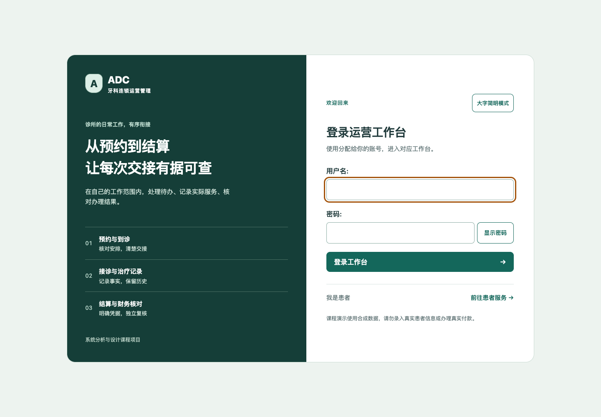

# UX1 登录与工作台更新

官方工作流学习 → 现有页面观察 → 常用操作前置 → 原生交互 → 多尺寸验证。

本轮已实现统一登录、深绿导航与清楚的工作范围；手机导航可展开全部功能，前台预约和患者入口、财务待审/对账/日结入口位于待办之前。沿用原授权、CSRF、工作上下文、预览签名和独立复核。

[调研与设计合同](../UI_UX_STUDY.md) · [60项真实浏览器检查与测量](acceptance.json) · [共同应用版本和交付](../evidence_r242/README.md)

同一1440像素合成前台的创建预约入口由约1577px提前到283px；这是入口位置，不是办事效率百分比。检查覆盖七角色、键盘、无脚本、320/390px、大字及200%文字；主要动作对比度6.73。尚无用户访谈或完整WCAG认证。

新版员工登录（空输入，无私有账号）：

[改版前](login-before.png) · [手机登录](login-mobile-after.png)

下一轮UX2将细化预约长清单、接诊和财务表单，并按实际使用反馈排序。

思维导图：范围清楚 → 常用动作 → 真正待办 → 详细模块 → 键盘/手机/大字 → 使用反馈。
