# ADC 牙科连锁运营管理系统分析与设计

患者服务入口与连锁门店协同 2026年10月24日

中 南 大 学

CENTRAL SOUTH UNIVERSITY

系统分析与设计

课 程 项 目 报 告

SYSTEMS ANALYSIS AND DESIGN REPORT

题　目  ADC 牙科连锁运营管理系统分析与设计

学生姓名  张加良

学　　号  8210241102

指导教师  毕文杰教授

学　　院  商学院

专业班级  信管 T2401

2026年10月24日

## ADC 牙科连锁运营管理系统分析与设计

## 摘　要

连锁牙科诊所的预约、接诊、治疗、结算和设备使用具有连续性，任何环节的信息脱节都可能造成重复预约、患者等待、费用争议或服务中断。本文以Andrew’s Dental Chain（ADC）课程案例为背景，面向一家约5至20家诊所的连锁机构，分析七类岗位的业务责任与交接关系。 连续诊疗进一步区分方案讨论、本人决定、实际执行和后续目标；复诊责任与加工件验收各有明确岗位及完成依据，避免把预约、联系或物理返回当成实际完成。 患者可以先按城市或主动定位查找门店，核对地址、电话、营业时间与服务后再登录；公开信息、账号通道及具体就诊人授权分别管理，保持预约与诊疗历史连续。

系统以患者服务过程为主线，区分电话咨询、完整患者建档、候选协商、明确确认和正式预约。网站与原生微信小程序从门店明确发布的服务出发，说明接诊范围、费用和到诊准备，再共用患者预约服务；本人或经核验的代约人选择就诊人后明确确认改期，保留原承诺与候补接受历史。科室开放、服务时长、医师出诊、椅位及必要设备统一核验；设备故障保留原承诺并进入责任协调。实际治疗、版本化账单、收退款、资金凭据、渠道对账和独立审核共同构成诊疗与财务闭环，取消分析进一步支持原因核实及改进措施复核。

研究采用用例驱动、领域关系和状态模型表达业务规则，以模块化结构、事务约束及追加式历史保持结果可追溯。课程合成场景覆盖跨岗位办理、资源竞争、授权隔离和数据恢复；统计指标说明分母与资料完整性。合成验证用于检验系统规则，不预设真实取消率下降或商业运营成效。

关键词  系统分析与设计；连锁诊所；预约流程；患者服务；财务管理；设备维护

## Analysis and Design of the ADC Dental Chain Operations Management System

## ABSTRACT

Dental-chain operations connect appointment intake, clinical care, billing and equipment availability. This report studies ADC as one chain of approximately five to twenty clinics and defines the responsibilities and handoffs of seven roles. Continuing care separates retained plan versions, exact patient decisions, actual performed work and follow-up goals. Attributed recall and cycle-specific laboratory review preserve existing appointment commitments. Patients can discover published branches by city or optional location before signing in. Public branch information, patient and staff login channels, and explicit patient authorization remain separate from resource commitments and retained clinical records.

Telephone consultation, complete patient registration, candidate negotiation, explicit consent and formal booking remain distinct. The website and native WeChat mini-program share patient booking services. Patients explicitly confirm replacements while original promises and accepted-offer history remain traceable. All booking channels check department hours, service duration, providers, chairs and required equipment. Equipment faults preserve existing promises and open accountable coordination. Actual treatment, versioned bills, independently reviewed cash entries and transaction reconciliation support traceable clinical and financial workflows. Published clinic offerings distinguish unknown fees from confirmed prices and continue into the same authorized booking workflow in both patient channels.

Use cases, domain relationships and lifecycle models specify observable outcomes and exceptions. Synthetic scenarios examine cross-role workflows, resource contention, authorization and recovery. Cancellation measures retain denominators and incomplete results. These findings validate course-system rules and do not establish commercial-scale capacity or real-world improvement.

Key words  systems analysis and design; dental chain; appointments; patient service; finance; equipment maintenance

## 目　录

## 第1章 绪论

### 1.1 项目背景与业务问题

ADC案例描述广东地区15家牙科诊所及三年内数量翻倍的扩张计划。管理者希望掌握各店服务质量、患者取消情况、牙医技能组合与经营表现，并以标准化业务资料支持管理决策。[1] 本项目据此选择一家拥有约5至20家诊所的连锁作为系统服务对象。

业务问题集中在五个方面：预约咨询与正式预约的界限不清，电话接待需要多次人工核对；患者对可用时段及变更结果不易掌握；接诊与实际治疗、账单和实收之间容易脱节；设备维护影响诊疗安排但缺少统一协调视图；经营报表能显示取消总量，却不足以解释哪些时间段、哪些原因需要优先改进。

### 1.2 研究目标与实践意义

系统以患者服务过程为主线，连接预约前咨询、预约确认、到诊交接、治疗记录、结算收退款及后续服务。业务人员应能知道下一步由谁办理、需要什么资料、成功后得到什么结果，以及失败时如何继续处理。

管理目标包括提高预约可解释性、减少重复录入与错误交接、保留资金和设备责任记录，并提供可核查的经营指标。业务价值以完整场景和可观察结果评估，不预设取消率已经下降、收入已经增长或系统已达到大型商业运营水平。

### 1.3 分析依据与研究方法

以课程案例和note讲义为理论依据。note 3强调需求应说明系统提供的服务、可被用户理解并具备可测试性；因此每项主要业务均描述参与者、触发、正常与异常路径及结果。note 5强调关注点分离、简单性与受限可见性；因此预约、临床、财务、设备各自管理本模块的业务规则，通过明确操作衔接。[3,5]

分析顺序为业务问题识别、现状流程建模、改进流程设计、用例和数据设计、场景验证。财务和统计部分同时运用会计核对与管理分析方法，将账单金额、实际资金、缺失资料和比例分母分别表达。流程设计中的岗位分工与资源规则属于课程方案，需要结合真实机构访谈进一步确认。

### 1.4 系统范围与报告结构

系统当前范围为患者服务、服务说明发布、电话及网站与小程序预约、到诊治疗、版本化结算、资金核对、候补排班、设备维护和经营分析。后续目标为同一连锁独立部署的完整门诊平台；临床监护同意、连续诊疗、临床签署及处方药事作为后续需求分别设计与专业验收。

第2章介绍方法与技术，第3章说明业务需求和流程，第4章给出系统设计，第5章讨论功能实现与业务测试，第6章总结设计并安排后续工作。附录提供63项编号业务用例和1项共享核验规约。演示采用合成资料，真实支付、保险申报及临床自动决策不在课程系统范围内。

表1-1 项目目标与可观察结果

| 目标 | 预期结果 | 主要核验对象 |
| --- | --- | --- |
| G1　资料一致 | 跨店复用患者编号，分别记录多过敏与多资格 | 档案关系与跨店查询 |
| G2　业务闭环 | 预约、到诊、实际治疗、结算及更正可以关联核对 | 状态、账单与历史版本 |
| G3　操作可理解 | 身份入口分离，唯一身份直达，手动引导不扩权 | 工作上下文与任务路径 |
| G4　结果可解释 | 缺失不等于零，指标带分母，收入只计当前版本 | 统计粒度与季度核对 |
| G5　协作可控 | 承诺、接收控制、任务与消息分开；已有安排不会被隐式撤销 | 候补、权限与异常响应 |

思维导图  业务背景 → {患者服务、岗位协作、经营核对} → 研究目标 → 范围与方法 → 六章分析设计。

## 第2章 相关方法与技术

### 2.1 用例驱动与业务流程建模

用例从执行者希望达到的业务结果出发，回答谁发起、为何办理、如何交互、何时成功和失败后保留什么。电话预约的咨询登记与正式预约分别建模，避免把一次询问误认为已有时间承诺；系统用例通过需求与测试追踪，连接用户可见行为和设计责任。[3]

业务序列说明不同岗位如何交接；活动流程突出选择与异常；领域模型表达患者、就诊、治疗、账单和资源之间的关系；状态机约束允许的业务变化。图示与文字规约相互补充，不能用页面清单代替完整业务流程。

### 2.2 多渠道访问与模块化结构

员工通过网站办理诊所业务，患者通过网站或原生微信小程序查询时段、预约、改期及候补。患者服务中心集中展示下一次就诊、待确认邀约和候补进展；两个渠道共用患者授权、排班资源、明确确认和保存结果。 门店主管明确发布患者服务说明；前台维护出诊，患者在选择时段前先了解服务范围与费用，服务介绍不等于治疗或收费。

系统采用Django、PostgreSQL和独立通知处理组件。模块化单体在同一事务边界中处理预约占用、治疗结算和资金审核，适合课程系统对一致性、可维护性和实施成本的要求。

### 2.3 信息隐藏与职责分离

接待模块管理沟通、责任及成约关联；排班模块管理服务目录、资源日历、方案与占用；临床模块管理实际治疗；财务模块管理结算、资金及审核；设备模块管理资产状态和维护。其他模块通过明确业务操作取得结果，不直接改写对方数据。[4-5]

职责分离也适用于岗位。经办人与独立审核人不能为同一账号；技术管理员维护账号和基础目录，不因此取得患者病历和财务审核权。

### 2.4 数据一致性与历史保留

通过事务、版本检查和资源锁保持关联结果的一致性。查询空闲不占用时段，提交预约时重新核对；改期失败保留原预约，成功后保留原记录及后继关系。实际治疗、已发布账单及已记账资金通过保留版本或追加记录更正。

患者取消、诊所取消、改期和爽约表达不同事实。资金申请、独立审核、实际记账、账内日结及渠道对账也分别表达状态，防止使用一个“已完成”掩盖不同责任。

### 2.5 场景验证与管理指标

业务测试以真实流程结果为依据。例如，预约确认产生唯一记录，治疗意向不进入收费，退款不超过可退余额，设备恢复需有独立验收。异常测试覆盖资源竞争、撤销权限、旧页面、重复提交和跨诊所访问。

统计分析同时展示期间、样本量、分子、分母及待核实数量。取消高发时段首先是需要调查的业务信号，不能仅凭比例推断原因，也不能用合成数据证明真实患者行为。

思维导图  分析方法 → {用例、业务序列、领域、状态}；设计原则 → {信息隐藏、职责分离、一致性}；评价 → {业务结果、分母、异常}。

## 第3章 系统需求分析

### 3.1 业务范围与现状分析

#### 3.1.1 业务边界与业务用例

业务边界仍取既有的“诊所服务与运营核对业务域”。患者和总部管理是该责任域的外部业务执行者；总部不因此成为ADC组织之外的机构。前台、牙医与财务是域内业务工人，既有载体及ADC系统按业务实体表达。业务用例描述对外价值，不表示菜单或操作顺序。（课件第85—89、93页）

图3-1  诊所服务与运营核对业务用例图（B01）

表3-1  业务用例及成果

| 业务编号 | 业务成果 | 主要协作 |
| --- | --- | --- |
| BU-01 | 获得就诊服务 | 前台、牙医 |
| BU-02 | 调整就诊安排 | 前台、主管 |
| BU-03 | 获取结算说明 | 牙医、前台、财务 |
| BU-04 | 获取运营核对结果 | 各店、牙医、财务 |

#### 3.1.2 现状就诊服务

图3-2  AS-IS预约、接诊与费用说明（B02）

本图根据案例描述重建现状业务情境。电话预约、患者资料、治疗计量及费用信息由案例支持；由前台向牙医协调、何时读取本店记录采用A1／A2假设。[1]

问题定位：跨店识别、时间协调和结算依据缺乏统一核对时，可能产生反复确认。此模型不证明旧系统每次出错，也不提供现状耗时统计。

#### 3.1.3 现状季度核对

图3-3  AS-IS季度资料归集与核对（B04）

案例明确要求按季度跟踪牙医收入、用品成本及运营费用，并提出总体激励基金比例。具体归集、汇总与缺失追问顺序采用A2／A3，不将补充流程冒充现场调研结论。[1]

核心风险是完整性不能由零散提交自行保证：未提交成本不等于成本为零，取得费用单也不等于已经收款。

### 3.2 系统总体目标与改进业务流程

#### 3.2.1 统一服务

图3-4  TO-BE统一就诊服务主路径（B03）

ADC系统在改进后的业务序列中是新增的业务实体；前台、牙医仍为业务工人。图中保留到店登记、专业诊疗及费用说明的责任区别；不展开软件内部边界类、控制类或SQL。图示以前台代办为主路径，患者自助遵守同等预约约束。（课件第87—89、108—112、314页）

冲突、未知过敏、无治疗关闭和重复完成分别见SU-04、SU-07、SU-08。预约意向不直接生成治疗或费用，系统不代替临床判断。

#### 3.2.2 季度核对

图3-5  TO-BE季度完整性核对及测算（B05）

财务维护、总部查阅分权。以当前有效结算单开单金额作为项目收入口径，按北京时间自然季度归属；先确认人员范围和成本，再形成测算。资料完整与资料缺失由alt片段表示为互斥分支。

对牙医d、季度q：P(d,q)=R(d,q)−C(d,q)−O(d,q)。总体P(q)为纳入牙医利润贡献之和；资料完整且P(q)>0时，F(q)=10%×P(q)。这是项目测算，不是法定财务净利润或个人奖金政策。有成本但无收入者仍需纳入，更正后只计当前版本。[1；项目设计]

#### 3.2.3 候补协同

图3-6  TO-BE候补、限时邀约与明确接受（B06）

候补登记与排程草案都不等于正式预约。主管发布后形成有期限的保留，由本人患者或取得明确意思的前台接受后才创建预约。接受、拒绝和失效在图中分别表达，不视为必然依次发生。

未启用资源控制的历史模式保留固定30分钟、有限候选最大匹配；已启用资源控制的诊所按服务时长、登记先后、可行时间和稳定资源顺序生成建议，不保证全局最优。患者短信、邮件和自动确认不在本阶段范围。邀约仍保留至发布后15分钟或预约开始的较早时点。

#### 3.2.4 责任协调

图3-7  改进后的出诊责任协调业务序列（B07）

前台先明确暂停新增，再协商并通过原业务流程处理；有阻断不得提交。只在提交与独立复核成立的分支进入后续维护。该TO-BE模型不声称新增了临床停诊或患者自动同意。

### 3.3 用户需求分析

七类工作台按当前身份及对象范围授权。一个人可以有多个授予的岗位，但一次只激活一个；切换身份不能自行审核。技术管理负责普通账号和基础目录，不因维护职责取得患者病历或财务审核权。

表3-2 利益相关者及职责边界

| 参与角色 | 核心工作目标 | 边界 |
| --- | --- | --- |
| 患者 | 预约、核对本人安排与费用、登记候补 | 仅本人绑定资料；不编辑治疗 |
| 前台 | 电话接待、患者档案、日周排班、出诊维护、候补发布、调班联系与到诊 | 仅当前店；保护原承诺，不审核治疗、资产验收或资金 |
| 负责牙医 | 复核信息、记录治疗、核对结算 | 本人负责的接诊；专业判断由人承担 |
| 诊所主管 | 资源规则、维修协调、独立复核与本店经营汇总 | 当前店汇总及独立复核；日常排班由前台办理 |
| 总部 | 全链汇总、季度核对与设备查阅 | 只读汇总；不代办财务写入或审核 |
| 财务 | 渠道账户、成本、资金及匹配复核 | 经授权办理；不同账号独立复核 |
| 技术管理 | 普通账号、基础资料登记、资格记录关联与安全处置 | 不默认获得临床或财务编辑权 |

### 3.4 需求清单与优先级

表3-3 需求模块与业务结果

| 模块 | 优先目标 | 受保护业务结果 |
| --- | --- | --- |
| 患者与临床 | 关键 | 稳定编号、到诊、过敏复核、实际治疗、明确结束。 |
| 财务与设备 | 关键 | 版本化账单、真实资金及凭据、独立复核、费用来源。 |
| 预约与服务 | 关键 | 患者明确确认，电话接待有责任，资源核对有依据，取消改期可解释。 |
| 排班与协调 | 重要 | 既有承诺保留、明确受理与复核、消息不代替业务事实。 |
| 经营与保障 | 重要 | 时段指标带分母与缺失，服务中断可识别，业务记录可恢复。 |

### 3.5 系统用例分析

#### 3.5.1 患者服务与接诊用例

系统边界为ADC软件。患者、前台、牙医和财务等作为执行者分别达成目标，每次工作上下文只激活一个身份。实线箭头表示功能交互，include表示共享核验，不表示业务的时间先后。

图3-8  患者服务与接诊系统用例（S01）

SU-04包含SF-01，表示提交预约必须执行共享核验；患者在SU-05中仅取消本人允许取消的预约，前台还可办理本店改期与爽约核实。共用椭圆不代表角色具有相同权限。

#### 3.5.2 候补 财务与运营用例

图3-9  候补协同、经营核对与标准目录用例（S02）

SF-01与图3-8为同一共享子功能。SU-16仅接受分支复用占用核验，拒绝无需创建预约；SU-10要求不同账号审核，不允许同一账号切换角色自批。SU-23财务可维护、总部只读。取消与创建是不同目标，不滥用extend表示时间先后。

#### 3.5.3 身份 引导与安全用例

图3-10  公共能力、结果核对及账号安全用例（S03）

SU-01—25及SF-01规约见附录A；SU-26—38见附录B。各用例表示独立可接受的用户目标，不用用例间箭头表达业务办理顺序。原始用例编号保持稳定，新增关系只在规约支持时引入。

#### 3.5.4 资料与出诊维护用例

图3-11  资料与出诊维护系统用例（S04）

角色来自实际业务交互，不因技术管理身份而扩大临床或财务权限；用例之间不以时间先后建立include。详见附录B的SU-26—30。

#### 3.5.5 责任协调与通知用例

图3-12  责任协调与站内通知系统用例（S05）

前台和主管分别承担受理与独立复核；两者均可查看本人的当前范围消息。通知后台属于内部实现机制，不冒充业务执行者。详见SU-31—38。

### 3.6 用例清单与业务完整性

系统共定义82项编号业务用例和1项共享核验。附录A为SU-01—25及SF-01，附录B为SU-26—38，附录C为SU-39—82。电话接待关注咨询与联系，SU-04关注正式成约；网站和原生微信小程序是预约、候补及改期的渠道路径，不按页面数量重复计数。

表3-4 用例分组及业务目标

| 业务范围 | 编号 | 使用者目标 |
| --- | --- | --- |
| 身份与资料 | SU-01—03、21—23、25—28、64—67 | 账号、患者资料、基础目录、专业审核与限定转诊。 |
| 预约与接诊 | SU-04—10、19、29—33 / SU-39—40、54、57—63 | 预约、变更、到诊、治疗、结算与资源核对。 |
| 候补与协作 | SU-13—17、24、31、34—38 | 候补、邀约、任务办理、独立复核及消息。 |
| 经营与引导 | SU-11—12、18、20、41、55—56、81—82 | 成本利润、取消分析和操作协助。 |
| 资金与对账 | SU-42—49、53 | 渠道、收退款、凭据、流水、对账及日结。 |
| 设备维护 | SU-50—52 | 资产、维修责任和独立验收。 |

分组交叉列出的协作用例只计一次。每项规约说明触发、前置、交互、替代路径、成功结果、最低保证和验收目标；待实现设计在规约和第5章明确标注。

### 3.7 业务规则与非功能性需求

表3-5  业务规则汇总

| 编号 | 规则内容 |
| --- | --- |
| BR-01 | 身份与范围：有效授权、当前激活身份、诊所及对象范围共同核验。唯一身份也须正式激活；切身份清旧店，切店不改身份。 |
| BR-02 | 资料：跨店复用患者编号；电话不是唯一身份。未知、已确认无已知过敏及具体过敏条目分别保存。 |
| BR-03 | 时间与占用：开始早于结束；处于有效出诊时段；同一患者或牙医的有效预约与邀约保留不得重叠。 |
| BR-04 | 状态：已预约、已到诊、治疗完成、无治疗关闭、取消、爽约、改期替代分别处理；普通编辑不任意回退终态。 |
| BR-05 | 结算历史：实际治疗为计价依据；逐行舍入至分后汇总；闭合就诊恰有一张逻辑结算单，历史版本不原地覆盖。 |
| BR-06 | 更正与季度：仅允许范围内的数字更正，独立审核；缺失不等于零，只计当前有效账单版本。 |
| BR-07 | 候补：每患者同时最多一条有效候补；未来14天连续窗口，至少容纳30分钟；邀约有效且经明确接受才建预约。 |
| BR-08 | 排程：最多60条需求、80个出诊块、200个候选格；只对枚举图最大匹配；草案超过15分钟不得首次发布。 |
| BR-09 | 引导：页面与步骤来自维护目录；不自动点击或提交；外部模型可选，不将“下一步”当作业务成功。 |
| BR-10 | 指标：按Visit而非治疗行计数；未来、改期替代、诊所取消与待核实分别列示；零分母显示N/A。 |
| BR-11 | 账号：目标状态、操作者和权限重新核验；普通停用遵守业务交接，紧急安全封禁按BR-15独立处理。 |
| BR-12 | 目录：标准单价变化不回写已存治疗快照和历史结算；财务维护、总部只读。 |
| BR-13 | 结果：沿选定候补—邀约—预约关联核对；区分曾转换成功与当前预约状态；查询失败不推断原办理失败。 |
| BR-14 | 只读模式：按经审核的路由与操作语义放行受限查询，不将所有POST等同写入；任何业务写操作仍受限。 |
| BR-15 | 安全封禁：立即停止受控普通账号访问并使原凭据失效，不等待未闭合业务、不自动取消预约；恢复先重置再启用。 |

令t为服务器核验时刻，s为候补最早可开始时间，e为最晚必须结束时间。候选代码采用s>t、e−s≥30分钟、e≤t+14天。跨多天窗口表示一个连续可接受区间，不表示每天重复的时段。合法偏好仍不保证存在匹配资源。

表3-6  关键边界决策

| 条件 | 规范结果 |
| --- | --- |
| s=t、e≤s或不足30分钟 | 指出对应字段，不保存候补。 |
| 首次接受时t≥截止时刻 | 拒绝首次接受，不创建预约。 |
| 已接受后再次提交 | 先核验当前权限，再返回既有预约，不因旧期限已过重建。 |
| 收到请求但回执丢失 | 查询已有结果；不能自动重复办理或断言未保存。 |
| 有未来业务但账号疑似泄露 | 允许受控安全封禁，保留业务；后续交接另行核验。 |

表3-7  质量要求及验证方法

| 编号 | 可测试要求 | 证据方法 |
| --- | --- | --- |
| NFR-01 | 关键事务无部分生效，重复接受只关联一条预约。 | 真实PostgreSQL独立连接竞争、失败注入及前后数据核对。 |
| NFR-02 | 320／390px及桌面主要动作可达；键盘与文本错误提示可用。 | 真实模板、浏览器、键盘和辅助技术检查；无AI普通流程仍可用。[15] |
| NFR-03 | 直接URL、POST、撤权、旧上下文及受限查询均不得越权。 | 角色—对象—范围正反矩阵；不能只查菜单。 |
| NFR-04 | 指标带分子分母，邀约带期限，核对结论带读取时点。 | 固定样本独立计算和字段核对。 |
| NFR-05 | 升级保留历史，备份能够恢复；公网配置单独验收。 | 隔离空库恢复、登录与金额核验；归档可读不等于恢复成功。 |
| NFR-06 | 性能目标与已测能力分开；预约、接诊及财务办理分别测量，复杂分析与导出另行记录。 | 以可重复的预约、接诊和财务工作负载测量正常请求p95及失败率；五店已测，二十店规模仍需业务代表性验证（第5、6章）。 |

可测试性、异常响应与维护可读性来自课程要求的规格属性；上述具体指标为项目自定目标，不是教师额外评分线，也不是当前已测结果。[3]

### 3.8 电话预约与患者自助预约

电话接待先记录来电者、与患者关系、待核实联系方式及服务、日期和医师偏好。咨询阶段不占用资源，也不授予病历访问权。新患者成约前完成姓名、出生日期、账单地址、联系方式和紧急联系人等既有建档要求；老患者按完整业务编号核对，不以手机号自动合并。过敏状态允许未知，仍由接诊人员复核。

前台核对预约服务及其总时长、科室开放、接收医师、诊室椅位和必要设备，向患者解释可行组合。复述诊所、服务、医师和起止时间，记录患者明确同意后再次核验并保存预约、资源占用与接待关联。查询不保留时段，冲突时重新协商，不擅自更换安排。

联系未果和待回复均保留有效负责人、下次期限及沟通历史；无资源、拒绝方案或联系未果分别记录未成约原因。需要候补时先核实完整档案和可接受时间，接受原邀约后关联同一成功预约。接待已成约事实保留，后续取消与改期显示原预约的关联结果。

网站患者通过已绑定账号选择服务、日期和医师，系统核对可行资源组合，患者无需选择设备编号。本人未开始且仍为已预约状态的预约可在本店、同一服务的未来十四天内改期；原新医师、时间和时长均须明确复述并确认。患者可以使用本人同店同服务的有效候补邀约替换原预约，接受邀约和替换一并完成。查询不占位，确认失败保留原约；另行取消才进入取消原因跟进。待就诊与历史清单分开，当前结果和人工联系入口可查询。小程序已实现分配账号登录、服务查询、预约、改期、取消、候补登记与邀约办理，网站可查询同一结果；需人工协调时联系原店前台。公开自注册、微信身份自动绑定及微信支付不在当前范围。

患者网站和小程序先展示门店已发布且接诊配置有效的服务，包括适合需求、包含内容、限制、费用和准备事项。未知费用保持待评估，不显示零元。服务选择跨登录保留，儿童代办先交前台核验；撤下公开说明不撤销已有预约。

表3-8 电话预约接待及交接流程

| 步骤 | 办理责任 | 业务动作与交接结果 |
| --- | --- | --- |
| 受理与识别 | 患者／前台 | 登记来电者与患者关系、待核实联络及服务偏好，建立有责任的接待单。 |
| 需求澄清 | 前台／医护 | 区分初诊、复诊与服务意向；专业问题转交医护，明确预计时长依据。 |
| 可用性核对 | 前台／系统 | 按服务时长核对科室开放、医师、诊室椅位、必要设备及有效邀约暂占。 |
| 协商候选 | 前台／患者 | 提供可选方案，说明诊所、医师、时间及需准备事项；不合适则改选或登记候补。 |
| 复述与确认 | 前台／患者 | 复述最终安排并取得明确同意；最终提交重新检查占用，只生成一条正式预约。 |
| 交付与后续 | 前台／患者 | 交付编号及查询、取消、改期途径；联系未果保持待联系，不默认为同意。 |

图3-13 电话预约接待与最终确认的业务序列

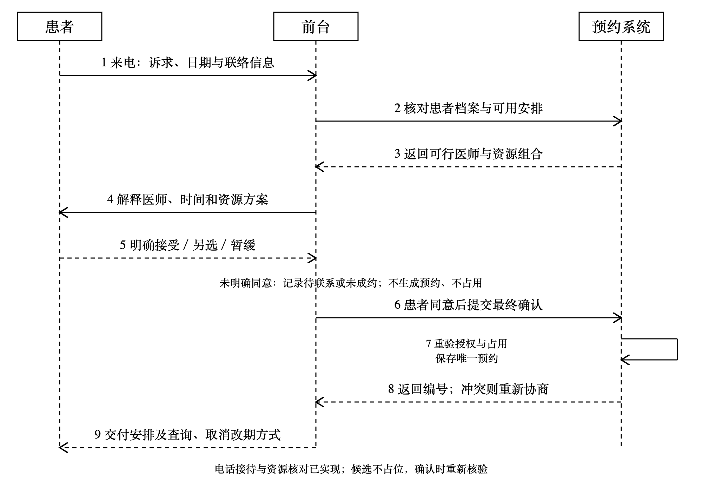

接待、完整建档、服务及资源核验、明确同意与最终成约分别办理。图中查询候选不是占用；同意后仍须重检资源，接待与成约结果一并关联。

图3-14 患者自助改期与候补替换的业务序列

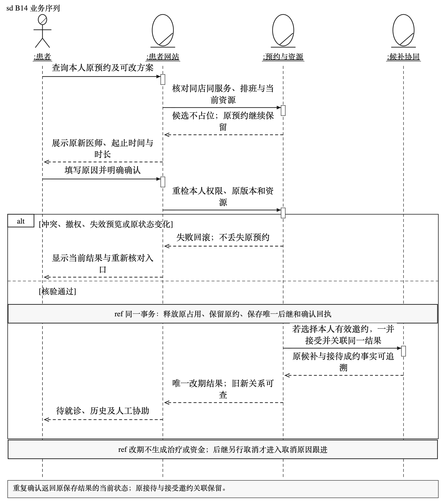

患者选择与明确确认分开；原预约在确认成功前保留。统一资源核验、唯一后继、确认回执及必要的邀约接受在同一事务保存。真正取消仍通过原取消及原因跟进流程办理。

### 3.9 取消时段分析与业务改进

按诊所、预约开始日、星期和开始时间段观察成熟预约。默认时间段为08:00—10:00、10:00—12:00、12:00—14:00、14:00—16:00、16:00—18:00、18:00—20:00，其他时间单列；以北京时间计算，区间左闭右开。未来预约和改期前身不进入成熟结果分母，改期前身另列数量。

沿用现有运营口径：A为到诊，P为患者取消，C为诊所取消，N为已核实爽约，U为到期未核实。患者行为分母D=A+P+N，患者取消率=P÷D，爽约率=N÷D；诊所取消单列。补充整体取消率=(P+C)÷(A+P+C+N)，不得与患者取消率混称。完整性=(A+P+C+N)÷(A+P+C+N+U)。分母为零显示无法计算。

分析同时显示每格分子、分母、待核实、诊所取消和改期数量；D不足30或完整性不足95%的格标注样本不足或待核实，不列高风险排行。30与95%是本课程的展示规则，不能代替统计显著性。对比应先在同店、相近服务与同类日期内进行，再解释预约提前天数、取消提前量及原因。

原始取消发起方和文字说明保留，前台追加核实后的分类、联系结果、责任人和期限。分类包括行程、遗忘或联系、费用、诊所或医师调整、其他和未提供；历史无凭据保持未提供。取消时点只从明确取消事件读取，缺失时提前量未知。已经取消的预约保持原状态；“已另约”必须关联同店同患者通过正式流程产生的有效预约。

主管针对同店星期和开始时段建立措施，保留完整原窗口快照、负责人及期限。负责人开始执行、说明实际办理并提交，另一位主管核对完整后续窗口和执行依据，可退回补充、确认样本不足、标注不可比或记录变化待观察。后续窗口不得早于最近执行开始日，且必须在查询当日以前完整结束；不能把执行前资料或未结束日期作为改进效果。

待联系和待回复必须安排下次期限，逾期提示核实；联系人授权失效时可重新分配。取消分析不自动创建预约、发送患者通知、调整排班或更改费用。实际联系采用已获同意的现有渠道，不能把记录联系结果等同于外部消息已送达。

表3-9 预约取消问题与改进措施

| 业务信号 | 建议措施及责任 | 复核结果 |
| --- | --- | --- |
| 患者忘记或行程冲突 | 前台按患者联系偏好提醒；网站提供便捷取消与替代时段；患者明确确认。 | 核对实际联系结果和关联另约；联系率、改期保留率尚未作为独立指标交付。 |
| 诊所或医师临时变更 | 主管核查停诊和排班原因，先协调既有预约，再调整未来接收；提供替代医师或时间。 | 单独核对诊所取消、通知及时性和患者接受的替代安排。 |
| 临近开始才取消 | 前台征询符合条件候补患者；说明时限并由患者确认，不直接替补。 | 核对释放时段、有效邀约、成功补位及重复预约情况。 |
| 数据待核实或样本过少 | 前台核实原结果；主管延长完整观察期，保持预设分组口径。 | 保留原分组与样本量，不将偶然高比例解释为规律。 |

### 3.10 财务收退款与费用核对

结算单来源于负责牙医确认的实际治疗。已开单金额、应收余额、已记账收款和退款分别展示。前台按账单提出收款或退款申请，允许一张账单多次付款；财务以不同账号复核，只有通过并记账的记录改变现金事实。

资金凭据记录本店渠道账户、参考编号和经办信息。渠道流水先导入预览再确认，保留原始字节和规范化结果；已记账资金与流水按同店、账户、币种、方向、金额和凭据编号逐笔核对。日结负责账内交接，渠道对账负责外部凭据核对，两项状态并列，次日结算不强行改变原业务日期。

表3-10 财务闭环与异常处理

| 业务事项 | 正常结果 | 异常处理 |
| --- | --- | --- |
| 分次收款／退款 | 每次保留独立申请及审核；余额来自当前账单和已记账资金。 | 超额、同账号审核、来源变更或授权撤销时拒绝并重新核对。 |
| 凭据补充／更正 | 追加独立复核的凭据版本，保持原资金不变。 | 过期预览拒绝；凭据更正使受影响匹配失效并保留历史。 |
| 流水导入／逐笔对账 | UTF-8、最多2MiB及1,000行；确认后逐笔提议和独立复核。 | 重复明确提示；无效或冲突批次不接受流水；组合款和手续费列为差异。 |
| 日结与迟到事实 | 分别核对收款、退款、设备支出及冲回四类总额。 | 后续资金变化提示重核，保留旧版本，不用对账动作自动记账。 |

### 3.11 设备维护与诊疗安排衔接

设备送修或退役立即影响新增可预约性，并依据实际资源占用列出受影响预约和有效邀约。系统保留原承诺，前台明确领取联系责任及期限，不能把送修等同于已通知、已改期或已取消。

同店、同医师、同时间的兼容资源可经前台预览确认替换，并保留原方案及依据；改变医师或时间须取得患者同意后走原改期流程。患者拒绝或未能联系时保留原预约及待办；取消另行记录发起方和原因。

到诊再次核对设备、位置、停用及实际使用状态。上一患者仍使用椅位或设备时，不能重复接诊，前台进入明确协调。治疗中故障由医护人工处置并记录，不自动搬迁患者、顺延预约或改变治疗状态。维修恢复继续要求另一主管独立验收。

### 3.12 患者关系核验与代约办理

家庭协助就诊时，实际操作账号与就诊患者可能不同。前台先按本店已有患者档案受理关系，记录关联人、关系类型和待核实事项；账号可稍后补充。系统不根据相同手机号、姓名或联系人资料自动合并患者，也不凭咨询记录开放患者资料。

具有本店关系核验职责的前台核对身份、账号归属与关系或委托依据，记录内部依据编号、核验时间和责任人。父母、监护人或患者委托人可获有明确有效期的本店预约代办授权；普通亲属及联系人记录不产生访问权。预约代办与临床知情同意分别办理。

患者网站和小程序均显示本次就诊人及本人或代约身份。切换就诊人后须重新核对原表单；可在授权店查询、新约、改期、取消和办理候补。授权暂停、撤销或到期后阻止新的代办，已承诺预约仍保留，由前台继续联系协调。

### 3.13 专业范围与跨店诊疗协作

医师身份、资质证据和操作授权分别管理。主管整理本店资质来源、依据、期限和服务范围，由受机构委任的另一医师独立审核查阅、记录及转诊动作；对象及整理人不能切换身份自审。技术人员登记审核职责，不因此取得病历权。

原负责医师明确接收店、指定医师、期限、披露同意和具体发布版本。接收店获明确职责的前台核对现有患者编号；不一致时保留待澄清，不按同名或同号合并。指定医师接收后才开放所选内容。

本人可在网站和小程序终止披露，代约人没有临床披露权。资质到期、撤权或离岗停止受限操作，原约、署名和发布历史保留并显式交接。

### 3.14 健康自述与实际检查记录

患者本人在网站或小程序补充既往健康、目前用药和过敏自述，区分尚未明确、自述有相关情况和自述目前无已知情况。每次提交保留来源、经办账号、时间及前版，不能覆盖原自述，也不自动改写已经复核的过敏资料。预约代办权限不包含临床自述。

负责医师在实际到诊后建立本次检查，引用本人提交或本店面谈取得的具体自述版本，分别记录主诉、检查、核对结论、差异及仍未知事项。恒牙、乳牙和混合牙列使用同一牙位、牙面规则；未记录的部位不推断为正常。

草稿保存在服务器，切换患者后旧表单不能继续办理。两页同时编辑时保留本页文字，先比较当前已保存内容，再明确继续；重复提交不重复新增。确认版本须重新核对自述和草稿，更正另建带依据的版本。检查记录本身不生成实际治疗、账单或收退款。

### 3.15 连续诊疗与后续责任

医师基于已经确认的检查形成跨次就诊方案，区分工作草稿、确认版本及稳定步骤沿革。步骤分别记录服务、牙位牙面、目标、估算、互斥选项、计费时点和加工依赖。费用未知保持未确定；互斥方案分别讨论，不相加为承诺价格。

患者本人可以通过网站或小程序认可、暂缓或不选择某个具体版本步骤。新版方案必须重新核对，预约代办不包含方案决定。实际执行另行核对本次就诊、已提供项目、位置、数量及实际时间；计划估算和本人表态都不产生治疗或资金。

复诊要求由医师明确服务、建议窗口、临床目标及完成标准。前台承接责任、内部跟进期限和联系事项，关联经资源规则形成的正式预约。本人暂不继续时转医师核对；预约、到诊、部分治疗或接通电话不能代替实际完成依据。

### 3.16 加工件送返、验收与原约保护

医师针对当前已接受的具体步骤登记加工类别、临床要求、原需要日期与前台送返说明。前台认领协调责任，手工记录送出、返回、延误和交接凭据。原需要日期和既有预约保留，延误须明确协调，不自动取消、挪动患者或顺延承诺。

加工件返回后由具有相应服务记录范围的医师核对适配，分别记录通过与返工。返工进入新的送返周期；方案换版后沿用加工件也须明确核对新版步骤。物理返回不等于临床验收，缺少依赖信息不能自动判定为无需加工。

前台查阅安排、期限和交接投影，医师查阅临床规格及验收详情；主管和总部只查看状态与逾期汇总。加工件全部满足本周期和具体步骤要求后，实际执行才能继续确认；这一准备状态本身不生成收费。

### 3.17 公开找店与按需登录

患者首次进入网站或小程序时，可以浏览已发布门店和服务，按城市、区域或名称筛选。主动授权位置后按由近到远排列，直线距离仅供估算；拒绝或无法定位时仍能继续选择。门店显示明确地址入口、电话、每周营业安排与已确认的临时说明，营业中不代表该时段一定可预约。

患者选定服务后才进入患者登录和就诊人选择，继续查询原服务候选并明确确认。患者与员工采用独立登录入口，服务器限制该通道可激活的岗位；同一人有多个岗位也不在患者小程序切换员工权限。待选服务不是授权，登录、查询和就诊人选择本身都不创建预约。

公开资料只包括门店、服务及必要出诊参考，不披露患者、内部停用依据或员工私有联络信息。位置在客户端用于排序，不记录精确位置轨迹。微信账号、核验手机号、患者本人身份和关系授权继续分别办理，不以昵称、手机号或定位推断患者身份。

思维导图  实际患者问题 → {找店、身份与关系、接待排班、检查方案、复诊加工、收退款、设备} → 岗位和可观察规则 → 异常继续 → 用例验收。

## 第4章 系统设计

### 4.1 领域关系与状态模型

领域关系分为诊疗结算、接待成约及资源占用三个主要视图，状态模型分别说明就诊、接待及资源协调。端点数字为关联多重性；图中为主要业务对象，不穷举全部数据表。咨询、资源占用、实际治疗与资金分别记录。

图4-1 诊疗与结算的核心领域关系

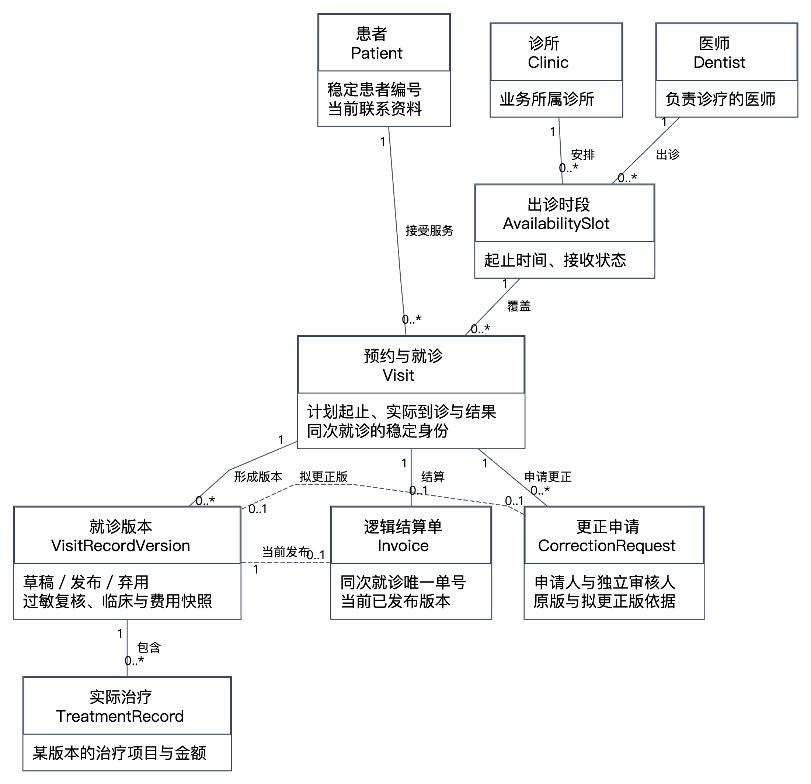

一个患者可有多次就诊，每次由一个出诊时段覆盖；就诊保留诊所与医师引用并核对一致。每次就诊可形成多个记录版本，每版包含实际治疗；同次就诊至多一个逻辑结算单，指向当前发布版本。更正保留原版、拟更正版及独立依据。

图4-2 电话接待与唯一成约的领域关系

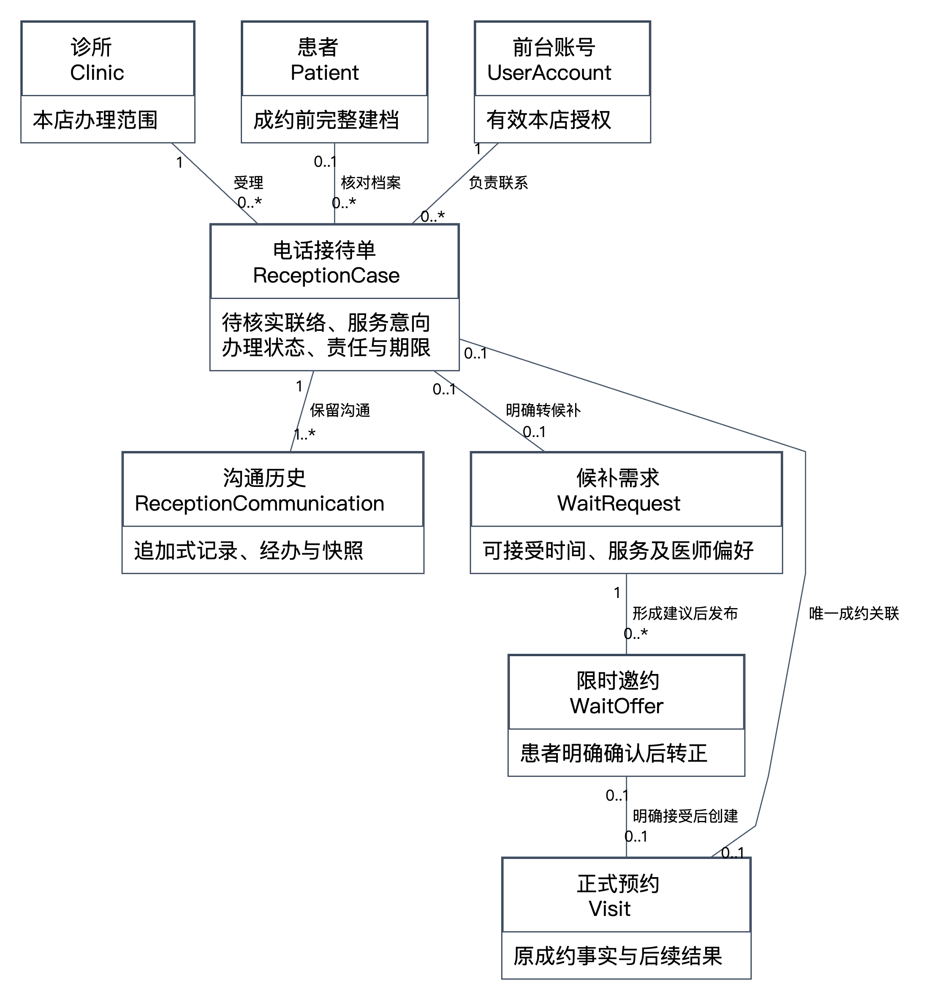

接待单属于一个诊所，咨询阶段可以没有患者关联；成约前须完成建档。每次沟通只追加，责任与期限可追溯。接待可以直接成约或转候补；候补接受后关联同一成功预约。接待的已成约事实不因后续取消或改期而改写。

图4-3 服务配置与资源占用的领域关系

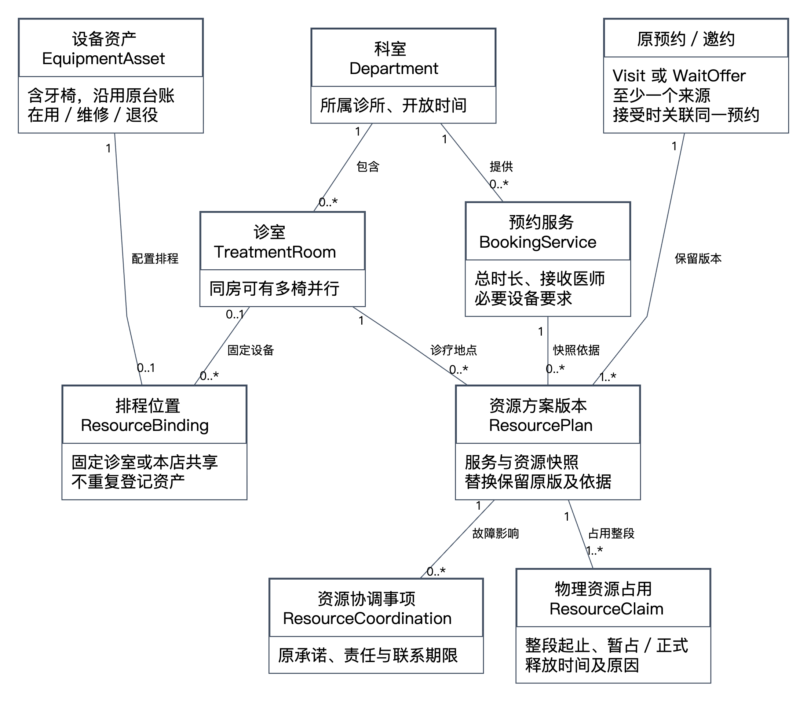

设备资产通过排程位置确定固定诊室或本店共享；牙椅不重复建账。预约服务定义时长、医师及必要设备，资源方案保留当时快照，整段占用通过明细约束。来源框是预约与邀约的业务引用组合，不是新增来源表；接受邀约时原方案关联同一预约，替换时追加新版本。

图4-4 预约与就诊状态及业务守卫

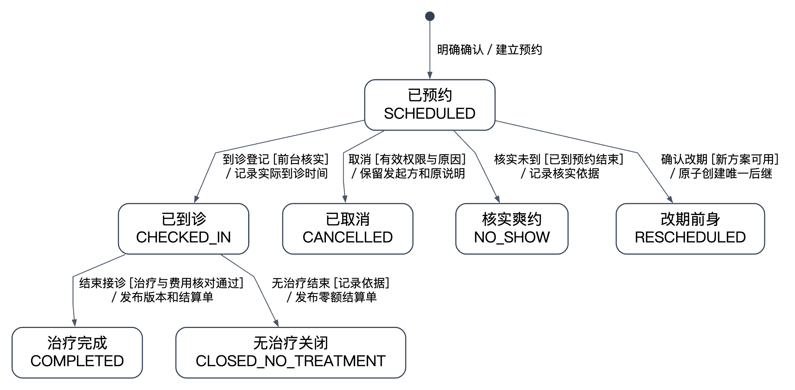

箭头采用事件、条件及业务动作表达。到诊后才能完成治疗或无治疗关闭；取消、爽约和改期各有依据。改期在同一事务保留原终态并创建唯一后继；治疗后的更正通过版本和独立申请办理，不倒退就诊状态。

图4-5 电话接待的办理状态与成约条件

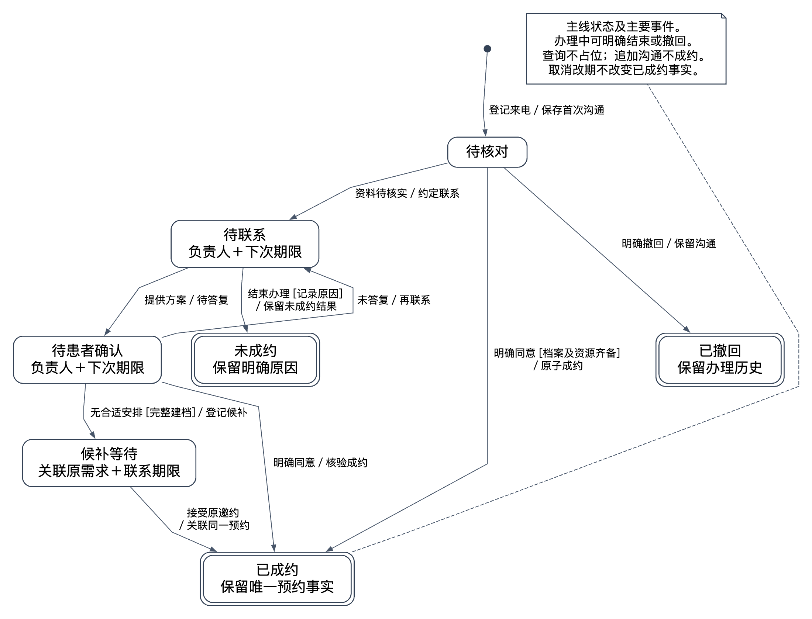

图示为接待主线及主要事件。办理中可追加沟通、重新核实、明确结束或撤回；待联系、待确认和候补等待必须有有效责任及期限。电话成约须完整建档与明确同意；候补成约关联原成功结果，不另建预约。结束状态保留事实。

图4-6 资源故障协调状态与原承诺保护

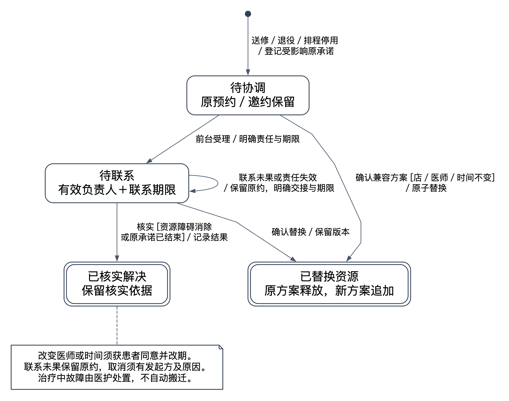

资源故障不自动取消预约。前台明确联系、兼容替换或核实解决，重复提交不重复替换；医师或时间变化须取得患者同意并改期。到诊仍在使用或设备不可用时不能重复接诊，治疗中故障由医护处置。

图4-7  候补请求状态机及迁移条件（M01）

本状态机只描述候补请求。迁移按“事件[警戒条件]／动作”表达；初始点表示该对象的缺省状态，不是整项业务流程的开始。OFFERED不保证邀约尚有效；到期阻止首次接受，执行回收后才恢复等待。BOOKED保留历史转换事实，后续取消发生在就诊对象上。（课件第339—345、350页）

### 4.2 模块职责与接口合同

图4-8  模块化单体的职责与代表性依赖（A01）

表4-1  模块责任与接口边界

| 责任模块 | 公开合同 | 必须隐藏或隔离的决定 |
| --- | --- | --- |
| accounts／workspaces | 核验身份、激活角色、选店、治理账号、校验上下文 | 授权存储、会话及修订机制；不得由模板自行授权。 |
| scheduling／coordination | 预约、变更、候补登记、建议、发布、接受 | 占用与锁协议、状态转换；各入口不能复制冲突逻辑。 |
| care／finance | 实际治疗、结算、更正、季度核对 | 价格快照、当前版本、成本完整性及计算粒度。 |
| guidance／assistants | 手动指南、受限结果核对、可选意图分类 | 模型输出不决定权限；纯规则不依赖网页布局或外部API。 |
| operations／查询层 | 授权范围内指标与事实读取 | 分母、缺失、期间及查询时点；不改业务状态。 |
| notifications | 事务内记录派发意图、个人收件箱、显式已读和有限重试 | 原收件授权与当前权限、去重与重试；消息不驱动任务状态。 |

图4-8是责任视图和代表性依赖，不是穷举的源代码导入图。功能与数据应并行细化，模块间联系应尽量少、明确且有序；拆分文件本身不能证明低耦合。[4-5]

### 4.3 结果核对与只读模式

图4-9  候补结果核对的分析序列（X03）

图4-9是SU-24的分析责任视图：边界类处理输入输出，控制类分配协作，领域对象判定授权和准确关联。前台路径换用前台接口并核验本店范围。它不是源码调用图；核对不得改写业务记录，会话与日志属于另一层。（课件第287、314—320页）

只读模式按业务副作用控制写入，允许经过授权的结果核对。查询仍需有效身份、诊所和对象范围；读取结果只表示当前时点，不构成后续预约的占用承诺。

放行查询不等于放行所有POST，不采用宽泛路径前缀。HTTP方法和业务副作用是两个不同维度；查询成功仅反映读取时点，不能锁定后续可用性。

### 4.4 账号安全封禁与业务退役

常规停用要求先处理未闭合业务，以保护业务连续性；但疑似凭据泄露时继续允许访问会妨碍安全处置。SU-25因此将安全访问控制与业务责任交接分离；技术人员只能对受控普通账号操作，不开放自操作、技术账号或超级用户目标。

图4-10  账号安全访问状态及分阶段恢复（A02）

表4-2  安全控制与业务连续性分离

| 操作 | 凭据与访问 | 既有业务 |
| --- | --- | --- |
| 常规业务停用 | 检查未闭合工作；不满足条件则拒绝 | 必须先明确处理或交接。 |
| 紧急安全封禁 | 停用账号，原凭据设为不可用；使旧上下文失效 | 不取消预约，不删除角色绑定，不转移治疗责任。 |
| 受控密码重置 | 设置新凭据，但仍保持停用 | 资料和历史保持原值。 |
| 再次明确启用 | 复核后恢复登录；旧会话不因启用自动复活 | 业务交接仍独立办理。 |

管理操作要求操作者重新验证密码、填写依据、核对目标签名，并对紧急封禁作专用确认。账号、工作上下文与审计在同一事务内更新。密码变更和会话失效策略参考框架机制，但本项目身份与数据库约束须经测试验证。[11-12]

封禁不撤销提交前已完成的事务，不清除浏览器已显示的信息，也不自动把患者交给另一位牙医。只读实例不执行封禁写入；技术／超级账号仍需离线受控维护。

### 4.5 设计原则在本项目中的应用

关注点分离体现在业务查询与写入、安全封禁与业务退役、预约意向与实际计费的区分。信息隐藏体现在授权、占用、结算和结果解释由小接口承接易变规则。简单性要求首先修复可复现的问题，而不以新增微服务或求解器替代验证。上述均为课程原则的项目应用，不是讲义指定的技术栈。[4-6]

质量评价覆盖核心业务完整性、权限、重复提交、回滚及历史金额。公开服务和更大规模需要独立验证，不能仅凭模型或功能数量作出结论。

### 4.6 协调与通知的数据责任

图4-11  出诊、任务和通知的概念关联（D02）

补充类图仅展示新增关系；类分栏与端点多重性区分归属。源审计唯一、事件与原授权消息去重等约束由数据库和业务测试验证。既有患者、治疗和账单关系仍见图4-1。

### 4.7 任务状态与独立复核

图4-12  协调任务状态机（M02）

研究对象为CoordinationTask；任务状态不能代替出诊、预约或消息状态。终态作为历史保存，不把对象的初始点解释为整个业务流程的开始。（课件第339—345、350页）

### 4.8 多渠道预约与接待记录设计

接待单独立于患者档案和预约。待核实联络、服务及日期偏好、责任人和期限构成当前办理资料；每次登记、核实、联系、交接及结束均追加沟通记录和当时快照。修正咨询联络不自动更改患者联系档案，原资料仍在历史中可查。

接待状态包括待核对、待联系、待患者确认、候补等待、已成约、未成约及已撤回。待联系事项有有效前台负责人和期限；授权失效时明确重新分配，保留交接依据。已成约单保留原成功事实，后续取消或改期在预约模块办理。

电话成约原子保存预约、资源占用和接待关联；失败不留下部分结果。网站与小程序共用本人绑定授权、候补登记及邀约处置。接受时明确选择新增预约或替换指定原约；拒绝继续候补，退出撤回未确认邀约，均不自动取消原约。重复提交返回当前结果，不恢复已退出记录。

前台查看本店个案及沟通文字；主管和总部仅取得对应范围的数量及逾期汇总。接待关联不扩展病历访问范围，联系人与临床文字不进入运行日志或总部汇总。

患者服务说明与预约服务一对一关联，接诊目录和患者文案分别管理。主管经预览、确认发布后才能供新预约选择；确认时按签名内容与当前资源重检。患者就诊需求进入本人预约，不作为已完成治疗，也不进入运行日志。公开说明下架不阻断原预约的合法查询、改期或既有邀约处置。

### 4.9 科室和诊疗资源设计

本店主管维护科室、每周开放区间、诊室、临时停用、预约服务、接收医师及必要设备。服务时长为15至240分钟、按15分钟递增，包含准备与周转；预约服务和收费项目分别管理。牙椅复用设备资产，不另建重复台账；一间诊室可有多椅，独占诊室仅配置一个椅位。

固定设备只能服务于所属诊室，共享设备可在同店调配。所有必要资源按完整预约时段占用。临时邀约保存暂占及到期时间；明确接受后原子转为正式占用，拒绝、撤回、到期、取消或改期分别记录释放。到期暂占不会依赖人工回收而持续阻挡新约。

出诊、患者、医师及物理资源使用统一锁序，物理设备按主键排序；数据库排斥约束拒绝重叠有效占用。确认重检当前授权、目录版本、设备状态和占用。预约与邀约保存当时服务时长及资源快照，目录修改不重写历史，资源替换另存版本。

诊所先进入资源核对，暂停新增成约和邀约并保留旧承诺；现有预约与有效邀约逐项核实资源后启用。未提供的历史科室、来源及设备保持未提供。新资源候补按登记先后、可行时间先后和稳定资源顺序生成有界建议，不保证全局最优；原固定30分钟算法保留历史适用边界。

### 4.10 资金与设备的协作合同

临床模块发布实际治疗版本，结算模块据此生成逻辑账单及版本；资金模块保存收退款申请和独立审核；凭据及对账模块解释资金的外部依据。账单更正不直接生成退款，对账完成不直接确认收款，设备维修成本也不直接成为设备支出。

设备维护工单关联送修事件、负责人、提交人与验收人，费用关联具有来源的维修或资产事件。费用更正与资金冲回分别保留历史，既有独立审核规则继续适用。

### 4.11 取消分析的数据与查询设计

运营模块拥有取消聚合、原因跟进及措施办理；预约模块继续拥有预约状态和资源确认。统计先限定授权诊所与开始日期，按北京时间分组，以就诊主记录计数，避免联接多个治疗明细放大分母。跟进只关联原取消预约及可选正式另约，不改动原预约、治疗或资金。

原因跟进保存当前联系结果与责任期限，办理历史保存每次核实快照。改进措施保存原窗口、执行记录、后续窗口和独立复核；历史只追加，数据库禁止改写或删除历史。两种业务对象不共用状态机，历史记录必须且只能归属其中一种。

所有变更先预览再明确确认；确认重新核对当前身份、诊所、授权、源对象版本与统计快照，过期、授权撤销或资料变化均需重核。重复确认返回已办理结果，并发办理仅产生一次效果。主管和总部读取汇总，患者身份及联系文字仅供当前店前台办理，权限不由菜单是否显示决定。

图4-13 取消跟进与改进措施的领域关系

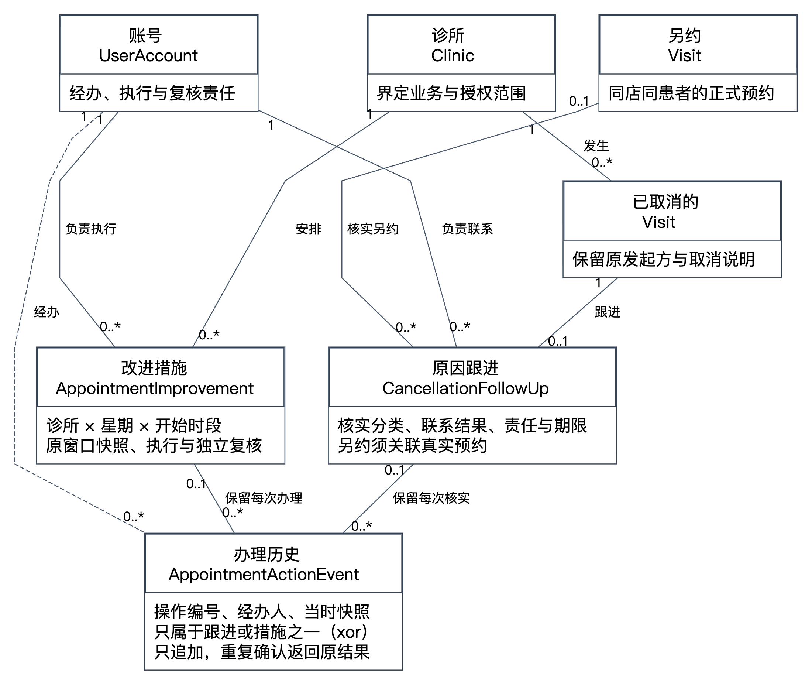

每个取消预约至多一个当前原因跟进，可引用正式另约；措施按诊所、星期和时段建立，不占用患者资源。每条办理历史只能属于跟进或措施之一，不能覆盖原预约和统计事实。

图4-14 改进措施状态与独立复核

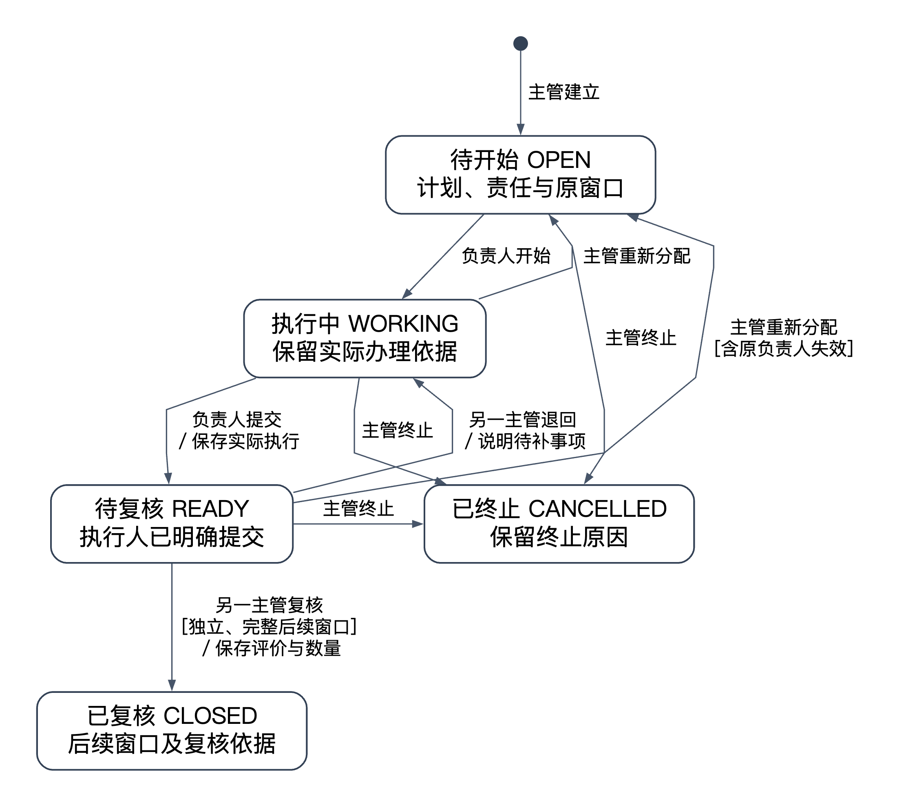

执行与复核采用不同账号；后续观察窗口完整结束且不早于最近执行开始日。样本不足、不可比和变化待观察分别记录，不把统计变化当作措施的因果效果。

### 4.12 权限、审计与服务连续性

身份和诊所范围在每次业务操作中分别核验。独立审核检查真实账号，角色切换不能自审；患者仅能访问本人绑定资料。重要变更保留经办、时间、原因及前后关联，便于解释预约和资金结果。

通知处理与业务提交分离，消息失败不撤销已成功的预约或资金事实，消息已读也不等于业务已办理。服务监测和备份恢复支持故障定位与数据连续性；具体部署和运行记录置于项目运行文档，业务报告仅讨论其对服务结果的影响。

### 4.13 数据库实体关系设计

数据库按业务责任分成十八个真实关系视图。独立PostgreSQL实际观察103张表，含102张ORM业务与框架表及1张迁移日志，共993个ORM字段；284条普通外键及1条账单同次就诊复合外键共285条。新增门店公开资料及发布版本，保留原诊所身份、患者、诊疗与资金历史。领域关系、真实ER及状态模型分别解释责任、主外键与生命周期。

PK表示主键，FK表示外键，UK表示单列唯一，问号表示可空。关系端点采用乌鸦脚记法：双竖线为恰好一个，圆圈加竖线为零或一个，圆圈加三叉为零到多个。条件唯一、状态与时间规则在图后单独说明。

方案及检查的患者与诊所从原就诊推导，避免重复维护归属。方案步骤保留发布时的项目单位、服务名称、科室和时长；历史未登记定义与加工依赖保持空值。条件唯一、追加历史、完成依据和当前有效占用分别由实际数据库约束及对应业务命令核验；JSON快照不伪画为外键。

#### 4.13.1 预约与电话接待

图4-15 预约与电话接待数据库ER图

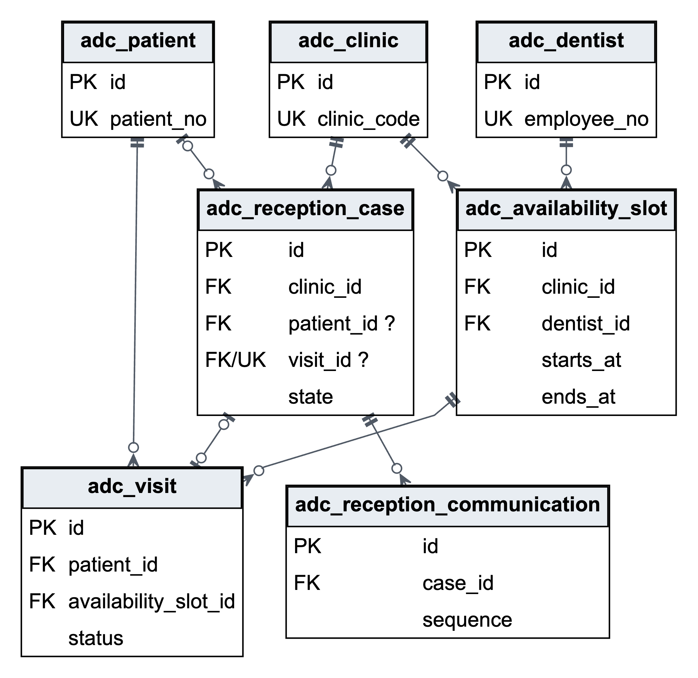

接待可以尚未建档；visit_id唯一且可空，沟通按case_id与sequence保留历史。诊所与医师等未展开外键见字段目录。

#### 4.13.2 排班服务与医师适配

图4-16 排班服务与医师适配数据库ER图

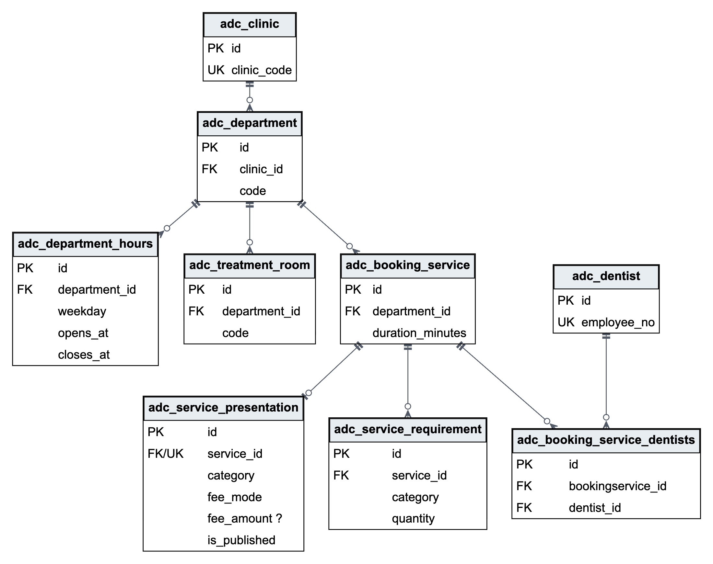

服务与医师的多对多关系通过真实连接表实现；科室开放与医师出诊分别保存。每项预约服务至多一份患者说明，未建立、草稿或不完整说明均不公开；费用说明不生成账单。

#### 4.13.3 设备位置与资源占用

图4-17 设备位置与资源占用数据库ER图

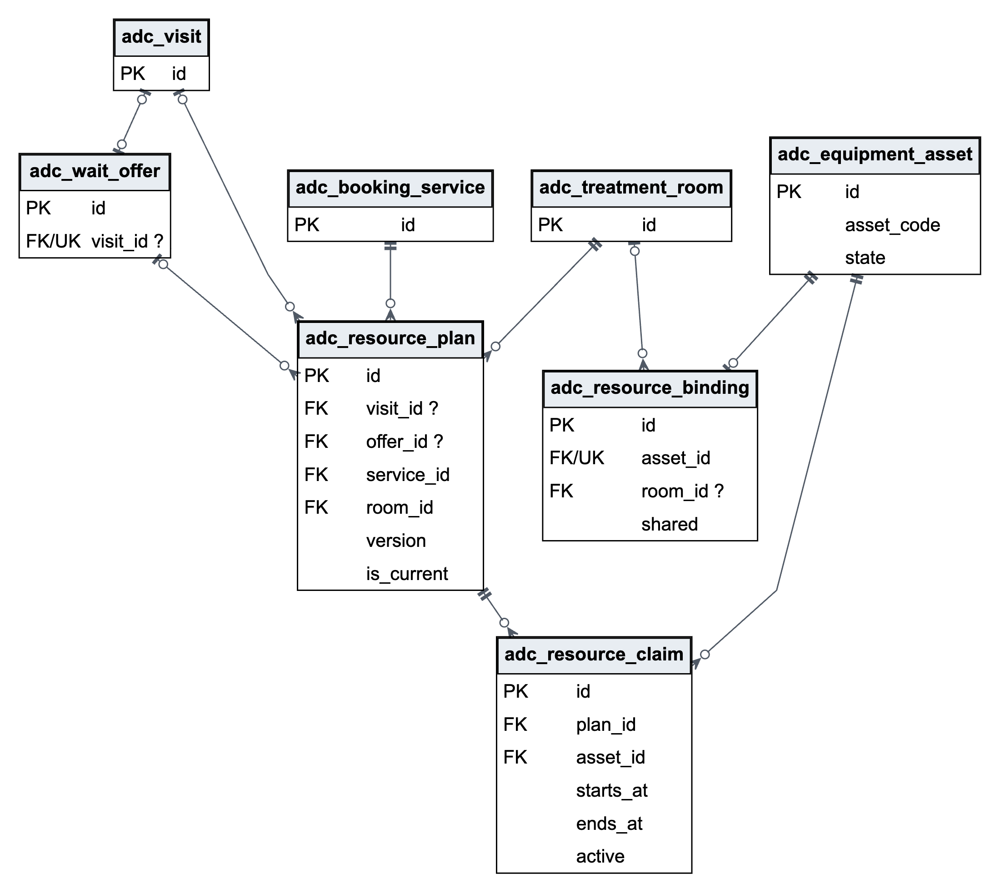

方案必须引用预约或邀约，接受邀约后允许两者同时存在；每个来源至多一个当前方案。牙椅使用设备资产，每项有效占用受时间排斥约束保护。

#### 4.13.4 诊疗结算与资金凭据

图4-18 诊疗结算与资金凭据数据库ER图

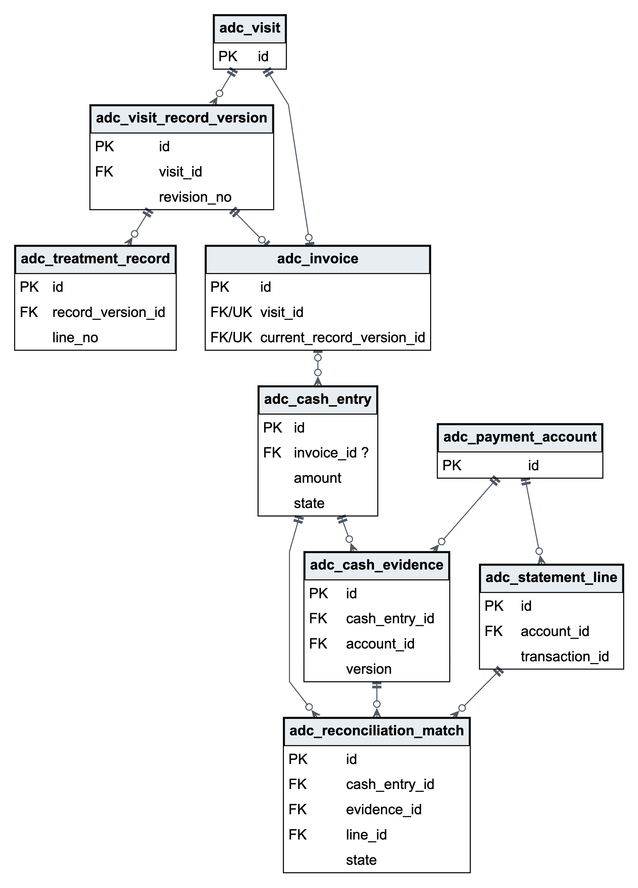

每次就诊至多一个逻辑账单；账单另有复合外键保证当前记录版本属于同一次就诊。凭据与匹配保留多次历史，活动匹配的唯一性由条件约束限定。

#### 4.13.5 前台排班与调班责任

图4-19 前台排班与调班责任数据库ER图

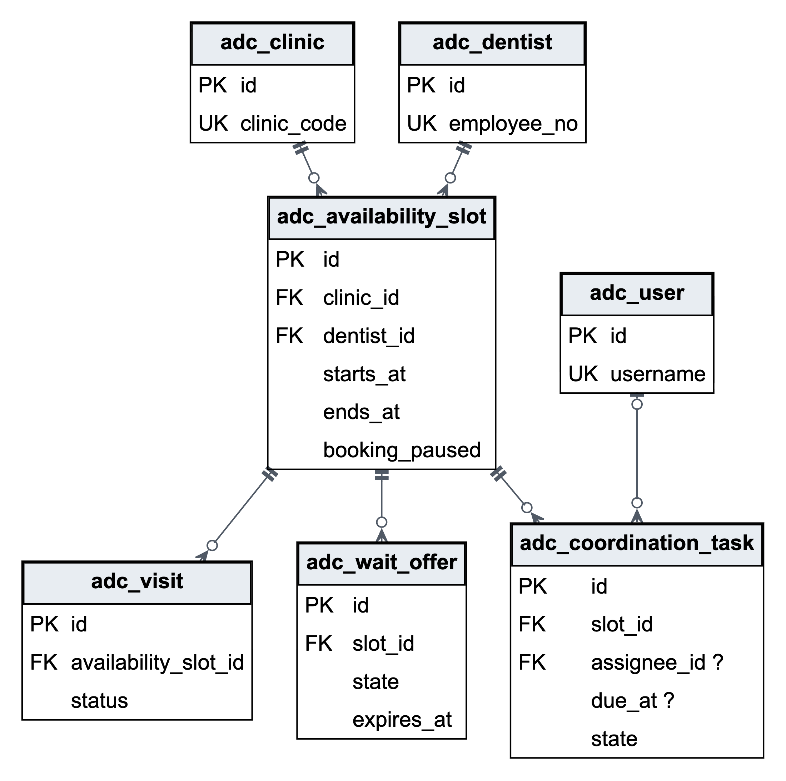

出诊是医师供给，预约与有效邀约是承诺；协调任务经slot_id归店，assignee_id可空，due_at历史可空。每个出诊至多一个活动任务；独立复核与具体预约变更另行办理。

#### 4.13.6 患者授权与预约改期来源

图4-20 患者授权与预约改期来源数据库ER图

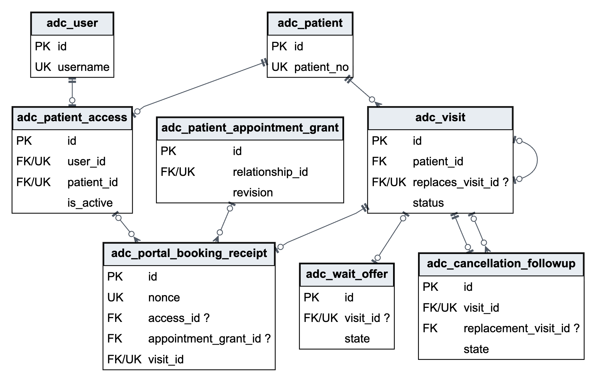

本人绑定保留；预约确认回执必须且只能引用本人绑定或预约代办授权之一，nonce唯一，visit_id唯一。预约自引用可空且唯一，构成原约与后继。邀约和取消跟进保留各自原关联，不因后续改期改写；当前患者、本店代约范围和活动状态由事务命令核验，不能从外键推定权限。

#### 4.13.7 患者关系核验与预约代办授权

图4-21 患者关系核验与预约代办授权数据库ER图

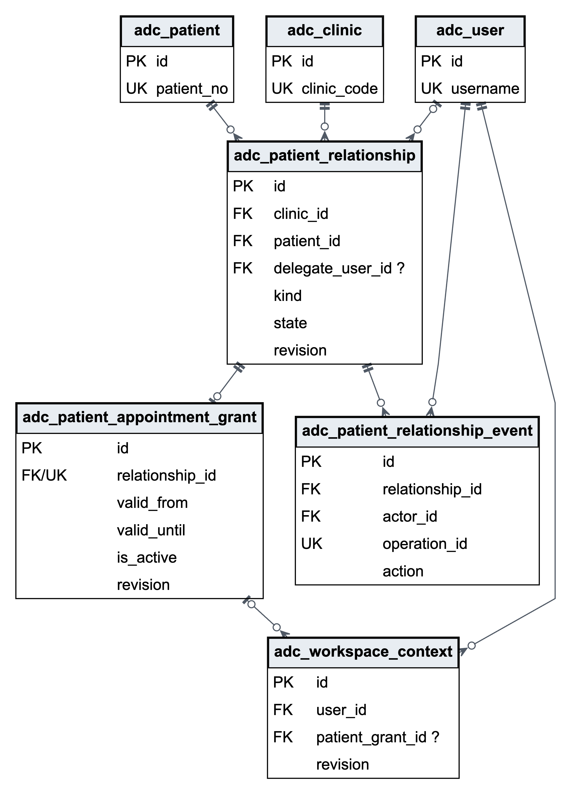

关系属于患者及核验诊所，账号可在待核验阶段补充。每项关系至多一项预约授权；联系人和普通亲属关系不生成授权。决定事件仅追加，operation_id唯一。上下文可选一个授权，本人入口保持空；有效期、当前账号与本店范围由事务核验，不从外键连线推断病历、资金或临床同意权限。

#### 4.13.8 专业资质来源与限定操作授权

图4-22 专业资质来源与限定操作授权数据库ER图

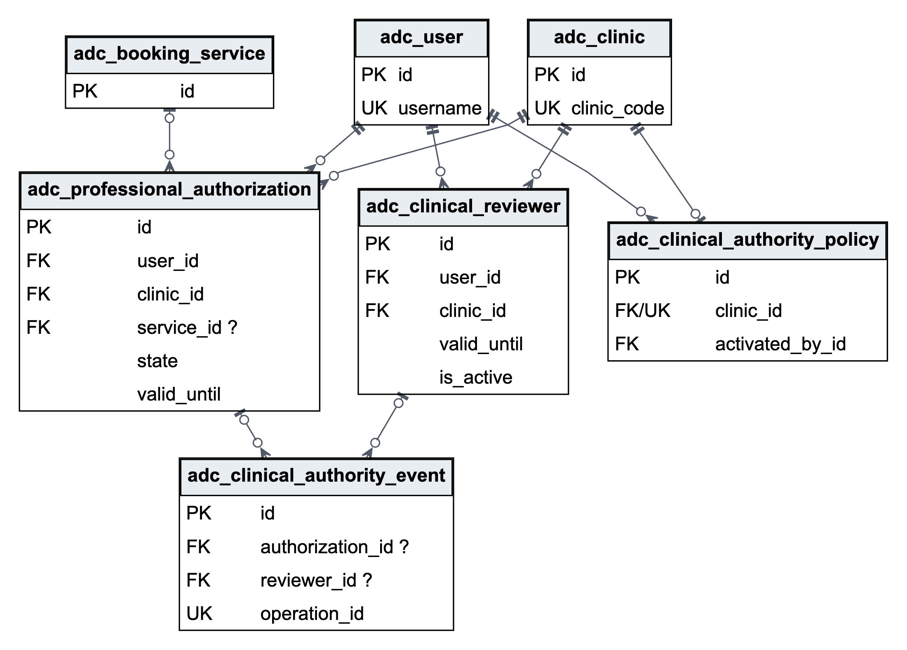

审核职责按账号与诊所唯一；机构委任不等于病历访问。专业申请分别引用账号、诊所和可空服务；空服务仅指无服务旧记录，不是全服务通配。决定历史及诊所启用事实不可改写。图中仅展开关键外键，来源证据、有效期及查阅／记录／转诊动作见完整目录与命令核验。

#### 4.13.9 限定跨店转诊与敏感查阅留痕

图4-23 限定跨店转诊与敏感查阅留痕数据库ER图

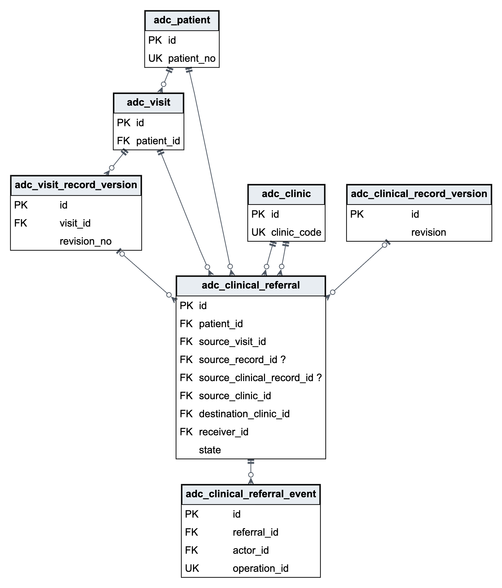

转诊保留原患者、原就诊、转出／接收诊所及指定医师。来源可不选，选择时至多引用一个旧发布版本或结构化检查确认版本；必须属于同次原就诊。后续更正不改写已选择的版本。身份核对、临床披露同意和医师接收分别办理。查阅事件的object_kind/object_id为受控类型与对象编号，不是虚构外键。其余来源及有效期在完整目录保留。

#### 4.13.10 患者自述来源与医师核对

图4-24 患者自述来源与医师核对数据库ER图

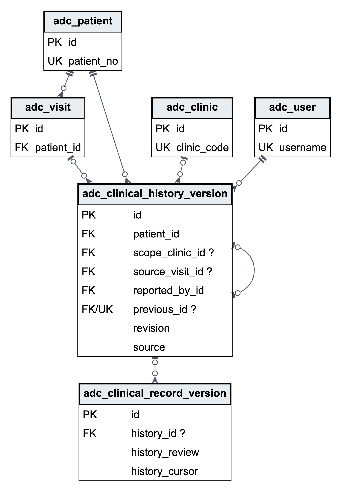

本人提交不归属某次预约或诊所；医师面谈引用实际就诊及当前诊所。患者与来源诊所及版号组成唯一键，空诊所也参与唯一性；各来源分别追加版本。检查记录可引用一个已核对的具体版本，并保留核对结论、差异和可见来源游标。自述不覆盖已复核过敏资料；外键不授予跨店查阅权限。

#### 4.13.11 实际检查、草稿与确认版本

图4-25 实际检查、草稿与确认版本数据库ER图

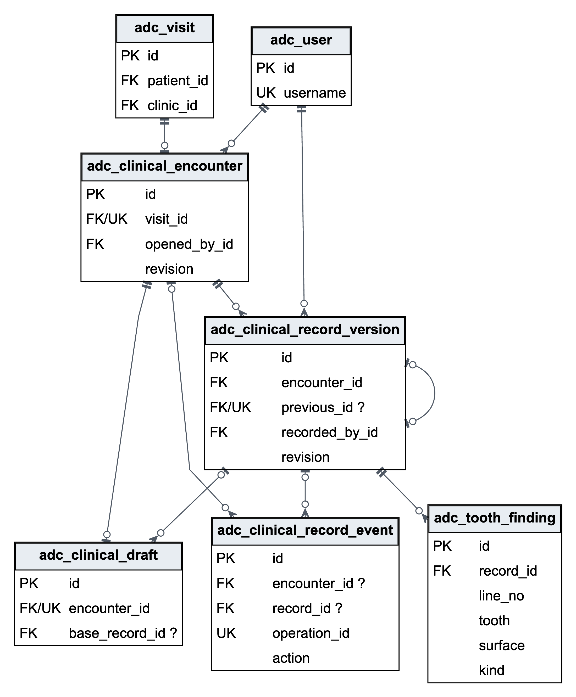

每次实际到诊至多一个检查头，患者与诊所经原就诊推导，不重复维护。每个检查头至多一个可修改草稿，base_record可空；确认版本按检查头和版号唯一，前版引用可空且唯一。牙位观察属于具体确认版本，草稿观察尚在有界工作载荷中。确认版本、观察及决定事件只追加，草稿可明确放弃。检查记录本身不是治疗执行或资金事实。

#### 4.13.12 跨次就诊方案与保留版本

图4-26 跨次就诊方案与保留版本数据库ER图

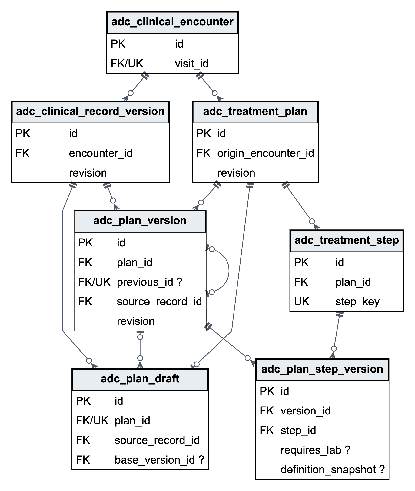

患者与诊所经原检查头及就诊推导；不重复维护患者归属。工作草稿可修改，确认方案和步骤版本保留历史。稳定步骤只表达沿革，不能把旧版本人决定或加工验收当作新版授权。目录定义与时长保留发布时快照，旧记录空值表示未登记，不补造历史。

#### 4.13.13 具体方案步骤与本人决定

图4-27 具体方案步骤与本人决定数据库ER图

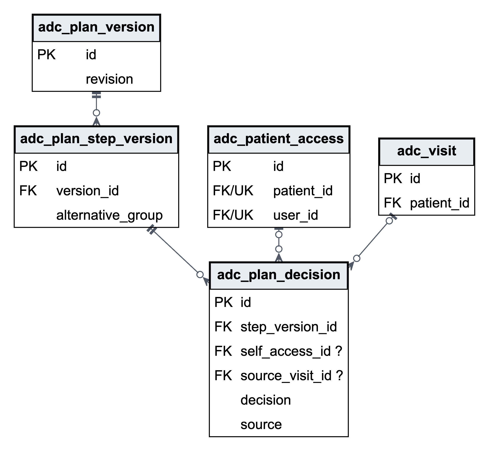

每次决定绑定具体步骤版本。本人网站决定引用本人PatientAccess，医师手工登记的讨论决定引用本次就诊，来源二选一；这不是手术知情同意签署。代约授权不授予方案或病历访问。互斥组不能同时形成两个已接受的当前选择；所有决定只追加。

#### 4.13.14 实际执行、原始开单与账单版本

图4-28 实际执行、原始开单与账单版本数据库ER图

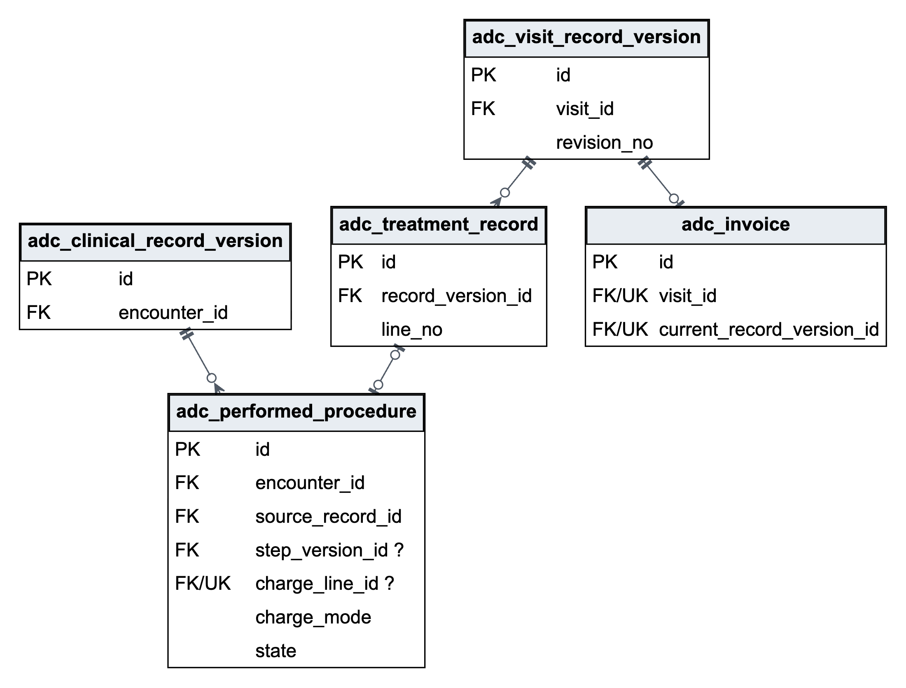

实际执行可引用计划内步骤，也可明确登记计划外依据。原始收费行至多归属一个实际执行；审核后的账单版本副本不生成第二次执行。原开单快照保留在实际执行JSON中，不伪画为外键。完成时计费方案的中间阶段可不另收费，但仍属已治疗；未发布作废保留原执行与快照，已发布执行不能作废。

#### 4.13.15 医师后续要求与原预约关联

图4-29 医师后续要求与原预约关联数据库ER图

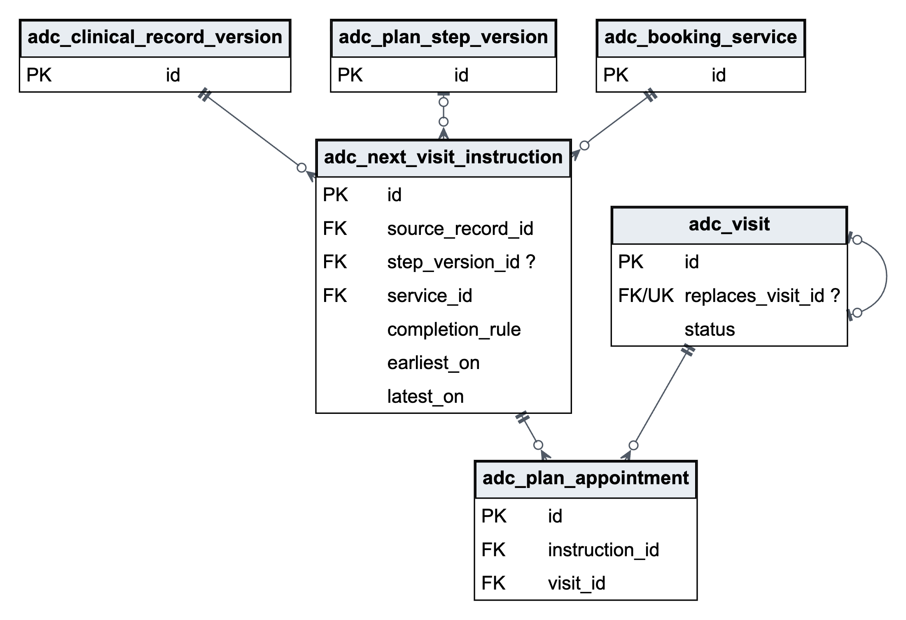

后续要求保留原检查、具体步骤、服务、建议窗口和完成标准；前台只读取安排所需投影。先经统一资源规则成约，再明确关联原预约；改期沿唯一后继关系跟踪，取消不代表复诊完成。一次部分治疗关闭后，如未达到明确完成标准，可以继续安排。历史未登记完成标准的记录保留未明确状态。

#### 4.13.16 复诊责任、沟通与实际完成依据

图4-30 复诊责任、沟通与实际完成依据数据库ER图

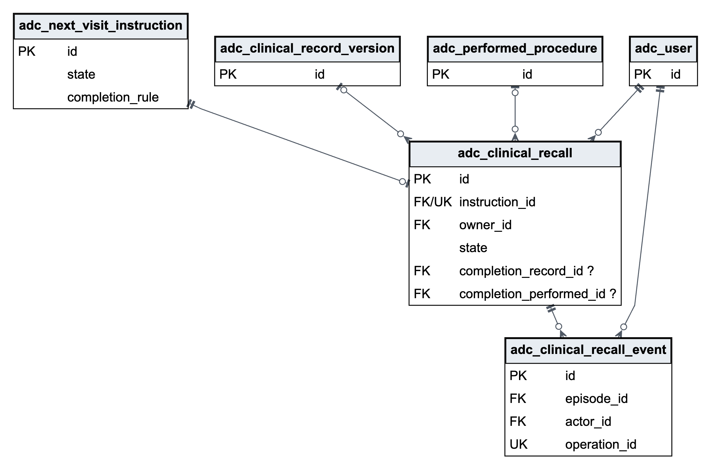

一条后续要求至多一份随访责任，状态、负责人和期限变化追加事件。完成时仅选择同患者、同店、同服务且明确关联的已关闭后续就诊事实；确认检查或指定步骤完成依据二选一。晚于建议窗口如实记录，不改原日期。患者暂不继续转医师核对，未经明确恢复不重复对外联系，也不自动取消预约。

#### 4.13.17 加工请求、物理送返与具体版本验收

图4-31 加工请求、物理送返与具体版本验收数据库ER图

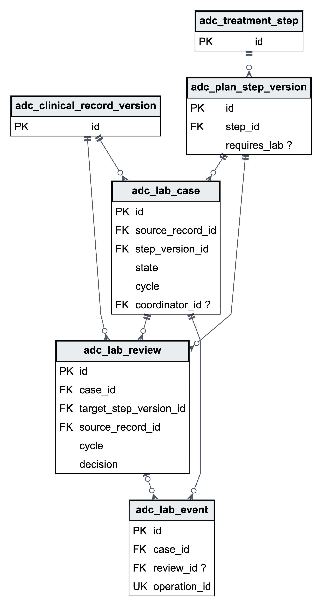

医师请求绑定原确认检查及已接受具体方案步骤。送出、返回是手工交接事实，不代表临床适配；每次返工须经过新送返周期。验收绑定本周期及当前确切步骤版本，跨版本复用必须重新明确核对。前台不读取加工临床规格或验收详情；原需要日期与预约保留。只在所需加工件全部有效验收后允许相应实际执行，不自动产生收费。

#### 4.13.18 门店公开资料与发布历史

图4-32 门店公开资料与发布历史数据库ER图

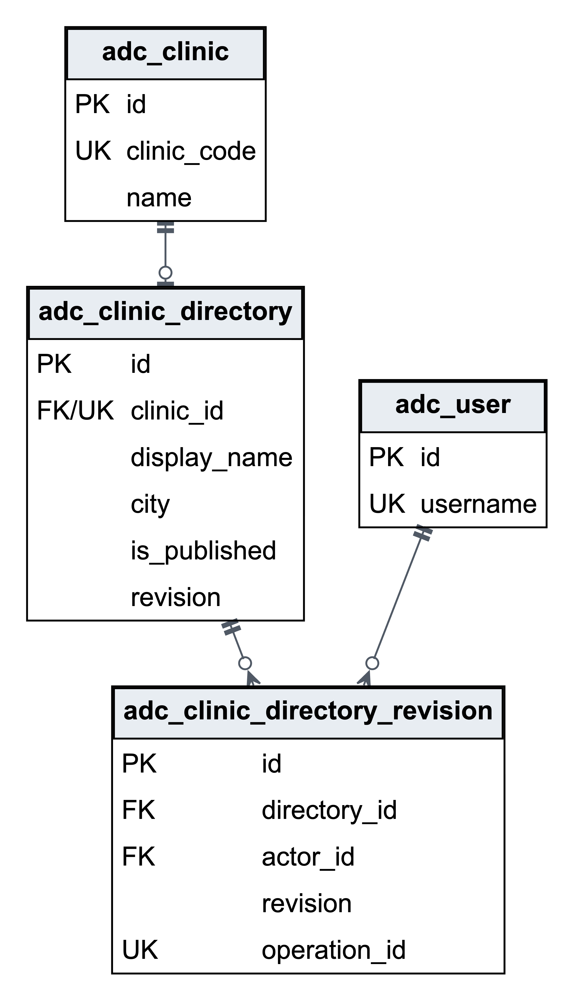

每家诊所至多一份当前公开资料；业务名称和既有单据身份不随公开别名改写。发布版本按资料及版号唯一，操作编号唯一，历史只追加。营业时间由科室开放和明确停用区间推导，不在资料中重复维护；WGS84排序与GCJ02导航坐标分开，坐标缺失保持未知。外键不授予岗位权限。

### 4.14 前台排班的职责与数据设计

日常排班由前台负责，包括医师出诊登记、未来空闲时段调整、停诊、暂停及恢复新增接收、候补建议核对与邀约发布。前台按当前店及已确认的医师工作安排办理，不因排班职责取得治疗、资产验收或资金审核权限。

主管维护科室、服务及设备等供给目录，并对需要独立复核的例外结果负责；正常日常排班无需主管逐条代办。已有预约或有效邀约时先由前台联系协调，未取得同意保留原承诺。

日周排班复用医师出诊、预约、邀约及资源占用事实，按本店、日期与医师筛选；有效邀约计入暂占，到期邀约显示待回收，接受后只计算正式预约。服务组合核对科室开放、完整时长及椅位设备；实际在诊超时另行提示，不将计划结束视为椅位已释放。

调班协调由前台核对依据、暂停新增并发起，明确受理人及下次跟进期限。联系未果保留原约，改变时间或医师须取得患者同意并另走原流程；无阻断后提交另一账号主管复核。复核通过后仍由前台明确维护出诊，任务结束不自动停诊或恢复接收。

数据库追加协调期限和按店、开始时间及邀约状态查询的索引。跨表约束检查设备绑定与停用对象同店、服务与诊室同科室、预约及邀约来源一致、资源占用与原承诺完整区间一致；旧记录不补造期限，历史时间和资金事实不改写。

表4-3 排班与资源的岗位分工

| 职责 | 目标办理岗位 | 业务边界 |
| --- | --- | --- |
| 日常出诊与候补排班 | 本店前台 | 核对工作安排、供给与承诺；明确确认，不自动代患者接受。 |
| 资源目录和供给规则 | 本店主管 | 维护科室、服务、医师适配及设备；修改不重写历史。 |
| 例外结果独立复核 | 另一获授权主管 | 保留原有独立复核；不成为每次日常排班的新增审批。 |

### 4.15 实际操作人与就诊人的分离设计

患者关系、预约授权与核验历史由患者入口模块负责。原本人绑定保留，每项关系属于患者及核验诊所；经核验的关系至多关联一项预约授权。决定事件追加保存操作人、依据和授权快照，数据库禁止更新或删除既有事件。

工作上下文保存当前所选授权和版本；本人入口不引用代约授权。预约回执必须且只能引用本人绑定或代约授权之一，保留实际办理来源。签名确认绑定操作账号、当前患者、授权版本、上下文和操作编号，确认时重新核验，不信任客户端传入患者编号。

不同合法操作者为同一患者办理时，共用原有出诊、患者、医师和物理资源锁及事务。暂停后重新核验产生新授权版本，旧预览不能恢复效力。关系记录、授权变更和患者切换均不产生治疗、账单或资金事实；代约投影不展示既有临床文字和结算单。

### 4.16 专业权限与限定披露设计

专业模块保存机构审核职责、专业授权申请、决定事件、诊所启用事实、转诊单、转诊事件和敏感查阅事件。每项申请绑定具体账号、诊所和预约服务；空服务只适用于无服务的旧记录，不代表所有服务。操作有效期必须处于资质证据有效期内，更新资质应另建申请，不覆盖原证据。

跨店转诊保存原患者、原就诊及可选的已发布记录版本，不创建重复患者或第二套预约库存。身份核对、临床披露同意和医师接收为不同业务事实；接收范围不扩展普通患者搜索。披露仅包含原版本的诊疗文字、该次过敏复核和治疗事实，不包含账单地址或资金金额。

专业范围变更与诊疗写入按固定账号顺序串行核验，再检查上下文、当前职责及业务版本。数据库保留源证据、决定和查阅历史；查阅事件只保存操作人、角色、类型化对象、用途、结果、追踪编号和时间。运行日志不记录临床文字、联系信息或凭据。角色失效后的患者清单也重新限定过敏资料访问。

转诊可明确选择既有发布记录或结构化检查确认版本之一，不接受未确认草稿。后续检查更正不改变已经选定的披露版本；接收医师仍须经过身份核对、本人同意及指定接收，普通跨店搜索权限不扩大。

### 4.17 检查记录的版本与状态设计

检查模块拥有患者自述版本、实际检查头、工作草稿、确认版本、牙位观察和操作事件六张关系表。每次实际到诊至多一个检查头，患者与诊所从原就诊推导；每个检查头至多一个草稿。本人自述与各店面谈分别按来源追加，避免通过版号或列表泄露其他诊所的面谈内容。

确认版本按检查头及版号唯一，引用具体自述与可见来源游标，保存观察发生时间、记录时间、作者和核对结论。牙位观察属于某一确认版本；数据库禁止改写确认内容、观察和既有事件。更正以工作草稿引用原确认版本，明确放弃草稿不删除原版本。

患者切换、专业范围失效、双页冲突及预览后新增自述均在确认时重检。新检查草稿未确认或有新自述待核对时，阻止直接结束接诊，并给出返回检查入口。旧诊疗和结算版本保留原含义，结构化检查与实际治疗收费分别核对；合格电子签名、归档和文书复制不是保存状态的别称。

图4-33 检查草稿与确认版本的业务状态

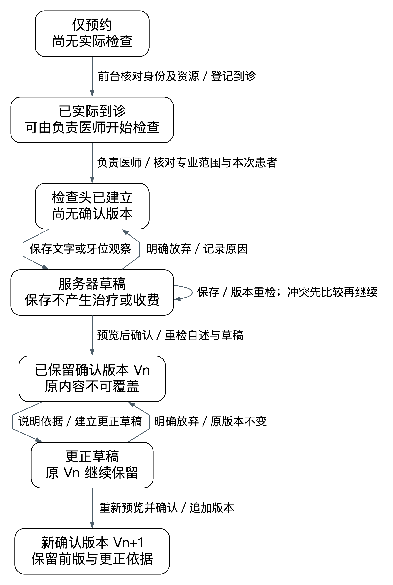

状态图描述可观察的业务阶段，不增加虚构的状态列。旧确认版本在更正草稿期间继续保留；确认及保存不等于合格电子签名或实际治疗。

### 4.18 方案、执行与唯一收费来源

临床模块拥有治疗计划、工作草稿、确认版本、稳定步骤、步骤版本、本人决定、实际执行、后续要求、预约关联和办理事件。确认版本引用具体检查依据，后续修改另建版本；稳定步骤表达同一目标的沿革，不代表旧决定和旧加工验收自动适用于新版。

实际执行引用本次确认检查，可以引用当前已认可的具体步骤，也可明确登记计划外依据。一个实际执行至多拥有一个原始收费行，并保留原开单快照；账单更正产生的审核版本副本不会制造第二次实际执行。完成时计费的已约定步骤，其中间阶段可以明确不另收费，但仍为已治疗，不能记成无治疗。

尚未发布的误录可以填写依据明确撤回，原执行及快照继续保留。已发布实际来源不能通过此入口作废，原账单与资金历史继续由各自更正和独立审核流程负责。临床签署、知情同意及受控归档另有专业合同，不把讨论决定称为合格签名。

图4-34 连续诊疗与后续责任的领域关系

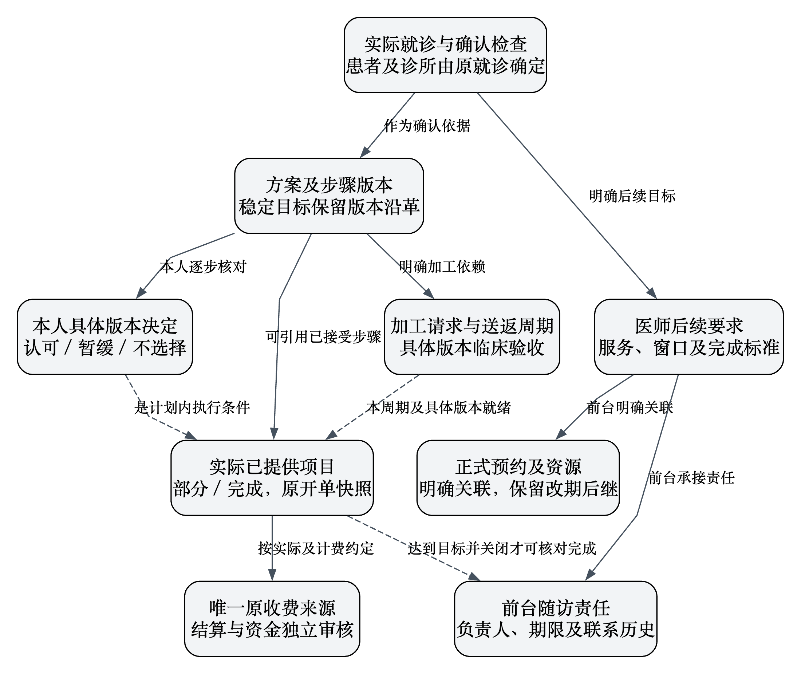

### 4.19 随访完成与加工就绪状态

一条医师后续要求至多一份随访责任，状态为继续协调、本人暂不继续转医师核对、已核对实际完成、原指示已撤回。责任、期限及联系变化追加历史。完成只选择明确关联预约及其唯一改期链上，同患者同店同服务且已经关闭的实际就诊；确认检查或指定步骤完成依据二选一。晚于原窗口照实记录，不改原建议日期。

图4-35 复诊责任状态与实际完成依据

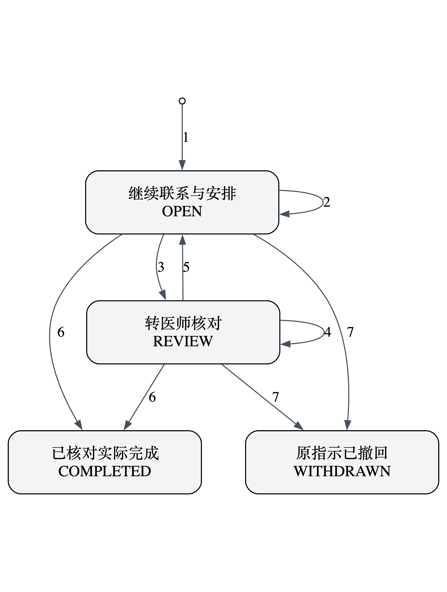

1 前台明确认领责任和下次内部期限。
2 记录联系、未回复、内部协调或责任接续，历史追加。
3 本人暂不继续，转医师核对；不自动再次联系。
4 内部协调并保留责任及期限。
5 有明确依据后恢复协调。
6 关联后续就诊已关闭，患者、诊所及服务相符，达到原完成标准。
7 医师已撤回原指示，前台明确核对；不记成实际完成。

候选查询、送返登记、临床验收与实际执行分别由各模块拥有。重新确认时核对当前主体、岗位、诊所、服务范围、版本及依赖；同一提交返回原成功结果。设备故障仍调用原资源替换和改期合同，既有预约与原始关联均保留，不以准备状态静默改变临床或资金事实。

加工请求保留原检查及具体步骤，状态为待安排、已送出、已返回、已验收、需返工和明确撤回。验收绑定物理周期和确切目标步骤，实际验收时间不晚于记录时间；实际执行不能早于所依据的验收。行政责任交接不会使未改变的临床验收失效。

图4-36 加工送返周期与临床验收状态

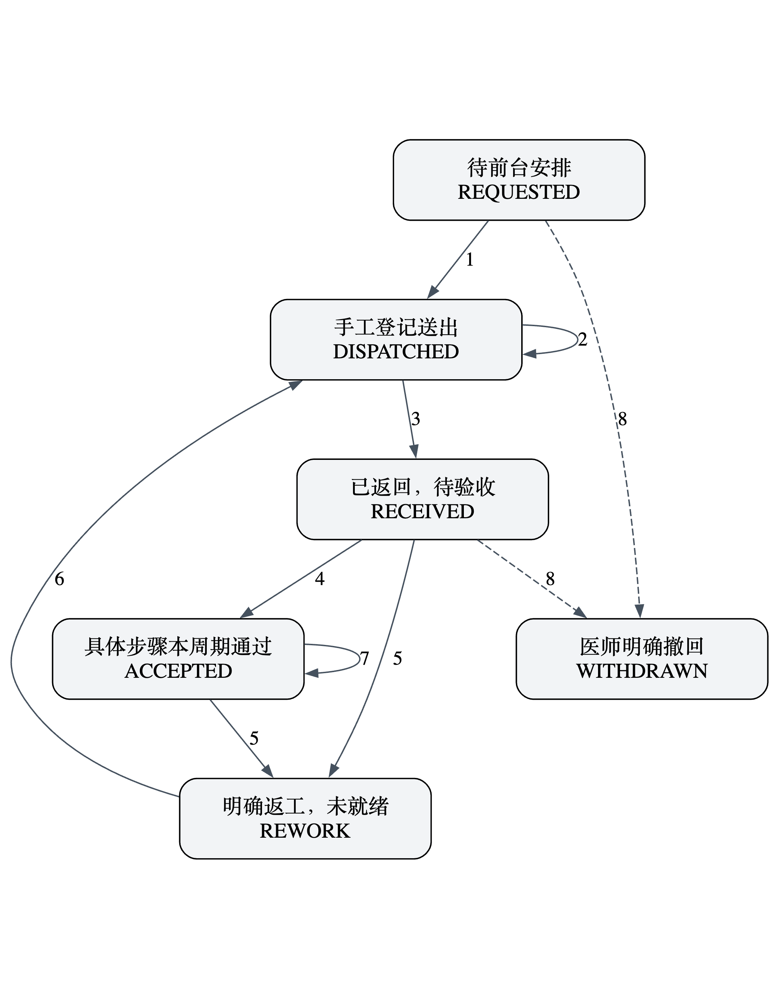

1 前台认领责任，记录实际送出；开始新物理周期。
2 获悉延误，记录内部跟进；原需要日期和预约保留。
3 前台记录本周期实际返回，不代表临床适配。
4 医师验收当前确切步骤，记录实际时间及结论。
5 医师明确返工，并单列前台需协调的事项。
6 重新送出、返回，进入下一物理周期后重新验收。
7 新版复用须重新核对具体步骤，旧验收不自动继承。
8 各非撤回阶段均可由医师明确撤回，保留原请求。

### 4.20 门店资料版本与患者入口

门店业务身份与对外资料通过唯一外键关联。当前资料保存展示名称、行政区、地址入口、公开电话、发布状态和坐标来源；每次明确确认追加具体版本与操作者，版本不可普通更新或删除。营业时间从原科室开放及有效停用区间计算，避免两套营业表相互矛盾。

距离计算使用同一WGS84坐标系，导航单独使用核对后的GCJ02坐标。未知坐标保持空值，不能作为零点；用户位置只在客户端参与排序。合成门店明确标识，拨号和地图操作在外部调用前拦截，不能把虚构号码及地址当成真实服务机构。

登录通道是服务器工作上下文中的受约束属性，不是另一套岗位授权。患者通道只激活有效患者身份，员工通道只激活有效员工岗位；具体患者或预约代办范围仍由原关系规则核验。服务延续绑定明确服务及短期提示，过期、撤回或撤权后重新选择，不自动替换服务或创建患者。

公开资料更新与资源目录共用锁并递增版本，旧预约预览不能在资料变化后直接确认。既有预约与有效邀约保留，新增资源方案保存当时公开联系快照；历史缺失快照不补造。实际搬迁及停诊影响交由前台明确协调，公开改名不静默移动原承诺。

思维导图  模块责任 → 真实主外键及基数 → {公开资料版本、授权、资源、临床、资金} → 明确状态与历史 → 同一数据库核对。

## 第5章 系统实现与测试

### 5.1 功能范围与完成状态

系统已实现七类岗位工作台、结构化电话接待、责任联系、统一服务与资源核对，以及患者自助预约和改期、到诊、治疗记录、版本化结算、收退款审核、资金凭据、渠道对账、日结和设备维护。网站、前台、电话、改期与候补共用资源规则，原有取消时段分析和改进措施独立复核继续可用。

下表按可观察的业务能力区分现有功能与后续范围。课程实例使用明确标注的合成资料，已实现功能仍需在真实业务环境评价其运营效果。

患者关系受理、账号补充、明确职责核验、有效期授权、暂停和撤销已实现。网站及原生患者端均可切换就诊人，预约、改期和候补调用原有业务命令；临床同意、完整纵向病历和处方流程仍须后续设计与验证。

专业操作申请、独立审核、明确启用、有效期及撤权核验已接入接诊。跨店转诊由原负责医师发起、接收店核对身份、指定医师接收；本人患者的终止披露在网站和小程序调用同一业务命令。

网站与原生小程序共用本人健康自述。医师工作台已接入实际到诊、主诉检查、具体自述核对、牙位牙面观察、服务器草稿、预览确认及追加更正；七类岗位和本店专业范围仍分别核验。

连续诊疗已接入具体方案版本、本人决定、实际执行和后续就诊；前台工作台接续复诊责任与手工加工送返，医师负责适配验收。网站和小程序展示同一本人方案及执行进展；代约仍限定在预约事项。

表5-1 业务功能的实现范围

| 业务能力 | 当前状态 | 使用边界 |
| --- | --- | --- |
| 门店服务内容与多渠道选约 | 已实现 | 主管发布范围、费用及准备；网站和小程序选约，儿童代办先核验。 |
| 网站患者预约与取消 | 已实现 | 本人绑定或本店有效代约；不开放自注册。 |
| 电话接待与正式成约 | 已实现 | 独立接待单、追加沟通、完整建档核对、候选协商和唯一成约关联。 |
| 统一服务与诊疗资源核对 | 已实现 | 按诊所启用；同房多椅、共享设备、服务时长、医师适配和停用共同核验。 |
| 本店资源目录维护 | 已实现 | 主管预览确认配置；旧预约与有效邀约逐项核实后启用，不补造历史。 |
| 前台日常出诊与候补排班 | 已实现 | 前台在当前店预览并确认出诊、接收控制及候补发布；日周视图与期限协调衔接，主管独立复核。 |
| 接诊、治疗与结算 | 已实现 | 由负责牙医确认实际治疗；账单与资金分别记录。 |
| 收退款、对账和日结 | 已实现 | 独立账号审核；真实支付接口不在课程范围。 |
| 设备维护与独立验收 | 已实现 | 送修影响与原承诺关联；兼容替换保留版本；恢复仍需独立验收。 |
| 取消时段、原因与措施 | 已实现 | 样本及完整性提示、实际联系与正式另约关联；后续完整窗口由另一主管复核。 |
| 患者网站自助改期 | 已实现 | 本人或授权患者的未来预约、本店同服务；时段与有效邀约均须预览确认，失败保留原约。 |
| 原生患者预约与候补 | 业务主链已实现 | 预约、改期、候补及邀约共用原有规则；微信平台实际运行另验收。 |
| 专业操作范围与独立审核 | 已实现 | 限定来源、诊所、服务、动作与期限；合成证据不等于真实临床资格认证。 |
| 限定跨店转诊与披露终止 | 已实现 | 接收店核对身份、指定医师接收；网站和小程序由本人终止披露。 |
| 本人自述与面谈来源 | 已实现 | 网站及小程序本人提交，本店医师面谈独立保存；未知及原版本保留，不覆盖过敏复核。 |
| 实际检查与版本更正 | 已实现 | 实际到诊、负责及专业范围核验；图形与键盘牙位、服务器草稿、冲突继续、预览确认及带依据更正。 |
| 跨次方案与本人决定 | 已实现 | 具体版本及互斥选择，估算不收费；新版须重新核对本人决定。 |
| 实际执行与唯一开单 | 已实现 | 实际项目、位置、阶段与时间独立记录；中间阶段不另收费仍属已治疗。 |
| 复诊责任与加工协同 | 已实现 | 前台负责联系与送返，医师核对实际完成及具体步骤适配；原预约保留。 |

### 5.2 预约与接诊的界面组织

患者入口按就诊需求、门店实际开放服务、费用及到诊准备组织信息，选择服务后继续登录和查询时段；不以设备编号或内部验收清单作为患者入口。公开页面提供大字模式，未启用脚本时仍可阅读服务并使用普通表单办理预约。

前台从接待与联系待办核对责任、期限和沟通历史，按服务查询医师、时间、诊室椅位和设备组合。确认页复述安排及患者同意，未建档或冲突时返回明确继续办理入口。网站患者选择服务、日期和医师，由系统安排兼容资源组合。 患者改期页并列原新安排和原因，明确区分普通候选与本人有效邀约；确认前原约继续保留，冲突时可重新选择或联系原诊所。待就诊、历史和全部分别查询，旧接受与取消跟进依据继续可追溯。

接诊界面按患者和过敏信息复核、实际治疗、治疗完成及结算查看组织。草稿只供负责牙医修改，已发布治疗事实保留版本。未到诊不能直接完成治疗；无实际治疗也需明确结束原因，避免以预约意向或草稿内容收费。

取消原因待办按联系状态和责任筛选，进入详情后可核对联络资料、办理正式另约或查看候补。另约入口带入患者编号，最终确认仍由预约模块核验；跟进页只保存已经成功的预约编号，联系结果修改追加历史。时段分析显示原数量及完整性，措施清单区分待开始、执行中、待复核及终止结果，并提供执行记录和独立复核入口。

### 5.3 财务与设备的操作衔接

资金表单将金额及日期、渠道凭据、申请依据分组，错误摘要可定位字段，提交后仍需预览确认。前台办理收退款申请，主管办理设备费用，财务分别复核；更正后原申请和凭据历史保留。

逐笔对账区展示待核对流水和资金记录，同金额并不能自动形成匹配。设备维护区展示负责人、期限、维修说明、费用和验收状态；独立验收通过后设备状态与费用来源可追溯，后续支付继续走资金流程。

设备维护直接展示已登记资源影响；前台办理同医师同时间替换，改变时间或医师需患者同意。到诊发现资源不可用或前一患者未结束时进入协调，原约和治疗事实均保留。

图5-1 收退款申请的分组表单

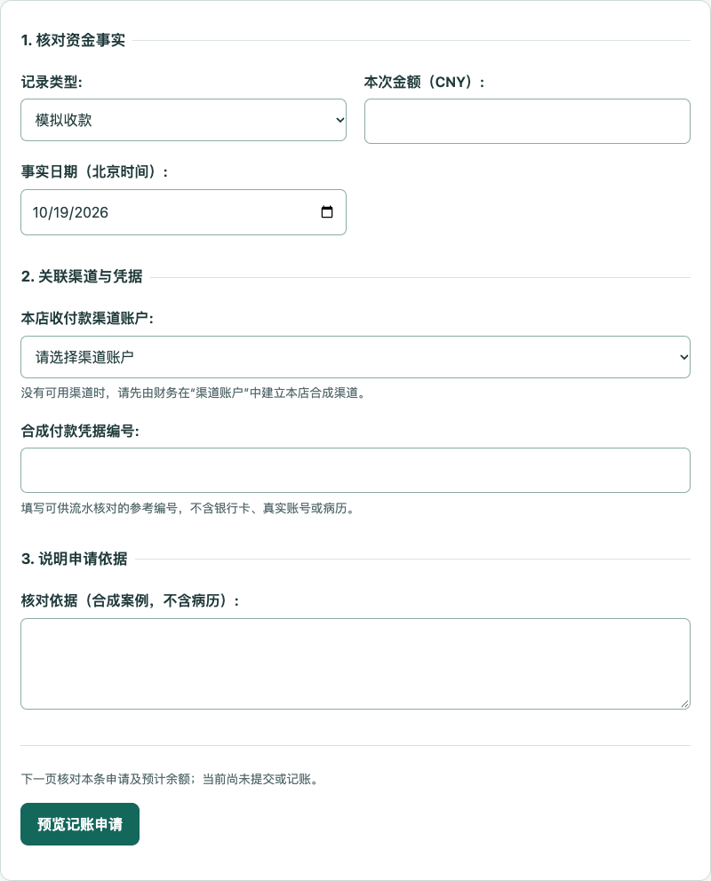

### 5.4 典型业务场景与测试设计

验收采用合成患者、医师、设备及渠道流水，分别从使用者可见结果和持久化业务事实核对。已执行场景与下一阶段目标分列；测试项数量只说明执行范围，不等于逐个用例均已完成业务验收。

日周排班、调班责任和数据库关系已有跨店场景验证；患者自助改期进一步核对本人候选、候补替换、原约保护及真正取消的跟进。当前业务演练、负载和恢复分别核对，不把测试总量表述为全部业务效果。

表5-2 跨岗位业务场景及验证状态

| 场景 | 关键核对结果 | 验证状态 |
| --- | --- | --- |
| 前台排班→调班联系→独立复核 | 当前店办理、明确期限，未联系上保留原约；同意后唯一改期，复核后前台维护。 | 既有五店调班与293项浏览器核对；完整回归继续通过。 |
| 患者改期→本人邀约→接诊收款 | 原约和接受历史保留；后继唯一；真正取消另行跟进；实际治疗后开单和独立收款审核。 | 五店173项、诊疗收款68项、跟进22项；数据库核对45＋8项通过。 |
| 预约→到诊→治疗→账单 | 确认后唯一预约；复核实际治疗；结算按行金额及版本核对。 | 已有服务和浏览器验证。 |
| 分次收款→退款→独立审核 | 多次收款分别保留；超额和自审拒绝；已记账金额独立计算。 | 已有五诊所合成验证。 |
| 流水导入→提议→复核 | 重复不重复接受，匹配条件逐项核对；原资金不被导入改变。 | 已有导入、权限及并发验证。 |
| 设备送修→办理→验收→费用 | 责任人与验收人分离；费用有来源；不自动改动患者安排。 | 已有工单及费用验证。 |
| 电话接待→候选→联系→确认 | 多次沟通、完整建档、明确同意后唯一成约；无资源、失联和拒绝均有责任结果。 | 五诊所电话成约至治疗结算、网站45分钟预约、15分钟候补及维修协调已执行。 |
| 取消时段→原因→措施→复核 | 分母及缺失可解释；不混计爽约、改期和诊所取消。 | 五诊所浏览器、数据库独立核算及并发验证通过；真实改善尚待观察。 |
| 椅位设备竞争与原约保护 | 不同椅位并行；同椅和共享设备竞争仅一个成功；送修不自动取消。 | 资源服务、数据库并发与浏览器场景执行。 |
| 资源到诊→治疗→结算 | 前一患者未结束不得重复接诊；预约服务及资源不制造实际治疗和资金。 | 独立核对预约、治疗、账单及资金事实。 |
| 专业审核→跨店核对→指定接收→本人终止 | 临床权限按期限及服务核验，转诊不制造预约、治疗或资金。 | 五店126项浏览器与原生页面核对；核心业务表及资金合计保持一致。 |

### 5.5 业务测试结果与质量评价

回归验收覆盖既有规则、真实数据库、HTTP权限与并发场景；新增关系受理、核验职责、授权有效期、切换旧页、代约回执、跨店拒绝及候补衔接场景。测试总量和合成结果不表示真实临床运营已经合格。

五诊所真实浏览器场景核对普通改期、本人邀约改期、重复确认、前台资源日历和真正取消的原因跟进。两店继续由患者明确同意变更医师，办理兼容椅位协调、到诊、实际治疗、开单和另一账号收款复核；每笔账单和收款为100元，合计200元，金额另按数据库事实计算。改期和候补接受本身不生成治疗或资金。 取消后正式另约、患者再次改期和原跟进依据的保留另行核对。

五诊所、二十患者账号连续三十分钟负载执行9,000次请求，80%读取、20%合法提交。提交包括900次改期预览及900次确认，共形成900次实际改期；普通请求p95为0.453秒。逐笔核对唯一后继、资源占用、回执及原有资金，无意外失败、重复业务效果或可见内存耗尽事件。该患者工作负载与既有岗位混合负载分开记录，不代表二十诊所全面运营能力。

浏览器检查七角色权限、390像素大字号和键盘提交；待就诊与历史列表分别显示，原新预约及人工协助可直接定位。加密备份在独立空数据库恢复，全部记录、结构以及当时42项触发器定义和启用状态一致；回执、资源方案、候补接受历史和取消跟进关联均保留。

原生患者服务在五诊所合成环境完成候补登记、网站前台发布邀约、邀约替换原约、新增预约、拒绝及退出，网站显示同一结果。二百五十八项联调检查和数据库独立核算确认唯一后继、占用释放及原账务保留；重复提交不恢复已退出记录。此前九页通过官方离线语法编译，微信运行时、手机及体验版仍须单独验收。

服务发布与双端预约场景另在五家合成诊所通过187项检查：患者选择服务、网站或小程序明确确认，原预约可跨端查询；下架阻止新的失效确认，同时保留既有预约和合法改期。此前十一页原生工程通过官方离线语法编译，仍需独立完成微信运行时、手机和体验版验证。

患者关系场景核对相同联络号码不会合并患者、普通联系人不能代约、撤销后原预约保留、两名合法操作者争用同一患者时段只产生一次有效预约。网站与原生页面共享后端事实；独立恢复包含关系、授权、事件和本人／代约回执，该关系场景验证时结构触发器数量为43项。

专业范围测试覆盖自审、失效审核职责、无服务通配误用、授权到期、撤权与接诊并发、离岗后历史保留、跨店身份争议及限定版本查阅。敏感查阅的许可和拒绝分别留痕，重复确认不会重复创建专业申请或转诊决定。

前述负载保留其预约场景的验证范围，不能据此推定新增专业协作或后续连续诊疗的容量；相应工作负载需分别测量。

检查场景覆盖五家合成诊所，核对未知保留、本人及面谈来源、图形与键盘录入、网络响应丢失后的同次重试、双页冲突继续、历史版本及跨店拒绝。独立核对显示自述和检查操作不改变原预约、治疗、账单与资金事实。

连续诊疗整组回归执行1104项源码规则及1688项真实数据库、HTTP和并发场景。五诊所实际浏览器及原生页面处理器核对方案换版、加工返工、明确复诊、资源故障替换和分阶段结算；离线语法编译与页面处理器验证不代替微信平台运行。

### 5.6 预约指标的独立核算示例

合成核算示例：到诊A=6、患者取消P=2、诊所取消C=1、爽约N=1、到期未核实U=3、改期前身R=5。D=9；患者取消率22.22%，爽约率11.11%，整体取消率30.00%，完整性76.92%；R不进入结果分母。

该示例样本与完整性不足，不列高风险排行。期间按预约开始日划分，未来预约单列，原因与取消时间缺失不补造。

### 5.7 需求、用例与验收追踪

以业务问题关联用例、设计责任和验收条件。原AT-01—25及维护协同编号保留，AT-B补充可观察场景；自动测试总量不等于用例覆盖率，微信平台实际运行、云端访问与真实运营效果仍需单独验证。

表5-3 业务需求到用例与验收的追踪

| 业务需求 | 用例及设计责任 | 可观察验收 |
| --- | --- | --- |
| 患者服务说明与公开 | SU-59；本店主管、患者服务与排班模块 | 草稿与已发布分别显示；未知费用不作零元；下架拒绝旧预览，已有预约保留。 |
| 患者自助预约 | SU-04／SU-05；患者端与预约模块 | 本人或本店有效代约范围；选择不占用；确认唯一；取消仅限允许状态。 |
| 电话接待与替代协商 | SU-39；接待单与预约模块 | 登记需求和来源；可回访；患者明确同意后成约；未成约有原因。 |
| 取消时段及改进 | SU-41／55／56；运营聚合、原因跟进与措施办理 | 五诊所原数量与比例一致；不足不排行；联系与正式另约可查；独立复核拒绝执行前或未结束窗口。 |
| 统一资源核对 | SU-54／SF-01；排班与设备模块 | 网站、电话、改期及候补重检同一资源；原约保留；兼容替换有历史。 |
| 收退款及日结 | SU-42—46／49／53；资金与审核 | 来源和余额一致；不同账号审核；四类总额分别核对。 |
| 逐笔对账 | SU-47—48；流水与匹配模块 | 上传预览不接受流水；重复明确；独立复核；不改原资金。 |
| 设备维护 | SU-50—52；设备与协调模块 | 负责人、期限、独立验收及费用来源可追溯；影响预约明确处理。 |
| 资源目录与启用 | SU-57；本店主管与排班模块 | 同店配置、时长及位置适配；逐项核实原承诺后启用。 |
| 患者自助改期 | SU-40；患者端、统一预约与候补模块 | 本人或授权患者同店同服务；原新方案明确确认；候补原子接受；重复确认唯一；失败保留原约，取消另行跟进。 |
| 跨次方案与本人决定 | SU-72／73；临床方案及患者本人渠道。 | 保留方案与目录定义；新版重核决定，估算及互斥方案不自动生成收费。 |
| 实际执行及唯一来源 | SU-74；临床、接诊结算与资金模块。 | 部分与完成分别记录；一个原始收费来源，重复确认唯一，退款不改原执行。 |
| 后续目标与责任 | SU-75／76／77；临床要求、前台随访与资源预约。 | 取消和改期保留关联；未达到明确目标不完成，责任失效可明确接续。 |
| 加工与管理投影 | SU-78／79／80；加工送返、医师验收及管理汇总。 | 返回不等于就绪，返工进入新周期；前台和管理投影不读取临床规格。 |

### 5.8 专业协作的实施与适用边界

五店合成流程核对原负责医师、接收前台、指定医师和本人患者之间的业务交接。身份待澄清时不能接收，接收前不披露临床文字，接收后只显示选定历史版本，终止后停止后续查阅。财务和技术身份不能打开临床披露记录。

上述软件流程以明确标注的合成资质、机构委任及同意依据验证。真实临床使用仍需要机构聘任合格审核人员、确认临床披露与法定代理政策，并审核后续临床记录术语和模板。微信实际运行、真实云环境和持续运行结果另行验证，不由离线编译或合成测试推定。

### 5.9 检查业务的应用与限制

临床检查以患者、实际就诊和负责医师为主线。草稿允许分次保存；冲突先比较再继续，确认另经预览和当前来源复核。网站与小程序读取同一已提交自述；转诊只披露被选中的确认版本。到诊、治疗、结算及资金审核继续由原有岗位按各自业务事实办理。

上述流程使用明确标注的合成资料核对软件行为。真实临床使用仍须由合格专业人员审定牙科记录术语、模板和诊疗范围，并完成电子签名、归档及相关制度。小程序离线编译与页面处理器验证不代表微信实际运行；真实平台、云环境及持续运行另行验收。

### 5.10 连续诊疗业务的跨岗位核对

五家合成诊所分别从原确认检查建立方案，患者本人认可确切步骤，医师登记加工要求，前台手工送返并记录延迟。医师返工后进入下一周期，换版又重新核对本人决定及具体版本适配，全部就绪后才登记实际执行。

原就诊的中间阶段按完成时计费约定不另收费，仍发布已治疗的零金额结算单。前台按原医师目标关联后续预约，明确改期保留后继，牙椅故障阻止到诊，经同店同医师同时间的兼容资源替换后继续。后续实际步骤完成并关闭接诊，前台才明确核对目标完成依据。

临床完成、开单收入、实际收退款和渠道对账分别核算。不同财务账号独立审核收款和部分退款，原实际执行与原账单不因退款而改写。主管和总部仅查看状态与逾期汇总，临床规格、联系文字及本人方案不进入汇总。

独立核对上述五例新增业务：五次中间治疗均为零金额结算，五次完成治疗各产生一条200元原收费，共开单1000元；另行审核收款1000元、退款500元，净收款500元、未收余额500元。退款不自动改写原开单收入，需要调减账单时另走独立更正；预约、方案和联系记录均不直接产生资金。

### 5.11 门店发现与登录延续核对

网站与原生小程序共用已发布门店和服务来源，访客入口仅提供公开只读投影。核对匿名访问不建立工作上下文或业务记录，定位失败可手动选城，同名距离采用稳定编号排序。患者选择服务后，经普通登录及合法就诊人选择继续原预约流程。

业务核对包括多岗位账号的登录通道、跨店与撤权、资料版本竞争、重复确认、公开撤回后旧预览、营业例外和原约联系快照。课程门店网络覆盖长沙等八省会二十份合成资料，其中长沙四店准备服务、牙椅设备与前台出诊，其余门店只提供已准备的公开资料，不因门店数量推断业务容量。

关系图由实际迁移后的数据库结构生成，逐列核对类型、可空、唯一及外键。已核对的软件业务路径与微信平台运行、真实手机号授权及医保联网分别记录；尚无平台及机构测试条件时，不将本地接口或合成数据称为真实授权或医保结算。

思维导图  合成跨岗位场景 → 正常与异常路径 → 独立业务核算 → 数据库并发与浏览器 → 容量、恢复与权限 → 分别记录软件和目标环境证据。

## 第6章 总结与展望

### 6.1 设计成果与业务价值

本文围绕连锁牙科的服务与管理过程，完成电话接待、统一资源预约、健康自述与检查、连续方案与实际执行、复诊责任与加工协同、到诊治疗、结算资金、设备维护和取消改进的业务设计。参与者、交接责任、状态、异常及最低保证通过用例和模型相互对应，使系统能够解释谁办理、依据什么、成功后得到什么，以及失败后如何继续。

现有能力支持合成课程场景的核心运营闭环，并将取消统计推进到原因核实、实际联系、责任期限、正式另约和独立措施复核。评价重点为一次业务能否办完、异常能否继续、管理者能否解释；比率下降不直接等于服务质量改善。

### 6.2 下一阶段业务完善计划

现有合成系统已形成服务发布、患者关系、限定专业范围和转诊、多渠道预约、前台排班、检查方案、实际执行、复诊加工及资金设备协同。后续面向单一连锁独立部署，确认真实机构政策与专业责任，重点推进临床签署归档、处方药事和材料执行；预约、方案讨论或账单记录不能替代完整临床专业制度。

下一阶段先完善本地微信身份、手机号核验与本人建档申请，再建立湖南版本目录、合成医保结算和退费核对。普通微信登录不会取得居民身份证；真实微信能力需平台条件，真实医保结算需具体定点机构及接口条件，目录分类不能直接视为患者报销比例。

表6-1 以业务完整性为主的后续安排

| 顺序 | 业务交付 | 完成条件 |
| --- | --- | --- |
| 身份与专业责任 | 明确患者与监护关系、机构及医护药事岗位权限。 | 资格证据可追溯，撤权、跨店和非本人访问被拒绝；新增专业权限经明确设计。 |
| 专业适用性确认 | 将已实现检查、方案、实际执行、随访与加工规则纳入真实服务矩阵。 | 由专业人员核对术语、服务字段、完成标准及加工要求，不把合成验收当成专业审定。 |
| 签署与归档 | 知情同意、记录签署、修订、受控复制和影像关联。 | 绑定正确患者与版本，保留原签署内容，按适用专业要求验收。 |
| 处方与药事 | 药品字典、处方、独立审方和实际调配。 | 未审方不进入药品计费和发药；专业资格、单位、部分执行及撤销可核对。 |
| 护理与材料 | 实际执行、批次效期、植入物和器械使用追溯。 | 患者、医嘱、执行人与批次一致；并发不得产生重复使用或负库存。 |
| 财务与外部衔接 | 实际诊疗与费用、预收分配、支付和所需外部接口。 | 临床与收费、渠道与账内资金分别核对，重复通知不重复记账。 |
| 目标环境交付 | 独立云端运行、微信平台试用、备份恢复及监督试用。 | 准确版本通过安全、业务、恢复和目标容量验收；实测地址与平台能力分别交付。 |

### 6.3 研究限制与进一步评价

课程规则尚未经过真实诊所岗位访谈确认；已实现的接待与资源规则属于课程业务方案。合成数据可检验计算、权限和一致性，不能证明真实取消行为、临床质量或收入改善。未来评价应观察患者体验、前台工作量和服务可达性，不以降低取消率作为单一目标。

课程演示继续使用分配账号和合成资料。云端访问和微信平台试用需在实际环境独立验收；本地接口联调不表示已在微信发布或已部署云端。真实临床替代还须由具有相应资质的人员完成业务、专业和合规确认，本报告不将规划功能列为已实现。

思维导图  现有业务闭环 → {身份与专业责任、连续诊疗、签署归档、处方药事、护理材料} → 财务外部衔接 → 目标环境验收与监督试用。

## 参考文献

[1] CHEN Z. ANDREW'S DENTAL CHAIN：数据建模：W44694[Z]. 指导：Derrick Neufeld. Ivey Publishing, 2024-10-08. 课程提供案例，第1—2页。

[2] LEVESON N. Software Engineering Concepts：过程模型[Z]. 课程提供讲义note__2，年份未注明. 第4—5页。

[3] LEVESON N. Software Engineering Concepts：Requirements Specification[Z]. 课程提供讲义note__3，部分页版权标记1999. 第1—5、11页。

[4] LEVESON N. Software Engineering Concepts：Software Design[Z]. 课程提供讲义note__4，部分页版权标记1999. 第7、10—11、15—16页。

[5] LEVESON N. Software Design Principles[Z]. 课程提供讲义note__5，部分页版权标记1999. 第4—10页。

[6] LEVESON N. Reuse and COTS[Z]. 课程提供讲义notes__6，部分页版权标记1999. 第4、8—9页。

[7] LEVESON N. Software Engineering Concepts[Z]. 16.355, Fall 2005. 课程提供讲义note__1，第8、18—21页。

[8] OBJECT MANAGEMENT GROUP. Unified Modeling Language, Version 2.5.1[S/OL]. 2017[2026-09-27]. https://www.omg.org/spec/UML/2.5.1/

[9] DJANGO SOFTWARE FOUNDATION. Deployment checklist：Django 5.2 documentation[EB/OL].[2026-09-27]. https://docs.djangoproject.com/en/5.2/howto/deployment/checklist/

[10] DJANGO SOFTWARE FOUNDATION. Middleware：Writing your own middleware[EB/OL].[2026-09-27]. https://docs.djangoproject.com/en/5.2/topics/http/middleware/

[11] OWASP FOUNDATION. Authorization Cheat Sheet；Session Management Cheat Sheet[EB/OL].[2026-09-27]. https://cheatsheetseries.owasp.org/

[12] DJANGO SOFTWARE FOUNDATION. Using the Django authentication system[EB/OL].[2026-09-27]. https://docs.djangoproject.com/en/5.2/topics/auth/default/

[13] GUNICORN AUTHORS. Gunicorn Settings[EB/OL].[2026-09-27]. https://gunicorn.org/reference/settings/

[14] F5 NGINX. Module ngx_http_proxy_module[EB/OL].[2026-09-27]. https://nginx.org/en/docs/http/ngx_http_proxy_module.html

[15] W3C WAI. Understanding SC 3.3.1：Error Identification；Use Clear Step-by-step Instructions[EB/OL].[2026-09-27]. https://www.w3.org/WAI/WCAG22/Understanding/error-identification.html

[16] OPEN DENTAL. Appointment Views[EB/OL]. https://www.opendental.com/manual/appointmentviews.html（访问日期2026-10-18）.

[17] ODOO. Search filter and group records[EB/OL]. https://www.odoo.com/documentation/19.0/applications/essentials/search.html（访问日期2026-10-18）.

[18] W3C. Understanding Reflow[EB/OL]. https://www.w3.org/WAI/WCAG22/Understanding/reflow.html（访问日期2026-10-18）.

[19] W3C. Understanding Target Size Minimum[EB/OL]. https://www.w3.org/WAI/WCAG22/Understanding/target-size-minimum.html（访问日期2026-10-18）.

[20] W3C. Understanding Focus Not Obscured Minimum[EB/OL]. https://www.w3.org/WAI/WCAG22/Understanding/focus-not-obscured-minimum.html（访问日期2026-10-18）.

## 附录A 基础系统用例规约

本附录给出SU-01—25及共享核验SF-01。规约以业务目标、交互、正常与异常结果为核心；验收编号为需求追踪标识，功能完成状态见第5章。

附录中固定30分钟、200个候选格及最大匹配描述适用于未启用资源控制的历史模式。已启用资源控制的诊所按SU-54与SU-57核对服务时长、椅位和必要设备，并按登记与可行时间先后生成建议；14天候补范围、明确接受、发布重检和原承诺保护继续适用。

#### SU-01　登录、选择与切换身份

表A-1 SU-01　登录、选择与切换身份用例规约

| 标题 | 内容（SU-01） |
| --- | --- |
| 用例名称 | SU-01　登录、选择与切换身份 |
| 执行者／触发 | 所有系统用户；登录或点击“切换身份”。 |
| 涉众利益 | 账号使用者希望少走无效步骤；机构需防止身份混用和越权。 |
| 前置条件 | 能够打开登录页，已通过受控方式取得账号；本用例包含凭据校验，不把登录成功当作前置条件。 |
| 基本路径 | 1）账号使用者提交账号和密码；系统验证凭据及账号状态。2）系统核对有效身份；无身份时反馈待授权，唯一身份时正式激活，多身份时由账号使用者选择后激活。3）系统再次核验授权并清除旧诊所范围；前台／主管随后通过SU-02选择诊所。4）账号使用者请求切换时，系统仅提供有效身份；唯一身份不增加重复选择。 |
| 扩展路径 | 凭据错误或账号停用：留在登录入口，反馈不泄露账号是否存在。 无身份／选择期间撤权：说明原因并提供退出；不授予新身份。 旧标签页提交：拒绝并要求核对当前身份与诊所；不得借用账号的其他身份。 |
| 成功结果 | 只改变当前工作身份，不增加权限，不改变已有业务记录。 |
| 最低保证 | 失败不进入受保护工作区，不改变患者、预约或账单。 |
| 追踪与状态 | BR-01；AT-01；功能范围及业务测试见第5章。 |

#### SU-02　选择与切换诊所

表A-2 SU-02　选择与切换诊所用例规约

| 标题 | 内容（SU-02） |
| --- | --- |
| 用例名称 | SU-02　选择与切换诊所 |
| 执行者／触发 | 当前为前台或主管的用户；进入角色首页或点击“切换诊所”。 |
| 涉众利益 | 前台／主管需明确当前店；其他诊所不应因切换受误操作影响。 |
| 前置条件 | 账号已登录并激活前台或主管身份。可进入的诊所集合由系统核验；空集合属于本用例的替代结果。 |
| 基本路径 | 1）系统反馈当前前台／主管身份可进入的诊所。2）前台／主管提交选定诊所；系统验证该身份与诊所的授权关系。3）系统激活选定诊所范围并反馈当前范围；不改变工作身份。 |
| 扩展路径 | 没有有效诊所：说明原因，不展示合并数据。 目标诊所停用或无授权：拒绝，不能借用另一角色的范围。 切换后旧表单提交：拒绝并要求刷新。 |
| 成功结果 | 当前店明确；另一家店的业务不会混入当前查询或提交。 |
| 最低保证 | 选择失败不激活未授权诊所；合法切换不修改业务记录，旧页不得沿用原范围提交。 |
| 追踪与状态 | BR-01；AT-02；功能范围及业务测试见第5章。 |

#### SU-03　建立与查阅患者档案

表A-3 SU-03　建立与查阅患者档案用例规约

| 标题 | 内容（SU-03） |
| --- | --- |
| 用例名称 | SU-03　建立与查阅患者档案 |
| 执行者／触发 | 前台建档；负责牙医查阅授权记录；新患者需要建档，或工作人员需要查阅。 |
| 涉众利益 | 患者希望跨店资料一致且隐私受保护；工作人员需可靠识别患者。 |
| 前置条件 | 有效工作身份与范围；仅使用合成资料。 |
| 基本路径 | 1）前台提交识别条件；系统检索既有患者，支持跨店复用编号，不按相同电话自动合并。2）前台为新患者提交姓名、出生日期、账单地址、电话、可选邮箱、紧急联系人及逐项过敏资料。3）系统校验资料并分配稳定编号；负责牙医请求查阅时，系统只反馈获授权的接诊所需资料。 |
| 扩展路径 | 疑似重复：提示核对，不按相同电话自动合并。 必填缺失、未来出生日期或过敏状态矛盾：阻止保存。 无关联/无授权的直接访问：拒绝，不泄露资料。 |
| 成功结果 | 成功建档产生一份可查询档案；查阅不修改数据。患者业务编号不是登录凭证；完整编辑／合并不在本次实现范围。 |
| 最低保证 | 建档失败不留部分档案；查阅失败不暴露对象，疑似重复不自动合并患者。 |
| 追踪与状态 | BR-02；AT-03；功能范围及业务测试见第5章。 |

#### SU-04　创建预约

表A-4 SU-04　创建预约用例规约

| 标题 | 内容（SU-04） |
| --- | --- |
| 用例名称 | SU-04　创建预约 |
| 执行者／触发 | 具有有效本人或代约入口的账号，或当前诊所前台；患者通过网站、微信小程序、电话或现场明确提出预约。 |
| 涉众利益 | 患者需要可理解的就诊安排；前台和医师避免冲突，并保留明确同意及原承诺。 |
| 前置条件 | 完整有效患者档案、可接收的出诊；已启用诊所提供服务和资源目录，工作人员有当前店权限，当前选择为本人或经核验的本店代约患者。 |
| 基本路径 | 1）核对患者及服务、日期和医师偏好。2）系统按服务时长查询科室、出诊、椅位及设备的可行组合。3）患者选定方案；复述诊所、服务、医师及起止时间，取得同意。4）执行SF-01并重检授权和资源。5）同一事务保存唯一预约与占用，电话接待同步关联成功结果。 |
| 扩展路径 | 无资源则协商或经同意转候补；联系未果保存责任及期限。冲突、旧预览或撤权时返回重新核对，原承诺保留。候补已有成功结果则关联原预约；重复确认返回原效果。 |
| 成功结果 | 获得唯一且可查的正式预约及资源方案；服务意向不产生实际治疗或收费。 |
| 最低保证 | 失败不新增部分预约或占用，不改变其他患者安排，不按电话推定身份或来源。 |
| 业务规则 | 15至240分钟、15分钟步长，整段占用；网站、小程序及候补未来十四天，前台按已发布排班。本人改期按已实现的SU-40办理，继续核对相同资源和唯一结果。 |
| 追踪与状态 | BR-03；AT-04；功能范围及业务测试见第5章。 |
| 渠道说明 | 小程序使用分配的课程账号登录，共用当前患者授权与资源核验；本地客户端已联通预约服务。微信开发者工具、真机及体验版发布须单独验收，不把微信请求来源当作患者身份。 |

#### SU-05　调整预约结果

表A-5 SU-05　调整预约结果用例规约

| 标题 | 内容（SU-05） |
| --- | --- |
| 用例名称 | SU-05　调整预约结果 |
| 执行者／触发 | 当前诊所前台；本人或有效代约人在授权范围取消预约，或按SU-40申请改期。 |
| 涉众利益 | 患者明确确认变更；诊所保留取消原因、原承诺及改期历史。 |
| 前置条件 | 有效身份和对象范围，原预约处于允许状态且修订号有效。患者自助仅针对未开始的已预约记录。 |
| 基本路径 | 1）核对原预约、当前状态及操作目的。2）患者取消时填写原因并明确确认；改期按SU-40核对同店同服务的新方案。前台还可按原业务规则办理本店取消、改期或核实爽约。3）系统重检授权、版本、时间及资源，在同一事务保存结果和历史。4）显示当前记录、合法关联结果及后续办理入口。 |
| 扩展路径 | 尚未达到核实条件时不能认定爽约。已到诊或结束、无权限、旧版本或资源冲突时拒绝不适用操作；改期失败保留原约。患者无法在线办理时联系原诊所前台，不能因联系未果自动取消。 |
| 成功结果 | 取消、改期或已核实爽约分别保存事实；改期保留原记录和唯一后继，取消保留发起方、原因及跟进依据。 |
| 最低保证 | 失败不新增部分预约或占用、不改变原状态；历史记录不删除，不制造治疗或资金。 |
| 业务规则 | 网站与小程序支持本人或有效代约患者改期及候补邀约替换，见SU-40；前台可协助。取消与改期不混计，技术请求重复不能产生重复业务效果。 |
| 追踪与状态 | BR-04；AT-05；功能范围及业务测试见第5章。 |

#### SU-06　登记实际到诊

表A-6 SU-06　登记实际到诊用例规约

| 标题 | 内容（SU-06） |
| --- | --- |
| 用例名称 | SU-06　登记实际到诊 |
| 执行者／触发 | 当前诊所前台；工作人员选择“登记到诊”。 |
| 涉众利益 | 患者与牙医需真实到诊队列；管理者不应得到虚假的出勤指标。 |
| 前置条件 | 当前前台身份和诊所范围有效，目标为已预约；前台须在路径中确认真实到达。系统只核验提交的登记信息，不能独立感知患者到店。 |
| 基本路径 | 1）前台核对本店预约，提交已确认真实到达的到诊登记请求。2）系统核验当前店权限、原预约状态及修订号。3）系统保存到诊标志、实际到诊时间与事件，并反馈登记结果。真实到达由前台核实，不由软件自行感知。 |
| 扩展路径 | 已经取消/爽约/改期替代：拒绝直接到诊。 旧修订号或授权撤回：拒绝并提示刷新。 重复或失败请求不产生第二次独立接诊。 |
| 成功结果 | 到诊=true，状态已到诊；此时尚无治疗完成或收款事实。 |
| 最低保证 | 校验失败不新增到诊时间；重复请求不产生第二次到诊事件或越过终态限制。 |
| 追踪与状态 | BR-04；AT-06；功能范围及业务测试见第5章。 |

#### SU-07　复核信息与记录实际治疗

表A-7 SU-07　复核信息与记录实际治疗用例规约

| 标题 | 内容（SU-07） |
| --- | --- |
| 用例名称 | SU-07　复核信息与记录实际治疗 |
| 执行者／触发 | 本次负责牙医；从接诊队列进入工作区。 |
| 涉众利益 | 患者需准确治疗与过敏记录；牙医需保留已存草稿和专业责任。 |
| 前置条件 | 牙医身份有效，目标本人负责且已到诊。 |
| 基本路径 | 1）牙医请求办理本人已到诊接诊；系统反馈获授权的主诉与过敏知识状态。2）牙医提交当次复核结果，以及实际治疗项目、标准单位、数量和当时单价。3）系统验证并保存治疗草稿；误录草稿由牙医说明原因后请求撤回。本任务不自动关闭接诊，结束须另行明确请求SU-08。 |
| 扩展路径 | 未知过敏可以保存草稿，但不能当作已确认无过敏。 数量/价格不合法或页面过期：阻止保存。 已发布内容不在此处直接修改；非本人接诊拒绝。 |
| 成功结果 | 实际治疗草稿可供后续核对；SU-08必须由牙医另行明确启动。已发布版本不可从本页原地改写。 |
| 最低保证 | 本次失败不新增治疗行；之前已保存草稿不丢失，历史已发布内容不受影响。 |
| 追踪与状态 | BR-02、BR-05；AT-07；功能范围及业务测试见第5章。 |

#### SU-08　完成就诊并生成结算单

表A-8 SU-08　完成就诊并生成结算单用例规约

| 标题 | 内容（SU-08） |
| --- | --- |
| 用例名称 | SU-08　完成就诊并生成结算单 |
| 执行者／触发 | 本次负责牙医；核对后明确关闭本次接诊。 |
| 涉众利益 | 患者需可核对费用；机构需闭合状态与唯一结算一致。 |
| 前置条件 | 已登录为本次负责牙医；目标可查阅。首次完成须已到诊；已经完成的重复请求走既有结果分支。 |
| 基本路径 | 1）系统反馈待核对的项目、数量、单价、行小计与总额。2）牙医核对后明确请求治疗完成；确无治疗时请求无治疗关闭并提交原因。3）系统验证完成条件，一并保存已发布内容、唯一结算单、闭合状态及事件，反馈结果；已成功完成的授权重试返回既有结算单。 |
| 扩展路径 | 有实际治疗但过敏未复核、数据不完整或数值非法：指出缺口，不完成。 有治疗却选无治疗：拒绝；确无治疗可保留未知信息，填写原因后生成零明细零金额单。 首次完成的中途失败：本次关闭与开单全部撤销；经授权核验的重复完成返回既有结算单。 |
| 成功结果 | 闭合就诊恰有一张逻辑结算单；到诊仍为true；不代表已收款。 |
| 最低保证 | 失败不出现“已闭合却无结算单”或半张账单；已成功完成的结果不得因重试再创建。 |
| 追踪与状态 | BR-04、BR-05；AT-08；功能范围及业务测试见第5章。 |

#### SU-09　查阅与打印结算单

表A-9 SU-09　查阅与打印结算单用例规约

| 标题 | 内容（SU-09） |
| --- | --- |
| 用例名称 | SU-09　查阅与打印结算单 |
| 执行者／触发 | 本人患者、授权前台/负责牙医/财务；用户打开账单或选择历史版本。 |
| 涉众利益 | 患者需看懂本人的费用；机构需保护历史及他人隐私。 |
| 前置条件 | 账单已发布；对象属于当前允许范围。 |
| 基本路径 | 1）患者／获授权工作人员提交目标结算单或历史版本的查阅请求。2）系统核验对象范围，反馈单号、患者、诊所、牙医、时间及对应版本的实际治疗明细和总额。3）患者／工作人员可请求打印已发布版本；系统标识历史版本“非当前”，不增加交易。 |
| 扩展路径 | 其他患者/诊所的对象：拒绝。 草稿版本不对患者公开；未开单不解释为免费。 历史打印明确“非当前”，不新增一笔交易。 |
| 成功结果 | 只读展示；任何目录调价不改变历史单据内容。 |
| 最低保证 | 本用例只读，不因查看或打印改变账单、增加收入或使患者看到他人的资料。 |
| 追踪与状态 | BR-05；AT-09；功能范围及业务测试见第5章。 |

#### SU-10　申请与审核账单数字更正

表A-10 SU-10　申请与审核账单数字更正用例规约

| 标题 | 内容（SU-10） |
| --- | --- |
| 用例名称 | SU-10　申请与审核账单数字更正 |
| 执行者／触发 | 负责牙医申请；不同账号的财务审核；发现原治疗行数量或单价误录。 |
| 涉众利益 | 患者需纠正误录；机构需独立审核、不覆盖原账单历史。 |
| 前置条件 | 基版仍为当前版；无另一待审核申请；在允许更正范围内。 |
| 基本路径 | 1）牙医选定一条原治疗行，提交正确数量或单价及事实依据。2）系统核验基版与申请条件，形成完整草稿，原版继续有效。3）不同账号的财务核对差异并明确批准或拒绝。4）系统在批准时一并发布后继版本、更新同一账单当前指针并保留历史。 |
| 扩展路径 | 同账号切换财务身份自批：仍拒绝。 基版已变化、撤权或非法数值：不发布。 拒绝/技术失败保留原版；不支持项目增删、身份或退款纠错。 |
| 成功结果 | 单号不变，旧版可查；收入只计当前有效版。 |
| 最低保证 | 批准失败或拒绝时旧版本继续有效；已发布历史不覆盖，未审核草稿不计入收入。 |
| 追踪与状态 | BR-05、BR-06；AT-10；功能范围及业务测试见第5章。 |

#### SU-11　形成季度成本与利润核对

表A-11 SU-11　形成季度成本与利润核对用例规约

| 标题 | 内容（SU-11） |
| --- | --- |
| 用例名称 | SU-11　形成季度成本与利润核对 |
| 执行者／触发 | 财务维护；总部授权查阅；选择季度进行核对。 |
| 涉众利益 | 总部需可信季度结果；牙医需避免漏计成本或重复计算收入。 |
| 前置条件 | 自然季度与纳入范围明确，当前角色允许读或写。 |
| 基本路径 | 1）财务提交季度和纳入牙医，包括有成本但无收入者。2）财务逐人提交并确认用品成本、运营费用及依据。3）财务确认人员范围；系统检查遗漏开单人员和未确认成本。4）资料满足条件时，系统反馈收入、利润贡献、总体基金、期间与查询时点；总部按只读授权核对结果。 |
| 扩展路径 | 未填与确认零值分开；资料不全不发布完整利润。 零/负总体利润：基金政策待确认，不生成负奖金。 旧页面修订号、权限或跨季度对象不符：拒绝写入。 |
| 成功结果 | 结果带期间、查询时点与口径；不是奖金发放或不可变关账报表。 |
| 最低保证 | 未确认成本不被默认为零；失败不半途确认人员清单，不对缺失数据发布完整利润。 |
| 追踪与状态 | BR-06；AT-11；功能范围及业务测试见第5章。 |

#### SU-12　查询运营指标

表A-12 SU-12　查询运营指标用例规约

| 标题 | 内容（SU-12） |
| --- | --- |
| 用例名称 | SU-12　查询运营指标 |
| 执行者／触发 | 本店主管或授权总部；用户提交只读筛选条件。 |
| 涉众利益 | 主管需可解释指标；患者和牙医不应被错误统计结论误导。 |
| 前置条件 | 有当前范围和明确日期区间。 |
| 基本路径 | 1）主管／总部提交授权范围内的日期筛选条件。2）系统按计划日期筛选已到结束时间的就诊，区分到诊、患者取消、诊所取消、爽约与待核实。3）系统反馈分子、分母、样本量、查询时刻及缺失说明，不改变业务状态。 |
| 扩展路径 | 未来预约与被改期替代记录不混入主要分母。 零分母显示N/A；未判定记录不假装为爽约。 范围外查询被拒绝，不用费用或少量样本判断临床能力。 |
| 成功结果 | 只读结果可解释，数据不因查询改变。 |
| 最低保证 | 只读查询不改状态；非法范围不扩大权限，零分母不显示为0%。 |
| 追踪与状态 | BR-10；AT-12；功能范围及业务测试见第5章。 |

#### SU-13　登记或退出候补

表A-13 SU-13　登记或退出候补用例规约

| 标题 | 内容（SU-13） |
| --- | --- |
| 用例名称 | SU-13　登记或退出候补 |
| 执行者／触发 | 本人患者或该店前台；无合适时段，或者不再需要等待。 |
| 涉众利益 | 患者需保留时间选择权；诊所需区分等待偏好与正式承诺。 |
| 前置条件 | 患者及诊所有效、当前主体获授权；本用例校验时间窗口和现有候补，不预设输入已合法。 |
| 基本路径 | 1）患者提交诊所、可选牙医及连续可接受区间；前台代办时另核对患者编号。2）系统核验最早可开始和最晚必须结束时间，至少容纳30分钟且在滚动14天范围内；区间不是每天重复时段。3）患者／前台明确确认这只是偏好；系统重验时间与唯一有效候补，保存等待安排。4）患者／前台请求退出并确认后，系统撤回未接受邀约并保留历史；已成预约须走SU-05，不由退出候补取消。 |
| 扩展路径 | 过去时间、倒置区间或不足30分钟：在对应字段指出具体原因，不使用笼统合并提示。 页面停留后时间失效、已有有效候补、账号／诊所停用：拒绝，不留下第二条有效需求。 需求已转预约：不删除正式预约；引导到预约详情。 |
| 成功结果 | 登记不是预约；退出不删除历史，也不取消其他正式预约。 |
| 最低保证 | 非法登记不产生第二条有效候补；退出不删除历史，也不取消已成立的预约。 |
| 追踪与状态 | BR-07；AT-13；功能范围及业务测试见第5章。 |

#### SU-14　生成有限排程建议

表A-14 SU-14　生成有限排程建议用例规约

| 标题 | 内容（SU-14） |
| --- | --- |
| 用例名称 | SU-14　生成有限排程建议 |
| 执行者／触发 | 当前诊所前台；前台请求生成候选安排。 |
| 涉众利益 | 前台需可行且有边界的建议；患者既有预约不得被自动移动。 |
| 前置条件 | 当前诊所前台身份与范围有效；本用例负责检查有无候补需求与可用出诊，不把“必有可行方案”当成前置条件。 |
| 基本路径 | 1）前台请求生成本店建议；系统按登记顺序纳入最多60条需求、80个出诊块，并枚举最多200个30分钟候选格。2）系统排除当前预约、有效保留、时间及牙医偏好冲突。3）系统在有限二部图中求最大匹配，保存并反馈草案、未安排项、生成时点及截断范围；不占位，不移动既有预约。 |
| 扩展路径 | 无候选：展示未安排及原因范围，不伪造可行解。 达到上限：说明仅处理枚举范围，不称全域最优。 此步骤不锁定时段；求解后可用性仍可能变化。 |
| 成功结果 | 仅保存草案；不修改已有预约，不声称椅位/资格/通勤优化。 |
| 最低保证 | 无候选或计算失败只给出说明；不产生邀约、不占用时间、不移动已有预约。 |
| 追踪与状态 | BR-08；AT-14；功能范围及业务测试见第5章。 |

#### SU-15　核对并发布限时邀约

表A-15 SU-15　核对并发布限时邀约用例规约

| 标题 | 内容（SU-15） |
| --- | --- |
| 用例名称 | SU-15　核对并发布限时邀约 |
| 执行者／触发 | 当前诊所前台；前台核对建议后确认发布。 |
| 涉众利益 | 患者需明确确认期限；前台需避免半批发布及过期草案生效。 |
| 前置条件 | 草案属于本店，未发布且生成未超过15分钟。 |
| 基本路径 | 1）前台核对本店草案、生成时点、所涉需求和候选时间，明确请求发布。2）系统执行SF-01并重验授权、需求修订及占用。3）全部通过时，系统整批建立限时邀约；期限为发布后15分钟或预约开始时刻的较早者。4）系统反馈发布结果及确认期限；正式预约数不因发布而增加。 |
| 扩展路径 | 任一项已变化或发生冲突：整批不发布，提示重新生成。 空草案/过旧草案：拒绝发布。 重复成功提交返回既有结果，不增加同一请求的邀约。 |
| 成功结果 | 请求转等待确认；邀约暂占资源，但正式预约数不因发布增加。 |
| 最低保证 | 任何一项不再可行则本批不发布；不得只发一部分而回执声称整批失败。 |
| 追踪与状态 | BR-07、BR-08；AT-15；功能范围及业务测试见第5章。 |

#### SU-16　接受或拒绝候补邀约

表A-16 SU-16　接受或拒绝候补邀约用例规约

| 标题 | 内容（SU-16） |
| --- | --- |
| 用例名称 | SU-16　接受或拒绝候补邀约 |
| 执行者／触发 | 本人患者或当前诊所前台；用户主动查看邀约并作出决定。 |
| 涉众利益 | 患者保留最终决定权；诊所需保证一次确认仅形成一条预约。 |
| 前置条件 | 已登录为本人患者或有当前店权限的前台；能读取目标邀约。首次接受须待确认且未过期；已接受的重试另行核验关联预约。 |
| 基本路径 | 1）患者请求查阅本人邀约；前台在当前店代办时取得患者明确意思。2）系统反馈诊所、牙医、时段与截止；患者／前台明确选择接受或拒绝。3）接受时系统执行SF-01并排除自身保留，重验有效性后同步保存预约、候补及邀约关联。4）拒绝时系统释放保留并恢复等待；接受成功时系统反馈准确关联的预约供核对。 |
| 扩展路径 | 拒绝有效邀约：不创建预约，释放保留；需求恢复等待。 首次接受已过期、被撤回或已冲突的邀约：拒绝并解释下一步，不创建预约。 已接受的重复请求：先核验当前权限及关联预约，返回同一预约，不因原确认期已过而创建新预约或误报原预约不存在。 当前主体无权、上下文已变或保存失败：拒绝／回滚；无法确定请求结果时先查询既有结果，不盲目重建。 |
| 成功结果 | 接受恰形成一条正式预约；拒绝不形成预约、不删除需求。 |
| 最低保证 | 一次成功接受只关联一条预约；失败不半途释放尚有效的保留后丢失原机会。 |
| 追踪与状态 | BR-07；AT-16；功能范围及业务测试见第5章。 |

#### SU-17　回收过期邀约

表A-17 SU-17　回收过期邀约用例规约

| 标题 | 内容（SU-17） |
| --- | --- |
| 用例名称 | SU-17　回收过期邀约 |
| 执行者／触发 | 当前诊所主管或前台；在候补页明确执行回收。 |
| 涉众利益 | 候补患者需重新参与匹配；已确认预约不得被清理误删。 |
| 前置条件 | 有本店到期仍待处理的邀约。 |
| 基本路径 | 1）主管／前台请求回收本店过期邀约，核对影响后确认。2）系统按当前时刻核验应处理对象，并将到期未确认邀约标为过期。3）系统恢复相应候补的等待状态，保留历史；每批最多200条，可继续处理剩余项。到期是否有效不依赖后台或本次清理。 |
| 扩展路径 | 仍有效、已接受或其他店邀约不受影响。 单次最多200条；剩余可再次执行。 本版没有后台自动回收；过期时间本身已使保留不再阻挡新预约。 |
| 成功结果 | 历史保留；回收不删除已经成立的预约。 |
| 最低保证 | 回收只作用于应到期的未确认邀约；不改变已接受邀约或删除正式预约。 |
| 追踪与状态 | BR-07；AT-17；功能范围及业务测试见第5章。 |

#### SU-18　获取操作引导

表A-18 SU-18　获取操作引导用例规约

| 标题 | 内容（SU-18） |
| --- | --- |
| 用例名称 | SU-18　获取操作引导 |
| 执行者／触发 | 患者、牙医、前台、主管、总部、财务；用户提问或从任务目录选择指南。 |
| 涉众利益 | 初次使用者需找到真实办理路径；机构需防止越权与虚假成功说明。 |
| 前置条件 | 已选有效工作身份；普通业务无需AI也可用。 |
| 基本路径 | 1）业务用户提交办理意图或选定任务；系统依据当前身份匹配适用指南，不明确时先澄清。2）仅经同意，系统可请求外部模型识别白名单意图；无钥、不同意或故障时系统明确使用本地模式。3）系统按维护目录反馈真实页面、条件与操作步骤，不把记录治疗扩大为结束接诊。4）业务用户自行办理并确认；说明进度不等于业务完成。候补结果可另用SU-24核对，其他任务尚无通用事实核对能力。 |
| 扩展路径 | 换身份/诊所：旧引导失效；网络返回后再次检查上下文。 模型失败明确降级；不伪造链接或办理成功。 医学判断转人工；无权任务说明切换已有身份，不新增授权。 |
| 成功结果 | 聊天无业务写入；只有实际业务页面提交才可能改变记录。 |
| 最低保证 | 不自行选患者、提交或宣布成功；错误分类可返回任务目录，原业务表单仍可用。 |
| 追踪与状态 | BR-09；AT-18；功能范围及业务测试见第5章。 |

#### SU-19　新增牙医出诊时段

表A-19 SU-19　新增牙医出诊时段用例规约

| 标题 | 内容（SU-19） |
| --- | --- |
| 用例名称 | SU-19　新增牙医出诊时段 |
| 执行者／触发 | 当前诊所前台；新增供预约/排程使用的可用时间。 |
| 涉众利益 | 前台需协调本店可用时间；牙医需避免跨店出诊重叠。 |
| 前置条件 | 牙医及本店有效；时段在未来。 |
| 基本路径 | 1）前台提交本店有效牙医及未来出诊起止时间。2）系统核验当前范围、牙医状态、时间顺序及跨店出诊重叠。3）前台明确确认后，系统保存出诊安排与事件并反馈结果；这本身不等于患者预约或临床资格确认。 |
| 扩展路径 | 无当前店权限、牙医停用、开始晚于结束或冲突：拒绝。 既有时段变更另见 SU-29／30；不能任意覆盖原时间。 新增时段不意味着医学资格适配或椅位资源已保证。 |
| 成功结果 | 形成可查询的出诊安排；患者仍须另行确认预约。 |
| 最低保证 | 冲突或校验失败不写入新的出诊时段；已有预约和出诊记录保持不变。 |
| 追踪与状态 | BR-03；AT-19；功能范围及业务测试见第5章。 |
| 重复与旧页 | 新增先预览再明确确认，同一有效操作重复或并发确认返回同一出诊；授权撤销、身份切换或预览后冲突拒绝且不留下部分记录。 |

#### SU-20　选择显示方式与非聊天帮助

表A-20 SU-20　选择显示方式与非聊天帮助用例规约

| 标题 | 内容（SU-20） |
| --- | --- |
| 用例名称 | SU-20　选择显示方式与非聊天帮助 |
| 执行者／触发 | 所有系统用户；用户调整字号、使用键盘或进入帮助目录。 |
| 涉众利益 | 不同使用习惯的人需可达的操作方式；个人资料不应被自动外传。 |
| 前置条件 | 已打开支持的页面；业务入口依然存在。 |
| 基本路径 | 1）账号使用者自主选择标准／大字简明模式，系统不按年龄强制分流。2）系统保留文字、键盘、普通业务和可返回退出的说明路径。3）账号使用者主动请求朗读时，系统仅在设备有可用本地中文声音时提供朗读，不自动录音或上传云端。 |
| 扩展路径 | 无可用语音：保留文本，不自动上传云端语音。 JavaScript或AI不可用：服务端普通表单仍可使用。 切换身份前提示未提交内容；不声称已自动保存草稿。 |
| 成功结果 | 用户明确当前模式与进度；无自动录音、病情上传或业务提交。 |
| 最低保证 | 显示方式调整不改变业务资料；无语音或外部AI时保留文字、键盘与普通操作路径。 |
| 追踪与状态 | NFR-02；AT-20；功能范围及业务测试见第5章。 |

#### SU-21　维护普通账号与业务授权

表A-21 SU-21　维护普通账号与业务授权用例规约

| 标题 | 内容（SU-21） |
| --- | --- |
| 用例名称 | SU-21　维护普通账号与业务授权 |
| 执行者／触发 | 当前具备有效技术管理身份的维护人员；为演示用户开户、授权、停用、绑定或重置密码。 |
| 涉众利益 | 业务人员需取得适当权限；患者与机构需避免误绑定和擅自提权。 |
| 前置条件 | 操作者的技术授权有效；能够核对目标账号与操作依据。此页不维护自身或技术管理／超级用户目标。 |
| 基本路径 | 1）技术管理人员重新验证本人密码，核对目标账号与当前状态，并提交理由。2）系统按明确请求创建默认无业务身份的普通账号，或授予／撤回允许的身份和诊所范围。3）技术管理人员核对既有患者后请求绑定；系统不允许自行认领或覆盖已有绑定。4）系统执行获准的启用、常规停用或密码重置，保存审计并使受影响旧工作上下文失效；未闭合业务的常规处理限制不变。 |
| 扩展路径 | 密码错误、目标已变或旧表单：拒绝并要求重核。 给自己提权、发放技术身份、组合错误范围、牙医关联无效：拒绝。 已有患者或牙医关联不覆盖；未闭合业务阻止正常退役或受限撤权。凭据失效的账号须先受控重置密码，再明确启用，不自动恢复旧会话。 |
| 成功结果 | 成功变更仅作用于核对过的目标；默认不开放临床资料，也不删除业务历史。 |
| 最低保证 | 任一校验或审计失败时本次管理操作不部分生效；密码不写入操作说明与日志。 |
| 追踪与状态 | BR-01、BR-11；AT-21；功能范围及业务测试见第5章。 |

#### SU-22　修改本人密码

表A-22 SU-22　修改本人密码用例规约

| 标题 | 内容（SU-22） |
| --- | --- |
| 用例名称 | SU-22　修改本人密码 |
| 执行者／触发 | 已登录的账号使用者；用户从工作台打开“修改我的密码”。 |
| 涉众利益 | 账号使用者需安全更换凭据；已有授权与业务应保持不变。 |
| 前置条件 | 当前会话有效，并能提供原密码；遗忘原密码不属于本用例。 |
| 基本路径 | 1）账号使用者提交当前密码和两次一致的新密码。2）系统验证原凭据、新密码规则及当前会话；账号使用者明确确认。3）系统保存新凭据，要求重新登录并重新确定身份及必要诊所范围；不改变角色、患者绑定和业务记录。 |
| 扩展路径 | 两次新密码不一致、原密码错误或新密码不符合规则：显示字段原因，不保存。 身份变化或页面过期：拒绝，重新开始。 遗忘密码：引导到受控管理员重置，不通过该页面跳过旧密码核验。 |
| 成功结果 | 仅本人登录凭据发生变化；角色、患者绑定、预约和账单不改变。 |
| 最低保证 | 失败保留旧凭据；不在页面、聊天或日志回显密码。 |
| 追踪与状态 | BR-11；AT-22；功能范围及业务测试见第5章。 |

#### SU-23　维护标准治疗目录与当前单价

表A-23 SU-23　维护标准治疗目录与当前单价用例规约

| 标题 | 内容（SU-23） |
| --- | --- |
| 用例名称 | SU-23　维护标准治疗目录与当前单价 |
| 执行者／触发 | 财务维护；总部只读；新增标准项目，或因业务依据调整当前标准单价。 |
| 涉众利益 | 财务需维护标准单价；患者与总部需保证历史费用不被回溯改写。 |
| 前置条件 | 当前财务／总部身份及权限有效；写操作仅财务。目标为允许维护的标准治疗目录，不是某次就诊的账单。 |
| 基本路径 | 1）财务／总部请求查阅标准目录；系统反馈编码、名称、单位和当前单价。2）财务提交未使用编码的新项目，或既有项目的新单价与依据，并明确确认。3）系统重新核验权限、目标状态和数值，一并保存目录变更及审计。4）新录入治疗按相应计价规则办理；系统不回写已存治疗快照或已发布账单。 |
| 扩展路径 | 总部只有查阅能力；其他身份不能借目录入口改价。 重复编码、非有限／负金额、超过两位小数、依据不足：明确拒绝，不自动舍入用户单价。 目标已变化、过期页面、撤权或审计失败：不变更；本例不支持删除目录、回溯调价或替代账单更正。 |
| 成功结果 | 目录当前单价可查；已保存治疗与历史结算单保持原值。 |
| 最低保证 | 目录和审计一起成功或一起撤销；不以改变目录方式修改历史收入。 |
| 追踪与状态 | BR-05、BR-12；AT-23；功能范围及业务测试见第5章。 |

#### SU-24　核对候补是否已转预约

表A-24 SU-24　核对候补是否已转预约用例规约

| 标题 | 内容（SU-24） |
| --- | --- |
| 用例名称 | SU-24　核对候补是否已转预约 |
| 执行者／触发 | 本人患者或当前诊所前台；在选定候补或邀约页点击只读核对；尤其是确认后未见回执、不确定是否办成。 |
| 涉众利益 | 患者需辨别准确办理结果；前台需避免因回执未知重复建立预约。 |
| 前置条件 | 已登录并激活患者／前台身份；前台已选店。目标可访问性、页面上下文和记录一致性由本用例核验，不预设已办理成功。 |
| 基本路径 | 1）患者／前台选定具体候补并请求核对，不自动换成他人或最近一条预约。2）系统重验当前身份、本人／本店范围与页面上下文，读取该请求及直接关联邀约、预约的必要事实。3）系统先核对已接受历史与关联，再区分当前取消、改期替代、到诊或结束；返回前复核当前授权。4）系统反馈读取时点、规则版本和下一步，仅在关联一致时提供准确入口。5）业务只读模式仍允许此核对，但不赋予接受、撤回、创建或其他业务写入权限。 |
| 扩展路径 | 无权或记录不存在：不给他人详情；切身份、切店、撤权或旧页面：停止核对并要求返回工作台。 首次确认机会已过期：说明不能首次接受；已转预约不因原截止时间已过而消失。关联缺失／矛盾：提示前台核对，不猜测成功。 读取暂不可用：提示结果未知、不代表此前失败，不自动重发。刷新后的状态可能变化，正式业务提交仍独立核验。 |
| 成功结果 | 返回所选候补在读取时点的受限结论及真实操作入口；不把历史转换与当前有效预约混淆。 |
| 最低保证 | 本用例不更改患者、预约、候补、邀约或账单；不调用外部模型，不查临床内容，不以查询失败推断原办理失败。 |
| 追踪与状态 | BR-01、BR-07、BR-13、NFR-03、NFR-04、BR-14；AT-24；功能范围及业务测试见第5章。 |

#### SU-25　紧急安全封禁普通账号

表A-25 SU-25　紧急安全封禁普通账号用例规约

| 标题 | 内容（SU-25） |
| --- | --- |
| 用例名称 | SU-25　紧急安全封禁普通账号 |
| 执行者／触发 | 当前技术管理人员；发现普通账号疑似泄露，需要立即阻止后续访问。 |
| 涉众利益 | 机构需及时阻止受损账号访问；患者与牙医的既有承诺仍须保留。 |
| 前置条件 | 操作者有有效技术身份并可重新验证自己的密码；目标不是本人、技术管理或超级用户账号。未闭合业务不是本用例的阻断条件。 |
| 基本路径 | 1）系统反馈目标账号状态及封禁影响：停用、使原凭据失效，保留角色、患者关联和既有业务。2）技术管理人员提交依据，重新验证本人密码，并明确确认紧急封禁。3）系统重验操作者、目标状态和只读限制，一并停用目标、失效原凭据及旧工作上下文并保存审计。4）系统反馈结果和恢复方式：先受控重置密码，再单独启用；业务责任交接由获授权人员另行办理。 |
| 扩展路径 | 操作者密码错误、目标签名过期、越权或只读实例：拒绝，不改变账号。 目标受保护或已经停用：提示按受控恢复／维护流程处理，不重复授予权限。 审计或保存失败：回滚账号与上下文变更；网络回执未知时先重新查询，不声称已经封禁。 |
| 成功结果 | 提交生效后，目标不能凭原密码或旧会话继续发起受保护操作；预约、候补、治疗及账单未被该操作取消或转移。 |
| 最低保证 | 失败不部分封禁；不修改专业责任归属。封禁不撤销其提交前已经完成的业务，也不承诺清除浏览器已显示的信息。 |
| 追踪与状态 | BR-01、BR-11、BR-15；AT-25；功能范围及业务测试见第5章。 |

#### SF-01　核验时间与占用（共享子功能）

表A-26 SF-01　核验时间与占用（共享子功能）用例规约

| 标题 | 内容（SF-01） |
| --- | --- |
| 用例名称 | SF-01　核验时间与占用（共享子功能） |
| 调用关系 | SU-04创建预约和SU-15发布邀约必须执行；SU-16仅接受分支复用。无独立用户入口。 |
| 输入及前置 | 提供患者、牙医、诊所、起止时间及可排除的自身保留；上层已识别主体，但仍需核验当前权限及对象范围。 |
| 行为 | 检查时间顺序、有效出诊覆盖和已有预约／邀约冲突；查询可用性不形成保留，写入前再次核验。 |
| 结果与最低保证 | 返回可继续办理或具体失败原因；核验本身不创建预约。现有合同不保证椅位、设备或通勤，后续资源扩展不得绕过统一核验。 |

## 附录B 维护 协调与通知用例规约

SU-26—38说明资料维护、出诊协调和站内任务消息。消息仅提示办理，不代替患者同意、任务受理或资金事实；资料更正、出诊维护及重试按各自业务流程办理。

#### SU-26　更正患者联络资料

表B-1 SU-26　更正患者联络资料用例规约

| 标题 | 内容（SU-26） |
| --- | --- |
| 用例名称 | SU-26　更正患者联络资料 |
| 业务问题与涉众 | 当前档案已经能够建档和查阅，但电话、邮箱或地址发生变化后，前台缺少受控更正入口。患者希望后续联系准确；前台希望一次核对后保存；负责牙医不希望临床内容被联络维护改变；财务希望历史单据仍能反映当时结算依据；维护人员希望差异、责任与重复请求有明确规则。 |
| 执行者 | 当前激活前台身份并选择授权诊所的工作人员。患者为资料涉众，本用例不开放患者自行编辑。 |
| 触发 | 前台取得患者说明，需要更新联络资料或更正已核对的录入错误。 |
| 前置 | 账号已登录，前台工作上下文存在。对象关联、权限是否仍有效、输入是否合法属于执行中检查，不预设成功。仅使用合成演示资料。 |
| 成功后置 | 恰好更新经预览确认的联络字段，并保存一条与操作编号关联的审计事件。 |
| 最低保证 | 校验失败不写入任何联络字段；审计或保存失败时本事务不部分生效；只更正指定档案，不触碰身份、过敏、账号关联、预约、治疗及已发布账单。 |
| BR-16 | 联络字段严格白名单；患者在当前店创建或有当前店就诊关系才可维护，全局精确查号本身不授予修改权。跨店患者仍是一份共享档案，修改不会复制成另一个人。 |
| BR-17 | 预览不改业务数据；最终确认必须重新校验授权、上下文和快照；同次成功请求不重复写入。 |
| BR-18 | 联络变更事件不保存原始电话、地址或邮箱。已发布结算头快照保持不变。 |
| 设计决定 | 预览令牌有效15分钟；更正依据从三个固定理由中选择，不允许在自由原因栏填写病史或其他敏感内容。 |
| 基本路径 | 1. 前台指定患者，请求更正联络资料。 / 2. 系统核对有效账号、前台身份、当前诊所和患者关联，提供允许维护的当前值及受签名保护的资料快照。 / 3. 前台提供五项完整联络字段和更正依据，请求核对变更。 / 4. 系统复核权限与资料版本，校验字段，反馈变更前后的差异；此时不写入业务数据。 / 5. 前台核对患者、差异与业务边界，明确确认保存。 / 6. 系统在同一事务中锁定授权上下文及目标患者，校验签名、时间、对象、资料指纹和操作编号，更新允许字段并记录事件。 / 7. 系统反馈本次保存结果并返回同一患者的档案；前台核对当前值。 |
| 扩展路径 | • 2a／4a／6a 无关联、停用或无权限：拒绝，不暴露越权患者；账号拥有其他身份不抵销当前身份限制。 / • 4b 输入缺失、超长、非法邮箱、不可见控制字符或夹带姓名/过敏字段：指出原因，不保存。 / • 4c 没有实际差异：说明无需保存，不增加审计。 / • 4d 编辑期间已被更新：重新读取，不合并或覆盖他人值。 / • 5a 放弃：返回档案；预览不产生待办记录或部分保存。 / • 6b 未明确确认、令牌篡改、过期或工作台变化：拒绝旧确认，要求查询当前资料。 / • 6c 相同成功操作再次提交且仍有权限和有效令牌：返回原事件结果；后来的合法新值不被撤销。 / • 6d 两个不同预览竞争：在应用行锁协议下只允许一个基于旧快照的更正；另一个必须刷新。 / • 6e 联系方式A→B→A：审计游标变化，原A快照仍然过期。 / • 6f 保存/审计异常：回滚；网络回执未知时先查当前档案，不把未知结果说成未保存，也不自动重放。 / • 只读实例：可在授权范围读取现值，但预览写流程及最终保存被拒绝；普通查询不扩权。 |

#### SU-27　登记基础目录资料

表B-2 SU-27　登记基础目录资料用例规约

| 标题 | 内容（SU-27） |
| --- | --- |
| 用例名称 | SU-27　登记基础目录资料 |
| 主执行者 |  当前激活SYSADMIN的技术维护人员。无外部模型/短信平台作为辅执行者。 |
| 涉众利益 |  运营人员希望新诊所和新牙医可供后续业务使用；牙医希望身份和联系资料准确且不被过度公开；原有患者/牙医不希望登记动作改写既有预约、治疗或账单；维护人员需要可核对的失败反馈和责任记录。 |
| 触发 |  技术维护人员依据已经人工核对的合成资料请求登记诊所、牙医或资格类别。 |
| 前置条件 |  会话有效且已激活技术身份；凭据、授权、编码唯一性和输入合法性由本用例检查，不提前假定全部成立。 |
| 基本路径 | 1. 技术维护人员提交目录类别、编码、基础字段和登记依据，请求核对。 / 2. 系统验证当前权限、字段范围和模型约束，核对现有编码；反馈拟登记内容及影响，尚不保存。 / 3. 技术维护人员核对目标和资料，提供自己的技术管理密码并明确请求保存。 / 4. 系统重新核验当前身份、工作上下文、确认期限、密码和唯一性；同步保存目录资料及审计。 / 5. 系统反馈稳定的业务对象和后续人工入口；账号授权、资格关联及出诊安排分别办理。 |
| 扩展路径 | • 2a 字段缺失、隐藏字符、编码不合格式、未来出生日期、非法面积或邮箱：系统指出问题，不登记。 / • 2b 已有相同编码或员工编号（含停用记录）：系统拒绝重复，不覆盖、不恢复，不凭同名自动合并。 / • 3a 维护人员放弃：不保存。 / • 4a 密码错误、未明确确认、撤权、旧上下文或过期令牌：不保存，要求重新核对。 / • 4b 他人已登记同一编码：本次不覆盖，提示查询既有记录。 / • 4c 同一成功操作重试：先核对当前权限与确认期限，再返回原结果；不重复保存。 / • 4d 保存或审计失败：目录与审计一起回滚。回执未知时先查询原编码，不断言前次失败。 |
| 成功后置条件 |  新增一条所选目录记录和相应事件；没有自动新增账号、角色、出诊、预约或账单。 |
| 最低保证 |  失败不留下半次登记；既有资料和历史单据保持原值。只读实例不执行保存。 |
| 扩展路径 | 字段列表： / • 诊所：clinic_code、name、postal_address、supervisor_name、phone、email、area_sqm。 / • 牙医：employee_no、name、date_of_birth、home_address、phone、email。 / • 资格类别：code、name。 / • 控制字段：固定登记依据、操作者密码（不保存）、明确确认、受签名保护的当前上下文/操作编号/期限。 |
| 设计约束 |  本功能不提供既有身份信息纠错、目录编辑/删除/停用。新目录默认可用，仅表示当前基础记录，不等于完成入职认证；主管联络姓名也不构成账号授权。列表隐藏个人联系地址/出生日期，技术详情受限可读。本课程仅使用合成数据。 |
| 追踪 |  BR-D01/02/03/05/06；AT-D01/02/04/05/06/07/08；目录字段来自既有registry模型。实现范围及业务测试见第5章。 |

#### SU-28　维护牙医资格关联记录

表B-3 SU-28　维护牙医资格关联记录用例规约

| 标题 | 内容（SU-28） |
| --- | --- |
| 用例名称 | SU-28　维护牙医资格关联记录 |
| 主执行者 |  当前技术维护人员。 |
| 涉众利益 |  运营人员希望准确记录牙医的多项资格类别；牙医希望误关联能够纠正且历史不被删除；患者希望不能以目录操作自动决定诊疗安全或撤销已有安排。 |
| 触发 |  维护人员请求新增关联、撤回误关联或恢复原关联。 |
| 前置条件 |  当前技术身份有效；牙医与资格类别存在。是否可关联、是否停用和是否重复由本用例核验。 |
| 基本路径 | 1. 技术维护人员指定牙医和资格类别，说明拟登记、撤回或恢复，并提交相应依据。 / 2. 系统核对当前记录及有效标志，反馈当前关联、拟进行动作和影响，生成状态预览；不保存。 / 3. 技术维护人员核对员工编号、资格类别和动作，提供技术密码并明确确认。 / 4. 系统再次核验权限、上下文、期限和关联快照；同步更新关联记录及审计。 / 5. 系统反馈该牙医的当前关联列表，不替维护人员办理账号或接诊变更。 |
| 扩展路径 | • 2a 已有有效关联：拒绝重复登记。 / • 2b 已有撤回记录：使用恢复依据，保留同一关联编号，不新建第二条关系。 / • 2c 牙医或资格类别已停用：拒绝新增/恢复；撤回现有误关联仍可按本用例核对。 / • 2d 关联不存在或已经撤回：拒绝再次撤回，不删除记录。 / • 4a 预览后任一相关状态已变化：拒绝旧预览；即使值改回原值，审计游标改变仍使旧预览失效。 / • 4b 密码、权限、签名、期限或只读模式不符：拒绝，不改变原关系。 / • 4c 同一成功操作重复确认：返回原操作的关联对象，不撤销其后的合法变更。 / • 4d 审计/保存失败：本次关系变化回滚；无法核对回执时反馈未知并指向查询入口。 |
| 成功后置条件 |  仅新增或改变所选DentistQualification当前有效标志，历史编号、原notes和原事件保留。 |
| 最低保证 |  不改变Patient、UserAccount、RoleAssignment、AvailabilitySlot、Visit、治疗或Invoice；不执行专业许可认证；不将缺失关联解释为无资格。 |
| 字段列表 |  dentist_id、qualification_id、attach/withdraw、依据类别、关联状态快照、操作编号、当前上下文及其修订、操作者密码和明确确认。 |
| 设计约束 |  模型没有资格有效期、核验机构、执业地点或医学适配规则。撤回“误关联”不同于撤销行政资格，也不同于安全封禁；账号封禁和业务交接仍使用各自受控流程。 |
| 追踪 |  BR-D01/03/04/05/06；AT-D03—08；实现范围及业务测试见第5章。 |

#### SU-29　调整未来空闲出诊时间

表B-4 SU-29　调整未来空闲出诊时间用例规约

| 标题 | 内容（SU-29） |
| --- | --- |
| 用例名称 | SU-29　调整未来空闲出诊时间 |
| 主执行者 |  当前激活FRONT_DESK且已选择诊所的诊所前台。无辅执行者或外部AI。 |
| 涉众利益 |  前台希望明确出诊安排和变更影响；患者希望既有预约或有效邀约不被暗中取消、改期；牙医希望历史出诊和接诊责任可核对；前台希望在同一岗位衔接协调与排班维护。 |
| 触发 |  前台依据已核对的计划提出时间调整。 |
| 前置条件 |  会话有效，当前工作身份为前台且已选店。是否授权、是否空闲、是否尚未开始以及是否冲突由本用例检查，不把它们全部预设为已满足。 |
| 基本路径 | 1. 前台指定本店原出诊，请求查询安排及相关业务影响。 / 2. 系统核对当前身份与范围，读取原时段、相关预约与邀约的必要事实，反馈时间、牙医、诊所、占用数和读取时点。 / 3. 前台提供新的开始、结束和固定类别的依据，请求预览变更。 / 4. 系统检查原记录及关联事实未在填写期间变化，原时段未开始且有效，没有阻止变更的业务，新时间在未来且不与同牙医其他有效出诊冲突；反馈新旧时间、历史保留方式及未发布草案影响。尚不保存。 / 5. 前台核对影响，明确要求保存。 / 6. 系统再次检查当前权限、上下文、确认期限、源对象与关联快照，并检查当下占用和时间条件。在同一事务中停用原时段、创建同店同牙医的新时段并记录两者关联及审计。 / 7. 系统反馈原记录及其替代记录入口，供前台核对已保存事实。 |
| 扩展 | • 2a 对象不存在、诊所不符、账号/角色/范围失效：拒绝，不暴露患者资料。 / • 2b 原时段已开始、已结束或已停用：拒绝该变更，保留历史。 / • 2c 有SCHEDULED、CHECKED_IN、COMPLETED或CLOSED_NO_TREATMENT记录：拒绝；未闭合业务由前台协调，已完成业务不能为排班调整而取消。 / • 2d 有PENDING且expires_at大于核验时点的邀约：拒绝，待患者决定或到期后重新核对。 / • 2e 记录关联不一致或任一关联集合超过1000条：不以部分结果认定空闲，提示受控核对。 / • 4a 开始不在未来、结束不晚于开始、包含秒/小数秒、新旧时间完全相同：指出问题，不生成可执行确认。 / • 4b 相同牙医在其他有效时段有重叠（包括跨店）：拒绝，不透露其他诊所患者信息。 / • 4c/6a 旧页面或旧快照：拒绝。即使相关事实后来又变回相同值，新增审计/关联记录仍使旧快照失效。 / • 5a 前台放弃：不保存。 / • 6b 预览之后有人预约或发布有效邀约：以本次锁定后事实为准，本次调整不执行。 / • 6c 同一成功操作在有效期和当前权限内重复提交：返回原结果，不再创建替代时段；不恢复此后又被合法停用的替代记录。 / • 6d 新时段并发冲突、保存或审计失败：回滚本次停用和新增，原有效安排保持。 / • 6e 网络回执不确定：先查询原时段与维护记录，不推断原操作失败，不自动重试。 |
| 成功后置条件 |  原时段is_active=False，但原编号、时间、诊所和牙医保持不变；新增同店同牙医的一条有效时段；维护事件将两者关联；未改动任何Visit、WaitOffer、WaitRequest、Patient、Invoice或账号授权记录。 |
| 最低保证 |  失败不留下“原时段已停用但替代时段缺失”的部分结果；历史记录不删除，已保存的既有业务不改变。重复请求不撤销先前成功结果。 |
| 字段列表 |  源出诊编号、新开始、新结束（北京时间、分钟精度）、固定依据类别、源快照令牌、预览确认令牌、当前工作上下文、操作编号、明确确认。 |
| 交互约束（不混入基本路径） |  前台工作台→出诊安排→查看安排与影响→调整未来空闲时段→预览影响→确认出诊变更。大字模式、键盘及无脚本文本路径保留；新时间控件动态提示结束下限，但服务端始终复核；不会静默重写用户结束时间。 |

#### SU-30　停用未来空闲出诊

表B-5 SU-30　停用未来空闲出诊用例规约

| 标题 | 内容（SU-30） |
| --- | --- |
| 用例名称 | SU-30　停用未来空闲出诊 |
| 主执行者 |  当前店前台。 |
| 涉众利益 |  前台需要停止提供某条未来机会；患者不希望预约被无声删除；审计与运营需要保留原安排依据。 |
| 触发/前置 |  前台提出停止某条原时段；有效会话、当前前台身份与诊所已选择。空闲性、有效性和授权由系统核验。 |
| 基本路径 | 1. 前台指定原出诊并请求停用影响预览。 / 2. 系统以与SU-29相同的权限、状态、未来时间、关联一致性与占用规则核对原记录。 / 3. 系统反馈原安排、停用影响和已核对的依据；尚不保存。 / 4. 前台明确要求保存。 / 5. 系统重新核验预览、当前授权与占用，在同一事务中将原记录is_active置为False并记录审计。 / 6. 系统反馈原记录当前状态和历史入口。 |
| 扩展 |  引用SU-29的授权、已开始/已停用、占用、旧页、上限、重复、失败和未知结果分支。停用不得携带新的开始/结束时间；不存在借停用动作更换牙医或诊所的分支。牙医资料已停用时，只要当前诊所授权仍有效且原出诊满足无占用/未开始条件，可以停用，但不能新建替代时段。 |
| 成功后置条件 |  只停用原出诊并新增审计。旧编号和全部关联历史保留，没有新增替代时段、预约或邀约。 |
| 最低保证 |  校验失败或审计失败不使部分操作生效，不取消任何正式预约，不自动回收邀约，不删除原记录。 |
| 字段 |  源出诊编号、固定依据类别、状态/确认令牌、当前上下文、操作编号、明确确认。无新时间字段。 |

#### SU-31　按出诊核对关联业务并定位协调入口

表B-6 SU-31　按出诊核对关联业务并定位协调入口用例规约

| 标题 | 内容（SU-31） |
| --- | --- |
| 用例名称 | SU-31　按出诊核对关联业务并定位协调入口 |
| 主执行者 |  当前激活前台身份并选择了获授权诊所的前台人员。无辅执行者；不调用外部模型/通知平台。 |
| 涉众利益 |  前台希望准确定位一条出诊的关联承诺，不在全店列表反复搜索；主管希望得到可重新核对的出诊编号与事实，而不是未经验证的“已清空”；患者希望已有安排只按本人明确意思和原业务规则变更，个人资料不过度展开；牙医希望已到诊/完成记录不因排班清理被撤销；维护人员希望错误关联不会导致越权披露。 |
| 触发 |  前台依据已核对的人工协调需求，指定本店出诊编号或浏览有关出诊。 |
| 前置条件 |  已登录且激活前台、已选择诊所。目标属于当前诊所、授权仍有效和资料完整性由本用例验证，不能预设“一定有待处理记录”或“已经允许停用”。 |
| 基本路径 | 1. 前台提供查询范围或明确出诊编号，请求查阅关联业务。 / 2. 系统验证当前身份和诊所范围，反馈匹配的出诊及定位所需统计；列表不是维护批准。 / 3. 前台指定一条出诊，请求核对其关联预约和邀约。 / 4. 系统读取原计划及完整有界的关联事实，检查诊所/牙医/患者关联、已接受邀约与正式预约的一致性，并计算读取时点下的阻断说明。 / 5. 系统反馈原出诊、牙医、时间、业务编号、分状态解释、读取时点、规则版本与原有授权办理入口。 / 6. 前台在必要时另行发起原预约/邀约用例；本用例不代替患者作决定，也不办理任何取消、改期或接受。 / 7. 前台在原办理返回后请求重新核对；系统重新读取，不根据刚才点击的按钮推测结果。若当前未发现阻断，反馈“可由前台重新核对”，最终出诊维护仍另行核验。 |
| 扩展路径 | • 2a/4a 当前角色错误、撤权、账号停用、诊所无权或上下文变化：拒绝，不借同一账号其他身份。 / • 2b 查询参数无效：反馈字段错误，不退化成返回全店/全链资料；明确编号查询允许包含历史。 / • 3a 目标不存在或属于他店：相同拒绝语义，不泄露该对象及患者详情。 / • 4b 关联计数超每类1000条上限或检测到关系不一致：反馈需要受控核对；不展开可疑患者编号和深链，不用部分结果判断可维护。 / • 4c 无关联业务：反馈当前未发现维护阻断；仍不是停用许可，查询后可出现新预约。 / • 4d 已有预约或未过期待确认邀约：逐条核对；仅提供原流程，不批量办理。 / • 4e 已到诊、治疗完成或无治疗关闭：作为受保护接诊说明，不提供快捷改期，不诱导为排班清空原记录。 / • 4f 待确认邀约到期但未回收：按服务器时间说明已不再有效；不自动改变其存储状态。 / • 4g 邀约已接受：核对直接关联预约及患者/时间一致性；不按旧确认截止将预约判作失效，不再计第二份保留。 / • 4h 原出诊已开始或停用：反馈当前状态及历史，不提供维护批准或恢复入口。 / • 4i 读取暂不可用：反馈本次结果未知，不推断前次写入失败，不自动重发。 / • 6a 改期产生直接后继：原预约详情提供同患者同诊所的直接前后继和合法来源回跳，不能用任意URL/外店编号绕过授权。 / • 7a 查询后又有新预约或其他变化：以新读取事实更新；原维护命令还须再次核验。 / • 全程只读实例：允许获授权GET查询；保留原业务写入限制，不因新页面开放额外POST例外。 |
| 成功后置条件 |  返回选定出诊在读取时点的受限关联投影及合法原业务入口；没有创建、更新、取消任何预约/邀约/候补/出诊/治疗/账单或授权，也没有发送通知或建立工单。 |
| 最低保证 |  无权或不完整查询不被当作“无待办”；读取失败不改变原记录、不自动重放业务命令；患者个人资料不因主管地位较高而扩大可见；结果仅代表本次读取，不保证后续仍空闲。 |
| 字段列表 |  输入为查询范围、出诊ID、页号；输出为出诊ID、诊所、牙医姓名及工号、原时间和状态、预约业务号/患者业务号、邀约与候补请求号、各自状态与起止/期限、关联预约ID、完整计数、读取时点、规则版本及受控内部入口。新列表不读取投影姓名、电话、地址、主诉、过敏或治疗正文。 |
| 质量约束 |  窄屏和大字模式下主要动作可达；文字说明不能只依靠颜色；no-store防止浏览器重用旧响应，但不承诺清除用户此前已看见内容。两类关系各分页20项；判断不得只依据当前页。 |
| 交互约束 |  前台工作台→出诊协调→按出诊编号核对。相关原详情带“返回出诊 #编号”；既有独立页面入口仍可用。主管仅获取聚合影响和告知前台的原出诊编号，本功能没有给主管创建前台入口。 |

#### SU-32　暂停出诊新增接收

表B-7 SU-32　暂停出诊新增接收用例规约

| 标题 | 内容（SU-32） |
| --- | --- |
| 用例名称 | SU-32　暂停出诊新增接收 |
| 主执行者 | 当前激活FRONT_DESK且已选择获授权诊所的前台。无AI辅执行者。 |
| 涉众利益 | 前台希望减少协调期间新增负担；患者希望原预约/有效邀约不被暗中撤销；牙医希望原安排与治疗责任不被改变；前台希望看到当前真实接收状态。 |
| 触发 | 前台依据已核对的协调需求或接待能力复核，请求暂停一条出诊的新增接收。 |
| 前置 | 会话有效、已选择前台身份和诊所。目标有效性、权限、是否结束、当前状态及冲突由本用例检查。 |
| 基本路径 | 1. 前台指定本店出诊，请求查询接收状态及关联承诺概况。 / 2. 系统核验范围，读取原出诊、接收修订号、关联计数和历史游标，反馈目前状态。 / 3. 前台提交暂停依据，请求预览。 / 4. 系统核验状态一致，反馈拟暂停及保留已有预约/有效邀约的影响，尚不保存。 / 5. 前台核对并明确确认。 / 6. 系统重新核验当前授权、工作上下文、15分钟确认期限、锁定后的状态摘要及是否尚未结束；同事务更新暂停标志、递增接收修订号并保存审计。 / 7. 系统反馈当前接收状态；前台另在自己的查询页面核对原承诺，按原流程办理。 |
| 扩展 | • 2a 无权/跨店/旧上下文：拒绝，不展示患者资料。 / • 4a 已停用、已结束或已经暂停：拒绝重复/无效操作，不取消任何记录。 / • 4b 诊所/牙医资料已停用：仍可进一步暂停有效出诊新增，但不能恢复或创建新供给。 / • 5a 放弃预览：没有业务写入。 / • 6a 预览后出现预约、邀约、状态或审计变化：拒绝旧确认，要求重新核对。暂停→恢复同值仍有不同修订号。 / • 6b 同一已成功操作的有效重放：先核验权限，再返回原操作及当前状态，不重新暂停，不撤销后续恢复。 / • 6c 只读实例、保存或审计失败：不部分生效；不根据异常回执认定前一次也失败。 / • 6d 新预约先获取源行锁：按当时状态先保存，该承诺保留；暂停确认需重核变化。暂停先完成：后到的新创建被拒绝。 |
| 成功后置 | 源出诊booking_paused=true，intake_revision递增，存在审计；is_active、原起止、牙医/诊所、Visit/WaitOffer/WaitRequest/Invoice记录均不被本用例改写。 |
| 最低保证 | 失败不部分暂停；既有临床/财务/账号事实不改变；不生成通知或推断患者已被联系。 |
| 字段 | slot_id、pause依据枚举、当前上下文、源状态签名、操作编号、确认签名、明确确认。审计无原始患者资料。 |

#### SU-33　恢复出诊新增接收

表B-8 SU-33　恢复出诊新增接收用例规约

| 标题 | 内容（SU-33） |
| --- | --- |
| 用例名称 | SU-33　恢复出诊新增接收 |
| 主执行者 | 当前店前台。 |
| 涉众利益 | 前台希望受控恢复供给；患者希望剩余机会真实且不会自动被登记；牙医希望仍按原排班和权限执行。 |
| 触发/前置 | 前台确认可以继续接收，指定已暂停、未结束的有效出诊。角色/范围同SU-32。 |
| 基本路径 | 读取状态→提供恢复依据→预览→前台明确确认→系统重新核对有效牙医/诊所、资料一致性和快照→同事务清除暂停标志、递增修订并审计→反馈。 |
| 扩展 | 已停用、已结束、从未暂停、资料异常/超核对上限、牙医或诊所停用、旧签名/撤权/只读/审计失败均不恢复。重复已成功确认只返回原结果，不撤销后来的再次暂停。 |
| 成功后置 | booking_paused=false、修订递增；可以提供新的剩余机会，但不自动创建预约、邀约、排程建议或恢复历史取消。 |
| 最低保证 | 恢复不延长旧邀约期限、不重开已停用历史出诊、不新增授权、不调用AI。 |
| 字段（沿用SU-32） | 出诊编号、恢复依据、当前上下文与修订、状态签名、操作编号、确认签名及明确确认。 |

#### SU-34　发起与管理出诊协调任务

表B-9 SU-34　发起与管理出诊协调任务用例规约

| 标题 | 内容（SU-34） |
| --- | --- |
| 用例名称 | SU-34　发起与管理出诊协调任务 |
| 主执行者 |  当前诊所前台；主管可提交协调交接需求。没有短信、外部AI等辅执行者。 |
| 涉众利益 |  主管希望协调计划有明确记录且不重复派出；前台希望目标、来源出诊和责任边界清楚；患者与牙医希望任务不偷偷改变服务承诺；维护人员希望保留撤销、交接和复核历史。 |
| 触发 |  前台对既有出诊提出时间调整或停用的协调需求。 |
| 前置条件 |  前台会话及当前诊所已选择；授权、源状态、暂停标志和重复任务由系统核验，而非全部假定成立。 |
| 联系责任 | 发起、受理和记录办理进度须填写未来的下次跟进期限；列表及工作台提示逾期。原历史空值显示未填写，不补造历史；主管退回后需由前台重新明确责任。 |
| 基本路径 | 1. 前台指定原出诊，提交协调目标及固定类别依据，请求预览。 / 2. 系统核验当前角色/诊所、源出诊尚未开始且有效、已明确暂停新增、关联资料完整且没有另一未结束任务，反馈拟创建任务。已有预约或有效邀约不阻止发起，但必须保留。 / 3. 前台明确确认。 / 4. 系统在锁定源出诊后重新核验状态、授权、确认期限和当前事实，同事务创建待受理任务与审计。 / 5. 系统反馈任务编号；任务不会自动受理或触发任何患者业务。 |
| 扩展 | • 2a 原出诊未暂停：提示先通过SU-32办理，不隐式暂停。 / • 2b 源已开始/停用、存在关联异常、超过完整上限：不创建普通任务，交由受控流程处理。 / • 2c 已有未结束任务：提示查询原任务，不以新编号绕过。 / • 3a 放弃预览：不创建。 / • 4a 旧上下文、摘要变化、过期/篡改、撤权、只读模式：不写入。 / • 4b 并发重复发起：源行锁与部分唯一约束保护一条活动任务；失败不覆盖原任务。 / • 4c 相同成功确认重放：重新核验当前权限后返回原任务当前状态，不重开或重复创建。 / • 4d 保存/审计异常：本次同事务回滚；回执未知先按原出诊查任务。 / • 管理分支：主管可对处理中/待复核任务说明退回依据，将其重置为待受理并清除当前受理/提交标记；旧办理事件保留。不能代另一个账号受理。 / • 撤销分支：主管可撤销未结束任务，保留历史，不暂停/恢复出诊、不取消患者业务。源已失效时仍可核对并撤销任务，但不能借此宣称正常维护完成。 |
| 成功后置条件 |  一条待受理任务存在；或一次明确的退回/撤销及相应事件已保存。既有源出诊、预约、邀约、临床与财务事实不改变。 |
| 最低保证 |  失败不留半次任务变更；原记录、原承诺和暂停标志保持；旧成功请求不撤销后续合法状态。 |
| 字段 |  下次跟进期限；source slot ID；目的DEACTIVATE/REPLACE；固定依据；签名状态/确认；当前上下文；操作编号；明确确认。没有任意受理人ID、患者资料或自由文本。 |
| 通知协作规则 | 成功任务变化、审计和NotificationOutbox同一事务保存；不向患者发送信息，派发失败不重新执行任务。 |

#### SU-35　受理并记录出诊协调办理

表B-10 SU-35　受理并记录出诊协调办理用例规约

| 标题 | 内容（SU-35） |
| --- | --- |
| 用例名称 | SU-35　受理并记录出诊协调办理 |
| 主执行者 |  当前诊所前台。 |
| 涉众利益 |  前台希望明确谁负责当前跟进，能够必要交接；患者希望自身意思仍通过原业务流程确认；主管希望区分联络声明和已保存业务事实。 |
| 触发 |  前台选择待受理任务，或继续本人已受理任务。 |
| 基本路径 | 1. 前台查询本店任务，选择准确原出诊。 / 2. 系统核对任务尚未受理，反馈由当前账号受理的影响。 / 3. 前台明确确认；系统再次核对任务修订并保存本人受理责任及审计。 / 4. 前台通过SU-31定位关联记录，另在原预约/邀约用例办理；任务服务不代办这些动作。 / 5. 前台指定本出诊的一条预约/邀约，选择尝试联络、等待患者决定、转原流程办理等有限声明，请求预览并明确确认。需要主管协助可以不指定个人对象。 / 6. 系统核对当前受理人、对象属于该出诊、快照及期限，保存声明事件并推进任务修订，不改变预约状态。 / 7. 前台认为可提交时发起复核请求；系统重新核对完整有界关联无阻断、源仍未来有效且暂停，再经明确确认将任务转为待主管复核并记录当时的业务事实摘要。 |
| 扩展 | • 别的前台已受理：不能覆盖；只允许当前受理人记录、退回或提交。 / • 无法继续：受理人可明确退回待受理队列；账号停用/撤权后不得自行继续，主管仍可按SU-34退回任务，其他合法前台自行受理。 / • 声明对象无关/不存在，或关联异常/超限：不附加声明；错误反馈不透露另一患者存在与否。 / • 声明类别不是患者同意或办理成功证明：系统不据此清除实际阻断。 / • 有受保护预约/接诊或有效邀约：不能提交复核。旧邀约到期后未回收不再占位，但仍保留历史；接受后的预约按真实预约事实核对。 / • 原出诊恢复接收/开始/停用：不能提交普通维护复核，主管需再核对或转其他流程。 / • 旧页、ABA、并发受理、重复确认、只读、审计异常：遵循签名/修订/锁/事务规则，不产生第二受理人或半次状态。 |
| 成功后置条件 |  当前受理人明确；或有一条附明确对象的操作者声明；或任务转为待复核且提交人/时点/摘要一致。上述不等于患者已同意，也不证明某次原业务已经成功。 |
| 最低保证 |  失败不改变责任；不自动处置预约/邀约、不通知患者，不开放其他角色权限。 |
| 字段 |  下次跟进期限；任务/出诊ID；操作依据枚举；声明对象类别与记录ID（不得填姓名电话）；状态/确认令牌；操作编号；当前上下文与明确确认。 |
| 通知协作规则 | 成功任务变化、审计和NotificationOutbox同一事务保存；不向患者发送信息，派发失败不重新执行任务。 |
| 联系期限 | 受理及进度记录同时核对未来跟进期限；期限仅用于待办提醒，不改变预约时间、患者同意或任何治疗资金事实。 |

#### SU-36　复核出诊协调结果

表B-11 SU-36　复核出诊协调结果用例规约

| 标题 | 内容（SU-36） |
| --- | --- |
| 用例名称 | SU-36　复核出诊协调结果 |
| 主执行者 |  当前诊所主管，必须与本次提交复核的前台为不同账号。 |
| 涉众利益 |  主管希望根据真实结果而非勾选进度判断；前台希望结果可追踪；患者希望已有承诺和临床记录不为结案被错误删除；系统维护人员希望失败可以恢复且不自批。 |
| 基本路径 | 1. 主管查询待复核任务，核对原出诊、目标、受理人和提交时点。 / 2. 系统核对独立账号、当前源状态和完整有界关联；确认原出诊仍未来有效且暂停，没有保护业务/有效邀约/异常/截断，且相关事实摘要仍与前台提交时一致。 / 3. 系统反馈本次可通过的依据，明确不自动维护出诊。 / 4. 主管明确确认。 / 5. 系统重新锁定、核验状态/权限/快照/时间条件，同事务将任务标为协调核对通过并保存独立复核人、时点和审计。 / 6. 系统提供回到原主管出诊的入口；SU-29/30维护或SU-33恢复由主管另行独立办理并重验。 |
| 扩展 | • 未由前台提交或同账号切身份自批：拒绝。 / • 提交后关联记录、接收修订或源维护历史变化：拒绝通过，主管退回重新核对；即使又变回同样状态也不能复活旧结果。 / • 查到受保护接诊或源已开始：不得为结案虚假取消、爽约或删除，转专门受控流程。 / • 条件不满足：主管按SU-34退回或撤销；不能跳过检查强制通过。 / • 保存/审计失败：任务仍为原状态；重复成功确认不反复结案或取消后续合法维护。 |
| 成功后置条件 |  协调任务结束，保留复核责任与历史，不新增预约、不改邀约、不改出诊接收标志。 |
| 最低保证 |  未满足真实条件不得写成功标记；任务结束不是对以后状态的永久保证，也不是停诊指令或临床许可。 |
| 字段 | 任务／源出诊编号、复核依据、提交事实摘要、状态与确认令牌、操作编号、当前上下文和明确确认。通过前后都须检查主管与提交人不是同一账号。 |
| 通知协作规则 | 成功任务变化、审计和NotificationOutbox同一事务保存；不向患者发送信息，派发失败不重新执行任务。 |

#### SU-37　查阅本人任务消息并标记已读

表B-12 SU-37　查阅本人任务消息并标记已读用例规约

| 标题 | 内容（SU-37） |
| --- | --- |
| 用例名称 | SU-37　查阅本人任务消息并标记已读 |
| 主执行者 | 当前本店前台或主管。无外部消息服务、AI或患者作为辅执行者。 |
| 涉众利益 | 前台希望知道新协调任务与退回；主管希望知道受理、声明和提交复核；患者希望通知不泄露个人/临床数据，不暗含其同意；原业务各方希望浏览通知不修改服务承诺。 |
| 触发 | 执行者查询站内收件箱，或对一条消息明确请求标记已读。 |
| 前置条件 | 有有效会话且激活相应身份和诊所。权限、消息归属、授权是否撤回由系统检查，不预设合法。 |
| 基本路径 | 1. 执行者提交消息范围及页码，请求查阅本人当前工作范围的消息。 / 2. 系统核验账号、当前身份、诊所及原始收件授权与当前授权，反馈有界分页消息。 / 3. 系统区分事件发生时状态、派发时点、当前查询任务状态及已读标记，反馈原任务查询入口。 / 4. 执行者需要时另行请求对指定本人消息标记已读。 / 5. 系统重新核验当前权限、工作上下文和归属，保存首次已读时间，并反馈该标记不构成受理/同意/完成。 |
| 扩展 | 2a没有符合条件消息：反馈空结果，但不认定没有任务；2b查询失败：反馈未知并保留原任务入口；2c其他患者或岗位未纳入本版消息：不扩大角色；3a任务有后续变化：以当前任务页为准；4a用户只浏览：不写已读；5a旧上下文/撤权/其他账号消息/其他店：拒绝；5b重复标记：保留第一次时间；5c只读实例：不保存标记；5d保存失败：不伪称成功，不重做原任务。 |
| 成功后置 | 只读查询不改消息及业务；明确标记仅改变本人该条消息read_at。最低保证：任务、出诊、Visit、WaitOffer、治疗、Invoice保持原值，无自动受理或患者同意。 |
| 字段 | mode(unread/all)、page、message_id、工作上下文令牌；查询返回task_id、slot_id、动作标题、历史状态/修订、当前状态/修订、发生/派发/首次标记时点。无姓名、电话、病例、自由文本或外部URL。 |

#### SU-38　核对本店通知派发并请求重试

表B-13 SU-38　核对本店通知派发并请求重试用例规约

| 标题 | 内容（SU-38） |
| --- | --- |
| 用例名称 | SU-38　核对本店通知派发并请求重试 |
| 主执行者 | 当前本店主管；后台worker是内部实现机制，不是主管身份的替代者。 |
| 涉众利益 | 主管希望发现等待或失败，不因通知失败误判任务失败；维护人员需要受控重试和不泄露敏感数据的错误信息；其他使用者不希望重试重复生成消息或业务动作。 |
| 触发 | 主管查询当前店通知处理情况，必要时重排失败事件。 |
| 前置条件 | 有效主管工作上下文，具体事件权限、状态和轮次由系统检查。 |
| 基本路径 | 1. 主管请求本店派发情况。 / 2. 系统反馈待派发、已生成、无符合条件收件人、失败状态及发生/处理时间；不暴露其他人的个人消息或明细收件名单。 / 3. 主管对一条失败事件核对原因，明确请求只重试通知。 / 4. 系统重新核验当前诊所、权限、只读策略和重试轮次，将原事件重排并保存审计。 / 5. 后台另行按原收件范围及当前授权有界重试，主管以后查询实际结果。 |
| 扩展 | 2a暂时读取失败：结果未知，不自动重发；3a空收件或失效授权：不通过重试创造新权限/新收件人；4a已处理/已经重排/旧轮次：拒绝第二次重置；4b其他店、前台身份、旧页面、未确认或只读：拒绝；4c审计失败：回滚重排；5a后台未运行：仍PENDING，不虚构成功；5b失败：退避到最多5次后FAILED；5c部分原授权失效：跳过并记录聚合数量，不向新授权补发。 |
| 成功后置 | 仅通知处理记录与审计变化。最低保证：重试不重新创建任务、取消/改期预约、接受邀约或释放资源；此前成功的消息行不重复。 |
| 字段 | event_id、expected_round、明确确认及工作上下文令牌。事件和收件快照不可在本入口修改。 |

## 附录C 扩展业务用例规约

本附录补充SU-39—82，覆盖电话接待、统一资源、取消改进、财务设备、患者关系、专业协作及连续诊疗。每项分别列明岗位、输入、正常与异常路径、最低保证及验收目标。

#### SU-39　登记电话预约接待与联系结果

表C-1 SU-39　登记电话预约接待与联系结果用例规约

| 标题 | 内容（SU-39） |
| --- | --- |
| 用例名称 | SU-39　登记电话预约接待与联系结果 |
| 执行者／触发 | 当前诊所前台；患者提出电话咨询。 |
| 实现状态 | 已实现：独立接待、追加沟通、责任联系、完整建档核对与唯一成约关联。 |
| 前置条件 | 当前诊所前台有有效授权；咨询可以先保留待核实联络，正式成约前须完整建档。 |
| 主要输入 | 来电者与患者关系、待核实联络、服务及日期／医师偏好、责任人及联系期限、每次沟通结果。 |
| 基本路径 | 1）登记来电与待核实资料，保存首次沟通；按业务编号核对老患者，不按电话合并。 / 2）核对服务、医师、时间、诊室椅位及必要设备，提供不占位的候选。 / 3）多次沟通均追加历史，待联系或待回复安排有效负责人和期限；失效时明确交接。 / 4）正式预约前完成患者建档，复述安排并取得同意，原子保存预约、占用与接待关联。 / 5）无合适安排则明确转候补或记录未成约原因；原候补成功时关联同一预约，成约事实保留。 |
| 扩展路径 | 未建档、未同意、旧预览或资源被占：不产生部分预约，返回核实和协商。 / 无资源、拒绝或联系未果：保留原因、责任及期限；不能自动取消其他安排。 / 接待成约后的取消和改期：打开原预约办理，不将接待改回未成约。 |
| 成功结果 | 可追踪接待结果、责任人和最终预约；咨询状态与预约状态分别可查。 |
| 最低保证 | 未确认不产生预约、收费或候补承诺；失败保留已保存咨询。 |
| 业务规则 | 联系电话不是身份凭证；专业判断由医护负责；接待记录不可用来绕过预约占用规则。 |
| 验收目标 | AT-B39-1：新老患者、多次联系、完整建档、唯一成约及重试。 / AT-B39-2：候补原结果关联、联系责任交接、拒绝及失联。 |

#### SU-40　患者自助改期

表C-2 SU-40　患者自助改期用例规约

| 标题 | 内容（SU-40） |
| --- | --- |
| 用例名称 | SU-40　患者自助改期 |
| 执行者／触发 | 本人绑定且当前激活患者身份的患者；请求调整未开始预约。 |
| 实现状态 | 已实现：网站和原生小程序支持普通时段改期及本人有效邀约替换；微信平台实际运行另验收。 |
| 前置条件 | 本人有效档案和已预约、尚未开始的原预约；所有权、时间、状态及目标资源均由系统核对。 |
| 主要输入 | 原预约、日期和医师偏好、候选资源组合或本人邀约、改期原因及明确确认。 |
| 基本路径 | 1）患者读取本人待就诊清单，进入原预约，核对当前状态、原服务及原承诺。 / 2）按日期和医师查询本店同一服务的可行组合，或选择本人同店同服务的有效候补邀约；查询不占位。 / 3）系统展示原新医师、起止时间、时长及资源，患者填写原因并明确确认。普通候选按当前服务时长，保留邀约按原承诺时长。 / 4）系统重新核对当前授权、原预约版本、排班及资源，在同一事务释放原占用、保存原已改期事实、建立唯一后继和确认回执；使用邀约时一并接受邀约并关联同一成约结果。 / 5）返回当前保存结果；原新预约可以互查，待就诊和历史分开。后继另行取消时进入真正取消的原因跟进。 |
| 扩展路径 | 资源被抢占、设备停用、配置变化、旧预览或撤权：返回重新核对与人工协助，事务失败不丢失原约。 / 原预约已到诊、取消、爽约、完成、已改期或已经开始：不再创建后继，显示当前状态及合法查询入口。 / 邀约过期、已撤回、其他患者或不同服务：不能借邀约改期；有效保留仍按原承诺和当前物理资源核验。 / 有效确认期内相同成功确认重复或断网重试：重新核对当前权限后返回原保存结果及当前状态，不产生第二次业务效果。 / 没有合适时段：保留原约，提示候补现状与原诊所联系方式；系统不自动接受邀约或撤回其他候补。 / 网站与小程序共用本人预约和邀约。接受邀约须明确选择新增预约或替换指定原约，不由客户端自动推断。 |
| 成功结果 | 原预约保留为已改期，存在唯一正式后继和确认回执；原资源释放，新资源有效占用，候补接受指向同一结果。 |
| 最低保证 | 失败不丢失原约、不留下部分占用；患者仅能操作本人本店同服务，不改写原治疗、账单或资金。 |
| 业务规则 | 未来十四天内选择本店同服务；医师或时间变化必须由患者明确确认。普通候选采用当前服务时长，有效邀约保留原时长；历史接待及取消跟进的原关联不改写，展示合法直接后继。改期不计为真正取消，不自动生成治疗或资金。 确认页十五分钟有效；过期先查看已保存结果，再决定是否重新办理。 |
| 验收目标 | AT-B40-1：两患者、前台与患者并发争用同一椅位或设备，仅保留一个有效结果。 / AT-B40-2：冲突、旧页面、越权、撤权及重复确认保持正确原新关系；自身原占用不会误排除可行替代。 / AT-B40-3：本人有效邀约原子转为唯一后继，接待关联同一成功结果；原接受事实保留，后继取消进入原因跟进。 / AT-B40-4：五店浏览器、窄屏键盘、接诊与结算、三十分钟患者负载及独立加密恢复分别核验。 |

#### SU-41　分析预约取消时段并跟进改进

表C-3 SU-41　分析预约取消时段并跟进改进用例规约

| 标题 | 内容（SU-41） |
| --- | --- |
| 用例名称 | SU-41　分析预约取消时段并跟进改进 |
| 执行者／触发 | 当前诊所主管；总部选择授权诊所查看汇总。 |
| 实现状态 | 已实现：本店星期×开始时段聚合、明确分母与缺失、原因及提前量汇总；主管及总部按授权访问。 |
| 前置条件 | 有效经营查询身份和诊所范围。 |
| 主要输入 | 期间、诊所、星期、预约开始时段、观察时点。 |
| 基本路径 | 1）选择本店及完整观察期间，总部先明确选择一家授权诊所。 / 2）查看星期×开始时段的到诊、患者取消、诊所取消、爽约、待核实和改期前身。 / 3）核对患者取消率与整体取消率的不同分母，查看样本不足或状态不完整提示。 / 4）按已核实分类及明确取消事件查看原因和提前量，缺失保持未知。 / 5）为需调查时段建立改进措施，由责任人执行并独立复核。 |
| 扩展路径 | 分母为零：显示无法计算，不显示零取消率。 / D不足30或完整性不足95%：不进入优先调查排行。 / 授权诊所不匹配：拒绝访问；不展示患者身份或临床文字。 |
| 成功结果 | 原数量、分子分母、完整性和观察时点可核对；可进入措施办理，不能以排行断言因果。 |
| 最低保证 | 分析不改预约或泄露身份，不自动取消、处罚或超额预约。 |
| 业务规则 | D=A+P+N；诊所取消与改期单列；合成结果不代表真实取消规律。 原取消说明保留，原因核实由SU-55办理；措施执行与复核由SU-56办理。 |
| 验收目标 | AT-B41-1：A6/P2/C1/N1/U3/R5得D9、22.22%、11.11%、30.00%及76.92%，不排行。 / AT-B41-2：充分样本、边界、跨午夜、未来及多治疗明细不放大计数；跨店拒绝。 |

#### SU-42　维护本店收付款渠道账户

表C-4 SU-42　维护本店收付款渠道账户用例规约

| 标题 | 内容（SU-42） |
| --- | --- |
| 用例名称 | SU-42　维护本店收付款渠道账户 |
| 执行者／触发 | 财务；新增或停用渠道。 |
| 实现状态 | 已实现。 |
| 前置条件 | 有效财务授权和当前目标范围。 |
| 主要输入 | 稳定账户代码、名称、方式和启停状态。 |
| 基本路径 | 1）选择授权诊所。 / 2）填写渠道方式及稳定代码。 / 3）预览核对后明确确认。 / 4）保存账户及历史，供新资金申请选用。 |
| 扩展路径 | 代码重复或跨店：拒绝。 / 停用账户：不再接受新使用，历史仍可查及对账。 |
| 成功结果 | 本店账户清晰可用且历史不被删除。 |
| 最低保证 | 失败不改变既有资金和匹配。 |
| 业务规则 | 方式包括现金、卡、转账、电子钱包及其他；不保存银行卡密码等支付凭据。 |
| 验收目标 | AT-B42-1：新建、停用后拒绝新用；旧资金和流水仍可核对。 |

#### SU-43　提出账单收款申请

表C-5 SU-43　提出账单收款申请用例规约

| 标题 | 内容（SU-43） |
| --- | --- |
| 用例名称 | SU-43　提出账单收款申请 |
| 执行者／触发 | 本店前台；患者支付全部或部分费用。 |
| 实现状态 | 已实现。 |
| 前置条件 | 有效账单及前台当前店权限；有可用渠道。 |
| 主要输入 | 金额、业务日、渠道、参考编号和申请依据。 |
| 基本路径 | 1）核对当前账单、已记账收退款和剩余应收。 / 2）录入本次金额与凭据，允许分次付款。 / 3）预览核对来源及金额后确认申请。 / 4）保存待审记录并交财务审核，显示当前办理状态。 |
| 扩展路径 | 超额或来源版本变化：拒绝，重新核对。 / 重复确认：返回既有申请。 / 联系或收款事实尚未明确：不以草稿记账。 |
| 成功结果 | 独立且有来源的待审收款，原应收和现金未被提前改变。 |
| 最低保证 | 申请失败不形成部分账务；预览不收款。 |
| 业务规则 | 独立财务审核后才形成已记账款项；账单不等于现金。 |
| 验收目标 | AT-B43-1：两次部分收款与余额独立核算一致；超额拒绝。 |

#### SU-44　提出账单退款申请

表C-6 SU-44　提出账单退款申请用例规约

| 标题 | 内容（SU-44） |
| --- | --- |
| 用例名称 | SU-44　提出账单退款申请 |
| 执行者／触发 | 本店前台；需要退还已收款项。 |
| 实现状态 | 已实现。 |
| 前置条件 | 原账单有可退已记账余额，具备当前店权限。 |
| 主要输入 | 退款金额、业务日、原因、渠道和参考编号。 |
| 基本路径 | 1）核对当前账单与已收已退。 / 2）说明退款依据并录入渠道证据。 / 3）预览后确认待审申请。 / 4）由不同财务账号核对并决定。 |
| 扩展路径 | 超过可退余额或原事实变化：拒绝。 / 只有账单更正而无可退余额：不自动退款。 / 回执不明：先查原申请，再决定后续处理。 |
| 成功结果 | 有依据的待审退款，审核和记账结果可查。 |
| 最低保证 | 失败不冲减实收，不删除原收款。 |
| 业务规则 | 退款、账单更正与临床更正分别处理；禁止盲目重复提交。 |
| 验收目标 | AT-B44-1：部分退款、超额、自审、并发退款及重复确认核对。 |

#### SU-45　独立审核收退款及设备资金

表C-7 SU-45　独立审核收退款及设备资金用例规约

| 标题 | 内容（SU-45） |
| --- | --- |
| 用例名称 | SU-45　独立审核收退款及设备资金 |
| 执行者／触发 | 不同账号的财务人员；待审申请进入队列。 |
| 实现状态 | 已实现。 |
| 前置条件 | 申请待审；经办和审核账号不同，双方授权仍有效。 |
| 主要输入 | 目标申请、通过或退回、审核理由。 |
| 基本路径 | 1）核对来源、当前金额与证据。 / 2）检查账单或设备事实及已记账、待审情况。 / 3）预览审核决定并明确确认。 / 4）重新核验版本和授权，原子保存决定及资金事实。 |
| 扩展路径 | 同账号换身份：拒绝自审。 / 经办撤权、来源变化或并发已审：不能沿用旧页通过。 / 退回：保留理由与原申请，不记账。 |
| 成功结果 | 通过后产生唯一已记账结果，或明确退回。 |
| 最低保证 | 失败不记账或改写原金额。 |
| 业务规则 | 不把审核通过当作外部真实支付已自动执行。 |
| 验收目标 | AT-B45-1：自审、撤权、旧页和双人并发审核只保留合法一次效果。 |

#### SU-46　补充或更正资金凭据

表C-8 SU-46　补充或更正资金凭据用例规约

| 标题 | 内容（SU-46） |
| --- | --- |
| 用例名称 | SU-46　补充或更正资金凭据 |
| 执行者／触发 | 账单前台／设备主管经办；不同财务账号复核。 |
| 实现状态 | 已实现。 |
| 前置条件 | 存在可处理资金及当前范围；不改变原金额。 |
| 主要输入 | 渠道账户、参考编号、补充或更正理由。 |
| 基本路径 | 1）读取原资金及当前凭据；缺失则明确未提供。 / 2）提出新证据版本。 / 3）不同财务账号核对补充或更正并确认。 / 4）追加版本；涉及已有匹配时使其失效并保留历史。 |
| 扩展路径 | 旧页或授权失效：拒绝。 / 试图修改金额或直接删旧凭据：不允许。 |
| 成功结果 | 证据有版本，原资金与历史决定仍可解释。 |
| 最低保证 | 失败不覆盖原凭据或现金事实。 |
| 业务规则 | 不为历史无证据记录伪造参考编号。 |
| 验收目标 | AT-B46-1：历史补证、更正后匹配失效、同账号审核及旧证据确认拒绝。 |

#### SU-47　导入收付款渠道流水

表C-9 SU-47　导入收付款渠道流水用例规约

| 标题 | 内容（SU-47） |
| --- | --- |
| 用例名称 | SU-47　导入收付款渠道流水 |
| 执行者／触发 | 当前店主管；取得合成CSV对账单。 |
| 实现状态 | 已实现。 |
| 前置条件 | 有目标店及账户权限；账户属于该店。 |
| 主要输入 | CSV原字节及选择账户；v1六列。 |
| 基本路径 | 1）上传UTF-8文件。 / 2）服务器保留预览并校验列、日期、方向、正数金额及币种。 / 3）展示无效、重复与冲突结果。 / 4）主管确认绑定原预览及摘要。 / 5）保存有效新流水、原始字节和解析信息；精确重复跳过。 |
| 扩展路径 | 超过2MiB或1,000行、格式错或冲突：整批不接受新流水。 / 跨上传重复按账户和交易号识别；不能信任隐藏字段改写上传。 |
| 成功结果 | 可追溯且不重复的渠道流水。 |
| 最低保证 | 导入不改变应收、现金、账单或临床事实。 |
| 业务规则 | 交易号以账户为范围；原文件随数据库备份保留。 |
| 验收目标 | AT-B47-1：重叠、精确重复、冲突交易号、错误CSV和过期预览。 |

#### SU-48　提交与独立复核逐笔对账

表C-10 SU-48　提交与独立复核逐笔对账用例规约

| 标题 | 内容（SU-48） |
| --- | --- |
| 用例名称 | SU-48　提交与独立复核逐笔对账 |
| 执行者／触发 | 本店主管提议；不同财务账号复核。 |
| 实现状态 | 已实现。 |
| 前置条件 | 同店已接受流水和已记账资金；证据当前有效。 |
| 主要输入 | 目标流水、资金记录及复核决定。 |
| 基本路径 | 1）查看建议及未匹配差异。 / 2）逐项核对店、账户、币种、方向、金额和凭据参考号。 / 3）主管明确提交一对一提议。 / 4）不同财务账号复核并确认，重新检查授权和证据。 / 5）保存匹配决定和历史；差异继续可见。 |
| 扩展路径 | 待审资金、方向金额等不符：拒绝。 / 流水或资金已占用：拒绝重复匹配。 / 凭据更正或经办撤权：旧提议不能通过。 |
| 成功结果 | 唯一有效的一对一匹配，或说明差异。 |
| 最低保证 | 匹配不能记账、改账、拼凑余额或掩盖手续费差异。 |
| 业务规则 | 组合结算、费用和拆分列为例外；需人工后续设计。 |
| 验收目标 | AT-B48-1：六条件、并发复核、重用流水、证据更正及独立审核。 |

#### SU-49　完成账内日结与交接复核

表C-11 SU-49　完成账内日结与交接复核用例规约

| 标题 | 内容（SU-49） |
| --- | --- |
| 用例名称 | SU-49　完成账内日结与交接复核 |
| 执行者／触发 | 本店主管经办；不同财务账号审核。 |
| 实现状态 | 已实现。 |
| 前置条件 | 业务日期有效；当前店及财务权限有效。 |
| 主要输入 | 四类声明总额、凭据说明及交接理由。 |
| 基本路径 | 1）取业务日已记账四类资金事实。 / 2）分别填写收款、退款、设备支出和冲回总额。 / 3）预览差异并提交日结。 / 4）不同财务账号核对当前事实后通过或退回。 / 5）并列展示账内交接和渠道对账状态。 |
| 扩展路径 | 存在金额差异或后续资金变更：阻止旧版本通过并要求重核。 / 次日渠道入账：对账可待处理，不改原资金业务日。 |
| 成功结果 | 可追溯的独立日结版本及差异。 |
| 最低保证 | 日结不生成资金，也不强行完成渠道对账。 |
| 业务规则 | 四类毛额分别核对，不仅比净额。 |
| 验收目标 | AT-B49-1：四类非零、迟到资金、旧页、独立复核和次日结算。 |

#### SU-50　登记设备资产及状态变更

表C-12 SU-50　登记设备资产及状态变更用例规约

| 标题 | 内容（SU-50） |
| --- | --- |
| 用例名称 | SU-50　登记设备资产及状态变更 |
| 执行者／触发 | 当前店主管；新增、投用、送修或退役设备。 |
| 实现状态 | 已实现。 |
| 前置条件 | 本店设备管理权限；来源和状态有效。 |
| 主要输入 | 设备编码、名称、序列资料、日期、费用及变更依据。 |
| 基本路径 | 1）核对是否已有资产和当前状态。 / 2）录入登记或允许的状态变化。 / 3）预览确认后保存资产事件。 / 4）查阅历史，并在送修后交接维修工单。 |
| 扩展路径 | 重复标识或不允许状态：拒绝。 / 存在未完成维护：按业务规则先处理，不直接覆盖。 |
| 成功结果 | 本店资产及追加事件可查。 |
| 最低保证 | 不改其他店，不删除既有历史或自动付款。 |
| 业务规则 | 设备状态不等于预约日历，诊疗影响仍需明确协调。 |
| 验收目标 | AT-B50-1：登记、送修、历史保留、跨店拒绝及重复提交。 |

#### SU-51　分派并办理设备维修工单

表C-13 SU-51　分派并办理设备维修工单用例规约

| 标题 | 内容（SU-51） |
| --- | --- |
| 用例名称 | SU-51　分派并办理设备维修工单 |
| 执行者／触发 | 本店主管创建；指定主管负责人执行。 |
| 实现状态 | 已实现。 |
| 前置条件 | 设备已送修且来源有效，无重复未完成工单。 |
| 主要输入 | 故障说明、负责人、期限、完成日期、费用和维修说明。 |
| 基本路径 | 1）关联设备送修事件并指定负责人和期限。 / 2）负责人开始办理；必要时明确改派。 / 3）记录完成说明、费用及下次保养时间。 / 4）确认已经核对排班影响，提交独立验收。 |
| 扩展路径 | 负责人失效：改派后继续。 / 维修未完成：不提交恢复使用。 / 工单取消不自动恢复设备或患者安排。 |
| 成功结果 | 维修责任、处理历史和待验收结果可查。 |
| 最低保证 | 失败不恢复设备、不关闭预约、不自动支出。 |
| 业务规则 | 费用未知不当作零，零费用须明确确认。 |
| 验收目标 | AT-B51-1：分派、改派、失效负责人、未知费用及提交退回。 |

#### SU-52　独立验收设备维修并协调恢复

表C-14 SU-52　独立验收设备维修并协调恢复用例规约

| 标题 | 内容（SU-52） |
| --- | --- |
| 用例名称 | SU-52　独立验收设备维修并协调恢复 |
| 执行者／触发 | 不同账号的本店主管；维修报告待验收。 |
| 实现状态 | 已实现；资源日历自动影响识别待SU-54扩展。 |
| 前置条件 | 工单可验收；验收人与负责人及提交人不同。 |
| 主要输入 | 通过／退回、依据和排班影响核对。 |
| 基本路径 | 1）核对维修结果、费用、日期和设备来源。 / 2）核对出诊影响与需继续办理的协调事项。 / 3）预览通过或退回并明确确认。 / 4）通过则记录维修事件与验收；退回则交负责人继续。 / 5）相关预约与接收控制通过各自流程另行办理。 |
| 扩展路径 | 同账号验收、来源变更或旧报告：拒绝。 / 仍有待协调事项：明确责任，不以声明代替患者同意。 |
| 成功结果 | 有独立依据的验收结果，费用可供后续资金申请。 |
| 最低保证 | 不自动给患者改期、不自动付款或放行已有业务阻断。 |
| 业务规则 | 维修完成、验收、付款及恢复新预约分别表达。 |
| 验收目标 | AT-B52-1：独立账号、过期来源、退回重提及预约事实不变。 |

#### SU-53　办理设备支出与资金冲回

表C-15 SU-53　办理设备支出与资金冲回用例规约

| 标题 | 内容（SU-53） |
| --- | --- |
| 用例名称 | SU-53　办理设备支出与资金冲回 |
| 执行者／触发 | 本店主管申请；不同财务账号审核。 |
| 实现状态 | 已实现。 |
| 前置条件 | 有可用设备费用来源，或待冲回已记账支出。 |
| 主要输入 | 来源事件、金额、业务日、渠道凭据和依据。 |
| 基本路径 | 1）核对资产或维修费用及现有资金情况。 / 2）提出有来源的设备支出，或基于原支出提出冲回。 / 3）预览后保存待审。 / 4）不同财务账号审核并保存唯一记账决定。 / 5）费用更正与资金冲回分别核对并保留历史。 |
| 扩展路径 | 重复费用申请、超额、旧来源或自审：拒绝。 / 维修记录更正不自动冲回已记账支出。 |
| 成功结果 | 设备费用与真实资金有明确来源关联。 |
| 最低保证 | 不删原支出，不让资产事件直接代办资金。 |
| 业务规则 | 设备支出及冲回分别计入四类毛额。 |
| 验收目标 | AT-B53-1：支出、冲回、费用更正、独立审核及重复申请核对。 |

#### SU-54　核对科室与诊疗资源并协调不可用安排

表C-16 SU-54　核对科室与诊疗资源并协调不可用安排用例规约

| 标题 | 内容（SU-54） |
| --- | --- |
| 用例名称 | SU-54　核对科室与诊疗资源并协调不可用安排 |
| 执行者／触发 | 本店前台、主管；预约或设备不可用需要协调。 |
| 实现状态 | 已实现：电话、网站、前台、改期及候补统一核对诊疗资源。 |
| 前置条件 | 已确认本店服务资源规则，有权查看可用性。 |
| 主要输入 | 服务类别、预期时长、科室、医师、房间／椅位和必要设备。 |
| 基本路径 | 1）按服务时长、科室开放及接收医师查询可行的诊室椅位和必要设备组合。 / 2）核对患者与医师冲突、有效暂占、设备状态和临时停用；查询不占位。 / 3）复述安排并取得同意，确认时在统一事务重检并保存预约、资源方案及占用。 / 4）设备送修或停用列出原承诺影响，前台明确联系责任；同店同医师同时间可确认兼容替换。 / 5）到诊核查设备和实际使用，仍被前一患者占用时进入协调；维修恢复由另一主管验收。 |
| 扩展路径 | 同椅位或共享设备竞争：只一方成功，失败不部分占用。 / 患者未答复或拒绝改期：保留原约和待办；取消需明确发起方和原因。 / 治疗中故障：医护人工处置并留痕，不自动搬迁、顺延或改治疗状态。 |
| 成功结果 | 预约与适配资源一致；变更有责任人和明确结果。 |
| 最低保证 | 失败保留原预约，不能突破安全占用或自动替代患者选择。 |
| 业务规则 | 资格记录不等于自动执业认证；多渠道共享同一资源规则。 |
| 验收目标 | AT-B54-1：同房双椅并行、共享设备争用、服务时长、关闭和维修。 / AT-B54-2：跨入口并发、送修竞争、原约保护、兼容替换及到诊占用复核。 |

#### SU-55　核实取消原因并跟进患者选择

表C-17 SU-55　核实取消原因并跟进患者选择用例规约

| 标题 | 内容（SU-55） |
| --- | --- |
| 用例名称 | SU-55　核实取消原因并跟进患者选择 |
| 执行者／触发 | 当前诊所前台；取消后需核对原因或联系结果。 |
| 实现状态 | 已实现：预览后明确确认，保留每次办理历史。 |
| 前置条件 | 原预约已取消；前台具有当前店有效权限；责任人属于本店前台。 |
| 主要输入 | 核实分类、联系人、联系结果、期限、依据；已另约时提供真实预约编号。 |
| 基本路径 | 1）进入取消待办，核对原发起方和取消说明，不覆盖原文。 / 2）按实际联系结果选择原因、责任人和联系状态；待联系或待回复填写下次期限。 / 3）患者接受另约时进入正式预约流程，成功后回到跟进页关联编号。 / 4）预览全部联系结果后明确确认，保存当前版本及办理历史。 / 5）按待办期限继续办理；核实变化时追加新版本，保留既有依据。 |
| 扩展路径 | 未联系或未提供原因：保持未提供，不依据关键词自动定责。 / 另约编号属于其他患者、诊所或无效状态：拒绝关联并继续核对。 / 原责任人授权失效或页面过期：重新分配或重开预览，不绕过授权。 |
| 成功结果 | 可知道谁联系、何时继续、患者实际选择及另约凭据；原预约仍保持取消。 |
| 最低保证 | 失败不部分写入；重复确认返回已完成结果；不更改原预约、治疗、账单及资金。 |
| 业务规则 | 只有当前店前台办理个案；记录联系不等于短信或微信送达。主管和总部不取得患者联系文字。 |
| 验收目标 | AT-B55-1：五店联系待办、原因修订、正式另约与历史一致；比率分母不被修改。 / AT-B55-2：旧预览、授权撤销、错店另约和并发重复确认拒绝或返回同一结果。 |

#### SU-56　安排预约改进措施并独立复核

表C-18 SU-56　安排预约改进措施并独立复核用例规约

| 标题 | 内容（SU-56） |
| --- | --- |
| 用例名称 | SU-56　安排预约改进措施并独立复核 |
| 执行者／触发 | 主管建立和复核，授权负责人实际执行；另一账号负责复核。 |
| 实现状态 | 已实现：预览后明确确认，保留每次办理历史。 |
| 前置条件 | 已选择本店星期及时段；完整原窗口已结束；执行人授权有效。 |
| 主要输入 | 改进类型、计划、执行负责人、期限、完整原窗口；提交后提供执行依据及后续窗口。 |
| 基本路径 | 1）主管依据时段问题建立措施，核对原窗口数量、分母及限制后确认保存。 / 2）负责人开始执行，按约定联系、协调或核实，记录实际执行依据。 / 3）负责人提交待复核；另一主管核对责任、执行记录及后续完整窗口。 / 4）确认后续窗口不早于最近开始日且已完整结束，选择样本不足、不可比或变化待观察。 / 5）复核后保存比较快照与依据；需补充则退回，责任失效则明确重新分配。 |
| 扩展路径 | 执行前或当日未结束窗口：拒绝复核，不提前宣称效果。 / 执行人与复核人为同一账号：拒绝；切换岗位不能自审。 / 样本不足：保留计数和不足结论；不选择已核对变化。 / 重新分配或终止：保存责任和原因历史，不修改原预约。 |
| 成功结果 | 计划、责任期限、实际执行及独立评价可追溯；当前措施未满观察期保持待复核。 |
| 最低保证 | 失败不部分写入；重复确认返回已完成结果；不更改原预约、治疗、账单及资金。 |
| 业务规则 | 待开始→执行中→待复核→已复核；退回、重新分配及终止使用明确路径。统计变化不等于措施因果作用。 |
| 验收目标 | AT-B56-1：执行提交、另一主管复核、退回、授权失效重分配及终止均保留历史。 / AT-B56-2：自审、并发重复、统计变化、执行前窗口及未结束窗口被核验。 |

#### SU-57　维护本店预约服务与诊疗资源目录

表C-19 SU-57　维护本店预约服务与诊疗资源目录用例规约

| 标题 | 内容（SU-57） |
| --- | --- |
| 用例名称 | SU-57　维护本店预约服务与诊疗资源目录 |
| 执行者／触发 | 本店主管；需要准备或调整服务与资源配置。 |
| 实现状态 | 已实现：预览确认维护，保留办理记录及原承诺。 |
| 前置条件 | 有效本店主管工作台，牙椅及必要设备已有本店资产登记。 |
| 主要输入 | 科室和开放时间、诊室、预约服务及时长、接收医师、必要设备数量、固定／共享位置、临时停用及核实依据。 |
| 基本路径 | 1）开始本店资源核对，暂停新增成约与邀约并保留旧承诺。 / 2）配置科室、开放区间、诊室、服务时长与医师适配；牙椅复用原资产台账。 / 3）配置固定或共享设备，核对同店位置与必要设备要求，预览后明确确认。 / 4）逐项核实现有预约和有效邀约的资源方案，不补造原来源与历史。 / 5）确认启用条件；日后调整只影响新候选，旧方案保留；停用进入影响协调。 |
| 扩展路径 | 外店关联、非法时长或不合适牙椅位置：拒绝，返回目录核实。 / 有未核实承诺或未完成影响协调：不能启用，原记录保留。 / 目录并发变化或旧预览：重新核对；重复确认不重复配置。 |
| 成功结果 | 本店服务与资源可用于统一预约，配置责任、启用条件及历史引用可核对。 |
| 最低保证 | 不直接创建治疗、账单或资金，不覆盖原预约、不删除历史资产。 |
| 业务规则 | 15至240分钟、15分钟步长；整段占用；固定设备服务所属诊室，共享设备仅本店；独占诊室配置一个椅位。 |
| 验收目标 | AT-B57-1：同店配置、时长、开放、固定／共享关系和停用。 / AT-B57-2：旧承诺逐项映射、启用重检、撤权、过期预览及重复确认。 |

#### SU-58　查阅日周排班并衔接预约或调班

表C-20 SU-58　查阅日周排班并衔接预约或调班用例规约

| 标题 | 内容（SU-58） |
| --- | --- |
| 用例名称 | SU-58　查阅日周排班并衔接预约或调班 |
| 执行者／触发 | 当前诊所前台；需要核对服务安排和剩余机会。 |
| 实现状态 | 已实现：日周视图及授权办理入口。 |
| 前置条件 | 有效前台工作身份并已选择本店。 |
| 主要输入 | 日期、日或周、可选本店医师与预约服务。 |
| 基本路径 | 1）选择日期与查看方式，系统按北京时间定位本日或从周一开始的一周。 / 2）查看本店出诊和分页范围，区分正式预约、有效邀约、到期邀约与剩余计划空档。 / 3）选择服务核对完整时长及首个可行诊室、椅位和设备组合；查询不保留资源。 / 4）按需要进入原预约、出诊维护、候补排班或调班任务，确认页重新核验授权与冲突。 |
| 扩展路径 | 无本页出诊：切换日期、医师或页码，不能据此断言全店无供给。 / 暂停新增、科室关闭、医师不适配或设备维修：显示状态，不能据计划空档直接成约。 / 上一患者仍在诊：显示现场协调提示，预约和到诊仍再次核验实际占用。 / 撤权或跨店筛选：拒绝；不提供其他店患者身份或临床内容。 |
| 成功结果 | 前台能定位可行服务机会及受影响承诺，并进入准确的原办理流程。 |
| 最低保证 | 只读查询不创建预约、资源占用、治疗、账单或资金；接受邀约不被重复计作两份承诺。 |
| 业务规则 | 星期从周一开始；最多28条出诊分页；按具体服务完整时长查询，计划空档与实际使用分别展示。 |
| 验收目标 | AT-B58-1：日周边界、医师及本店过滤、跨日出诊、分页和到期邀约。 / AT-B58-2：15／45／60分钟、维修停用、实际在诊超时、键盘及390px大字布局。 / AT-B58-3：七角色隔离、重复确认、并发、无逐行查库及查询无业务副作用。 |

#### SU-59　维护并发布患者服务说明

表C-21 SU-59　维护并发布患者服务说明用例规约

| 标题 | 内容（SU-59） |
| --- | --- |
| 用例名称 | SU-59　维护并发布患者服务说明 |
| 执行者／触发 | 当前诊所主管；患者阅读公开内容。 |
| 实现状态 | 已实现：本店草稿、预览、明确发布及双端服务选约；真实临床能力须另行核实。 |
| 前置条件 | 本店资源目录已配置，主管当前身份及诊所授权有效；公开前接诊配置及内容完整。 |
| 主要输入 | 对应预约服务、分类、适用需求、包含内容、限制、准备事项、费用方式与金额、公开选择。 |
| 基本路径 | 1）选择本店既有预约服务，填写患者可读的说明；模板仅作为草稿。 / 2）核对服务范围、接收医师、时长与费用；预览患者阅读效果。 / 3）明确选择公开，预览并确认保存；公开目录仅展示内容完整且接诊配置有效的服务。 / 4）患者在网站或小程序了解内容，选择同一服务并查询时段；正式预约仍经统一资源确认。 / 5）主管按原流程调整或下架，保留操作历史；已有预约仍按原授权办理。 |
| 扩展路径 | 草稿、不完整或停用：不作为可新预约的公开服务。 / 未知费用：保留待评估与空金额；明确零元不与缺失混用。 / 查询后服务变化或下架：旧预览不能新成约，成功回执重放仍返回原结果。 / 儿童代办：前台核验关系及授权后，代约人可在有效期内选择患者办理；阅读说明本身不授予权限。 |
| 成功结果 | 本店已核对的患者说明与真实预约目录一致，两个渠道使用同一公开服务。 |
| 最低保证 | 发布不新增临床权限、不占位、不创建治疗、账单或资金；失败保留原记录。 |
| 业务规则 | 每项服务至多一份说明；本店主管可维护，前台继续负责排班。公开不表示临床资格已认证，也不保证某时段空闲。 |
| 验收目标 | AT-B59-1：本店发布、外店拒绝、草稿预览、内容完整性、未知与零元费用。 / AT-B59-2：网站与小程序选约、登录续接、下架旧页、既有预约改期及重复确认。 |

#### SU-60　受理患者关系并关联账号

表C-22 SU-60　受理患者关系并关联账号用例规约

| 标题 | 内容（SU-60） |
| --- | --- |
| 用例名称 | SU-60　受理患者关系并关联账号 |
| 执行者／触发 | 本店前台 |
| 实现状态 | 已实现；基于课程合成资料验证。 |
| 前置条件 | 患者已建档，前台处于当前诊所。 |
| 主要输入 | 患者编号、关联人、关系、可选账号和受理说明。 |
| 基本路径 | 1）核对本店患者，登记关联人与关系。 / 2）账号缺失时保留待核验，可由技术人员先创建独立账号。 / 3）人工核对账号归属后预览并确认关联；受理事件保留。 |
| 扩展路径 | 外店、无效患者或不存在账号：不能办理。 / 同一患者与账号已有办理中关系：继续原单。 / 相同手机号：仍独立核对，不自动合并。 |
| 成功结果 | 待核验关系与受理历史；尚未产生代约权。 |
| 最低保证 | 失败不留下部分预约或授权效果，已保存的历史和原承诺保留。 |
| 业务规则 | 联系人和普通亲属关系不是访问授权。 |
| 验收目标 | AT-C11-60：正常办理、撤权、旧预览、重复确认、跨店及恢复核对。 |

#### SU-61　核验关系并授予预约代办

表C-23 SU-61　核验关系并授予预约代办用例规约

| 标题 | 内容（SU-61） |
| --- | --- |
| 用例名称 | SU-61　核验关系并授予预约代办 |
| 执行者／触发 | 获本店明确核验职责的前台 |
| 实现状态 | 已实现；基于课程合成资料验证。 |
| 前置条件 | 待核验或已暂停关系；代约账号已人工核对。 |
| 主要输入 | 核验方式、内部依据编号、说明、截止时间和明确确认。 |
| 基本路径 | 1）复述患者、关联人、账号和本店范围。 / 2）核对关系及委托依据，填写有效期。 / 3）预览并明确确认；关系状态与授权在同一事务保存。 / 4）保留核验人员、时间及原始决定。 |
| 扩展路径 | 无核验职责或职责已撤销：拒绝。 / 联系人核验：保存关系但不生成授权。 / 有效期已过或关系版本已变：重新核对。 |
| 成功结果 | 可在有效期内办理指定患者本店预约事项。 |
| 最低保证 | 失败不留下部分预约或授权效果，已保存的历史和原承诺保留。 |
| 业务规则 | 预约委托不包含病历、账单、支付或临床知情同意权。 |
| 验收目标 | AT-C11-61：正常办理、撤权、旧预览、重复确认、跨店及恢复核对。 |

#### SU-62　切换患者并办理预约事项

表C-24 SU-62　切换患者并办理预约事项用例规约

| 标题 | 内容（SU-62） |
| --- | --- |
| 用例名称 | SU-62　切换患者并办理预约事项 |
| 执行者／触发 | 患者本人或有效代约人 |
| 实现状态 | 已实现；基于课程合成资料验证。 |
| 前置条件 | 账号已登录，至少一个有效本人或代约入口。 |
| 主要输入 | 本人或授权患者选择，预约、改期、取消或候补决定。 |
| 基本路径 | 1）选择就诊人，页面显示姓名和办理身份。 / 2）查阅所选患者授权范围内的预约及候补。 / 3）核对服务、医师、起止时间或候补意向。 / 4）明确确认后共用原预约资源事务并返回办理结果。 |
| 扩展路径 | 切换后旧表单、迟到响应：失效并重新核对。 / 授权暂停或到期：联系前台，原预约保留。 / 资源被占或重复提交：返回冲突或原成功结果。 |
| 成功结果 | 所选患者的唯一有效办理结果，可在网站和小程序查询。 |
| 最低保证 | 失败不留下部分预约或授权效果，已保存的历史和原承诺保留。 |
| 业务规则 | 实际操作者与就诊人分别保留；同一患者不同操作者共享资源冲突检查。 |
| 验收目标 | AT-C11-62：正常办理、撤权、旧预览、重复确认、跨店及恢复核对。 |

#### SU-63　暂停或撤销预约代办并协调原约

表C-25 SU-63　暂停或撤销预约代办并协调原约用例规约

| 标题 | 内容（SU-63） |
| --- | --- |
| 用例名称 | SU-63　暂停或撤销预约代办并协调原约 |
| 执行者／触发 | 本店前台 |
| 实现状态 | 已实现；基于课程合成资料验证。 |
| 前置条件 | 存在已核验或已暂停关系。 |
| 主要输入 | 暂停或撤销决定、原因与明确确认。 |
| 基本路径 | 1）核对当前关系、授权及历史。 / 2）预览并确认暂停或撤销，追加决定事件。 / 3）停止新的代办确认，保留原约和候补。 / 4）前台按既有预约与候补入口继续联系处理。 |
| 扩展路径 | 已完成决定的重试：返回当前记录。 / 暂停后需恢复：重新核验并产生新版本。 / 旧预览或已撤销关系：不得恢复效力。 |
| 成功结果 | 授权失效且业务历史连续；原承诺未被隐式取消。 |
| 最低保证 | 失败不留下部分预约或授权效果，已保存的历史和原承诺保留。 |
| 业务规则 | 前台取消或改期仍须单独明确办理，不以撤权代替患者决定。 |
| 验收目标 | AT-C11-63：正常办理、撤权、旧预览、重复确认、跨店及恢复核对。 |

#### SU-64　申请并独立审核专业操作范围

表C-26 SU-64　申请并独立审核专业操作范围用例规约

| 标题 | 内容（SU-64） |
| --- | --- |
| 用例名称 | SU-64　申请并独立审核专业操作范围 |
| 执行者／触发 | 本店主管及受机构委任的专业审核医师 |
| 实现状态 | 已实现；以明确标注的合成资料验证。 |
| 前置条件 | 有效医师账号和本店服务适配，审核职责有明确机构依据及期限。 |
| 主要输入 | 医师、服务、资质来源机构与编号、证据期限、操作期限及查阅／记录／转诊范围。 |
| 基本路径 | 1）主管核对原始资质证据并整理限定申请。 / 2）预览后确认提交，等待专业审核。 / 3）另一名受委任医师核对来源、期限和动作，批准或拒绝。 / 4）需要暂停、恢复或撤销时另行说明并明确确认，保留全部决定。 |
| 扩展路径 | 申请对象或整理人切换身份自审：拒绝。 / 职责撤回、资质到期或当前页面状态变化：重新核对。 / 重复确认：返回原申请或当前决定，不新增第二项效果。 |
| 成功结果 | 限定专业范围及可追溯的独立决定。 |
| 最低保证 | 失败不留下部分授权或披露结果，原预约、诊疗及财务历史保留。 |
| 业务规则 | 目录资质和机构审核职责不自动授予病历、处方、财务审核或临床文书复制权限。 |
| 验收目标 | AT-AUTH-64：正常交接、撤权、旧预览、并发、跨店与历史保留核对。 |

#### SU-65　启用专业控制并办理授权失效交接

表C-27 SU-65　启用专业控制并办理授权失效交接用例规约

| 标题 | 内容（SU-65） |
| --- | --- |
| 用例名称 | SU-65　启用专业控制并办理授权失效交接 |
| 执行者／触发 | 本店受委任专业审核医师及技术管理人员 |
| 实现状态 | 已实现；以明确标注的合成资料验证。 |
| 前置条件 | 本店原有未来和在诊预约逐项核对专业范围。 |
| 主要输入 | 启用依据、授权调整或离岗停用依据及明确确认。 |
| 基本路径 | 1）核对本店原承诺所需的医师、服务和日期。 / 2）明确启用后，接诊与查阅持续核验当前账号、专业动作和有效期。 / 3）人员离岗时通过受控账号治理停止访问及旧会话。 / 4）保留原预约、诊疗署名和结算历史，另行安排业务交接。 |
| 扩展路径 | 原承诺尚无有效专业范围：先补齐或协调，不能直接启用。 / 授权到期或撤回：拒绝新临床操作，不自动取消预约。 / 安全封禁后恢复：先重置凭据，再明确启用，原会话不恢复。 |
| 成功结果 | 临床操作受持续授权控制，原有业务事实可追溯。 |
| 最低保证 | 失败不留下部分授权或披露结果，原预约、诊疗及财务历史保留。 |
| 业务规则 | 专业失效不等于预约取消或临床事实撤销，技术人员不能代替专业审核。 |
| 验收目标 | AT-AUTH-65：正常交接、撤权、旧预览、并发、跨店与历史保留核对。 |

#### SU-66　发起并接收限定跨店转诊

表C-28 SU-66　发起并接收限定跨店转诊用例规约

| 标题 | 内容（SU-66） |
| --- | --- |
| 用例名称 | SU-66　发起并接收限定跨店转诊 |
| 执行者／触发 | 原负责医师、接收店身份核验前台及指定接收医师 |
| 实现状态 | 已实现；以明确标注的合成资料验证。 |
| 前置条件 | 原负责医师具有本次服务转诊范围，接收医师有接收店相应查阅范围。 |
| 主要输入 | 原就诊、可选发布版本、接收店和医师、独立披露同意依据、目的与查阅期限。 |
| 基本路径 | 1）原医师核对患者同意，预览并确认限定转诊。 / 2）接收店获明确职责的前台核对现有患者完整编号。 / 3）身份相符后，指定医师明确接收限定范围。 / 4）接收医师查阅选定版本，再根据实际情况另行安排后续诊疗。 |
| 扩展路径 | 身份编号不一致：登记待澄清，不合并档案。 / 未核对身份、非指定医师或过期专业范围：拒绝接收或查阅。 / 草稿、其他患者或其他就诊记录：不能作为披露版本。 / 重复或并发确认：保存一次决定，旧预览不能覆盖撤回。 |
| 成功结果 | 保留指定人、范围、期限及各岗位决定的转诊记录。 |
| 最低保证 | 失败不留下部分授权或披露结果，原预约、诊疗及财务历史保留。 |
| 业务规则 | 转诊不授予全连锁搜索，不产生预约、实际治疗、账单或收退款。 |
| 验收目标 | AT-AUTH-66：正常交接、撤权、旧预览、并发、跨店与历史保留核对。 |

#### SU-67　核对并终止本人转诊披露

表C-29 SU-67　核对并终止本人转诊披露用例规约

| 标题 | 内容（SU-67） |
| --- | --- |
| 用例名称 | SU-67　核对并终止本人转诊披露 |
| 执行者／触发 | 患者本人、原负责医师或转出店主管 |
| 实现状态 | 已实现；以明确标注的合成资料验证。 |
| 前置条件 | 存在本人或本店有权终止的转诊事项。 |
| 主要输入 | 明确的终止决定及办理依据。 |
| 基本路径 | 1）在网站或小程序核对本人转诊接收店、指定医师及截止时间。 / 2）预览本次撤回或终止范围。 / 3）明确确认后停止后续查阅。 / 4）保留办理历史，原预约及原诊疗记录继续按各自流程管理。 |
| 扩展路径 | 预约代约人：不能进入临床披露控制。 / 切换患者后旧预览：重新核对。 / 重复确认或网络重试：返回当前结果，不恢复原授权。 |
| 成功结果 | 撤回未接收转诊，或撤销已接收转诊的后续查阅。 |
| 最低保证 | 失败不留下部分授权或披露结果，原预约、诊疗及财务历史保留。 |
| 业务规则 | 停止后续查阅不能收回已经合法送达的信息；不以撤权代替取消或更改预约。 |
| 验收目标 | AT-AUTH-67：正常交接、撤权、旧预览、并发、跨店与历史保留核对。 |

#### SU-68　补充与核对本人健康自述

表C-30 SU-68　补充与核对本人健康自述用例规约

| 标题 | 内容（SU-68） |
| --- | --- |
| 用例名称 | SU-68　补充与核对本人健康自述 |
| 执行者／触发 | 患者本人及本次负责医师 |
| 实现状态 | 已实现；以明确标注的合成资料核对软件流程。 |
| 前置条件 | 本人账号已绑定有效患者；医师面谈须实际到诊并具有本店本服务记录范围。 |
| 主要输入 | 既往健康、目前用药及过敏的自述状态和说明，当前来源版号及明确确认。 |
| 基本路径 | 1）患者通过网站或小程序核对当前就诊人。 / 2）区分已有情况、目前无已知和仍未知，明确提交新的自述版本。 / 3）医师在本次实际面谈中另存所取得的自述来源。 / 4）后续检查引用具体自述版本，分别保留核对结论及差异。 |
| 扩展路径 | 预约代办人：拒绝临床自述。 / 其他店面谈：不进入本店可核对列表。 / 旧页或重复请求：比较最新来源后继续，原历史不被覆盖。 |
| 成功结果 | 有来源、作者及前版的自述，未知事项继续可见。 |
| 最低保证 | 失败不留下部分确认结果，已保存草稿及原患者、诊疗和财务历史保留。 |
| 业务规则 | 自述不等于专业核验，不自动改变已复核过敏、治疗或资金事实。 |
| 验收目标 | AT-CLINICAL-68：来源、未知、并发、重试、撤权、跨店及历史核对。 |

#### SU-69　记录本次检查与牙位观察

表C-31 SU-69　记录本次检查与牙位观察用例规约

| 标题 | 内容（SU-69） |
| --- | --- |
| 用例名称 | SU-69　记录本次检查与牙位观察 |
| 执行者／触发 | 本次负责医师 |
| 实现状态 | 已实现；以明确标注的合成资料核对软件流程。 |
| 前置条件 | 患者已实际到诊，医师对当前诊所、服务和记录动作具有有效专业范围。 |
| 主要输入 | 主诉、检查说明、自述来源、核对结论、差异、牙列、牙位牙面及观察说明。 |
| 基本路径 | 1）核对实际就诊人与本次负责关系，开始唯一检查记录。 / 2）填写主诉和检查，选择具体自述及核对结论。 / 3）以牙位图或键盘选框录入恒牙、乳牙或混合牙列观察。 / 4）分次保存服务器草稿，逐条核对未确认观察。 |
| 扩展路径 | 未到诊、过期范围或其他医师：不能建立检查。 / 非法牙位、牙面或重复位置：提示修正，保留本页填写。 / 两页冲突：比较当前已保存草稿，再保留本页文字明确继续。 |
| 成功结果 | 有正确就诊关联及当前版号的服务器检查草稿。 |
| 最低保证 | 失败不留下部分确认结果，已保存草稿及原患者、诊疗和财务历史保留。 |
| 业务规则 | 未记录部位不推断为正常；牙位观察不等同于已实施治疗或收费。 |
| 验收目标 | AT-CLINICAL-69：来源、未知、并发、重试、撤权、跨店及历史核对。 |

#### SU-70　确认检查版本与追加更正

表C-32 SU-70　确认检查版本与追加更正用例规约

| 标题 | 内容（SU-70） |
| --- | --- |
| 用例名称 | SU-70　确认检查版本与追加更正 |
| 执行者／触发 | 本次负责医师 |
| 实现状态 | 已实现；以明确标注的合成资料核对软件流程。 |
| 前置条件 | 本次有已保存草稿，来源及患者专业范围可重新核对。 |
| 主要输入 | 服务器预览、明确确认；更正时填写依据。 |
| 基本路径 | 1）预览服务器保存的文字、牙位和具体自述来源。 / 2）核对患者、观察发生时间、未知和差异后确认。 / 3）需要更正时基于原版本建立新草稿并填写原因。 / 4）重新预览后追加新版本，原版本、作者及前版关系继续保留。 |
| 扩展路径 | 预览后新增自述或草稿变化：保留草稿并重新核对。 / 重复确认：返回已保存进度，不新增第二个版本。 / 误建更正草稿：说明依据并明确放弃，原版本不变。 |
| 成功结果 | 可按原版本阅读的检查历史及带依据的新更正版本。 |
| 最低保证 | 失败不留下部分确认结果，已保存草稿及原患者、诊疗和财务历史保留。 |
| 业务规则 | 检查更正不重写已发布结算；结构化记录可作为限定转诊来源，披露仍遵守独立同意和接收规则。 |
| 验收目标 | AT-CLINICAL-70：来源、未知、并发、重试、撤权、跨店及历史核对。 |

#### SU-71　通过检查工作台完成接诊衔接

表C-33 SU-71　通过检查工作台完成接诊衔接用例规约

| 标题 | 内容（SU-71） |
| --- | --- |
| 用例名称 | SU-71　通过检查工作台完成接诊衔接 |
| 执行者／触发 | 本次负责医师 |
| 实现状态 | 已实现；以明确标注的合成资料核对软件流程。 |
| 前置条件 | 有效医师身份及当前患者、诊所、服务查阅范围。 |
| 主要输入 | 活动、草稿、已确认及历史列表，具体就诊编号。 |
| 基本路径 | 1）查看本人的授权负责清单及检查进度。 / 2）进入对应患者实际检查，完成来源核对与确认。 / 3）返回接诊页面复核过敏及实际治疗。 / 4）按实际治疗核对并结束接诊，结算与资金操作继续独立办理。 |
| 扩展路径 | 检查草稿未确认或有新增自述待核对：提示处理入口并阻止直接结束。 / 前台、财务、主管、总部、技术或患者身份访问临床工作台：拒绝。 / 范围撤回或跨店探测：停止新查阅，原署名与历史保留。 |
| 成功结果 | 检查、实际治疗和结算各自完整，下一操作明确。 |
| 最低保证 | 失败不留下部分确认结果，已保存草稿及原患者、诊疗和财务历史保留。 |
| 业务规则 | 清单不扩大跨店病历搜索；工作台显示及敏感查阅事件不产生临床或资金决定。 |
| 验收目标 | AT-CLINICAL-71：来源、未知、并发、重试、撤权、跨店及历史核对。 |

#### SU-72　建立与修订跨次治疗方案

表C-34 SU-72　建立与修订跨次治疗方案用例规约

| 标题 | 内容（SU-72） |
| --- | --- |
| 用例名称 | SU-72　建立与修订跨次治疗方案 |
| 执行者／触发 | 负责医师 |
| 实现状态 | 已实现；以明确标注的合成资料核对软件流程。 |
| 前置条件 | 本次有确认检查及本店本服务记录范围。 |
| 主要输入 | 方案摘要、步骤、位置、估算、互斥组、计费时点与加工依赖。 |
| 基本路径 | 1）基于当前检查建立工作草稿。 / 2）讨论目标及可选步骤，未知费用保持空缺。 / 3）预览后明确确认具体方案版本。 / 4）后续改变另建版本，保留原步骤沿革及发布时目录定义。 |
| 扩展路径 | 目录或检查在预览后变化：重新核对。 / 双页冲突、撤权或跨店：拒绝覆盖并提供返回入口。 |
| 成功结果 | 可按确切版本查阅的方案与工作历史。 |
| 最低保证 | 失败不留下部分业务效果，已保存草稿及原患者、预约、诊疗和财务历史保留。 |
| 业务规则 | 方案估算不产生治疗或账单；旧本人决定不自动适用新版。 |
| 验收目标 | AT-CONTINUITY-72：具体版本、责任、准备、实际完成、重试、并发、撤权及历史核对。 |

#### SU-73　核对具体方案步骤的本人决定

表C-35 SU-73　核对具体方案步骤的本人决定用例规约

| 标题 | 内容（SU-73） |
| --- | --- |
| 用例名称 | SU-73　核对具体方案步骤的本人决定 |
| 执行者／触发 | 患者本人或手工记录讨论的负责医师 |
| 实现状态 | 已实现；以明确标注的合成资料核对软件流程。 |
| 前置条件 | 网站和小程序须为有效本人；医师须有具体服务范围。 |
| 主要输入 | 认可、暂缓或不选择，具体步骤版本与讨论说明。 |
| 基本路径 | 1）读取本人已经发布的方案。 / 2）选择具体版本步骤及本人表态。 / 3）核对预览并明确提交。 / 4）刷新当前进度，保留所有旧决定。 |
| 扩展路径 | 互斥步骤同时认可：拒绝第二个选择。 / 患者切换或响应丢失：清除旧主体资料，原提交可同次核实。 |
| 成功结果 | 可追溯来源、账号及版本的本人决定。 |
| 最低保证 | 失败不留下部分业务效果，已保存草稿及原患者、预约、诊疗和财务历史保留。 |
| 业务规则 | 代约权限不含临床决定；讨论决定不等于治疗完成或合格知情同意签署。 |
| 验收目标 | AT-CONTINUITY-73：具体版本、责任、准备、实际完成、重试、并发、撤权及历史核对。 |

#### SU-74　登记实际执行与唯一开单来源

表C-36 SU-74　登记实际执行与唯一开单来源用例规约

| 标题 | 内容（SU-74） |
| --- | --- |
| 用例名称 | SU-74　登记实际执行与唯一开单来源 |
| 执行者／触发 | 本次负责医师 |
| 实现状态 | 已实现；以明确标注的合成资料核对软件流程。 |
| 前置条件 | 实际到诊、确认检查、具体服务权限及必要准备已满足。 |
| 主要输入 | 实际项目、数量、位置、发生时间、阶段、计费及差异依据。 |
| 基本路径 | 1）核对当前已认可步骤或明确计划外依据。 / 2）检查加工件周期及确切步骤就绪。 / 3）预览实际执行和本次开单金额，明确确认。 / 4）依实际治疗关闭接诊并发布结算，保留原收费来源与快照。 |
| 扩展路径 | 旧预览、重复确认或并发执行：重新核对或返回原结果。 / 未发布误录：说明依据撤回，原执行及快照保留。 |
| 成功结果 | 唯一实际执行与至多一个原始收费行；阶段不收费仍记已治疗。 |
| 最低保证 | 失败不留下部分业务效果，已保存草稿及原患者、预约、诊疗和财务历史保留。 |
| 业务规则 | 估算和本人表态不收费；已发布执行不能由本入口作废，审核账单副本不新增执行。 |
| 验收目标 | AT-CONTINUITY-74：具体版本、责任、准备、实际完成、重试、并发、撤权及历史核对。 |

#### SU-75　明确后续要求并关联正式预约

表C-37 SU-75　明确后续要求并关联正式预约用例规约

| 标题 | 内容（SU-75） |
| --- | --- |
| 用例名称 | SU-75　明确后续要求并关联正式预约 |
| 执行者／触发 | 负责医师、当前店前台 |
| 实现状态 | 已实现；以明确标注的合成资料核对软件流程。 |
| 前置条件 | 医师有已确认检查及目标服务范围；前台有本店预约权限。 |
| 主要输入 | 服务、日期窗口、临床目标、完成标准、安排说明及已有预约。 |
| 基本路径 | 1）医师明确后续目标和完成标准。 / 2）前台核对患者与统一资源时段并正式成约。 / 3）明确关联同患者同店同服务预约。 / 4）沿原改期后继显示当前结果，未完成目标继续安排。 |
| 扩展路径 | 原预约取消或部分治疗关闭：保留临床目标并继续协调。 / 窗口或资源不符：重新协商，不自动造约。 |
| 成功结果 | 有原检查依据和原预约关联的后续要求。 |
| 最低保证 | 失败不留下部分业务效果，已保存草稿及原患者、预约、诊疗和财务历史保留。 |
| 业务规则 | 关联预约不代表复诊完成，前台不查阅临床目标及计划估价。 |
| 验收目标 | AT-CONTINUITY-75：具体版本、责任、准备、实际完成、重试、并发、撤权及历史核对。 |

#### SU-76　承接复诊责任与联系跟进

表C-38 SU-76　承接复诊责任与联系跟进用例规约

| 标题 | 内容（SU-76） |
| --- | --- |
| 用例名称 | SU-76　承接复诊责任与联系跟进 |
| 执行者／触发 | 当前店前台 |
| 实现状态 | 已实现；以明确标注的合成资料核对软件流程。 |
| 前置条件 | 医师已明确后续完成标准。 |
| 主要输入 | 责任期限、实际联系结果及安排需要的说明。 |
| 基本路径 | 1）明确认领责任和下次内部期限。 / 2）记录联系、未接通或内部协调。 / 3）本人暂不继续时转医师核对。 / 4）原责任人失效可明确接续，经核对后明确恢复协调。 |
| 扩展路径 | 非责任人、撤权或跨店：不得代替原责任人写入。 / 本人暂不继续：不自动再次联系，不自动取消预约。 |
| 成功结果 | 有责任、期限和追加沟通历史的随访工作。 |
| 最低保证 | 失败不留下部分业务效果，已保存草稿及原患者、预约、诊疗和财务历史保留。 |
| 业务规则 | 内部期限不是患者承诺，也不触发真实电话或短信。 |
| 验收目标 | AT-CONTINUITY-76：具体版本、责任、准备、实际完成、重试、并发、撤权及历史核对。 |

#### SU-77　核对随访目标实际完成

表C-39 SU-77　核对随访目标实际完成用例规约

| 标题 | 内容（SU-77） |
| --- | --- |
| 用例名称 | SU-77　核对随访目标实际完成 |
| 执行者／触发 | 当前责任前台 |
| 实现状态 | 已实现；以明确标注的合成资料核对软件流程。 |
| 前置条件 | 明确关联的后续就诊已关闭并达到医师定义的目标。 |
| 主要输入 | 具体实际完成依据及核对说明。 |
| 基本路径 | 1）查看原要求、建议窗口及原预约后继。 / 2）选择已关闭实际检查或指定步骤完成依据。 / 3）核对患者、诊所、服务及实际时间。 / 4）明确结束责任，保留迟于建议窗口等事实。 |
| 扩展路径 | 只有预约、到诊、草稿或部分治疗：不得完成。 / 原指示被医师撤回：按撤回事实另行结束，不能记成完成。 |
| 成功结果 | 带实际证据的完成或明确撤回结果。 |
| 最低保证 | 失败不留下部分业务效果，已保存草稿及原患者、预约、诊疗和财务历史保留。 |
| 业务规则 | 不改原建议日期，不把联络或物理返回当成临床完成。 |
| 验收目标 | AT-CONTINUITY-77：具体版本、责任、准备、实际完成、重试、并发、撤权及历史核对。 |

#### SU-78　登记加工要求与手工送返

表C-40 SU-78　登记加工要求与手工送返用例规约

| 标题 | 内容（SU-78） |
| --- | --- |
| 用例名称 | SU-78　登记加工要求与手工送返 |
| 执行者／触发 | 负责医师、当前店责任前台 |
| 实现状态 | 已实现；以明确标注的合成资料核对软件流程。 |
| 前置条件 | 当前已接受步骤明确需要加工件，医师有对应服务范围。 |
| 主要输入 | 加工类别、临床要求、原需要日期、加工方、交接凭据及期限。 |
| 基本路径 | 1）医师从确认检查登记具体步骤加工要求。 / 2）前台认领协调责任和期限。 / 3）手工登记实际送出、返回及凭据。 / 4）延误照实登记新获悉日期，原日期及预约保留。 |
| 扩展路径 | 责任人失效：明确交接并留历史。 / 延误或原约不合适：进入原资源改期流程，不静默取消。 |
| 成功结果 | 可核对周期及责任的加工流转历史。 |
| 最低保证 | 失败不留下部分业务效果，已保存草稿及原患者、预约、诊疗和财务历史保留。 |
| 业务规则 | 手工登记不是供应方回执，前台不读取临床规格及验收详情。 |
| 验收目标 | AT-CONTINUITY-78：具体版本、责任、准备、实际完成、重试、并发、撤权及历史核对。 |

#### SU-79　临床验收、返工与加工件就绪

表C-41 SU-79　临床验收、返工与加工件就绪用例规约

| 标题 | 内容（SU-79） |
| --- | --- |
| 用例名称 | SU-79　临床验收、返工与加工件就绪 |
| 执行者／触发 | 具有具体服务记录范围的医师 |
| 实现状态 | 已实现；以明确标注的合成资料核对软件流程。 |
| 前置条件 | 加工件已实际返回，目标为当前明确步骤。 |
| 主要输入 | 验收周期、具体版本步骤、实际验收时间、结果及返工说明。 |
| 基本路径 | 1）核对物理周期及当前具体步骤。 / 2）分别记录临床验收通过或明确返工。 / 3）返工经下一次送返周期重新验收。 / 4）换版复用重新核对，全部有效请求满足后允许实际执行。 |
| 扩展路径 | 只有返回、旧周期或旧版本：不能作为当前就绪。 / 缺少历史依赖或实际时间早于验收：重新核对。 |
| 成功结果 | 有原检查、版本、周期及医师依据的就绪或返工结果。 |
| 最低保证 | 失败不留下部分业务效果，已保存草稿及原患者、预约、诊疗和财务历史保留。 |
| 业务规则 | 返回不等于适配，撤回请求不取消步骤依赖，验收本身不产生收费。 |
| 验收目标 | AT-CONTINUITY-79：具体版本、责任、准备、实际完成、重试、并发、撤权及历史核对。 |

#### SU-80　查看复诊与加工协同汇总

表C-42 SU-80　查看复诊与加工协同汇总用例规约

| 标题 | 内容（SU-80） |
| --- | --- |
| 用例名称 | SU-80　查看复诊与加工协同汇总 |
| 执行者／触发 | 当前店主管、总部 |
| 实现状态 | 已实现；以明确标注的合成资料核对软件流程。 |
| 前置条件 | 相应管理范围有效。 |
| 主要输入 | 状态、未承接及逾期筛选。 |
| 基本路径 | 1）主管核对当前诊所的责任和状态数量。 / 2）总部查看授权范围汇总。 / 3）区分复诊未完成、本人暂不继续和加工待验收。 / 4）根据汇总交由对应岗位办理，不能代替临床或财务决定。 |
| 扩展路径 | 其他岗位或跨店探测：拒绝越权明细。 / 空数据：明确为零，不补造联系或临床结果。 |
| 成功结果 | 可解释统计范围与状态含义的管理投影。 |
| 最低保证 | 失败不留下部分业务效果，已保存草稿及原患者、预约、诊疗和财务历史保留。 |
| 业务规则 | 汇总不包含患者身份、联系文字、临床目标、加工规格和验收详情。 |
| 验收目标 | AT-CONTINUITY-80：具体版本、责任、准备、实际完成、重试、并发、撤权及历史核对。 |

#### SU-81　发现附近门店并延续预约选择

表C-43 SU-81　发现附近门店并延续预约选择用例规约

| 标题 | 内容（SU-81） |
| --- | --- |
| 用例名称 | SU-81　发现附近门店并延续预约选择 |
| 执行者／触发 | 访客、患者或有权预约代办人 |
| 实现状态 | 已实现；软件流程采用明确合成资料核对，平台运行另行验收。 |
| 前置条件 | 存在明确发布的有效门店或服务；浏览不要求登录。 |
| 主要输入 | 手动城市、区域或名称，主动定位选择，明确门店及服务。 |
| 基本路径 | 1）浏览已发布门店及营业、电话和详细入口。 / 2）手动筛选，或主动授权后由近到远排序。 / 3）选定明确服务，再按需登录患者通道。 / 4）选择合法就诊人，继续原服务候选及明确预约确认。 |
| 扩展路径 | 拒绝定位或缺少坐标：继续手动选择，不显示伪造距离。 / 服务撤回、提示过期、撤权或跨店：重新核对，不替换为其他服务。 / 合成电话及地址：说明课程资料，不执行真实拨号或导航。 |
| 成功结果 | 保留明确门店和服务选择，后续预约仍由统一规则确认。 |
| 最低保证 | 浏览、定位、登录和患者选择均不制造预约、患者、治疗或资金记录。 |
| 业务规则 | 公开只读字段与私有工作台分开；用户精确位置只在客户端排序；营业状态与资源余位分别表达。 |
| 验收目标 | AT-DISC-01—06：访客、定位拒绝、排序、登录延续、撤回、患者切换、窄屏大字与键盘。 |

#### SU-82　维护并发布本店公开资料

表C-44 SU-82　维护并发布本店公开资料用例规约

| 标题 | 内容（SU-82） |
| --- | --- |
| 用例名称 | SU-82　维护并发布本店公开资料 |
| 执行者／触发 | 当前店主管 |
| 实现状态 | 已实现；正常预览确认与数据库版本核对。 |
| 前置条件 | 有效主管工作上下文及当前诊所授权；发布前已有科室开放安排。 |
| 主要输入 | 展示名、行政区、地址入口、公开电话、两种坐标及来源、发布状态。 |
| 基本路径 | 1）查看本店当前资料与版本。 / 2）输入公开字段并预览营业来源和影响。 / 3）核对后明确确认，追加发布版本。 / 4）公开撤回时隐藏新服务入口，保留原约、有效邀约及历史。 |
| 扩展路径 | 跨店、撤权或只读实例：拒绝写入。 / 旧预览或同时确认：核对当前版本后继续；重复同次提交返回原结果。 / 实际停诊或搬迁：前台明确协调原承诺，不由公开文字改写预约。 |
| 成功结果 | 当前公开资料与不可覆盖的操作者版本记录。 |
| 最低保证 | 失败不留下部分资料确认；业务诊所身份、单据及原承诺保持。 |
| 业务规则 | 一店一份当前资料；版本及操作编号唯一；开放日历复用原表，历史缺失不补造。 |
| 验收目标 | AT-DIRECTORY-01—08：字段、营业来源、并发、重复、撤权、历史和SQL约束。 |
