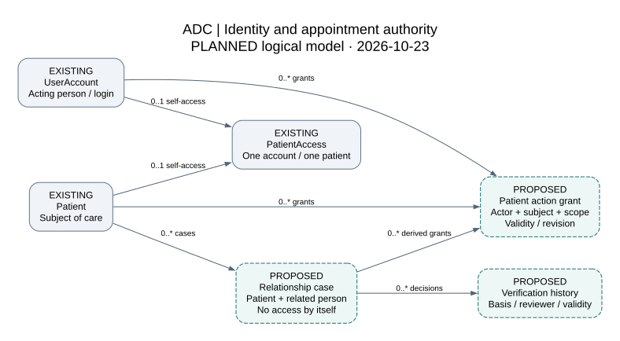
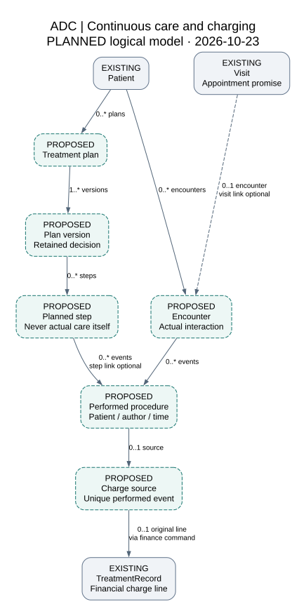

# Proposed domain relationships — identity and continuous care

Business meanings → cardinality → owner → transaction → observed ER after implementation.

These are **PLANNED logical models**, reviewed against source `3d0fb0002e7aa5631f5f12763c2885f85e278dee` on 2026-10-23. They do not add SQL tables or supersede the [observed PostgreSQL ER](../database/README.md). The current baseline remains 70 tables, 171 SQL foreign keys, 42 triggers and 40 migration files. Preserve all 40 files and historical data; choose final table names and constraints in additive implementation ADRs.

## Identity, relationship and authority（身份、关系与授权）

Diagram source: [identity_concept.dot](identity_concept.dot). Solid nodes are existing entities; dashed nodes explicitly say PROPOSED. A parent-to-child edge states how many children a parent can have; each child has one referenced parent unless the edge says optional. Colour has no independent meaning.

| Logical relation | Proposed cardinality and rule |
|---|---|
| Account ↔ current self-access ↔ patient | Existing one-to-one references remain unchanged. An account/patient may have no self-access row. Its active flag and context remain authoritative for existing adult self-service |
| Patient → relationship case | Zero or many cases, each with one patient subject and separately identified related person. A related person need not have a login; the minimal person representation is an ADR decision |
| Relationship → verification history | Zero or many attributable decisions; append evidence/status changes. A contact/kinship assertion is not verified guardian or clinical-consent authority |
| Account → action grant → patient | Zero or many grants per account/patient. Each grant binds one acting account, one subject, a bounded action scope, clinic/care scope, validity and authority revision |
| Relationship → grant | Zero or many derived grants. A relationship-backed grant must refer to the verified basis; current adult self-access does not require a fabricated relationship |

Verification expiry and suspension affect permitted use of the basis. They do not erase the fact that a person once made a claim or that a historical decision was taken. The grant's current status is checked separately at confirmation. Changes to a relationship must invalidate dependent authority in the same defined command protocol.

The related person's identity-to-account binding requires an attributable reviewed rule; it is not a free-text name comparison. The diagram deliberately leaves the representation open until ADR-C1-IDENTITY, rather than presenting an invented physical schema. Clinical-consent authority, appointment delegation and financial responsibility remain separately named capabilities.

`BookingReceipt` currently points to self-only `PatientAccess`. ADR-C1-RECEIPTS must choose a single compatible replay design for delegated effects. The patient selector cannot solve this by logging in as the subject. Existing receipts, visit links, nonces and business results remain readable and unique.

Mind map: identity ≠ contact ≠ relationship ≠ authorization → actor + subject + purpose/action + validity → current authority check + retained history.

## Continuous care and charging（连续诊疗与收费）

Diagram source: [clinical_concept.dot](clinical_concept.dot). Dashed entities are proposed. This is a bounded clinical-to-charge view; recall, laboratory, signing and archive lifecycles are specified in the [study](DENTAL_PRACTICE_STUDY_20261023.md) and [next-stage plan](../COMMERCIAL_V2_NEXT_STAGE.md), rather than crowded into the same diagram.

| Logical relation | Proposed cardinality and rule |
|---|---|
| Patient → encounter | One patient has zero or many actual encounters. A cancelled appointment does not manufacture an encounter |
| Visit → encounter | For the initial appointment-based slice, a visit may support zero or one encounter and an encounter may reference zero or one visit. Walk-in and non-visit interaction scope must be decided before migration; they are not silently enabled |
| Patient → treatment plan → plan version → planned step | A patient can have several plans. A plan has one or more versions; a version may start empty in draft but must satisfy its presentation rules. A presented/accepted version preserves its actual steps and decisions |
| Encounter → performed procedure | Zero or many attributable performed events per encounter. A performed event belongs to one patient through its encounter |
| Plan step → performed procedure | A step may have zero or many performed events. A performed event can reference at most one step in this initial model, including an explicit unplanned-treatment path. Cross-patient links are rejected |
| Performed procedure → charge source | Zero or one charging source for an event in the first non-drug slice. A source has one event; replay returns the same source. A no-charge performed event remains clinically meaningful |
| Charge source → existing treatment charge line | Initially zero or one original charge line per source. Later correction/version copies must retain the original source and cannot count as additional performed work. If one procedure must produce several components, approve an explicit component model before migration |

The existing `Visit`, `TreatmentRecord`, `VisitRecordVersion` and `Invoice` retain their current meanings. A billing snapshot is not a signed clinical record. Define the charging bridge's unique key and exact handoff through the existing financial command, not direct writes from the chart editor. Do not infer missing clinical events from historical line descriptions.

Do not overwrite a prior accepted plan to represent a revised proposal. Give subsequent events an explicit plan/version/step source; support carried-forward or superseded steps without duplicating execution. Completed work remains when remaining steps are declined. Consent, actual execution, record signing, billing and cash each have their own responsible actor and lifecycle.

Mind map: appointment promise → actual encounter → findings and revised plan → performed facts → unique charge source; later visits continue the plan without rewriting prior facts.

## Database-design acceptance（数据库设计验收）

1. Resolve only the ADR choices required for the next slice. Record keys, optionality, ownership, uniqueness, deletion/history policy and command lock order.
2. Keep facts normalized: account/subject/grant, plan/version/step, actual event and charge source. Use typed foreign keys for identity and money; JSON is reserved for bounded versioned snapshots and template extensions.
3. Store effective/event time separately from recorded time. Preserve units, numbering convention, source and UNKNOWN values. Index demonstrated query paths and enforce actual exclusivity/uniqueness; avoid speculative schema frameworks.
4. Test same-patient, same-clinic and current-authority invariants in real PostgreSQL, including concurrent confirmations and revocations. Document what is enforced by SQL and what requires the shared application command protocol.
5. After additive migration, generate the physical ER/field/FK catalogue from the migrated database. Compare it with the proposed model, explain deviations and update the formal course report only for implemented relations.
6. Restore nonempty new and old records into an independent empty database. Compare identities, decisions, versions, source links, original bytes where present and financial facts; row counts alone are insufficient.

No FHIR or DICOM conformance is claimed. Their published concepts inform terminology; an external interface requires its own partner contract and tests.
